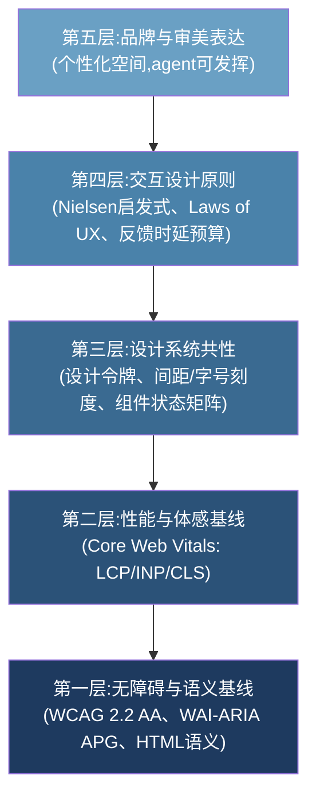
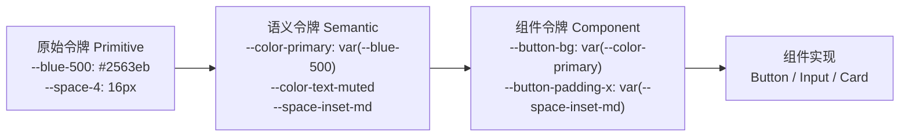
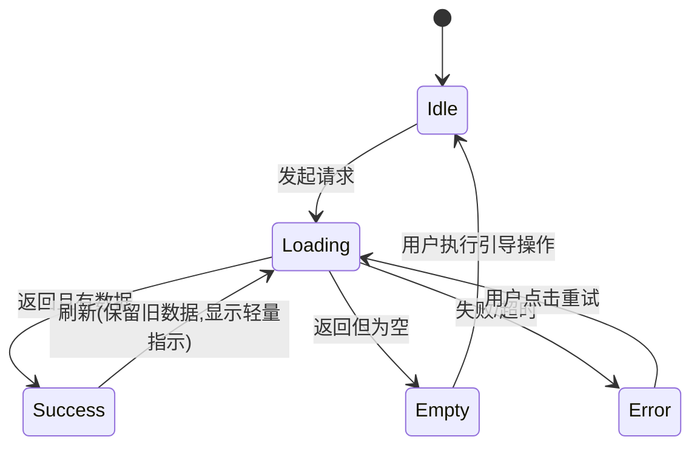
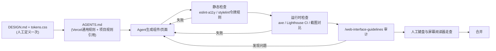

[toc]


## 全文导读与总体框架

现代Web前端的"好设计"不是玄学,而是**可分层、可检验、可写进`AGENTS.md`的约束集合**。本文把它拆成五层,越靠下越"硬"(可自动化检查、有法规和标准背书),越靠上越"软"(需要审美判断,但也有可操作的共性):



**给coding agent的核心策略**:第一至第三层写成**MUST/NEVER**硬规则(可被lint、axe、Lighthouse验证),第四层写成**SHOULD**原则加判例,第五层只给**边界约束**(例如调色板限制、禁止清单),把创造力留在边界内。这正是你所说的"有标准可依据,在此基础上进一步发挥"。另请记住两点：**WCAG只给底线、不规定产品长什么样，可用性启发式是检查角度而非法律清单**，具体色彩密度布局仍按任务定；验收顺序为**任务通→错误可恢复→键盘窄屏可用→视觉统一→装饰打磨**，自动化检查后仍须走一遍真实任务流程。

---

## 第一层:无障碍与语义基线(必须遵守的硬性规范)

### WCAG 2.2 AA 是当前事实上的合规底线

WCAG(Web Content Accessibility Guidelines,Web内容无障碍指南)由W3C制定。WCAG 2.2于2023年10月成为W3C推荐标准,新增九条成功标准并移除一条(4.1.1 Parsing)。新增标准中有六条属于AA级或更低级别,而AA级正是法律和诉讼和解所期望的级别:Focus Not Obscured、Dragging Movements、Target Size、Accessible Authentication、Consistent Help 和 Redundant Entry。它建立在WCAG 2.1和POUR原则(可感知Perceivable、可操作Operable、可理解Understandable、健壮Robust)之上,新增标准聚焦认知、低视力和运动障碍用户。

下表是WCAG 2.2新增九条的速查,其中AA级及以下为**MUST**:

| 编号   | 名称(英/中)                                       | 级别 | 一句话要求                                                   | 对前端实现的直接含义                                        |
| ------ | ------------------------------------------------- | ---- | ------------------------------------------------------------ | ----------------------------------------------------------- |
| 2.4.11 | Focus Not Obscured (Minimum) / 焦点不被遮挡(最低) | AA   | 元素获得焦点时不得被粘性头部、横幅或模态框完全遮挡;常见违例是粘性cookie横幅盖住菜单中获得焦点的链接 | 粘性元素要预留`scroll-padding`,或在焦点进入时自动让位       |
| 2.4.12 | Focus Not Obscured (Enhanced)                     | AAA  | 同上但要求焦点元素完全可见(不允许部分遮挡)                   | 推荐而非强制                                                |
| 2.4.13 | Focus Appearance / 焦点外观                       | AAA  | 焦点指示器须有最小面积(周长2CSS像素)且与未聚焦状态有3:1对比;删除默认outline而不替换即不合格 | 虽是AAA,但**实践上应按AA对待**,因为代价极低                 |
| 2.5.7  | Dragging Movements / 拖拽操作                     | AA   | 任何拖拽交互必须也能通过单指针操作(简单点击或轻触)完成       | 拖拽排序必须配"上移/下移"按钮;滑块必须可点击、可键盘        |
| 2.5.8  | Target Size (Minimum) / 目标尺寸                  | AA   | 可点击目标至少24×24 CSS像素,或间距足够使以每个目标为圆心的24px圆不重叠;句中链接和浏览器控制尺寸的控件例外 | 图标按钮设置`min-width/min-height: 24px`,移动端建议44px以上 |
| 3.2.6  | Consistent Help / 一致的帮助                      | A    | 帮助选项在每页以相同相对顺序出现                             | 帮助入口/客服入口固定位置                                   |
| 3.3.7  | Redundant Entry / 冗余输入                        | A    | 不要让用户重复输入同样的信息                                 | 多步表单回填、"同收货地址"复选框                            |
| 3.3.8  | Accessible Authentication (Minimum)               | AA   | 登录不依赖记忆或解谜                                         | 允许密码管理器粘贴,不禁用paste;验证码需有替代               |
| 3.3.9  | Accessible Authentication (Enhanced)              | AAA  | 更严格版本                                                   | 推荐                                                        |

关于目标尺寸的层级关系值得辨析:WCAG 2.1已有AAA级的2.5.5 Target Size要求44×44 CSS像素;WCAG 2.2引入的AA级版本采用更小的24×24下限,以便更多组织可以达成。在可能的情况下,最好遵守AAA的44×44最小尺寸。我的建议是:**桌面密集型工具界面用24px底线,触屏优先界面用44px(Apple HIG的44pt与Material的48dp也在这一量级)**。

关于自动化检测的边界要有清醒认识:在这些新增标准中,能被自动化工具(axe-core 4.9+)可靠捕捉的是2.5.8(目标尺寸)和部分2.4.11(焦点遮挡),其余需要人工审查或流程审计。这意味着agent生成的代码**必须辅以人工键盘走查**。

### 从WCAG 2.1继承的、agent最常违反的条款

以下条款虽非2.2新增,但在AI生成代码中违例率极高,应当明确写入规则:

| 条款                         | 要求                                                         | 常见违例                                 | 正确做法                                            |
| ---------------------------- | ------------------------------------------------------------ | ---------------------------------------- | --------------------------------------------------- |
| 1.4.3 Contrast (Minimum) AA  | 正文文字对比度至少**4.5:1**,大号文字(约24px常规或18.66px粗体以上)至少**3:1** | 浅灰占位文字、灰底灰字的次级说明         | 设计令牌中预先验证过的文字色对                      |
| 1.4.11 Non-text Contrast AA  | UI组件边框、图标、焦点环与相邻颜色至少**3:1**                | 浅色输入框边框`#e5e7eb`在白底上          | 边框色至少达到`#949494`量级                         |
| 1.4.1 Use of Color           | 不得**仅用颜色**传递信息                                     | 表单错误只变红边框;图表仅用颜色区分系列  | 加图标、文字、纹理或形状                            |
| 1.4.12 Text Spacing          | 用户把行高调到1.5、段距2倍、字距0.12em时内容不得丢失         | 固定高度容器裁切文字                     | 不给文字容器写死`height`,用`min-height`             |
| 1.3.1 Info and Relationships | 视觉结构要有语义对应                                         | 用`<div>`堆砌标题、列表、表格            | `<h1>`至`<h6>`层级、`<ul>`、`<table>`加`<th scope>` |
| 2.1.1 Keyboard               | 全部功能可键盘操作                                           | 在`<div onClick>`上做按钮                | 用`<button>`;自定义控件实现APG模式                  |
| 2.4.7 Focus Visible          | 焦点可见                                                     | `outline: none`/Tailwind的`outline-none` | 用`:focus-visible`给出替代样式                      |
| 4.1.2 Name, Role, Value      | 控件有可访问名称                                             | 仅含SVG的图标按钮没有`aria-label`        | `aria-label`或视觉隐藏文本                          |
| 1.1.1 Non-text Content       | 图像有替代文本                                               | `alt`缺失或为文件名                      | 信息图写`alt`,装饰图写`alt=""`                      |

### WAI-ARIA Authoring Practices Guide(APG)与"ARIA第一准则"

APG是W3C维护的自定义组件(对话框、下拉菜单、标签页、组合框、树等)的**键盘交互与ARIA角色模式手册**。Vercel的面向agent的指南第一条即是键盘到处可用:所有流程都可以键盘操作并遵循WAI-ARIA Authoring Patterns。

**ARIA第一准则**(No ARIA is better than bad ARIA):能用原生HTML元素就不要用ARIA模拟。Vercel的`AGENTS.md`契约同样强制原生语义优先于ARIA,并要求所有仅图标的按钮包含描述性aria-label。

关于焦点管理的三条具体规则,可直接作为agent规则:清晰的焦点:每个可聚焦元素显示可见、不被遮挡的焦点环;优先使用:focus-visible而非:focus以免干扰鼠标用户;为分组控件设置:focus-within;粘性头部、底部、横幅和遮罩层永远不覆盖聚焦元素。管理焦点:按WAI-ARIA Patterns使用焦点陷阱、移动和返回焦点。一个贴近实际的例子:用户在订单列表点击"删除"按钮打开确认对话框,焦点应移入对话框(通常落在"取消"按钮以防误操作),Tab循环被限制在对话框内,按Esc或完成操作后焦点**回到原来那个"删除"按钮**,而不是跳回页面顶部。

### 中文语境下的额外语义要求

- `<html lang="zh-CN">`(简体)或`zh-TW`/`zh-HK`,这影响屏幕阅读器发音、字体回退、`text-transform`、连字符与断行规则。
- 中文无空格分词,长串英文/URL会撑破容器:为可能出现长串的容器设置`overflow-wrap: anywhere`,段落用`word-break: normal`而非`break-all`(后者会把英文单词切断)。
- 中文**没有斜体字形**,`<em>`的默认斜体在CJK字体下会被浏览器人工倾斜,观感差,设计系统中应将`em`映射为加粗或变色。
- 标点挤压与行首行尾禁则:较新的`text-autospace`、`text-spacing-trim`属性可处理中西文混排间距,但浏览器支持不完整,目前作为渐进增强。
- 国内还有国家标准GB/T 37668-2019《信息技术 互联网内容无障碍可访问性技术要求与测试方法》,其技术要求与WCAG 2.0高度对应(2026-10-01联网核实:W3C博客与Deque/EqualWeb均确认其对标WCAG);若面向政府、金融、教育类项目应核对该标准。

---

## 第二层:性能与体感基线(Core Web Vitals)

性能是体验的一部分,而不是独立的工程指标。Google的Core Web Vitals(核心网页指标)三项目前稳定如下:

| 指标                                             | 衡量什么   | 良好    | 需改进  | 差      |
| ------------------------------------------------ | ---------- | ------- | ------- | ------- |
| LCP (Largest Contentful Paint,最大内容绘制)      | 加载速度   | ≤ 2.5s  | ≤ 4.0s  | > 4.0s  |
| INP (Interaction to Next Paint,交互到下一次绘制) | 全程响应性 | ≤ 200ms | ≤ 500ms | > 500ms |
| CLS (Cumulative Layout Shift,累计布局偏移)       | 视觉稳定性 | ≤ 0.1   | ≤ 0.25  | > 0.25  |

Google以第75百分位评估页面,"良好"意味着LCP低于2.5秒、INP低于200毫秒、CLS低于0.1;这些值记录在web.dev官方文章中,自2024年3月INP上线以来未变;一个页面必须同时达到三项阈值才算整体"良好"。需要提醒的是,网上有文章声称LCP阈值已收紧到2.0秒,这是一个值得先破除的误区:LCP良好阈值是2500毫秒(2.5秒)而非2.0秒;所谓2026年降到2.0秒的说法是错误的,web.dev仍将2.5秒记录为未改变的标准。

INP对agent生成的重JS界面尤其严苛:INP观察用户访问期间的所有点击、轻触或按键,并报告最差(最长)的交互延迟。它是最难通过的指标:重JavaScript仪表盘、聊天组件和单页应用常常不合格。而CLS失败的根源非常具体:最常见的是图像没有显式尺寸、字体加载导致布局偏移、首屏在初次渲染后动态注入内容。

转化为agent可执行的规则:

- **所有``必须写`width`和`height`**(或`aspect-ratio`),首屏图不加`loading="lazy"`,首屏以下加。
- 字体使用`font-display: swap`配合`size-adjust`或系统字体栈,避免FOUT引起的偏移;中文Web字体体积巨大(数MB),**正文优先系统字体栈**,品牌字体只用于标题且做子集化。
- 异步内容(广告位、推荐位、横幅)**预留占位高度**,用骨架屏而非从0撑开。
- 长任务拆分:超过50ms的同步计算用`scheduler.yield()`、`requestIdleCallback`或Web Worker;列表超过约50项用虚拟滚动(Vercel规则);写操作(`POST`/`PATCH`/`DELETE`)目标<500ms。
- 用户输入后**先给视觉反馈再做重活**(如先把按钮置为loading态,再发请求),这是INP优化的核心手法。

---

## 第三层:好设计的共性——设计系统(Design System)思维

观察Material Design、Apple HIG、Fluent、Ant Design、Arco Design、TDesign、shadcn/ui等成熟体系,会发现它们的共性不在于长什么样,而在于**结构性约束**。这些约束正是agent最需要的"轨道"。

### 设计令牌(Design Tokens):把所有视觉决策变成命名变量

设计令牌是"原子化的、有命名的设计决策"(颜色、间距、字号、圆角、阴影、时长)。W3C设计令牌社区组(DTCG)的JSON交换格式已于2025.10发布首个稳定版(2026-10-01联网核实)。对agent而言,关键在于**三层令牌架构**:



| 层级                | 作用                   | 命名规则                                                     | agent规则                               |
| ------------------- | ---------------------- | ------------------------------------------------------------ | --------------------------------------- |
| 原始令牌(Primitive) | 不带语义的调色板、尺度 | 色相+明度刻度,如`--gray-50`至`--gray-950`                    | 只在语义层引用,**组件代码禁止直接使用** |
| 语义令牌(Semantic)  | 表达用途与意图         | `--color-{用途}-{状态}`,如`--color-bg-surface`、`--color-text-danger` | 主题切换(明暗模式)只改这一层            |
| 组件令牌(Component) | 组件局部覆盖           | `--{组件}-{属性}`                                            | 可选,小项目可省略                       |

**为什么这对agent至关重要**:没有令牌时,模型会在每个组件里"随意发挥"出`#3b82f6`、`#2563eb`、`#1d4ed8`三种相近蓝色和`13px`、`15px`、`17px`这类魔法数字,整体立刻显得廉价。有令牌后,"任何颜色、间距、字号、圆角、阴影、时长必须引用令牌,出现字面值即为违规"是一条**可用stylelint检查**的硬规则。

明暗模式的正确做法是:在`:root`声明`color-scheme: light dark`,语义令牌按模式切换值,配合`<meta name="theme-color">`。Vercel的审核技能也把深色模式与主题(color-scheme、theme-color meta)列为检查项。

### 间距与尺寸刻度:4pt/8pt网格

所有间距、尺寸取**4的倍数**(紧凑处允许2px),常用刻度为4、8、12、16、24、32、48、64。好处是任何两个元素之间的距离都存在可预测的节奏感,这是"看起来专业"的最廉价来源。配套规则:

- **父子关系用内边距,兄弟关系用间隙**(`gap`优先于`margin`),避免margin折叠带来的不一致。
- 相关元素靠近、无关元素远离(格式塔接近性原则):例如标签与输入框间距8px,字段组与字段组之间24px,区块与区块之间48px。**间距差要大到一眼可辨**(至少1.5倍),否则层级模糊。
- 内容最大宽度受控:阅读型内容容器约`65ch`至`75ch`(西文),中文约**每行30到40个汉字**;后台数据型界面可全宽但表格列宽要有上限。

### 字体排印刻度(Type Scale)

| 要素       | 推荐值                                                       | 说明                                                     |
| ---------- | ------------------------------------------------------------ | -------------------------------------------------------- |
| 正文字号   | 西文16px起;中文14px至16px                                    | 中文笔画密,14px在高分屏上尚可,**低于12px禁止**           |
| 行高       | 西文1.5;中文**1.6至1.8**                                     | 中文方块字视觉密度大,需要更大行距;标题行高收紧到1.2至1.3 |
| 字号刻度   | 比例刻度1.2(次大调)或1.25(大三度)                            | 例如12/14/16/20/24/30/36,**全站字号不超过6到7档**        |
| 字重       | 常用2到3档(400/500/600或700)                                 | 中文字体多数只有常规和粗体两档真实字重,`500`可能被合成   |
| 字体栈     | `system-ui, -apple-system, "PingFang SC", "Microsoft YaHei", "Noto Sans CJK SC", sans-serif` | 系统字体零加载成本;若用Web字体,中文须子集化              |
| 数字       | 表格、价格、计时器用`font-variant-numeric: tabular-nums`     | 等宽数字防止跳动                                         |
| 标点与省略 | 用真正的省略号和弯引号;文本截断用`text-overflow: ellipsis`并提供完整内容的`title`或tooltip | Vercel的审查项也包含排版(弯引号、省略号、tabular-nums)   |

**中文排版的两个禁忌**:不要用`text-align: justify`处理中西文混排(会出现大空洞);不要把中文正文设为浅灰(如`#999`)——中文笔画细,低对比下可读性比西文恶化得更快。

### 颜色系统

- **角色化调色板**:一个主色(Primary)、一个中性灰阶(Neutral,9至11档)、四个语义色(Success/Warning/Danger/Info),可选一个强调色(Accent)。**大面积界面由中性色构成,主色用量通常不超过10%**,语义色只用于传递状态。
- 中性灰**微带色相**(例如偏蓝或偏暖)比纯灰更有质感,但全站只能用一种倾向。
- 现代CSS可用`oklch()`定义色阶,其感知均匀性使同一明度等级的不同色相看起来亮度一致,适合生成系统化色板;浏览器支持已普及,但若需支持老旧WebView应提供sRGB回退。
- 对比度必须在令牌层预先验证(4.5:1文字、3:1组件),而不是在组件里临时挑色。WCAG 3草案中的APCA算法是未来方向但**尚未成为标准**,当前合规仍以WCAG 2.x的对比率为准;Vercel另建议设计时参考APCA,两者不冲突(合规看前者、质感看后者)。(2026-10-01联网核实)

### 组件状态矩阵

一个成熟组件不是"画出来一个样子",而是**覆盖完整状态**。agent生成组件时应被要求显式实现下列状态:

| 维度   | 状态                                                         | 要点                                                         |
| ------ | ------------------------------------------------------------ | ------------------------------------------------------------ |
| 交互态 | default / hover / active(pressed) / focus-visible / disabled | hover只在`@media (hover: hover)`下生效,触屏无hover;disabled要有`aria-disabled`或原生`disabled`并保持可读对比(可放宽到3:1) |
| 数据态 | idle / loading / success / empty / error / partial(部分失败) | **空状态要有引导性文案和主要操作**,而非一片空白              |
| 校验态 | valid / invalid / pending(异步校验中)                        | 错误信息用`aria-describedby`关联、`aria-invalid="true"`      |
| 尺寸   | sm / md / lg                                                 | 高度分别约32/40/48px,触屏默认不低于40                        |
| 变体   | primary / secondary / ghost / danger                         | **一屏只能有一个primary按钮**                                |

异步数据的状态流转可以用状态图固化,避免agent漏掉分支:



对这张图的说明:**Success到Loading的刷新路径要保留旧数据**(stale-while-revalidate),只在角落显示小型进度指示,而不是整页回到骨架屏,这是"刷新一下整个页面闪一下"这种低级体验的根源;Error态必须有**可操作的恢复路径**(重试按钮、返回链接),而不是只有一行红字。

---

## 第四层:优秀交互设计的原则

### Nielsen十大可用性启发式(Usability Heuristics)

Nielsen的十大可用性启发式由Jakob Nielsen与Rolf Molich于1990年首版、1994年精炼(NN/g 2024年复核确认十条未变),至今仍是UX设计中最广泛使用的检查清单;它们不是严格的界面规则,而是广义的经验法则。适用于审查通用产品界面:SaaS应用、结账流程、引导页、仪表盘或营销站,对桌面、移动和Web同样有效。下表把每条原则落到前端实现:

| 启发式                       | 含义                                                         | 前端落地示例                                                 |
| ---------------------------- | ------------------------------------------------------------ | ------------------------------------------------------------ |
| 系统状态可见性               | 设计应始终通过在合理时间内给出适当反馈,让用户了解正在发生什么 | 按钮点击立刻进入loading态;上传显示百分比;保存成功有确认      |
| 系统与现实世界匹配           | 系统应使用用户的语言,用用户熟悉的词汇、短语和概念,而非系统导向术语;遵循现实世界惯例,让信息以自然、合逻辑的顺序出现 | 错误提示写"邮箱格式不正确",不写"Validation failed: regex mismatch" |
| 用户控制与自由               | 提供撤销操作和轻松退出状态的选项                             | 删除后给"撤销"toast;多步向导有"上一步";模态框可Esc关闭       |
| 一致性与标准                 | 保持统一并遵循平台惯例                                       | 同一动作全站同一词、同一位置、同一颜色                       |
| 错误预防                     | 比好的错误信息更好的是预防问题发生的细致设计:消除易错条件,或检查它们并在用户提交前给出确认选项 | 输入日期用选择器而非自由文本;不可逆操作前确认                |
| 识别而非回忆                 | 通过让对象、操作和选项可见来最小化用户的记忆负担             | 下拉显示最近使用项;搜索框保留历史;字段有示例                 |
| 灵活性与效率                 | 用可适配的界面同时照顾新手和专家                             | 快捷键、批量操作、命令面板(Cmd/Ctrl+K)                       |
| 美学与极简                   | 避免无关信息以保持界面整洁                                   | 每屏一个主要任务;次要信息折叠或降级                          |
| 帮助用户识别、诊断、恢复错误 | 用平实语言给出有帮助的错误信息并建设性地建议解决方案         | "密码至少8位,需包含数字"而非"密码不合法"                     |
| 帮助与文档                   | 帮助内容应易于搜索、聚焦用户任务、简洁并列出具体步骤         | 复杂字段旁的问号tooltip;空状态内嵌文档链接                   |

### Laws of UX:几条值得写进规则的"定律"(经验参考,非硬标准,写入SHOULD不入MUST)

- **Fitts定律**:目标越大、距离越近越容易点中。推论:主要操作按钮放在光标/拇指自然到达处,触屏底部优于顶部;相邻的破坏性操作与确认操作之间要留足间距。
- **Hick定律**:选项越多决策越慢。推论:导航一级项目控制在5到7个;长列表提供搜索或分组。
- **Jakob定律**:用户大部分时间花在别的网站上,所以期望你的站点与它们**一样工作**。推论:不要为了"创意"重新发明滚动、导航、表单,除非有明确收益。
- **Miller定律与分块**:工作记忆有限,长表单分步、长数字分段(手机号3-4-4)。
- **Doherty阈值**:系统响应在约400ms以内时,人机互动效率最高。
- **峭终定律(Peak-End Rule)**:人们按高峰与结尾记忆体验。推论:完成态(支付成功页、提交成功)值得精心设计。
- **美学可用性效应**:好看的界面被认为更好用,用户对小问题更宽容——这是审美层确有工程价值的依据。

### 反馈与时延预算

把"系统状态可见性"量化,是agent最容易执行的方式:

| 响应时间      | 用户感知   | 应当做什么                                                   |
| ------------- | ---------- | ------------------------------------------------------------ |
| ≤ 100ms       | 即时       | 不需要任何加载指示,直接变化(hover、按下、切换)               |
| 100ms至~300ms | 轻微延迟   | 过渡动画掩盖;不显示spinner(会闪烁)                           |
| 300ms至1s     | 可察觉等待 | **延迟约300ms后再显示**轻量指示(按钮内spinner、进度条);局部而非全局 |
| 1s至10s       | 等待       | 骨架屏或进度条;**保持界面其他部分可操作**;提供取消           |
| > 10s         | 注意力流失 | 显示进度百分比与预计时间,允许离开并通知                      |

**乐观更新(Optimistic UI)**:点赞、切换开关、拖拽排序等低风险操作先在界面上立即呈现结果,后台失败再回滚并提示。这同时服务于INP指标与"即时感"。

### 动效原则(数值为经验参考,非标准;常规过渡上限320ms)

- **目的性**:动效用于解释状态变化(从哪来到哪去)、引导注意力、提供反馈,**不用于装饰**。
- **时长**:微交互(hover、开关)约100至150ms;中等元素(下拉、tooltip)约200至250ms;大面积(抽屉、页面级)约300至320ms;**超过500ms的UI过渡几乎总是太慢**。
- **缓动**:进入用ease-out(快起慢停),退出用ease-in,位移类用标准曲线如`cubic-bezier(0.2, 0, 0, 1)`;**不要用linear做UI位移**。
- **只动合成器属性**:`transform`与`opacity`;不要对`width`、`height`、`top`、`left`、`margin`做动画(引发布局重排,拖垮INP)。Vercel的审查项也包括动画(prefers-reduced-motion、合成器友好的transform)。
- **尊重`prefers-reduced-motion: reduce`**:关闭位移、缩放和视差,保留不透明度变化或直接切换。
- 不要让动效阻塞操作:用户在动画中途点击应立即响应。

### 表单设计规范

表单是绝大多数Web应用的核心交互,也是agent最常出错的地方:

- 每个输入**必须有可见的`<label>`**,placeholder不能替代label(输入后提示消失,且对比度通常不合规)。
- 使用正确的`type`、`inputmode`、`autocomplete`(如`autocomplete="email"`、`"tel"`、`"one-time-code"`、`"new-password"`),这既是无障碍要求也直接提升填写速度。
- 校验时机:**失焦(blur)时校验单字段,提交时汇总**;不要在用户还在输入第一个字符时就报错;错误出现后随输入即时消除。
- 错误信息紧贴字段、用`aria-describedby`关联、含具体修复建议;提交失败时**焦点移到第一个错误字段**或顶部错误汇总。
- **不要把提交按钮disabled来阻止提交**:用户点击后得不到任何反馈,也不知道哪里错了。更好的做法是允许点击并展示错误。
- 提交后**保留用户已输入的内容**;多步表单支持返回修改且数据不丢失(对应WCAG 3.3.7)。
- 密码框允许粘贴、允许显示/隐藏;不要用CAPTCHA作为唯一验证手段(对应WCAG 3.3.8)。
- 移动端`<input>`字号不低于16px,防止iOS聚焦时自动缩放(Vercel规则)。
- 破坏性操作:确认对话框中**明确写出后果与对象名**("将永久删除项目 Alpha 及其 32 个文件"),确认按钮用danger色且文案是动词("删除")而非"确定"。

### 导航与状态

- **URL反映状态**:筛选条件、分页、当前标签页、打开的详情都应可通过URL还原和分享;浏览器后退按钮必须按预期工作。Vercel审查清单中专门列出导航与状态(URL反映状态、深度链接)。
- 当前位置清晰:导航高亮当前项(`aria-current="page"`)、面包屑、页面标题(`<title>`随路由变化)。
- 滚动位置:列表到详情再返回时恢复滚动位置;新页面滚动到顶部。
- 模态框层级:**一次只开一个模态框**;需要堆叠时考虑改用抽屉或分步。

---

## 第五层:美观的审美特征——可操作的"好看"

审美确有主观成分,但大量优秀界面存在共性,且每一条都能转为约束。以下是我作为从业者的归纳:

| 特征                   | 本质                           | agent可执行的约束                                            |
| ---------------------- | ------------------------------ | ------------------------------------------------------------ |
| **清晰的视觉层级**     | 一眼看出什么最重要、第二重要   | 每屏仅一个视觉焦点(一个primary按钮、一个主标题);通过字号、字重、颜色、留白三到四种手段分级,**不在同一级别上既放大又加粗又变色** |
| **慷慨而有节律的留白** | 留白是信息分组的首要手段       | 卡片内边距不小于16px(桌面24px);区块间距至少是元素间距的2倍;**宁多勿少** |
| **严格对齐**           | 一切元素落在不可见的网格上     | 左对齐为默认,仅标题/卡片等短内容可居中;表格数字右对齐;禁止"差几像素"的近似对齐 |
| **克制的色彩**         | 色彩少而准                     | 中性色打底,一个主色,语义色只传递状态;**禁止随意渐变、禁止多个饱和色并置** |
| **一致的圆角与阴影**   | 形状语言统一                   | 全站圆角档位不超过3档(如4/8/12,加上全圆);阴影不超过3级,且**阴影颜色带主色或中性色相而非纯黑** |
| **有质感的边界**       | 层次靴靠边框或阴影其一,不叠用  | 浅色模式中用1px低饱和边框分隔;深色模式用背景明度差而非边框   |
| **排版驱动的设计**     | 文字即界面                     | 字号对比明确(标题至少是正文的1.5倍以上才有层级感);段落行长受控;避免全大写长句 |
| **图标统一**           | 同一图标库、同一线宽、同一尺寸 | 只允许一个图标库(如Lucide、Phosphor、Tabler);尺寸绑定文字行高(16/20/24) |
| **真实内容优先**       | 用真实长度的文案和数据排版     | 禁止用"Lorem ipsum";用最长可能的用户名、金额、中文长词测试布局 |
| **细节一致性**         | 微小处见功夫                   | 全站同一动效时长;同一类元素同一hover反馈;链接样式全站统一    |

**对AI生成界面常见"审美塌陷"的具体约束**(把这些写入NEVER清单效果立竿见影):紫蓝渐变大标题与渐变按钮、满屏玻璃拟态(glassmorphism)、所有卡片都加大阴影、标题前加emoji、每个区块都用不同的强调色、"Hero区 + 三列图标卡片 + 客户评价 + CTA"的模板化落地页、把所有信息都放进卡片导致"卡片套卡片"。

---

## 应该避免的不良设计

### 技术与可用性反模式

| 反模式                                   | 问题                     | 替代                                   |
| ---------------------------------------- | ------------------------ | -------------------------------------- |
| `outline: none`不替换                    | 键盘用户失去位置         | `:focus-visible`自定义焦点环           |
| 用`<div>`/`<span>`加`onClick`当按钮      | 不可键盘、无角色、无名称 | `<button type="button">`               |
| 仅hover触发的功能(hover才出现的操作按钮) | 触屏不可达               | 始终可见或长按/焦点可见                |
| 滚动劫持、视差过度                       | 失控感、晕动             | 原生滚动                               |
| 自动播放有声媒体、自动轮播               | 分心、不可控             | 用户触发;轮播必须有暂停                |
| 无尺寸图片、延迟注入首屏内容             | CLS                      | 显式尺寸、占位                         |
| 无限spinner、整页loading                 | 不知进度                 | 骨架屏、局部指示、超时提示             |
| toast滥用、toast承载重要错误             | 信息转瞬即逝             | 重要信息内联或对话框;toast仅做确认     |
| 模态框滥用、模态内嵌模态                 | 打断流程                 | 内联展开、抽屉、独立页面               |
| 禁用提交按钮而无说明                     | 用户不知为何不能提交     | 允许提交并展示错误                     |
| 按钮看起来可点、实际无功能               | 误导用户、破坏信任       | 所有控件有真实行为;未实现功能明确标示   |
| 每次操作都弹确认框                       | 打断普通任务             | 仅高风险/不可逆操作用确认;可撤销优先撤销 |
| 低对比的灰色文字、12px以下正文           | 可读性                   | 遵守4.5:1和字号底线                    |
| "神秘肉"导航(只有图标无标签)             | 需猜测                   | 图标加文字,或至少tooltip加`aria-label` |
| 截断文字无法查看全文                     | 信息丢失                 | tooltip或展开                          |
| 阻止粘贴、禁止右键、劫持浏览器快捷键     | 对抗用户                 | 不做                                   |
| 无限滚动没有页脚可达且无位置记忆         | 迷失                     | "加载更多"按钮或分页,或两者结合        |
| 禁用缩放(`user-scalable=no`)             | 违反WCAG 1.4.4           | 不做                                   |
| 依赖`window.alert/confirm`               | 不可样式化、阻塞、体验差 | 自定义对话框(`<dialog>`元素)           |

### 欺骗性设计模式(Deceptive Patterns / Dark Patterns)

Dark patterns是指诱骗或操纵用户做出非本意决定的界面设计选择——订阅不想要的服务、分享不想分享的数据、购买未选择的附加品;该术语由UX研究者Harry Brignull于2010年创造。其判定有三个特征:欺骗(用户不理解自己真正在做什么)、不对称(设计偏好的操作远比用户想做的操作容易)、认知利用(利用紧迫感、损失恐惧、默认值等心理偏差绕过理性思考)。

常见类型(依据deceptive.design分类)及对应的道德替代:

| 类型                        | 表现                                                         | 替代                                              |
| --------------------------- | ------------------------------------------------------------ | ------------------------------------------------- |
| Roach Motel(蟑螂屋)         | 进来容易出去难:注册流程无摩擦,取消流程像迷宫                 | 取消与订阅同样的步数                              |
| Forced Continuity(强制续费) | 免费试用结束后未充分通知即扣费,依赖用户忘记或觉得取消太费事  | 试用到期前主动提醒,默认不自动转付费或一键取消     |
| Confirmshaming(羞辱式确认)  | 用"不,我宁愿流血至死"之类措辞让用户为拒绝感到羞愧            | 中性措辞:"不,谢谢"                                |
| Trick Questions(诱导性问题) | "如果您不希望不接收营销邮件请取消勾选"这种双重否定需要主动解析 | 单一肯定句、默认不勾选                            |
| Hidden Costs(隐藏费用)      | 在支付最后一步添加意外费用                                   | 首页即展示全价                                    |
| Sneak into Basket           | 未经同意向购物车添加商品                                     | 任何附加品需主动勾选                              |
| Misdirection(误导)          | 突出无关功能以掩盖关键细节                                   | 给选项同等的视觉权重,让用户基于价值而非设计做选择 |
| Fake Urgency / Scarcity     | 模拟人为稀缺以促使立即购买,如显示虚假限量库存                | 只显示真实数据                                    |
| Obstruction(设障)           | 把不希望用户做的操作弄得比必要更复杂,如退订需多个步骤        | 一步完成                                          |
| Nagging(纠缠)               | 不接受"不"的反复请求                                         | 记住拒绝,不再弹出                                 |
| Privacy Zuckering           | 强迫同意数据共享                                             | 最小化数据收集、默认关闭                          |
| Disguised Ads               | 广告伪装成普通内容诱使点击                                   | 明确标注"广告"                                    |

这些模式不仅有伦理问题,也有商业和法律代价:长期后果包括更高的流失率(感觉被骗的用户一有机会就离开)、更低的生命周期价值、声誉损害以及日益增长的监管风险。监管机构已开始以真实罚款打击,但最重要的防线是认识这些模式并拒绝构建它们的开发者。对agent而言,**应当在规则中明确禁止生成上述任何一种模式**,包括用户要求"把取消按钮做得不明显"这类指令。

---

## 面向coding agent的落地方案

### 现成的机器可读规范:Vercel Web Interface Guidelines

这是目前最成熟的"直接给agent用"的界面规范。Web Interface Guidelines项目是一个持续更新的、非穷尽的设计与工程决策集合,旨在构建高质量的Web界面。它同时是人类可读的参考文档(交互、动效、布局、性能的最佳实践)和AI机器契约(一组机器可读的指令和审计工具,让AI编码代理能主动按标准生成代码并事后审计)。

仓库文件分工:README.md是面向人的完整规则文档;AGENTS.md是面向AI代理生成阶段的机器可读"系统提示";command.md是/web-interface-guidelines审查命令的逻辑;install.sh是检测本地AI工具并安装指南的自动化脚本。一份第三方阅读记录显示,2026年8月20日读取时,README含129条规则,AGENTS.md含107条以MUST、SHOULD和NEVER书写的规则,command.md含17个标题下的103条(条数为快照,以仓库实时为准;2026-10-01已实测拉取AGENTS.md原文成功)。

覆盖范围:审计100多条涵盖无障碍、性能和UX的规则,包括无障碍(aria-label、语义HTML、键盘处理)、焦点状态、表单(autocomplete、校验、错误处理)、动画、排版、图片(尺寸、懒加载、alt)、性能(虚拟化、布局抖动、preconnect)、导航与状态。

两种使用方式,**建议同时采用**:

| 方式                                                         | 作用时机       | 安装                                                         |
| ------------------------------------------------------------ | -------------- | ------------------------------------------------------------ |
| `AGENTS.md`(主动约束)                                        | 生成代码时     | 放在项目根目录;Cursor、Windsurf等工具会自动索引根目录文件构建内部"Rules for AI" |
| `/web-interface-guidelines`命令或`web-design-guidelines`技能(被动审计) | 代码写完后审查 | `curl -fsSL https://vercel.com/design/guidelines/install | bash`,支持Claude Code、Cursor、OpenCode、Windsurf和Gemini CLI;其他代理可直接使用命令提示或添加AGENTS.md;或`npx skills add https://github.com/vercel-labs/agent-skills --skill web-design-guidelines` |

注意该技能的边界:它只审查已有文件,不负责生成或搭建新UI。所以生成阶段的质量仍依赖你自己的`AGENTS.md`加设计令牌。

**国内网络环境注意**:上述安装都依赖GitHub原始文件(`raw.githubusercontent.com`)。有代理时,`*nix`下在当前shell执行`export HTTPS_PROXY=http://127.0.0.1:7890`(端口以你的mihomo配置为准),Windows PowerShell下为`$env:HTTPS_PROXY="http://127.0.0.1:7890"`;`npx`本身可配置`npm config set registry https://registry.npmmirror.com`加速依赖下载。无代理时可手工下载`AGENTS.md`:把原始链接`https://raw.githubusercontent.com/vercel-labs/web-interface-guidelines/main/AGENTS.md`用`https://gh-proxy.com/`前缀包裹后下载(该镜像可用性请以实际为准),放到项目根目录即可;`SKILL.md`中硬编码的在线拉取规则也可改为读取本地副本。

### 自建项目级设计规范:`DESIGN.md`模板

Vercel的规范是通用工程底线,**不包含你的项目品牌与审美决定**。建议在仓库根目录增加一份项目专属文件(常见命名为`DESIGN.md`或在`AGENTS.md`中引用),agent据此生成。以下是我整理的模板:

```markdown
# Design Spec

## 0. Priority
1. Follow WCAG 2.2 AA and Vercel Web Interface Guidelines (AGENTS.md). Hard rules.
2. Follow this file's tokens and constraints. Hard rules.
3. Within the above, you MAY make creative choices. Explain them briefly in the PR.

## 1. Tokens (single source of truth: `src/styles/tokens.css`)
- Color: use only semantic tokens `--color-{role}-{state}`. NEVER write hex/rgb/oklch literals in components.
- Spacing: 4px grid, scale {SPACING_SCALE}. NEVER use other values.
- Type: scale {TYPE_SCALE}; body {BODY_SIZE}/{BODY_LINE_HEIGHT}; font stack {FONT_STACK}.
- Radius: {RADIUS_SCALE}. Shadow: {SHADOW_SCALE}. Motion: {DURATION_SCALE}, easing {EASING}.

## 2. Component rules
- Every component MUST implement: default/hover/active/focus-visible/disabled.
- Every async view MUST implement: loading/success/empty/error (see state machine in docs).
- Exactly one `primary` button per view. Destructive actions use `danger` variant + confirmation dialog naming the object.
- Icon library: {ICON_LIB} only, sizes 16/20/24.

## 3. Layout
- Content max-width {CONTENT_MAX_WIDTH}; reading width {READING_WIDTH}.
- Breakpoints: {BREAKPOINTS}. Mobile-first. Prefer container queries for components.
- Touch targets >= {MIN_TARGET}px on touch layouts; >= 24px everywhere.
- Mobile `<input>` font-size >= 16px (防iOS聚焦缩放); lists > 50 items virtualized.

## 4. Language & locale
- `lang="{LANG}"`. CJK body line-height >= 1.6. No italics for CJK. No `text-align: justify`.
- Dates/numbers formatted with `Intl.*` for locale {LOCALE}.

## 5. NEVER
- Gradients on text or buttons; glassmorphism; emoji in headings; placeholder-as-label;
  `outline: none` without `:focus-visible` replacement; `div` with onClick; `window.alert`;
  disabled submit as validation; any deceptive pattern (confirmshaming, hidden costs, obstruction...).
- Fake controls / fake progress / unexplained disabled states; NEVER ship them.

## 6. Verification before done
- `pnpm lint` (eslint + jsx-a11y + stylelint token rule) passes.
- `pnpm test:a11y` (axe via Playwright) reports 0 violations.
- Manual: Tab through the whole flow; Esc closes overlays; focus returns.
- Order: task works → errors recoverable → keyboard + 320px OK → visual consistent → decoration last.
  State the task/assumptions up front; at delivery report states covered, viewports checked, open assumptions.
```

模板中占位符的含义:

| 占位符                                    | 含义                 | 示例值                                                    |
| ----------------------------------------- | -------------------- | --------------------------------------------------------- |
| `{SPACING_SCALE}`                         | 允许使用的间距档位   | `4, 8, 12, 16, 24, 32, 48, 64`                            |
| `{TYPE_SCALE}`                            | 字号档位             | `12, 14, 16, 20, 24, 30, 36`                              |
| `{BODY_SIZE}` / `{BODY_LINE_HEIGHT}`      | 正文字号与行高       | `14px` / `1.7`(中文)或`16px` / `1.5`(西文)                |
| `{FONT_STACK}`                            | 字体栈               | `system-ui, "PingFang SC", "Microsoft YaHei", sans-serif` |
| `{RADIUS_SCALE}`                          | 圆角档位             | `4, 8, 12, 9999`                                          |
| `{SHADOW_SCALE}`                          | 阴影层级             | `sm, md, lg`三级并给出具体值                              |
| `{DURATION_SCALE}` / `{EASING}`           | 动效时长与缓动       | `120ms, 200ms, 320ms` / `cubic-bezier(0.2, 0, 0, 1)`      |
| `{ICON_LIB}`                              | 唯一允许的图标库     | `lucide-react`                                            |
| `{CONTENT_MAX_WIDTH}` / `{READING_WIDTH}` | 容器最大宽与阅读宽   | `1280px` / `68ch`                                         |
| `{BREAKPOINTS}`                           | 断点                 | `640, 768, 1024, 1280`                                    |
| `{MIN_TARGET}`                            | 触屏最小目标         | `44`                                                      |
| `{LANG}` / `{LOCALE}`                     | HTML语言与格式化区域 | `zh-CN` / `zh-CN`                                         |

### 工具链:让规则可被机器验证

| 层面         | 工具                                                         | 检查什么                              |
| ------------ | ------------------------------------------------------------ | ------------------------------------- |
| 静态检查     | `eslint-plugin-jsx-a11y`(React)、`eslint-plugin-vuejs-accessibility`(Vue) | 缺失alt、label关联、无效ARIA、div点击 |
| 样式规则     | `stylelint`加自定义规则或`stylelint-declaration-strict-value` | 禁止颜色/间距字面值,强制使用令牌      |
| 运行时无障碍 | `axe-core`(`@axe-core/playwright`、`@axe-core/react`)、`pa11y`、Storybook的`addon-a11y` | 对比度、角色、名称、目标尺寸          |
| 性能         | Lighthouse CI、`web-vitals`库上报真实用户数据                | LCP/INP/CLS预算                       |
| 视觉回归     | Playwright截图对比、Chromatic、Argos                         | 防止agent改动造成意外视觉漂移         |
| 人工走查     | 键盘、屏幕阅读器(NVDA/VoiceOver)、200%缩放、深色模式、`prefers-reduced-motion` | 自动化无法覆盖的部分                  |

一条实践建议:**把"前端完成"的定义写进agent的任务指令**——lint通过、axe零违例、Lighthouse无障碍分≥95、键盘走查记录——否则agent会在视觉"看起来差不多"时就宣称完成。

### 推荐的整体工作流



对这张图的说明:左侧两项是**一次性人工投入**,它们决定了agent之后所有产出的下限;中间三道自动闸门让大多数低级错误在人工介入前被打回;最后的人工走查聚焦自动化无法判断的事(焦点顺序是否合理、文案是否说人话、空状态是否有引导)。

### 基础组件库选型(配合agent)

与其让agent从零手写下拉、对话框、组合框(几乎必然违反APG),不如以**无样式但语义与键盘行为完备的基础库**为底座:

| 方案                                                   | 特点                                                   | 适用                       |
| ------------------------------------------------------ | ------------------------------------------------------ | -------------------------- |
| Radix UI / shadcn/ui(React)                            | 无头或轻样式,APG行为完善,代码可复制进仓库由agent修改   | 需要高度定制的产品         |
| React Aria / Headless UI                               | 同为无头方案,React Aria对国际化与键盘支持极深          | 国际化要求高               |
| Ant Design / Arco Design / TDesign / Semi Design(国内) | 完整组件、中文文档、中文排版默认值合理、国内可访问性好 | 后台管理系统、快速交付     |
| Material Web / MUI                                     | 遵循Material 3                                         | 偏Android/Google风格的产品 |
| Vuetify / Element Plus / Naive UI(Vue)                 | Vue生态对应方案                                        | Vue项目                    |

无论哪种,规则是:**agent不得自造已有的交互组件;需要新组件时先基于无头基础库组合**。

---

## 一页速查:给agent的MUST / SHOULD / NEVER

| 级别   | 规则                                                         |
| ------ | ------------------------------------------------------------ |
| MUST   | 全流程键盘可操作;`:focus-visible`焦点环不被遮挡;模态框焦点陷阱与返回 |
| MUST   | 文字对比≥4.5:1,组件与大文字≥3:1;不仅靠颜色传意               |
| MUST   | 点击目标≥24px(触屏≥44px);拖拽有单击替代                      |
| MUST   | 语义HTML优先;图标按钮有`aria-label`;图片有`alt`与尺寸        |
| MUST   | 所有颜色/间距/字号/圆角/时长引用令牌                         |
| MUST   | 异步视图实现loading/empty/error/success;错误有恢复路径       |
| MUST   | 表单有可见label、`autocomplete`、失焦校验、内联错误、提交后保留数据;移动端输入字号≥16px |
| MUST   | URL反映可分享状态;后退可用;`<title>`随路由变化               |
| MUST   | 尊重`prefers-reduced-motion`与`prefers-color-scheme`;动效仅用transform/opacity |
| MUST   | 中文:`lang`正确、行高≥1.6、不用斜体与两端对齐、长串可换行    |
| SHOULD | 每屏一个主操作、一个视觉焦点;间距差≥1.5倍以区分层级          |
| SHOULD | 低风险操作乐观更新;撤销优于确认;破坏性操作命名对象           |
| SHOULD | 300ms后再显示加载指示;刷新保留旧数据                         |
| SHOULD | 导航项≤7;长列表可搜索;提供快捷键与命令面板                   |
| SHOULD | 开工先明确目标用户/主要任务/下一步并记录假设;交付时说明已实现状态、已查视口与遗留假设 |
| NEVER  | `outline:none`无替代;`div`当按钮;hover-only功能;`window.alert`;禁用提交代替校验 |
| NEVER  | 假按钮/假进度/无说明的禁用;未实现功能不标示                   |
| NEVER  | 假按钮/假进度/无说明的禁用;未实现功能不标示                   |
| NEVER  | 渐变文字与按钮、满屏玻璃拟态、标题emoji、多强调色并置、卡片套卡片 |
| NEVER  | 任何欺骗性模式:羞辱式确认、隐藏费用、取消设障、虚假紧迫、默认勾选付费项 |

---

## 附录:依据、核实与合并说明

### 依据与适用范围

本指南的检索重点是W3C标准(WCAG 2.2、WAI-ARIA APG)、NN/g可用性启发式和Apple平台设计指南,并非对所有行业规范、设计系统或实证研究的多轮调研。WCAG用于可访问性底线(默认AA目标,不构成法律意见);NN/g原则用于启发检查;平台指南用作反馈、动效与一致性的参考。它们都不能替代对具体用户任务的验证。

### 联网核实记录(2026-10-01)

- WCAG 2.2:W3C `TR/WCAG22`与`WAI/new-in-22`确认2023-10-05 Recommendation,新增九条与级别,移除4.1.1。
- 对比度大文字:W3C Understanding 1.4.3确认18pt≈24px、14pt粗体≈18.5px。
- 回流:W3C Understanding 1.4.10确认竖滚320px/横滚256px。
- Core Web Vitals:2026年多份指南与web.dev确认LCP≤2.5s/INP≤200ms/CLS≤0.1@p75;INP于2024-03-12替代FID;LCP收紧到2.0s的说法不实。
- DTCG:DTCG JSON交换格式2025.10首个稳定版。
- `oklch()`:caniuse/MDN确认Baseline广泛可用(Chrome 111+,2023-03-07);老WebView给sRGB回退。
- `text-autospace`/`text-spacing-trim`:仅渐进增强(`text-spacing-trim`仅Chrome 123+/Edge/Opera,Safari/Firefox不支持)。
- Nielsen启发式:1990年与Molich首版、1994年精炼,2024年复核十条未变。
- Dark patterns:Brignull 2010年命名,deceptive.design分类。
- GB/T 37668-2019:W3C博客2020及Deque/EqualWeb确认其对标WCAG。
- Vercel Web Interface Guidelines:已实测拉取AGENTS.md原文;键盘/APG/24px-44px/URL状态/合成器动画等引用一致;差异项(移动输入≥16px、列表>50虚拟化、变更<500ms、设计参考APCA)已并入正文。
- 未确证项(Laws of UX具体数值、动效毫秒档、Doherty阈值、Hick数量)一律降级为经验参考,写入SHOULD不入MUST;APCA仍为草案,合规看WCAG 2.x。

### 合并说明

本文为唯一保留的前端设计指南。`prompts/前端设计luna.md`(任务优先的精简契约与验收清单)与`prompts/前端设计合并版.md`(AGENTS核心+DESIGN模板+核实记录)的值得合并内容已合入本篇,上游两份文件已删除;可执行的skill实现见真源仓库`skills/frontend-design`。

