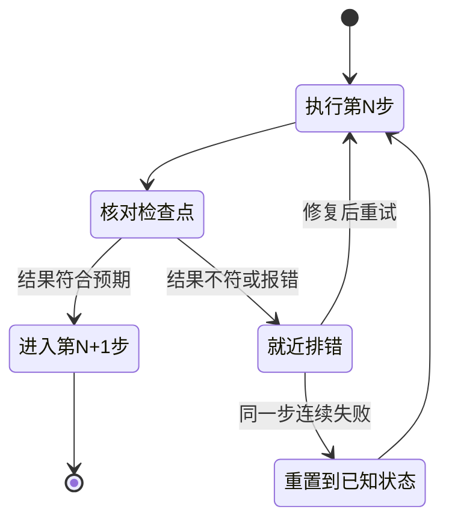

[toc]

## 这份指导的定位

**好的教程不是缩短版的手册，而是为特定读者设计的一条学习路径。**

面向初学者，可以用五个标准检查一篇教程是否成立：

- **前提明确**：读者知道自己需要会什么、装什么、有什么权限。
- **顺序合理**：内容按理解依赖组织，而不是按知识分类堆叠。
- **操作可执行**：读者知道在哪里做、做什么、输入什么。
- **结果可验证**：读者能判断自己做对了没有。
- **出错可恢复**：读者知道失败后先检查什么，如何回到正轨。

本文面向教程、操作指南及知识型文档的作者，重点讨论初学者，同时说明进阶与高级读者的差异。多数原则也适用于非技术主题。

**取证日期为2026年11月4日。**文中引用的文档分工、写作规范与教学原则来自已读取的来源；具体结构、示例和验收清单是基于这些材料的综合建议，不代表某一种模板具有普遍最优性。来源与未核验部分见文末。

### 如何使用这份指导

| 你的任务 | 优先阅读 |
| --- | --- |
| 第一次写教程 | 先判断文档类型与成功标准、按具体能力定义读者、面向初学者、骨架与检查点 |
| 改造现有教程 | 按学习依赖组织内容、命令与占位符、示例与练习、质量保证 |
| 同时面向多类读者 | 三层读者的设计差异、分层而非混写 |
| 建立团队写作规范 | 模板与检查清单、自动化检查、可执行文档、常见反模式 |
| 时间有限，只想先改三件事 | 直接看“如果只能先改三件事” |

## 先判断文档类型与成功标准

### 四种文档职责

“教程”“指南”经常混用，但读者可能带着完全不同的目的进入文档。

Diátaxis是一种按读者需求区分文档职责的方法，其名称有“编排、安排”之意。它区分四类文档，有助于避免一篇文章同时承担过多任务。[来源：Diátaxis的教程原则](https://diataxis.fr/tutorials/)

| 文档类型 | 读者的主要问题 | 写作重点 | 成功判据 | 不应成为主体的内容 |
| --- | --- | --- | --- | --- |
| **教程**(Tutorial) | 我还不会，怎样通过实践学会？ | 受控的学习路径、完整示例、观察与练习 | 读者完成一个可见成果，并能解释关键变化 | 大量选项、完整参数表、无关分支 |
| **操作指南**(How-to Guide) | 我有一个实际问题，怎样解决？ | 适用条件、操作路径、分支、验证与恢复 | 读者达成既定目标 | 从零解释所有基础概念 |
| **解释性文档**(Explanation) | 为什么这样工作？各部分有什么关系？ | 动因、机制、关系、边界与权衡 | 读者建立可用的心智模型 | 为了凑实践而加入冗长操作 |
| **参考资料**(Reference) | 这个字段、规则或接口的准确含义是什么？ | 完整、精确、一致、便于定位 | 读者查到准确信息 | 要求读者从头阅读的教学叙事 |

**教程与操作指南的核心分野，是“学习”与“办事”的区别。**教程面向还不知道自己不知道什么的读者，由作者带着走完一次有意义的实践；操作指南面向已经知道自己要完成什么的读者，重点是把事情做成。操作指南不要求读者是专家，但要求读者已经具备完成该任务的基础。[来源：The Good Docs Project的教程模板指南](https://www.thegooddocsproject.dev/template/tutorial)

**文档类型与读者水平是两个不同维度。**

高级读者学习陌生技术时，也可能需要教程；初学者完成一项已经学过的操作时，也可能只需要简短指南。不要把“教程”等同于低级内容，也不要把“参考资料”等同于高级内容。

这些分类用于明确职责，不是强制设置目录。小型教程可以包含必要的概念解释，不必把每一句解释拆成独立页面。专业写作者Tom Johnson对Diátaxis的讨论，也指出了机械分桶可能带来的问题。[来源：Diátaxis及其与其他文档方法的比较](https://idratherbewriting.com/blog/what-is-diataxis-documentation-framework)

### 把目标写成可以观察的能力

“了解”“熟悉”“掌握”可以表达意图，却不够适合决定内容取舍和验收标准。

| 模糊目标 | 更可执行的目标 |
| --- | --- |
| 了解数据筛选 | 根据给定条件筛选记录，并说明为什么这些记录被保留 |
| 掌握配置方法 | 修改指定配置、验证生效，并在失败时恢复原配置 |
| 理解权限管理 | 区分不同权限的作用范围，并为给定场景选择所需权限 |
| 熟悉性能优化 | 根据测量结果识别瓶颈，并说明优化方案的代价 |

**先写最终验收标准，再倒推必需步骤和必需概念。**

例如，教程的最终验收标准是“能根据给定的支出数据制作一张分类汇总图”，那么必需步骤是导入数据、检查字段、分类汇总、生成图表；必需概念是数据类型、分类字段、汇总方式；图表配色、自动更新和复杂交互则可以放到延伸阅读。

**某个知识点很重要，不等于它必须出现在当前教程中。**判断依据是它是否服务于本篇目标，而不是它在整个知识体系中的地位。

### 写清范围与非目标

好的文档不仅说明“本文讲什么”，还说明“本文不讲什么”。

Google的技术写作课程建议，在开头明确文档范围，并写出读者合理预期、但本文不覆盖的非范围。[来源：组织完整文档](https://developers.google.com/tech-writing/one/documents)

**非目标**(Non-goals)是被低估的工具。明确写出“本教程不涉及生产部署、不涉及权限模型、不解释底层协议”，可以：

- 让高级读者快速判断是否该离开，减少误读和差评。
- 让作者有正当理由拒绝范围蔓延，这是教程臃肿的主要来源。
- 让初学者不因为“没学到那些”而产生自我怀疑。

| 项目 | 要写清的内容 | 示例 |
| --- | --- | --- |
| **目标** | 读完后能做出什么可观察的成果 | 能筛选出库存低于5的商品，并解释筛选与删除的区别 |
| **范围** | 本文覆盖的任务、环境和版本 | 单条件筛选；本地电子表格；示例数据 |
| **非目标** | 读者可能期待、但本文不覆盖的内容 | 不涉及排序、公式、自动补货和生产数据 |
| **前置条件** | 知识、软件、权限、材料、成本 | 会创建文件；有可用的电子表格软件；无需管理员权限 |
| **时间与成本** | 预计耗时，是否包含安装和准备，是否可能产生费用 | 约15分钟，不含软件安装；不产生云费用 |

非目标不要写成“暂不涉及”。**“暂”字会招来追问，也会让范围重新变得模糊。**

## 按具体能力定义读者

### 初学者、进阶和高级是相对的

读者水平不是一个人的固定标签。

有经验的程序员可能第一次使用某种命令行工具；熟悉业务的工作人员可能不熟悉电子表格公式；高级用户切换平台后，也可能不清楚新的路径、权限和默认行为。

Google的技术写作课程强调：除职业角色外，还要考虑读者与当前知识的接近程度，不能仅凭职位推定其背景。[来源：受众分析](https://developers.google.com/tech-writing/one/audience)

建议分别考虑三个维度：

- **领域知识**：是否理解业务概念、术语和规则。
- **工具熟练度**：是否会用当前软件、命令行、编辑器或平台。
- **当前任务经验**：是否做过类似任务，是否知道常见失败模式。

同一个人可能在一个维度是初学者，在另一个维度是高级用户。**用“已有能力加当前目标”定义读者，比只写“适合初学者”更有用。**

### 读者画像

动笔前，建议用一页纸记录读者画像。画像不必对外发布，但要能指导取舍。

| 分析项 | 需要明确的问题 | 反例 | 正例 |
| --- | --- | --- | --- |
| **已有技能** | 读者已经会什么？ | 有一定基础 | 能写Python函数，用过`pip`，没用过虚拟环境 |
| **知识缺口** | 读者不会什么？ | 不熟悉本工具 | 不知道什么是依赖解析，不理解锁文件的作用 |
| **触发场景** | 为什么现在来读？ | 想学习 | 被要求两天内把一个脚本交付给同事可复现运行 |
| **可用时间** | 单次阅读预算 | 无 | 30分钟内要看到成果 |
| **环境约束** | 操作系统、权限、网络 | 无 | Windows 11、无管理员权限、公司代理 |
| **成功标准** | 跟做成功即可，还是需要独立迁移 | 学会 | 能独立完成同类任务，并能解释关键选择 |

**环境约束对中文读者尤其关键。**国内网络、Windows占比、公司代理这三项，直接决定教程第一屏要不要给镜像源、代理配置和平台差异。

### 三层读者的设计差异

| 设计维度 | 初学者 | 进阶读者 | 高级读者 |
| --- | --- | --- | --- |
| **主要需求** | 建立基本理解并完成首次实践 | 从会用过渡到会选择、会组合 | 在约束下诊断、设计和权衡 |
| **起点** | 具体问题、可见结果、必要基础 | 已知方法的不足、常见变体 | 复杂问题、约束、争议或失效案例 |
| **阅读方式** | 从头到尾线性精读 | 目标导向的跳读加精读 | 高密度扫描与精确查表 |
| **指导程度** | 明确位置、动作、输入和检查点 | 保留关键步骤，减少重复说明 | 省略已声明的基础，保留关键依据 |
| **决策归属** | 作者替读者做默认选择 | 作者给选项与权衡 | 读者自决 |
| **示例形式** | 完整示例，控制变量 | 对照示例、补全任务、组合任务 | 真实案例、边界条件、多方案比较 |
| **原理深度** | 足以解释当前行为的最小模型 | 机制、关联和适用条件 | 假设、证据、反例及模型局限 |
| **练习方式** | 小幅修改并观察结果 | 独立选择方法、处理变体 | 开放任务、故障分析和方案论证 |
| **错误处理** | 穷举高频报错，逐条给处置 | 给排查方法与日志定位 | 给可观测性入口与源码位置 |
| **语言密度** | 低密度，多重复，多检查点 | 中密度 | 高密度，可用行话 |
| **视觉辅助** | 截图、录屏、成果预览 | 结构图、流程图 | 时序图、状态机、基准数据 |
| **典型失败模式** | 环境装不上，弃读 | 找不到匹配自己场景的配方 | 嫌啰嗦、信息密度低，不再回访 |

这里的关键不是“初级长、高级短”，而是**不同读者需要不同的信息密度与支撑方式**。

### 专家逆转效应与支撑递减

**专家逆转效应**(Expertise Reversal Effect)指的是：某种指导对缺乏相关知识的学习者有帮助，但随着相关知识增加，同样的指导可能变成冗余，甚至妨碍学习。[来源：新南威尔士州教育部门的认知负荷实践指南](https://education.nsw.gov.au/about-us/education-data-and-research/cese/publications/practical-guides-for-educators/cognitive-load-theory-in-practice)、[北京师范大学的中文研究综述](https://cit.bnu.edu.cn/syscg/53511.html)

这意味着：

- 初学者的教程需要完整步骤、明确位置和检查点。
- 进阶读者需要变体、方法比较和适用条件，不需要重复入门操作。
- 高级读者需要边界、证据、失败模式和权衡，不需要基础教学。

**高级文档可以省略基础教学，但不应省略关键条件，更不应故意写得晦涩。**“高级”不等于“难懂”，而是假设读者已具备基础，把篇幅留给判断依据。

## 面向初学者：理解断点与认知负荷

### 不把作者熟悉的内容当作读者已知

作者常常知道一连串操作，却忘记其中包含多少隐含知识。这是**知识诅咒**(Curse of Knowledge)：掌握知识以后，很难准确想象尚未掌握它时的状态。

例如，“修改配置后重启服务”对作者可能十分明确，对初学者却可能留下这些问题：

- 修改哪个文件，文件在哪里？
- 修改哪一项，保留哪些内容？
- 保存以后是否已经生效？
- 重启的是应用程序、后台服务，还是整台计算机？
- 在哪里执行重启操作？
- 怎样确认重启完成，而不是失败退出？

初学者并非需要所有背景知识，但需要补足**会阻断当前任务的知识**。

| 常见跳跃 | 读者可能卡在哪里 | 补法 |
| --- | --- | --- |
| **省略环境** | 哪个文件、哪个目录、哪个终端、什么权限 | 写明位置和前置状态 |
| **未定义术语** | 为了看懂第一句，要去搜五个概念 | 首次出现给一句解释，再链接深入说明 |
| **默认完美环境** | 路径、权限、网络、版本与作者不同 | 给环境自检和已知限制 |
| **省略判断** | 不知道成功还是失败，只能继续往下试 | 给预期结果和检查点 |
| **省略退出方式** | 进入交互式环境后不知道怎么回到系统终端 | 说明如何进入、如何退出 |

可逐处检查：

> 读者第一次遇到这个词、这个动作或这个结果时，仅凭前文，能否知道它是什么、应该怎样处理？

### 为新概念建立最小理解模型

**最小理解模型**是足以解释当前任务中关键行为的简化认识，不是完整理论。

引入一个主线概念时，建议按以下顺序组织：

1. **问题或动因**：为什么需要它？
2. **基本定义**：它是什么？
3. **当前用途**：本例中用它做什么？
4. **可观察行为**：操作后发生什么？
5. **关键边界**：最容易误解的地方是什么？

例如，介绍电子表格筛选：

> 当表格记录较多时，逐行查找低库存商品容易遗漏。筛选可以按条件只显示部分记录，方便检查。本例只显示库存数量小于5的商品。**筛选隐藏了不符合条件的行，并没有删除这些记录。**

这段解释同时交代了用途、行为和边界，而不必先介绍完整的数据分析理论。

**“善意的简化”是允许的，但要标明边界。**可以说“你现在可以把它理解成X，后面会讲更准确的定义”，但不能让简化版本与后续事实冲突，也不能省略会改变判断的条件。

### 避免循环定义和术语递归

不良解释：

> 缓存用于提高缓存命中率；命中率就是命中缓存的比例。

问题不只是语言重复，而是读者没有获得更基础的理解。

更好的解释：

> 为了避免重复执行耗时工作，系统可以暂存以前得到的结果。再次遇到相同请求时，如果能直接使用暂存结果，就不必重新计算。这个暂存机制称为缓存；能够复用暂存结果的请求，占全部请求的比例，称为命中率。

**定义应依靠读者已知的概念，而不是依靠另一个尚未解释的术语。**

术语表可以帮助回查，但不能替代首次使用处的必要说明。缩写的英文全称也不等于解释了其含义。

### 简化但不建立错误模型

初学者说明可以省略细节，却不能省略会改变判断的条件。

| 容易误导的简化 | 更合理的写法 |
| --- | --- |
| 筛选会去掉不需要的数据 | 筛选会隐藏不符合条件的记录，原始数据仍然保留 |
| 保存配置后就会生效 | 本例中的程序在启动时读取配置，因此保存后还需重启 |
| 这个参数越大越好 | 在本例范围内增大参数可以提高并发，但也会增加资源占用 |
| 系统会自动完成 | 说明在什么条件下自动完成，以及何时需要手工处理 |
| 这里直接复制即可 | 说明哪些值需要替换，复制后要检查什么 |

**适用条件和重要例外，应与结论一起出现，不宜全部留到文末纠正。**

### 认知负荷：减少无关负担

**认知负荷**(Cognitive Load)可以理解为：学习时，为暂时保持、处理和关联信息而承担的心理负担。它受任务复杂度、已有知识和材料呈现方式影响。

| 负荷类型 | 来源 | 对写作的含义 | 可采取的做法 |
| --- | --- | --- | --- |
| **内在认知负荷**(Intrinsic Cognitive Load) | 任务本身的复杂度、元素之间的交互量 | 不能消除，只能调节和分段 | 一次引入一个概念；先给完整范例再让读者改参数；把复杂任务拆成有意义的单元 |
| **外在认知负荷**(Extraneous Cognitive Load) | 呈现方式、结构、术语、排版造成的额外负担 | 应尽量降低，但不可能降为零 | 统一术语；就近解释；消除无关选项；让命令、说明和预期结果靠在一起 |
| **关联认知负荷**(Germane Cognitive Load) | 用于构建心智模型的努力 | 当前认知负荷理论常把它归入内在负荷，不再作为独立相加的类型 | 在关键步骤后问“刚才发生了什么”；让读者解释因果；用变体促进迁移 |

**不要把工作记忆容量写成一个固定数字。**不同研究的估计口径不同，写作建议也不依赖某个具体数字。真正需要记住的是：工作记忆容量有限，材料呈现不当会挤占用于理解任务的资源。

写作应减少无关负担，而不是消除一切思考。例如，寻找上一页的参数说明是可避免的负担；比较两个条件的差别，则可能正是学习目标。

中文研究综述也提醒，材料不是切得越细越好，复杂度和读者知识水平都需要考虑。[来源：北京师范大学的认知负荷综述](https://cit.bnu.edu.cn/syscg/53511.html)

### 首屏契约与早期可见结果

初学者打开一篇教程时，最想知道四件事：我要做什么，我能得到什么，我需要准备什么，怎样算完成。

建议在开头给出一个简洁的“契约”：

- **你将构建什么**：一句具体可见的成果描述，最好配一张最终效果图或一段最终输出。
- **你将学到什么**：控制在三到四个核心概念以内。
- **预计耗时与前置要求**：说明是否包含安装和准备，是否可能产生费用。
- **完成标准**：读者怎样判断自己已经完成。

**尽早给出可见结果**是重要的设计目标。让读者在合理的最短时间内看到第一个真实变化，有助于建立“我能学会”的信心。

但不要把“5分钟”写成心理学定律。复杂环境准备、依赖安装和权限申请可能超过5分钟；为了赶时间跳过必要检查，反而会让读者在后面卡得更久。

### “少解释”与“必须解释”的边界

Diátaxis强调教程应尽量少解释，让读者专注于做；认知负荷研究则强调初学者需要明确指导。两者并不矛盾，关键在于**解释的时机和剂量**。

- **当前动作必需的解释，就地保留。**不解释就无法正确操作，或容易造成误操作时，必须说明。
- **暂时用不到的原理，退出主线。**可以放到步骤之后、可选阅读或独立解释文档。
- **安全、费用、数据破坏和不可逆操作，必须在动作之前解释。**这类信息不能等到出错后再补。
- **概念本身就是学习目标时，应在使用处解释，并配例子。**不要用“后面会讲”把当前理解缺口留到最后。
- **深度解释可以链接出去，但当前步骤要留一句最低限度的说明。**不能让读者为了完成当前操作而跳转多次。

**“少解释”不是“少到读者看不懂”，而是“不把与当前动作无关的内容塞进主线”。**

## 按学习依赖组织内容

### 先写验收标准，再倒推内容

一种实用的编排方法是：先写最终验收标准，再倒推必需步骤和必需概念。

| 层次 | 要回答的问题 | 示例 |
| --- | --- | --- |
| **最终验收** | 读者完成后能做出什么？ | 能根据支出数据制作一张分类汇总图 |
| **必需步骤** | 要经过哪些可观察的动作？ | 导入数据、检查字段、分类汇总、生成图表 |
| **必需概念** | 不懂哪个概念会做错或看不懂结果？ | 数据类型、分类字段、汇总方式 |
| **可选深入** | 哪些内容有助于理解，但不影响完成？ | 图表配色、自动更新、复杂交互 |

不服务于本次目标的知识，先不要塞进主线。

### 推荐主线

面向初学者的实践教程，可以采用以下组织顺序：

1. **展示任务与结果**：说明要解决的问题，以及完成后的样子。
2. **确认起点**：列出必要知识、环境、材料和风险。
3. **建立最低限度理解**：只解释开始行动所必需的概念。
4. **完成一次受控实践**：提供明确步骤和阶段性检查点。
5. **解释关键结果**：把操作、变化和原因联系起来。
6. **完成小幅迁移**：改变条件、补全步骤或处理一个常见异常。
7. **收束与分流**：总结已能完成的任务，指向进阶学习或参考资料。

这不是要求所有教程都机械采用相同章节。它表达的是一种顺序：**先形成方向感，再提供行动能力，最后促进独立运用。**

### 前置知识要“够用”，不要变成先修百科

前置部分容易走向两个极端：

- **不足**：写“需要基础知识”，却不说明究竟需要什么。
- **过量**：要求先学习整套基础课程，才允许开始当前任务。

更合适的做法是区分：

| 内容 | 放置方式 |
| --- | --- |
| 缺少就无法开始的知识或工具 | 放在前置条件，提供明确检查方法 |
| 开始操作时才需要的概念 | 在首次使用处解释 |
| 有助于理解但不影响完成主线的背景 | 标为选学，放在合适的阶段之后 |
| 完整规则、全量参数、历史沿革 | 放入参考或深入阅读 |

**前置条件应具体到可检查的能力。**“需要计算机基础”不如“能够创建并保存文件，知道文件保存在哪个文件夹”明确。

### 理论/实践顺序按风险与依赖决定

两种绝对规则都不可靠：既不能永远“理论在前”，也不能永远“先做再说”。

- 涉及安全、费用、数据破坏或不可逆操作时，必须先解释风险和必要原理。
- 面向初学者的低风险任务，可以先建立简短模型，再通过操作加深理解。
- 概念本身就是学习对象时，可以先讲概念，但应尽快连接具体情境。
- 面向高级读者时，可以从现有方法失效的案例进入，再分析机制。

**决定顺序的依据，是理解依赖、任务风险和已有知识，而不是固定写作流派。**

### 三层信息放置

把内容分成三层，有助于兼顾主线清晰和按需深入：

| 信息 | 放在哪里 | 例子 |
| --- | --- | --- |
| 不知道就无法继续，或容易做错 | 当前步骤之前或旁边 | 字段类型、权限要求、危险操作的影响范围 |
| 有助于深入理解，但不影响继续 | 简短说明、可选阅读区 | 为什么这样配置、这个参数的常见取值 |
| 其他方案、完整规则、特殊场景 | 独立章节、参考文档或后续指南 | 其他部署方式、完整参数表、历史沿革 |

例如，第一次操作时可以明确说：

> 本教程使用方案A，因为它不需要额外配置。方案B的适用场景见“其他部署方式”。

这比一开始平铺五种方案、让新手自行选择更合适。

**但必要条件和风险提示不能被“分层”隐藏掉。**关键说明应出现在活动之前或附近，而不是等读者出错后才第一次出现。

### 拆分应形成完整单元，避免过度碎片化

拆分内容时，以**有意义的学习单元**为单位：

- 一个概念与足够理解它的例子。
- 一组共同完成一个小目标的操作。
- 一个可以观察、验证并暂停的阶段。

不要把连续任务拆成大量只容纳几句话的页面，迫使读者持续切换。**碎片化本身也会增加认知负担。**

### 单一决策路径与必要分支

初学者没有能力做技术选型。**作者应替读者做出最稳妥、最通用的默认选择。**

但“单一决策路径”不等于“全文只能出现一条命令”。需要区分四类分支：

| 分支类型 | 例子 | 处理方式 |
| --- | --- | --- |
| **作者可代决的默认选择** | 用npm还是pnpm；用SQLite还是PostgreSQL | 作者选定一个，其他放到延伸阅读 |
| **环境差异** | Windows与类Unix系统的命令、路径、权限 | 在相关步骤给双写法，明确标注；这是呈现分支，不是选择 |
| **任务目标不同** | 部署到测试环境还是生产环境 | 拆成不同文档或独立章节 |
| **风险或权限不同** | 是否有管理员权限，是否允许公网访问 | 前置条件写清；必要时拆成独立路径 |

**复杂分叉应外迁到操作指南，而不是在教程里让读者自行判断。**平台差异可以在步骤内用清楚的标注处理，但不要让每个步骤都变成“如果你用A就这样，用B就那样”的迷宫。

### 渐进披露

**渐进披露**(Progressive Disclosure)指先展示完成当前任务所需的核心内容，再按需提供更复杂的内容。

常见手法：

- **折叠块**：把原理说明、其他平台做法放入折叠区，默认收起。
- **旁注**：用引用块标注“进阶”，与主干步骤区分。
- **外链加一句话摘要**：链接必须说明“读了能得到什么”，避免裸链接。

**必要信息不应默认折叠；选学信息不应伪装成必读。**

## 骨架、步骤与检查点

### 教程骨架

一个可直接采用的教程骨架如下。顺序本身是设计，不是形式要求。

| 部分 | 目的 | 要写什么 |
| --- | --- | --- |
| **标题** | 让读者一眼判断是否相关 | 动词开头加具体成果，例如“用FastAPI搭建一个带数据校验的待办事项接口(API)” |
| **成果前置** | 建立期待，降低首屏焦虑 | 截图、最终输出，或一句“完成后你将拥有X” |
| **元信息** | 让读者判断成本和适用性 | 预计耗时、难度、最后验证日期、已验证环境 |
| **前置条件与非目标** | 避免中途发现缺少条件 | 知识、软件版本、权限、材料、成本、风险，以及本文不覆盖的内容 |
| **环境准备与自检** | 把环境问题前置解决 | 版本锁定、镜像源、一键脚本或容器、检查命令 |
| **主体步骤** | 带读者完成实践 | 编号、一步一个可观察动作、每步检查点 |
| **完整成品** | 供读者比对和恢复 | 最终文件、配置或输出的全貌 |
| **排错** | 让读者原地恢复 | 症状、原因、处置、验证 |
| **清理** | 避免留下僵尸资源或费用 | 删除容器、文件、云资源，恢复配置 |
| **收束与出口** | 巩固成果，指向下一步 | 总结已能完成的任务，按读者层次给出去向 |

### 元信息

元信息不必复杂，但关键字段不能靠名字自解释。

| 字段 | 含义 | 取值约定 | 易混淆点 |
| --- | --- | --- | --- |
| `title` | 对外标题 | 动词开头加可见成果 | 与导航短标题可以不同，但不要同义改写，否则搜索命中率下降 |
| `audience` | 目标层级 | `beginner`、`intermediate`、`advanced` | 指本文假定的起点，不是“本文难度” |
| `est_minutes` | 预计耗时 | 以新手实测中位数或合理估计为准 | 不是作者自己跑一遍的时间；作者通常低估 |
| `last_verified` | 最后一次在干净环境实跑通过的日期 | ISO 8601 | 与最后编辑日期不同；改错别字不应刷新本字段 |
| `verified_env` | 已验证环境矩阵 | 显式列出操作系统与运行时版本 | 与“支持环境”不同；未实测就不要列 |
| `deps_lock` | 依赖锁文件 | 仓库内相对路径 | 教程可复现性的实际担保物 |
| `non_goals` | 显式排除范围 | 名词短语 | 不要写“暂不涉及” |

这些字段可以写在文档头，也可以放在正文的“适用环境”表中。**不是每篇文档都需要YAML front matter；但一旦使用，就应保持一致。**

### 单步结构

对于容易出错或状态变化明显的步骤，可以用以下要素检查完整性：

| 要素 | 要回答的问题 |
| --- | --- |
| **目的** | 当前步骤要完成什么？ |
| **位置与前提** | 在哪个文件、窗口、目录或状态下操作？ |
| **动作与输入** | 具体做什么，哪些内容需要替换？ |
| **预期结果** | 完成后应看到什么，哪些内容允许不同？ |
| **判断方法** | 什么表明可以继续？ |
| **异常处理** | 出现典型差异时，先检查什么？ |

推荐的单步顺序是：

> 推荐顺序是：先写意图，再写位置，然后给命令或动作、预期输出和检查点，最后可选地补一句原因。

**一个编号步骤应包含一个可观察的动作。**但不必为每次点击都加满六个标签；应以“可独立检查的小目标”划分步骤。短步骤可以合并，关键状态转换必须明确。

### 检查点

**检查点**(Checkpoint)是把“蒙眼走路”变成“有仪表盘”的装置。它回答三个问题：我做对了吗？不对的话错在哪一步？怎么回到正轨？

| 形式 | 示例 | 可靠性 | 适用场景 |
| --- | --- | --- | --- |
| **描述性** | “你应该看到服务启动日志” | 低 | 图形界面步骤的兜底 |
| **精确输出** | “终端最后一行应为`Uvicorn running on http://127.0.0.1:8000`” | 中 | 多数命令行步骤 |
| **可执行断言** | 运行`curl -s localhost:8000/health`应返回`{"status":"ok"}` | 高 | 推荐默认采用 |
| **自动化脚本** | `bash scripts/check_step3.sh`退出码为0 | 高 | 长教程、培训场景 |

检查点要给出**可观察的具体事实**，不要写“应该没问题”。可执行断言的额外价值是：它能被持续集成(CI)复用，也能减少读者对“输出是否正常”的主观猜测。

较长的教程还应设置**阶段检查点**，说明当前已经完成什么、接下来做什么，方便读者中断后继续。

单步执行时，读者实际经历的状态流转如下：



这张图强调三件事：**排错后应回到原步骤，而不是带着错误继续；同一步连续失败时要有重置出口；重置路径必须被显式设计**，例如“删除虚拟环境后重来”，而不是让读者自行发挥。

### 预期结果

预期结果要帮助读者判断，而不只是展示。

- 成功时出现什么标志？
- 输出中的哪些部分具有判断意义？
- 时间、路径、标识符等哪些值可能不同？
- 是应当等待、继续输入，还是已经完成？

**不要要求读者把示例输出逐字匹配，也不要让读者从几十行日志里猜重点。**

| 情况 | 写法 |
| --- | --- |
| **成功标志** | 明确指出关键字、状态码或界面变化 |
| **可变值** | 说明时间戳、进程号(PID)、哈希、绝对路径可能不同，哪些关键字必须匹配 |
| **静默命令** | `cp`、`mkdir`、`export`、`git add`等没有输出时，紧接着给一条状态确认命令 |
| **阻塞进程** | 说明前台服务会占用当前终端，测试命令需要另开一个终端 |
| **交互式环境** | 说明如何进入、如何退出，回到系统终端后再执行下一条命令 |

### 风险、恢复与清理

涉及删除、覆盖、权限、公开发布、联网收费等行为时：

- 在动作之前说明影响范围。
- 提供备份、预览或安全试验方式。
- 使用练习数据、测试账号或隔离环境。
- 说明失败以后如何停止、恢复或清理。
- 说明重复执行会不会产生重复资源或改变结果。

**警告应放在操作命令的上方，而不是下方。**许多读者习惯边看边敲命令，放在代码块下方的警告往往在操作完成后才被看到。

**不要用“为了简洁”删除读者作出安全决定所必需的信息。**

### 排错表

排错表的索引词应是**读者实际看到的原始报错**。读者通常会把报错原样粘贴到搜索框，索引词对齐才能被搜到。

| 症状（原始报错） | 最可能原因 | 处置 | 验证 |
| --- | --- | --- | --- |
| `ModuleNotFoundError: No module named 'fastapi'` | 虚拟环境未激活，或装到了系统Python | 激活虚拟环境后重装 | `python -c "import fastapi; print(fastapi.__version__)"`输出版本号 |
| `Address already in use`或`[WinError 10048]` | 端口被占用 | 换端口，或排查占用进程 | 重新启动后日志出现监听地址 |
| `SSL: CERTIFICATE_VERIFY_FAILED` | 代理中间人证书或系统证书链 | 配置企业根证书，或改用可信镜像源 | 单包下载成功 |

高频错误可以就近放在步骤下方，完整排错表放在文末。**不要把所有问题都塞进无人阅读的常见问题附录。**

### 收束与出口

结尾不要只写“恭喜你完成教程”。应说明：

- 读者现在能完成什么。
- 关键关系是什么，哪一步最容易混淆。
- 接下来适合学什么，按读者层次给出去向。

例如：

- 刚入门：下一篇《用分支管理两个并行任务》。
- 要解决具体问题：操作指南《如何撤销：reset、revert与restore的选择》。
- 想理解原理：解释文档《版本控制的三棵树与引用模型》。

## 命令、代码与占位符

### 可复制命令与终端记录

教程中的代码块至少有两种用途，不能混为一谈。

| 类型 | 用途 | 写法 | 是否供复制 |
| --- | --- | --- | --- |
| **可复制命令块** | 读者直接执行 | 不含提示符、不含输出；一条命令或一组连贯命令 | 是 |
| **终端记录块** | 展示命令与输出的交互 | 用`$`或`PS>`回显命令，输出紧随其后 | 否 |

例如，终端记录块：

```shell
$ git status --short
 M demo.txt
```

可复制命令块：

```bash
git status --short
```

仓库的排版规范要求：一个输出块对应多条命令时，在块内逐条用`$ 命令`回显，PowerShell示例用`PS> 命令`。这条规则适用于**终端记录块**；教程主路径的可复制命令块应保持干净，避免读者把提示符和输出一起粘进终端。

### 代码块与输出

- 代码块必须标注语言，例如`bash`、`powershell`、`python`、`yaml`。
- 不要用`text`或`plaintext`代码块承载普通说明、列表或大纲。
- 命令输入与输出应分开；不要把输出混进可复制命令块。
- 一个输出块对应多条命令时，逐条回显命令；没有输出的命令标“无输出”。
- 终端输出可以使用`shell`或`bash`标签获得高亮；这种标签不精确，但比无高亮的`console`更易读。

### 占位符

形式化语法中的占位符必须逐项解释，不能依赖名字自解释。

常见元语法约定：

- 方括号`[ ]`表示可选参数，实际输入时不要键入方括号。
- 尖括号`<...>`表示需要替换的变量，实际输入时不要键入尖括号。
- 小写或下划线词组通常表示变量占位符。

| 写法 | 含义 | 适用场景 | 风险 |
| --- | --- | --- | --- |
| `<UPPER_SNAKE>` | 读者必须替换的值 | 正式语法、参考文档 | PowerShell中`<`和`>`是重定向符，整块复制会报错，需要提醒 |
| `${VAR}` | 既是占位符又是真实环境变量 | 脚本化教程 | 读者可能以为已经自动定义 |
| `your-project-name` | 低风险示意值 | 面向纯新手 | 读者可能原样照抄，需要检查点兜底 |

**每篇文档选定一种约定，并保持一致。**占位符解释表至少包含：是否必填、含义、示例取值、取值约束、易混点。

以SSH本地端口转发为例：

```bash
ssh -L [bind_address:]local_port:dest_host:dest_port [-p ssh_port] user@ssh_server
```

| 字段 | 是否必填 | 含义 | 示例 | 易混点 |
| --- | --- | --- | --- | --- |
| `-L` | 必填 | 开启本地端口转发 | 固定字面量`-L` | 不要与远程转发`-R`或动态代理`-D`混淆 |
| `bind_address` | 可选 | 本地监听绑定的网络接口 | `127.0.0.1`或`0.0.0.0` | 省略时通常只绑定回环地址；设为`0.0.0.0`可能让局域网其他机器访问隧道 |
| `local_port` | 必填 | 本地电脑上监听的端口 | `15432` | 是本地客户端连接的端口，不必与远端服务端口一致 |
| `dest_host` | 必填 | 最终目标服务的地址 | `127.0.0.1`或`10.0.1.25` | 该地址由`ssh_server`解析和连接，不是由本地电脑直接解析 |
| `dest_port` | 必填 | 目标服务实际监听的端口 | `5432` | 必须与目标服务器上的服务端口一致 |
| `-p ssh_port` | 可选 | SSH服务端口 | `-p 2222` | 不要与被转发的业务端口混淆 |
| `user@ssh_server` | 必填 | 登录跳板机的用户名和地址 | `deploy@203.0.113.10` | 本地电脑必须能访问`ssh_server`的SSH端口 |

**面向初学者的可复制命令，优先使用具体示例值，再用加粗文字提醒替换。**例如“请把双引号内的`YourName`替换为你的英文名字”，比直接给一个尖括号占位符更不容易出错。

### 版本锁定

教程过期的主要原因是版本漂移。

- 不要写“安装最新版本”；写明已验证的版本或版本范围。
- 给出锁文件、依赖清单或容器镜像标签。
- 在文档头标注`last_verified`和`verified_env`。
- 区分“支持环境”和“已验证环境”；未实测的平台不要写成已支持。
- 教程中避免使用`latest`标签，除非教程本身就是在讲如何跟踪最新版本。

### 完整代码与片段

- 每个示例都应**完整可运行**，不要用省略号隐藏关键逻辑。
- 明确代码放在哪个文件、从哪里运行、哪些值需要替换。
- 包含必要的导入、初始化和依赖声明。
- 先给完整可运行示例，再逐段讲解，而不是让读者自己拼接零散片段。
- 如果只能给片段，要说明它应放在哪里、缺少什么、如何验证。

### 跨平台命令

| 差异点 | 类Unix系统 | Windows | 教程中的处理 |
| --- | --- | --- | --- |
| **环境变量** | `echo "$USER_HOME"` | `Write-Output "$env:USER_HOME"` | 不要只给一种写法；明确终端类型 |
| **临时设置环境变量** | `APP_ENV=prod ./app` | `$env:APP_ENV="prod"; .\app.exe` | Windows PowerShell与CMD不支持命令前缀内联赋值，拆成两条语句；Git Bash可用类Unix写法 |
| **长命令换行** | 行尾反斜杠`\` | PowerShell用反引号`` ` `` | 参数不多时优先写单行，保证全平台可复制 |
| **路径分隔符** | 正斜杠`/` | 正斜杠或反斜杠 | 配置文件和代码参数中优先用`/`，避免转义问题 |
| **命令串联** | `cmd1 && cmd2` | PowerShell 7支持`&&`，5.1不支持 | 面向新手时改用分行写法 |
| **可执行权限** | `chmod +x` | 无等价概念 | 在仓库层面用`git update-index --chmod=+x`保留权限位 |
| **文件名大小写** | 通常敏感 | 通常不敏感 | 跨平台项目中避免只靠大小写区分文件名 |

**CRLF指回车加换行，LF指单独换行。**两者在跨平台脚本、Git检出和容器挂载中常引发问题；教程应说明仓库和工具链期望哪一种，而不是只说“注意换行符”。

**不要宣称“全平台支持”，却只给一种平台的命令。**至少要在关键步骤给出另一种平台的写法，或明确说明适用范围。

### 非ASCII字符与编码

国外工具未必充分考虑中文路径和字符编码。面向中文读者时，应提前说明已知限制。

- **路径**：初学者项目尽量使用纯英文、无空格的目录；在Shell中给路径变量加双引号，例如`cd "$PROJECT_DIR"`。
- **文件读写**：Python读写文本时显式指定`encoding="utf-8"`。
- **Excel的CSV(逗号分隔值)文件**：Excel依赖字节顺序标记(BOM)判断编码时，可使用`utf-8-sig`导出。
- **数据库**：MySQL使用`utf8mb4`，不要使用可能截断字符的旧字符集。
- **终端乱码**：Windows旧版控制台可尝试`chcp 65001`；PowerShell可设置`[Console]::OutputEncoding = [System.Text.Encoding]::UTF8`。这些方法并非对所有工具都有效，应给出验证方式。
- **压缩包文件名**：Windows生成的zip可能使用本地代码页，跨平台解压时可能需要指定编码。

**不要把这些差异写成“Windows一定有问题”。**应说明具体版本、具体表现和检查方法。

### 网络、镜像与代理

面向国内读者的教程，应区分**国内开发环境**和**海外生产环境**。

- 国内开发环境可能直连GitHub、Docker Hub、PyPI、npm或海外二进制源不稳定。
- 海外生产环境通常直连畅通，不应继承本地代理或镜像重写规则。
- 教程应提供“无代理镜像或加速方案”和“本地代理方案”两条路径，并说明生产环境如何清理。

| 生态 | 常见配置方式 | 注意事项 |
| --- | --- | --- |
| Python与pip | `pip config set global.index-url <MIRROR_URL>` | 镜像地址是示例，发布前需实测 |
| Node.js与npm | `npm config set registry <MIRROR_URL>` | 团队私有源优先，不要覆盖锁文件 |
| Go | 设置`GOPROXY`环境变量 | 取值可用官方或镜像，按网络环境选择 |
| Rust与cargo | 在`~/.cargo/config.toml`中配置源替换 | 保留官方源作为回退 |
| Docker | 在`daemon.json`中配置`registry-mirrors` | 公共镜像站变动频繁，务必实测 |

代理配置要分平台给全，并提醒**只在当前终端会话有效**：

```bash
# 类Unix系统（bash、zsh）
export http_proxy="http://127.0.0.1:7890"
export https_proxy="http://127.0.0.1:7890"
```

```powershell
# Windows PowerShell
$env:HTTP_PROXY = "http://127.0.0.1:7890"
$env:HTTPS_PROXY = "http://127.0.0.1:7890"
```

**端口`7890`只是示例。**教程应教读者查看自己代理客户端的实际端口，而不是写死某个客户端。

Git可以只对特定域名使用代理，避免把内网GitLab流量也劫持到外部代理：

```bash
git config --global http.https://github.com.proxy http://127.0.0.1:7890
```

无代理时，可以使用镜像前缀或URL重写，但要说明：

- 公开镜像通常只支持只读拉取，不一定支持推送。
- 镜像站可能随时失效，应提供2到3个候选方案和自检命令。
- 迁移到海外生产环境或镜像失效时，必须撤销重写规则。
- 不要为了绕过证书问题关闭TLS(传输层安全)证书校验。

## 示例与练习

### 选择最小但有意义的案例

好的入门示例应同时满足：

- **真实问题**：读者知道为什么值得做。
- **复杂度受控**：不引入大量无关业务知识。
- **因果可见**：能看出操作与结果之间的关系。
- **可以变化**：能够通过小幅修改练习迁移。
- **允许安全重试**：失败不会造成难以恢复的后果。

“真实”不等于“完整生产系统”。过于复杂的案例会让学习目标被业务、工具安装和环境问题淹没。

### 示例分级

| 层级 | 示例类型 | 要求 |
| --- | --- | --- |
| **初学者** | 完整工作范例 | 可整体复制运行，带预期输出和检查点 |
| **进阶** | 范例加变体矩阵 | 给2到3个真实场景下的参数差异与理由 |
| **高级** | 最小可复现示例加反例 | 突出边界条件、失败模式、性能数据 |

**示例在精不在多。**每个示例都应完整、可运行、有明确用途；不要用大量玩具示例填充篇幅。

### 从完整示范到独立任务

**教学支架**(Scaffolding)指学习过程中提供的临时帮助，例如完整步骤、提示、检查点和部分答案。它的目的不是永久代替思考，而是帮助读者获得独立完成任务的能力。

一种实用安排是：

1. **完整示范**：提供全部必要步骤，说明关键判断。
2. **局部修改**：只改变一个条件，预测并观察结果。
3. **部分补全**：保留目标和部分步骤，让读者补足关键环节。
4. **独立完成**：给出新任务与验收标准，不再提供完整过程。
5. **解释选择**：说明为什么采用这种方法，以及何时不适用。

**“照着完成了”不等于“能够独立应用”。**教程完成后，增加一个小变体任务，比只写“恭喜你完成教程”更能检验学习效果。

**不要把第一次完整示例留作练习。**新手需要先看到完整工作范例，才能在此基础上修改；一上来就让读者从空白拼装，会把内在负荷推到崩溃点。

### 贯穿式案例

整篇教程最好围绕**一个主干案例**展开，后续知识点作为该案例的增量。

这样做的好处是：

- 新知识挂载在已有上下文上，内在负荷更低。
- 读者每学一个概念，都能看到它在同一个项目中如何起作用。
- 读者最终得到一个完整可带走的产物，而不是一堆互不相干的片段。

不要每节都换一套数据、命名和工具。**连贯的上下文能大幅降低读者每进一节重新理解背景的损耗。**

### 电子表格短例

以下为**教学设计示意**，不对应某个电子表格软件版本的实测操作记录。实际发布时，应补齐具体软件、版本、界面路径和验证结果。

**目标与范围**

> 使用筛选找出库存数量小于5的商品，并理解筛选不会删除其他商品。本次不处理排序、公式和自动补货。

**练习数据**

| 商品 | 库存数量 |
| --- | ---: |
| 笔记本 | 3 |
| 文件夹 | 5 |
| 铅笔 | 12 |
| 橡皮 | 0 |

**必要概念**

> 筛选按照条件决定显示哪些记录。本例的条件是“库存数量小于5”，因此数量为0和3的商品符合条件，数量等于5的不符合条件。

**操作安排**

1. 打开包含练习数据的工作表，确认商品名称与库存数量分别位于不同列。
2. 对包含标题与全部记录的数据区域启用筛选。
3. 在“库存数量”列设置数值条件“小于5”。
4. 检查结果：应只显示“笔记本”和“橡皮”。
5. 清除筛选，确认所有商品重新出现。

实际教程应把“启用筛选”和“设置数值条件”替换为经过验证的具体界面步骤。

**解释观察**

> 清除筛选以后，其他商品重新出现，说明这些记录只是暂时隐藏，并未被删除。

**小幅迁移**

> 把条件改成“小于或等于5”。先预测哪些商品会出现，再实际检查。

这个练习只改变条件边界，能够检验理解，又不会同时引入新工具。

**异常检查**

> 如果结果与预期不同，先检查筛选条件是否设在“库存数量”列、数量是否为数值，以及数据区域是否包含全部记录。

### Git综合例

同一主题面向不同水平时，深化的方式不是“增加更多步骤”，而是增加**变体、判断、约束和责任范围**。

| 层级 | 目标 | 路径 | 关键命令或配置 | 检查点 | 常见问题 |
| --- | --- | --- | --- | --- | --- |
| **初学者** | 配置身份，克隆示例仓库，运行自检脚本 | 单一路径：使用HTTPS和默认分支 | `git config --global user.name`、`git clone`、`bash check_env.sh` | `git config --get user.name`非空；脚本输出`[SUCCESS]` | 代理未启动；目录已存在；换行符导致脚本无法执行 |
| **进阶** | 在混合网络与跨平台协作中稳定拉取 | 域名级代理或镜像重写；提交`.gitattributes` | `git config --global http.https://github.com.proxy ...`、`url.<base>.insteadOf`、`* text=auto eol=lf` | `git config --get`能查到配置；`git status`无异常；脚本保持LF | 全局代理劫持内网；镜像只读；CRLF污染 |
| **高级** | 在CI或多机环境幂等引导 | 非交互脚本；参数契约；退出码；清理 | `bootstrap-repo.sh -r ... -d ...`、`set -euo pipefail`、`git -c http.proxy=...` | 退出码为0；重复执行不重复克隆；临时文件清理 | 非ASCII路径；代理与镜像回退；权限边界 |

表中的命令和配置是写法示意，不是可直接照抄的完整教程；实际发布时应补齐脚本内容、预期输出和验证记录。

初学者版应把每一步写成可执行动作，并给出预期输出；进阶版应给出方案权衡和适用边界；高级版应给出参数契约、失败行为、退出码和清理方式。高级版的完整脚本可以放在仓库中，正文给出参数契约、关键片段和验证方式即可；不要把上百行脚本全部塞进教程正文。

### 验证能力层级

| 要验证的能力 | 合适的任务 |
| --- | --- |
| **能否执行** | 按教程完成操作 |
| **是否理解因果** | 解释某一步为什么必要 |
| **能否迁移** | 改变输入或条件后独立完成 |
| **能否判断边界** | 识别一个不适用场景 |
| **能否诊断** | 根据异常现象选择检查方法 |
| **能否保持** | 间隔一段时间后再次完成核心任务 |

练习应针对本篇目标。不要刚教完基础筛选，就要求读者设计完整库存管理系统。

### 常见示例问题

| 问题 | 为什么有害 | 替代做法 |
| --- | --- | --- |
| 使用`foo`、`bar`、`baz`、`test123` | 无意义数据无法借助生活常识降低理解成本 | 使用`orders`、`user_id`、`created_at`等有语义的数据 |
| 代码带省略号 | 读者不知道省略了什么，无法运行 | 给完整可运行示例，再逐段讲解 |
| 只给玩具数据，不说明与真实场景的差距 | 读者无法迁移 | 说明简化边界，并给一个真实场景的变体 |
| 代码只放在截图里 | 无法复制，无法搜索，无法被辅助技术读取 | 同时给文本代码块 |
| 把第一次完整示例留作练习 | 新手缺少可模仿的完整范例 | 先完整示范，再设计练习 |
| 使用`latest`标签 | 破坏可复现性 | 锁定版本或镜像标签 |

## 阅读体验

### 标题与导航

标题应反映内容或行动，不应只有“相关说明”“其他内容”“深入理解”等宽泛标签。

| 宽泛标题 | 更有帮助的标题 |
| --- | --- |
| 环境准备 | 检查运行环境 |
| 注意事项 | 避免覆盖原始文件 |
| 问题分析 | 为什么筛选结果为空 |
| 进阶内容 | 组合多个筛选条件 |

**只看标题，读者也应大致知道文档覆盖什么，以及去哪里找答案。**

- 标题用“动词加对象”，让读者扫标题就能定位。
- 同一层级的标题尽量使用平行结构。
- 标题长度控制在一行以内，不要把标题写成一段话。
- 长文提供目录和稳定锚点。
- 允许从搜索结果直接进入的页面，应保留必要上下文，不能只写“按照前面的方式处理”。

**先给整体地图，再进入细节。**例如先说“整个过程分为五步”，再写第一步。读者知道自己在哪、还有多远，焦虑会明显降低。

### 版式选择

| 内容关系 | 优先形式 |
| --- | --- |
| 连续动作 | 有序列表 |
| 并列要点 | 无序列表 |
| 多对象按相同维度比较 | 表格 |
| 原因、论证与例外 | 正文段落 |
| 空间关系、依赖、状态与复杂交互 | 有明确用途的图 |
| 需要识别的界面位置 | 局部截图与文字说明 |
| 代码、命令、配置 | 可复制且标明类型的代码块 |

**不要把所有内容都改成列表，也不要为了“结构化”把长段论证塞进大表格。**一段围绕一个问题，长段落应拆分。

### 降低来回查找的成本

- 把参数说明放在相关命令附近。
- 把图片标注放在对应对象附近。
- 在步骤旁提供关键预期结果。
- 核心路径不依赖大量外链。
- 基础概念在首次使用处简释，再链接完整说明。
- 选学内容说明阅读收益，不只标注“扩展”。

**必要信息不应默认折叠；选学信息不应伪装成必读。**

全文知识的唯一正本与局部可读性可以兼顾：详细规则集中维护，首次使用处保留一句理解当前内容所需的解释，而不是复制完整章节。

### 语言

| 维度 | 推荐做法 | 反例 | 正例 |
| --- | --- | --- | --- |
| **人称** | 用第二人称“你”，统一到底 | “我们现在来创建项目” | “创建项目目录”或“你将创建一个项目目录” |
| **语气** | 步骤用祈使句 | “可以考虑执行一下初始化命令” | “执行初始化命令：” |
| **语态** | 主动语态 | “配置文件会被工具读取” | “工具读取配置文件” |
| **时态** | 一般现在时 | “将会生成一个目录” | “生成一个目录” |
| **条件句序** | 条件在前，动作在后 | “点击保存，如果你改了端口” | “如果你改了端口，点击保存” |
| **术语** | 同一概念只用一个词 | “仓库”“版本库”“repo”混用 | 全文统一“仓库”，首次标注“仓库(repository)” |
| **句长** | 一句一个意思 | 三行长句套三层定语 | 拆成两到三句 |

应避免：

- “很简单”“显然”“只需要”，掩盖真实难点。
- “自行配置”“按需修改”，却不给判断依据。
- “这个”“那里”“上面的内容”，造成指代不明。
- 用更多术语、更长句子表示“专业”。
- 为追求轻松而使用不必要的俚语和文化梗。

中文技术写作还有一些特有陷阱：

- **长定语堆叠**：“用于管理由多个相互依赖的子模块构成的项目的配置文件”应拆成短句。
- **“的”字密度过高**：同一句出现三个以上“的”，通常需要重写。
- **中英混排**：术语首次出现给“中文(English)”对照，之后固定用一种写法。
- **不要用空格强行对齐中文表格或字符画**：中文字符宽度随字体变化，必然错位；要对齐就用Markdown表格。

**正式与易懂并不冲突。**可以使用准确术语，同时把句子写短、把关系写明。

### 无障碍

无障碍不仅面向特定群体，也有助于移动阅读、低带宽访问、翻译和快速查阅。

- 标题层级应表达真实结构。
- 链接文字说明目标内容，不只写“点击这里”。
- 图片提供必要的替代文本，不仅靠颜色传达区别。
- 视频提供字幕，并为关键操作保留可检索的文字说明。
- 避免只能从截图复制代码或识别参数。
- 大表格、长代码和复杂图片应考虑窄屏阅读。
- 技术教程明确Windows与类Unix系统的终端、路径、权限、编码或换行差异。
- 中文文件名、字体和非英文字符存在兼容风险时，提前说明已知限制。

这些要求可参考W3C的网页无障碍写作建议。[来源：面向网页无障碍的写作提示](https://www.w3.org/WAI/tips/writing/)

### 分层而非混写

不建议一段基础、一段高级地交替。这种安排容易让初学者不断遇到陌生内容，也让高级读者反复跳过基础说明。

| 情况 | 组织建议 |
| --- | --- |
| 任务相同，仅解释深度不同 | 保留共同主线，基础解释与深入分析分层 |
| 前置能力和操作路径明显不同 | 分成入门与进阶教程，明确衔接条件 |
| 学习目标不同 | 分成不同文档，不强行共享全文 |
| 只有少量环境差异 | 在相关步骤提供清晰的平台分支 |
| 环境差异贯穿全过程 | 提供独立路径，避免每一步反复分叉 |

**入口应按可检查的能力引导，而不只按身份标签分流。**

例如：

> 如果你已经能够独立完成单条件筛选，并解释清除筛选后的变化，可以直接阅读“组合多个条件”。

这比“高手请跳过”更明确，也更尊重读者。

如果必须写在一篇文档里，可以使用三种装置：

- **顶部分流导航**：分别指向“我是新手”“我只想查命令”“我想了解原理”。
- **TL;DR速通块**：开头给几行可直接复制的命令，让高级读者快速离场。
- **难度标记与折叠**：进阶内容统一放入折叠区，高级内容外链。

**避免用“高级用户请忽略本节”代替结构设计。**这种说明要求读者读完才知道该不该读，是典型的伪分层。

## 质量保证与维护

### 区分技术正确与教学有效

| 验证层面 | 检查重点 |
| --- | --- |
| **技术正确** | 示例能否执行，界面、参数和结果是否准确 |
| **路径完整** | 是否存在遗漏步骤、隐含环境、状态不一致 |
| **理解可达** | 读者是否能解释关键变化，而非只复制动作 |
| **迁移有效** | 改变条件后，能否独立完成 |
| **查阅方便** | 能否找到前提、错误处理和关键规则 |
| **维护可靠** | 版本变化后，是否能识别并更新受影响内容 |

### 干净环境实跑

**作者能跑通，不等于读者能跑通。**

至少做一次干净环境测试：

- 使用全新的虚拟机、无缓存的容器或新建操作系统账户。
- 严格只复制文档中写明的命令，不凭经验补充。
- 凡是需要测试者额外敲入文档里没写的命令才能通过的地方，一律视为文档缺陷。
- 记录实际使用的版本、平台和网络环境。

### 真实读者走查

找3到5位符合前置条件的目标读者，让他们在不被打断的情况下跟做。

- 作者只记录，不出声提示。
- 记录他们在哪里停住、猜测、回读或求助。
- 结束后再追问，不要中途打断。
- 测试的是文档设计，不是参与者是否聪明。

**不要一遇到困难就口头补充**，否则测到的是“作者陪同下能否完成”，而不是文档本身的可用性。

### 摩擦日志

记录卡点时，优先记录具体行为：

> 读者在“设置条件”处停顿，不确定应选择文本条件还是数值条件。

而不是只写：

> 这一段不够清楚。

可以按严重程度标记：

- **绿色**：顺畅完成。
- **黄色**：犹豫、回读、猜测。
- **红色**：卡死、报错、无法继续。

针对黄色和红色节点重构文档微结构，而不是只改措辞。

### 自动化检查

| 目的 | 工具示例 | 说明 |
| --- | --- | --- |
| Markdown规范 | `markdownlint-cli2` | 标题层级、列表缩进、行尾空格 |
| 散文风格 | `Vale` | 可加载Google或Microsoft风格规则，检查被动语态和禁用词 |
| 中文文案 | `textlint`加中文规则插件 | 中英间距、全半角标点、常见错别字 |
| 链接存活 | `lychee` | 批量检查外链；CI中建议只告警不阻塞 |
| Shell示例 | `shellcheck`、`shfmt` | 教程里的脚本同样应过静态检查 |
| 图渲染 | `mermaid-cli` | 在CI中渲染一次Mermaid，提前发现语法错误 |

这些工具本轮未逐一实测；接入时应先小范围试跑，避免规则噪声淹没真正的问题。

### 可执行文档

把教程中的关键命令标记为可测试块，由CI定期抽取执行，可以提前发现文档腐坏。

推荐采用**白名单**：只执行显式标记的块，未标记的块一律跳过。

````markdown
<!-- verify -->
```bash
python -c "import fastapi; print(fastapi.__version__)"
```
````

下面是一个简化脚本，用于抽取标记块并执行：

```python
#!/usr/bin/env python3
"""抽取Markdown中标记为verify的bash块并执行。"""
import argparse
import os
import re
import subprocess
import sys
import tempfile

BLOCK = re.compile(r"<!--\s*verify\s*-->\s*\n```(?:bash|sh)\n(.*?)```", re.S)

def main():
    parser = argparse.ArgumentParser()
    parser.add_argument("path")
    parser.add_argument("--dry-run", action="store_true")
    parser.add_argument("--shell", default="bash")
    args = parser.parse_args()

    with open(args.path, encoding="utf-8") as handle:
        text = handle.read()
    blocks = [match.group(1).rstrip() for match in BLOCK.finditer(text)]
    if not blocks:
        print("no verifiable block found", file=sys.stderr)
        return 2

    body = "set -euo pipefail\n" + "\n".join(blocks) + "\n"
    print(f"[info] extracted {len(blocks)} block(s)", file=sys.stderr)

    if args.dry_run:
        print(body)
        return 0

    with tempfile.NamedTemporaryFile("w", suffix=".sh", delete=False) as handle:
        handle.write(body)
        temp_path = handle.name

    result = subprocess.call([args.shell, temp_path])
    os.unlink(temp_path)
    return result

if __name__ == "__main__":
    sys.exit(main())
```

接入时先用`--dry-run`检查抽取范围，确认没有误抽危险命令，再接入CI。**白名单比黑名单安全**：一次疏漏就可能执行未标记的删除命令。

### 发布后指标

| 指标 | 采集方式 | 用途 |
| --- | --- | --- |
| **首次完成率** | 走查观察或结尾打卡 | 教程质量的主指标 |
| **卡点分布** | 录屏标注每步耗时 | 定位要重写的具体步骤 |
| **中途退出位置** | 页面滚动深度埋点 | 发现“看不到终点”的问题 |
| **排错表命中率** | 搜索词日志或issue标签 | 决定排错表该补哪条 |
| **`last_verified`过期天数** | CI定期扫描 | 发现文档腐坏 |

指标用于发现问题，不用于替代阅读和判断。

### 文档腐坏与更新

教程腐坏不是偶发事故，而是必然事件：依赖会升级、界面会改版、链接会失效。

- 把文档与代码放在同一仓库，随代码变更一起评审。
- 在文档头标注最后验证日期和已验证环境。
- 依赖升级、界面改版、接口变更时，触发相关教程重新验证。
- 收集社区issue和高频提问，反哺内联排错提示。
- 对长期未验证的教程，明确标注“可能已过时”，而不是继续假装有效。

### 如果只能先改三件事

如果时间有限，优先做这三件事：

1. **写清前提与最终成果**：读者知道自己能不能学、最后能得到什么。
2. **给关键步骤补上预期结果和失败处理**：读者知道自己有没有做对，错了怎么办。
3. **让真正的目标新手按文档独立走一遍**：这是发现作者跳步的最可靠方式。

## 模板与检查清单

### 教程模板

模板中的`<TOOL>`、`<OUTCOME>`等尖括号内容是占位符，使用时替换为实际内容，不要原样保留。

```markdown
## 用<TOOL>完成<OUTCOME>

**你将做出什么**：一句话加一张成果截图或一段最终输出。

| 预计耗时 | 难度 | 最后验证 | 已验证环境 |
| --- | --- | --- | --- |
| 30分钟 | 初学者 | 2026-11-04 | Windows 11、Ubuntu 24.04，Python 3.13 |

**前置条件**

- 你需要会：……
- 你需要装好：……（含版本）
- 你需要有：……（账号、权限、端口）

**本教程不涉及**：生产部署、权限模型、性能调优（各附链接）。

### 第0步：环境自检

（命令）

**预期输出**：……

**检查点**：若输出为空，先做……再继续。

### 第1步：<动词短语>

**目的**：一句话。

（命令或操作）

**预期输出**：……

**检查点**：执行`<断言命令>`，应得到`<断言结果>`。

> 为什么这样做：（一句话，可选）

### 后续步骤

（每步保持同构）

### 完整成品

（一次性给出最终文件或配置全貌）

### 排错

| 症状（原始报错） | 原因 | 处置 | 验证 |
| --- | --- | --- | --- |

### 清理

（删除容器、文件、云资源的命令）

### 下一步

- 刚入门：……
- 要解决具体问题：……
- 想理解原理：……
```

模板用于提醒遗漏，不应变成“每篇必须填满”的形式要求。

### 操作指南模板

操作指南的重点是任务，不是教学。可以采用以下结构：

- **任务标题**：动词加具体对象，例如“为GitHub仓库配置域名级代理”。
- **适用读者与前置条件**：已经具备什么，不假设什么。
- **目标与验证**：完成后如何确认任务成功。
- **步骤**：按操作顺序编号；分支用清晰的子标题。
- **变体与权衡**：不同环境下的方案比较，给出推荐默认值。
- **常见问题**：原始报错、原因、处置、验证。
- **相关参考**：完整参数、原理说明和延伸阅读。

### 元信息模板

```yaml
title: "用FastAPI搭建带数据校验的待办事项接口(API)"
audience: beginner
est_minutes: 35
last_verified: 2026-11-04
verified_env:
  os: ["Windows 11", "Ubuntu 24.04"]
  runtime: "Python 3.13"
deps_lock: "requirements.lock"
non_goals: ["生产部署", "权限模型", "数据库迁移"]
```

字段含义见前文“元信息”表。不是所有文档都需要这段元信息；一旦使用，就应保持字段一致。

### 发布前检查清单

**面向所有读者**

- [ ] 文档职责、目标读者、适用范围和成功标准明确。
- [ ] 内容按任务与理解依赖组织，而不是按作者想到的顺序排列。
- [ ] 示例、命令、界面与关键结果经过验证；未验证内容有明确标注。
- [ ] 风险说明出现在相关操作之前，并提供必要恢复方式。
- [ ] 标题、术语、格式和链接含义一致。
- [ ] 核心路径能够独立完成，不依赖大量外部跳转。
- [ ] 实测环境与未验证的平台、版本明确区分。
- [ ] 有更新触发条件，能够识别内容何时可能失效。

**面向初学者重点加查**

- [ ] 没有用“基础知识”“自行配置”替代具体前提。
- [ ] 新概念说明了用途、含义和当前场景。
- [ ] 定义没有依赖未解释术语，也没有循环解释。
- [ ] 知道在哪里操作、输入什么、哪些内容需要替换。
- [ ] 关键步骤有检查点，知道何时可以继续。
- [ ] 重要例外与结论一同出现，没有先制造错误模型。
- [ ] 主线不存在过多方案选择和无关分支。
- [ ] 有小幅迁移任务，而不只要求重复原例。
- [ ] 可以暂停、回查、重试，并知道当前处于什么状态。
- [ ] 没有用“显然”“很简单”等表述掩盖解释缺口。

**面向进阶与高级读者重点加查**

- [ ] 进阶内容增加了变体、关联和方法选择，而不只是更多步骤。
- [ ] 已声明的基础内容可跳过，但必要前提并未省略。
- [ ] 高级内容明确约束、证据、替代方案和失败条件。
- [ ] 结论具有适用边界，没有把单一案例当作普遍规律。
- [ ] 练习需要独立判断，而不是换一组数据重复固定动作。

**工程化与维护**

- [ ] 代码块都标注了语言；可复制命令块没有混入提示符和输出。
- [ ] 占位符有逐项解释表，相邻易混字段做了辨析。
- [ ] 版本已锁定，没有出现`latest`。
- [ ] 标注了`last_verified`与已验证环境矩阵。
- [ ] 关键命令已纳入自动化验证，或有明确的验证计划。
- [ ] 文档与代码同仓库维护，变更有评审和更新触发条件。

### 常见反模式

| 反模式 | 为什么有害 | 替代做法 |
| --- | --- | --- |
| 教程里穷举所有平台和选项 | 把决策推给无力决策的新手 | 单一决策路径，复杂分支外迁 |
| “安装最新版本” | 破坏可复现性 | 锁定版本或版本范围 |
| “留作读者练习”代替第一次完整示例 | 新手缺少可模仿的范例 | 先完整示范，练习另设章节 |
| 只给命令不给预期输出 | 读者无法自检 | 每步配检查点 |
| 大段原理挡在第一步前 | 早期流失 | 原理后置、分层或外链 |
| 截图包含个人信息或过期界面 | 失效快，有隐私风险 | 优先用文本输出；截图标注日期与版本 |
| 用`text`代码块承载普通列表 | 不规范、不可读 | 用Markdown列表或表格 |
| 混用同义术语 | 新手以为是两个东西 | 术语表加全文统一 |
| 没有清理章节 | 读者留下僵尸资源或费用 | 加清理章节 |
| 文档与代码分仓 | 必然腐坏 | 文档与代码同仓库，同PR评审 |
| 把提示符混进可复制命令 | 读者复制后报错 | 可复制块与终端记录块分开 |
| 用尖括号占位符但不解释 | 读者把占位符原样输入 | 给占位符释义表和替换提示 |
| 用全局代理劫持所有Git流量 | 内网GitLab或私有源被错误代理 | 域名级代理或按需注入 |
| 把必要风险藏在折叠块 | 读者在出错后才看到 | 风险提示放在操作之前 |
| 只让专家审稿，不让新手走查 | 发现不了作者跳步 | 找目标读者独立走一遍 |

## 来源与证据边界

本文综合了以下已读取来源。表中“支持内容”只列本文实际使用的部分，不表示来源的全部观点。

| 来源 | 支持的内容 | 备注 |
| --- | --- | --- |
| [Diátaxis：教程原则](https://diataxis.fr/tutorials/) | 教程是学习导向的实践；尽早给出可见结果；控制解释；忽略无关选项 | 2026-11-04读取 |
| [Google技术写作：受众分析](https://developers.google.com/tech-writing/one/audience) | 角色与知识接近程度；知识诅咒；按读者已有知识组织内容 | 2026-11-04读取 |
| [Google技术写作：组织完整文档](https://developers.google.com/tech-writing/one/documents) | 范围与非范围；声明受众；开头总结关键点 | 2026-11-04读取 |
| [Microsoft写作风格：分步说明](https://learn.microsoft.com/en-us/style-guide/procedures-instructions/writing-step-by-step-instructions) | 先位置后动作；多步过程用编号；避免步骤过多 | 2026-11-04读取 |
| [Microsoft写作风格：可扫读内容](https://learn.microsoft.com/en-us/style-guide/scannable-content/) | 重要内容前置；清晰标题；长文导航；稳定格式 | 2026-11-04读取 |
| [W3C：面向网页无障碍的写作提示](https://www.w3.org/WAI/tips/writing/) | 标题、链接文字、替代文本、清晰说明、简洁内容 | 2026-11-04读取 |
| [新南威尔士州教育部门：认知负荷实践指南](https://education.nsw.gov.au/about-us/education-data-and-research/cese/publications/practical-guides-for-educators/cognitive-load-theory-in-practice) | 按已有知识调整教学；完整示例；逐步增加独立练习；删除无关信息 | 2026-11-04读取 |
| [北京师范大学：认知负荷综述](https://cit.bnu.edu.cn/syscg/53511.html) | 内在、外在、关联负荷；专家逆转效应；分段与学习者差异 | 2026-11-04读取 |
| [美国教育科学研究所：组织教学与学习](https://ies.ed.gov/ncee/wwc/practiceguide/1) | 完整示例与独立练习交替；图文结合；具体与抽象结合；提问促进解释 | 2026-11-04读取 |
| [The Good Docs Project：教程模板](https://www.thegooddocsproject.dev/template/tutorial) | 学习目标、受众、前置条件、步骤、总结、下一步；教程与操作指南的区别 | 2026-11-04读取 |
| [Tom Johnson：Diátaxis及其比较](https://idratherbewriting.com/blog/what-is-diataxis-documentation-framework) | Diátaxis四类划分；不应机械分桶；教程与操作指南的区别 | 2026-11-04读取 |

**证据边界：**

- 教学研究与技术写作规范的证据性质不同。前者研究特定情境下的学习效果，后者提供实践规范，不能把两者都表述成普遍因果定律。
- 2025年专家逆转效应荟萃分析在检索中出现，但本轮未取得原文，因此本文没有引用其统计结果；相关建议依据已读的教育机构指南与中文综述。
- 参考稿中关于“工作记忆固定容量”“外在负荷降为零”“关联负荷最大化”“5分钟首胜”等表述，本文已改为更谨慎的写法。具体镜像站、代理端口和部分命令的可用性未在本轮逐一实测，发布前应按目标环境验证。
- 电子表格示例是教学设计示意，不是某个软件版本的实测操作记录；Git示例用于说明不同层级的写法差异，实际教程应在干净环境跑通并记录验证日期。
- 可执行文档脚本是简化示意，接入前应先用`--dry-run`检查抽取范围，并在目标CI环境验证。
- 将教育研究中的教学原则迁移到成人技术教程，是有依据的设计迁移，但仍需通过目标读者测试确认效果。

**最终原则是：对初学者减少隐含前提，对进阶读者增加迁移机会，对高级读者提供判断依据；对所有读者，都应保持目标明确、路径合理、结果可验证。**
