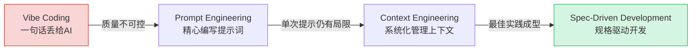
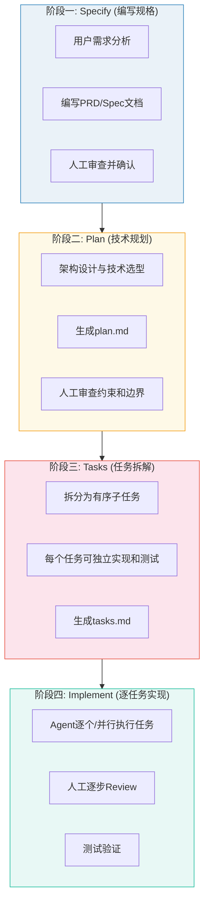
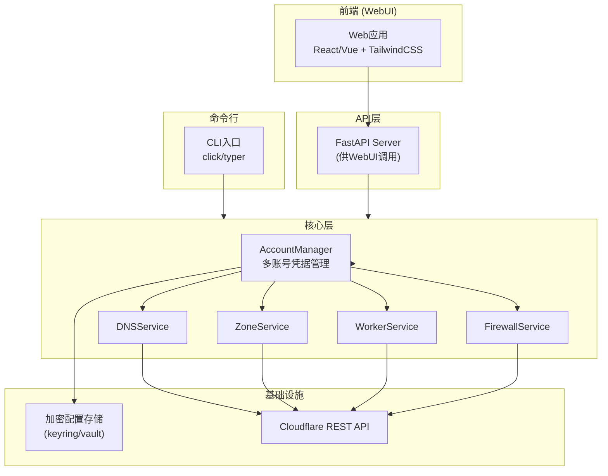
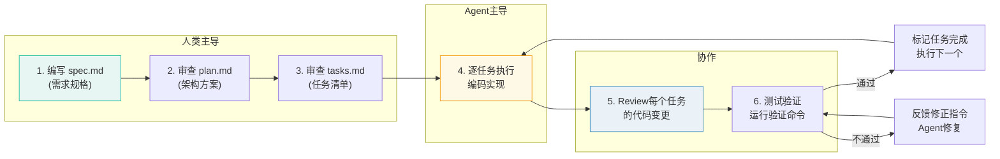

[toc]


## 核心观点先行

> 一句话结论: **不要把整个需求一股脑丢给AI Agent。** 2025年行业已从"**Vibe Coding**(凭感觉编码)"转向"**Context Engineering**(上下文工程)"和"**Spec-Driven Development**(规格驱动开发)"——人类负责**设计规格和工程上下文**, Agent负责**按规格生成代码**。



2025年软件开发行业经历了一次实时实验,AI的软件工程能力在不断接受检验,从年初的"Vibe Coding"逐步转向被称为"Context Engineering"的系统化方法,表明人类开发者仍然绝对关键。 Gartner在2025年的研究中也将上下文工程(Context Engineering)识别为AI应用开发的关键范式转变。

---

## 方法论全景: 从需求到交付的四阶段工作流

一种四阶段模式已在主流AI平台中浮现: **Specify → Plan → Tasks → Implement**(规格 → 计划 → 任务 → 实现),每个阶段都有明确的依赖关系、可测试的产出和有界的范围。



### 为什么不能一步到位?

AI编码助手面临的核心问题是**上下文问题**: IDE集成的助手只能访问几个打开的文件和当前的提示,但它缺乏人类开发者在数月间积累的关于项目约定和先前决策的跨领域知识。 更好的策略是**迭代聚焦**,行业实践指南建议将复杂需求分解为顺序的、简单的指令。

对于"Cloudflare多账号管理系统"这类涉及**多模块**(CLI + WebUI)、**多关注点**(认证、DNS、WAF、Workers等)、**跨层**(后端API封装 + 前端UI)的项目,如果一个提示词就把所有需求塞进去,Agent会:

- **上下文溢出**: 关键约束被淹没在大量文本中
- **架构失控**: 缺乏全局一致性,各模块风格迥异
- **难以验证**: 产出物太大,无法有效Review
- **错误级联**: 一处失误引发连锁问题

---

## 阶段一: Specify — 编写项目规格(最关键的人类工作)

**PRD**(Product Requirement Document,产品需求文档)用于描述"构建什么"和"为什么": 用户故事、验收标准和成功指标。 应将规格视为"可执行的工件(Executable Artifacts)"并与版本控制和CI/CD绑定。

### 规格文档的结构模板

以Cloudflare多账号管理系统为例,一份`spec.md`应包含以下章节:

| 章节           | 内容说明                         | 示例要点                                                     |
| -------------- | -------------------------------- | ------------------------------------------------------------ |
| **项目概述**   | 一段话说明系统目标、用户群体     | "面向管理多个Cloudflare账号的运维人员,提供CLI和WebUI两种操作方式" |
| **用户故事**   | "作为X,我希望Y,以便Z"的格式      | "作为运维人员,我希望批量查看所有账号下的Zone列表,以便快速定位域名" |
| **功能需求**   | 分模块列举,标注优先级(P0/P1/P2)  | P0: 多账号管理、Zone列表; P1: DNS批量操作; P2: Workers部署   |
| **非功能需求** | 性能、安全、兼容性约束           | "API Token以加密方式存储,禁止明文写入配置文件"               |
| **技术约束**   | 指定技术栈、Python版本、依赖限制 | "Python 3.11+, 使用Cloudflare官方SDK `cloudflare` 包"        |
| **UI/UX需求**  | 设计风格、响应式要求             | "现代化暗色/亮色主题切换,移动端断点≤768px自适应"             |
| **验收标准**   | 每个功能的通过/失败判定条件      | "`cf-manager zones list --account all`能在5秒内返回所有账号的Zone" |
| **边界与排除** | 明确不做什么                     | "不实现Cloudflare账号注册功能,不处理账单相关API"             |

### 技术选型中的Cloudflare SDK说明

Cloudflare官方Python库提供了对Cloudflare REST API的便捷访问,支持Python 3.9+,包含所有请求参数和响应字段的类型定义,同时提供同步和异步客户端。

该SDK支持自动分页迭代器,例如`client.accounts.list()`会自动获取后续分页。 使用示例:

```python
from cloudflare import Cloudflare

client = Cloudflare(
    api_token="YOUR_API_TOKEN",  # 建议通过环境变量注入
)
# 自动分页遍历所有账号
for account in client.accounts.list():
    print(account.id, account.name)
```

SDK的Accounts资源提供了`create`、`delete`、`get`、`list`等方法,其中`list`返回`SyncV4PagePaginationArray[Account]`分页数组。

> **注意**: 旧版`python-cloudflare`(v4包装器)已**归档(Archived)**并标注为`DEPRECATED`,应使用`cloudflare/cloudflare-python`这个新的官方维护仓库。

在规格中明确指定SDK:

```markdown
## 技术约束
- Python SDK: `cloudflare` (官方库, github.com/cloudflare/cloudflare-python)
- 禁止使用已废弃的 `python-cloudflare` 包
- 认证方式: API Token (非 Global API Key), 通过环境变量 `CLOUDFLARE_API_TOKEN` 注入
```

---

## 阶段二: Plan — 架构与技术规划

这一阶段由**人与Agent协作**完成。你向Agent提供`spec.md`,要求它生成`plan.md`(技术实施方案),然后**人工审查**架构决策。

### 系统架构示意

以下是Cloudflare多账号管理系统的参考架构:



### `plan.md`中应包含的技术决策

| 决策项        | 推荐方案                                      | 理由                                                         |
| ------------- | --------------------------------------------- | ------------------------------------------------------------ |
| **CLI框架**   | `typer` (基于`click`)                         | 自动生成help文档,类型安全,Pythonic                           |
| **WebUI后端** | `FastAPI`                                     | 异步支持好,自动OpenAPI文档,与`cloudflare` SDK的async客户端配合 |
| **WebUI前端** | React + TailwindCSS + shadcn/ui 或 Vue + Nuxt | 现代化组件库,响应式原生支持                                  |
| **凭据存储**  | `keyring`库 + 可选环境变量                    | 跨平台安全存储,避免明文配置                                  |
| **项目结构**  | `src/`布局,分`core/`、`cli/`、`api/`、`web/`  | 关注点分离,CLI和WebUI共享核心层                              |
| **包管理**    | `uv` 或 `pdm`                                 | 现代Python包管理,lockfile保证一致性                          |
| **测试框架**  | `pytest` + `pytest-asyncio`                   | 标准选择,支持异步测试                                        |

### 项目目录结构示例

```
cf-manager/
├── AGENTS.md                    # AI Agent指令文件
├── spec.md                      # 项目规格
├── plan.md                      # 技术方案
├── tasks.md                     # 任务清单
├── pyproject.toml
├── src/
│   └── cf_manager/
│       ├── __init__.py
│       ├── core/                # 核心业务逻辑 (CLI和API共用)
│       │   ├── account.py       # 多账号凭据管理
│       │   ├── zone.py          # Zone操作服务
│       │   ├── dns.py           # DNS记录操作
│       │   ├── worker.py        # Workers管理
│       │   └── firewall.py      # WAF/防火墙规则
│       ├── cli/                 # CLI入口
│       │   ├── __init__.py
│       │   └── main.py          # typer命令定义
│       ├── api/                 # FastAPI后端
│       │   ├── __init__.py
│       │   ├── main.py
│       │   └── routes/
│       └── web/                 # 前端静态资源 (或独立前端项目)
├── tests/
│   ├── test_core/
│   ├── test_cli/
│   └── test_api/
└── docs/
    └── usage.md
```

---

## 阶段三: Tasks — 任务拆解(Agent可协助,人必须审)

Agent将规格和计划拆分为实际工作——小的、可审查的代码块,每个任务都可以独立实现和测试。例如,不应写"构建认证功能",而是拆分为具体任务如"创建一个验证邮箱格式的用户注册端点"。

### 任务拆解示例(部分)

以下展示`tasks.md`的片段结构(以Cloudflare管理系统为例):

**Task 1: 项目初始化与基础配置**
- 创建`pyproject.toml`,配置`uv`或`pdm`,添加`cloudflare`、`typer`、`fastapi`、`uvicorn`依赖
- 创建项目目录结构(按`plan.md`中的布局)
- 配置`ruff`(linter + formatter)和`pyright`(类型检查)
- 验证信号: `uv run python -c "from cf_manager import __version__; print(__version__)"` 正常输出

**Task 2: 多账号凭据管理核心模块**
- 实现`AccountManager`类: 支持增删改查账号凭据
- Token加密存储(使用`keyring`)
- 配置文件`~/.cf-manager/accounts.yaml`仅存储账号别名和ID,不存Token
- 验证信号: `pytest tests/test_core/test_account.py` 全部通过

**Task 3: Zone列表查询服务**
- 实现`ZoneService.list_zones(account_id)`
- 支持传入"all"以并发查询所有账号
- 使用`AsyncCloudflare`客户端实现并发
- 验证信号: 集成测试用mock通过

**Task 4: CLI - 账号管理命令**
- `cf-manager account add <alias> --token <token>` 
- `cf-manager account list`
- `cf-manager account remove <alias>`
- 验证信号: `cf-manager account list` 输出已添加账号的表格

...(后续任务按类似粒度继续)

最佳实践是将每一步执行聚焦在任务清单中的**单一子项**,每次使用一个干净的Agent会话。这有助于锚定Agent的注意力并大幅缩小Agent需要理解的范围。

---

## 工程上下文: `AGENTS.md`的规范编写

以上三个阶段的产出物(`spec.md`、`plan.md`、`tasks.md`)构成了Agent工作时的**知识库**。但Agent还需要一份**持久化的行为指令**——这就是`AGENTS.md`的角色。

`AGENTS.md`是一个开放规范,用于在仓库根目录以单个markdown文件的形式向AI编码Agent提供指令。可以将它视为"给机器读的README": 人类读`README.md`,Agent读`AGENTS.md`。

**如果团队使用多种AI编码工具,应以`AGENTS.md`为主要规范来源。** 如果全面使用Claude Code,可将`AGENTS.md`与Claude Skills结合使用。如果纯用Cursor,应将旧的`.cursorrules`迁移到`.cursor/rules/`目录。

### `AGENTS.md`与其他指令文件的关系

通常为了让编码助手更好工作并输出更高质量的代码,需要在项目中提供指令文件。例如`.cursor/rules`、`.clinerules`、`.github/copilot-instructions.md`、`claude.md`、`gemini.md`等。

| 文件                              | 适用工具                                 | 特点                                                        |
| --------------------------------- | ---------------------------------------- | ----------------------------------------------------------- |
| **`AGENTS.md`**                   | Cursor, Claude Code, Codex等(多工具通用) | 纯Markdown,无需前置元数据(Frontmatter),**推荐作为统一规范** |
| `.cursor/rules/*.md`              | 仅Cursor                                 | 支持glob模式按目录/文件类型匹配,需要YAML frontmatter        |
| `CLAUDE.md`                       | Claude Code                              | Claude专用,Cursor CLI也会读取                               |
| `.github/copilot-instructions.md` | GitHub Copilot                           | Copilot专用                                                 |

Cursor还支持**嵌套的`AGENTS.md`**: 可以在子目录放置各自的`AGENTS.md`文件(如`frontend/AGENTS.md`、`backend/AGENTS.md`),子目录指令与父目录合并,更具体的指令优先。

### `AGENTS.md`核心编写原则

有效的`AGENTS.md`遵循以下原则: **简单结构**——纯Markdown加清晰章节,无需YAML前置元数据; **代码示例优于解释**——用真实代码片段展示期望输出; **明确指定技术栈**——包含版本和关键依赖; **按主题组织**——使用清晰标题如Code Style、Architecture、Testing; **保持简洁**——聚焦于项目特有的关键规则。

实践建议: 保持`AGENTS.md`小而聚焦;以**具体示例和文件路径**引导;给出文件级别的类型检查、格式化、lint和测试命令;当你**第二次看到Agent犯同一个错误**时,就把规则加进去。

### 示例: Cloudflare管理系统的`AGENTS.md`

```markdown
## 项目概述

基于Cloudflare官方Python SDK的多账号批量管理系统。
详见 spec.md (规格)、plan.md (方案)、tasks.md (任务清单)。

## 命令

- `uv run ruff check .`: Lint检查
- `uv run ruff format .`: 代码格式化
- `uv run pyright`: 类型检查
- `uv run pytest`: 运行全部测试
- `uv run pytest tests/test_core/test_account.py`: 运行单文件测试

每次修改代码后, 必须先运行 lint 和类型检查再提交。

## 代码风格

- Python 3.11+, 使用类型注解(Type Hints)
- 使用 `ruff` 作为 linter 和 formatter (配置见 pyproject.toml)
- 使用 `pyright` 做类型检查, strict模式
- 优先使用 `async/await` 与 `AsyncCloudflare` 客户端
- 导入排序: 标准库 → 第三方 → 本项目, 由ruff自动处理
- docstring风格: Google style

## 架构规则

- CLI 和 WebUI 共用 `src/cf_manager/core/` 下的服务层, 禁止在 cli/ 或 api/ 中直接调用 Cloudflare SDK
- 所有 Cloudflare API 调用必须通过对应的 Service 类封装
- API Token 绝不允许硬编码或以明文存储
- 参考 `src/cf_manager/core/zone.py` 作为 Service 类的标准写法

## 错误处理

- Cloudflare API 异常统一通过 `cf_manager.core.exceptions` 模块的自定义异常类包装
- CLI 层捕获异常并输出 `rich` 格式化的错误信息
- API 层捕获异常并返回结构化 JSON 错误响应

## 测试

- 每个 Service 类必须有对应的单元测试
- 使用 `pytest-httpx` 或 `respx` mock HTTP请求, 禁止在测试中发起真实 API 调用
- 测试文件命名: `test_<module>.py`

## 禁止事项

- 不要使用已废弃的 `python-cloudflare` 包
- 不要使用 Global API Key 认证方式
- 不要在 core/ 层引入 CLI 或 Web 框架的依赖
- 不要使用 `print()` 做日志输出, 使用 `logging` 模块
```

---

## 面向AI Coding Agent的提示词设计规范

上文讲了**流程**(四阶段)和**持久上下文**(`AGENTS.md`),下面聚焦于你**每次与Agent交互时的提示词**怎么写。

### 提示词的结构化公式

最好的提示词是那些**最小化模型猜测空间**的提示词,明确定义任务、上下文、期望格式和语气。

指令层应当清晰直接——追求精确和朴素的语言,就像一个被最少程度简报过的同事也能看懂并执行的那种。

一个高质量的编码提示词应包含以下结构:

| 要素                   | 说明                        | 反面示例          | 正面示例                                                     |
| ---------------------- | --------------------------- | ----------------- | ------------------------------------------------------------ |
| **角色(Role)**         | 告知Agent它的身份和专业领域 | (不设定)          | "你是一个精通Python和Cloudflare API的后端工程师"             |
| **上下文(Context)**    | 指向已有的规格和约定文件    | "帮我写个程序"    | "参考 @spec.md 和 @plan.md 中的架构定义"                     |
| **任务(Task)**         | 一个明确、有边界的具体动作  | "实现DNS管理功能" | "实现`DNSService.list_records(zone_id)`方法,返回指定Zone下所有DNS记录的列表" |
| **约束(Constraints)**  | 技术限制和禁令              | (不设定)          | "使用`AsyncCloudflare`客户端,不要阻塞事件循环"               |
| **输出格式(Format)**   | 期望的交付物形式            | (让Agent自由发挥) | "修改`src/cf_manager/core/dns.py`,并更新`tests/test_core/test_dns.py`" |
| **验证(Verification)** | 怎么判断做对了              | (不说明)          | "完成后运行`uv run pytest tests/test_core/test_dns.py -v`确认测试通过" |

像"写得好一点"这种指令对现代生产级Agent来说**过于模糊**。你需要明确到"永远不要捏造缺失的工具参数"或"没有经过验证的标识符不要执行账号操作"这种程度。

### 完整提示词示例

以下是一个规范的、针对"实现DNS记录批量操作"任务的提示词(适用于Cursor Agent、Claude Code等):

````markdown
## 任务: 实现DNS记录批量导出功能

### 上下文
- 项目规格见 @spec.md 第3.2节 "DNS管理"
- 架构约定见 @plan.md, 所有Cloudflare调用通过 core/ 层的Service类
- 参考 `src/cf_manager/core/zone.py` 中 `ZoneService` 的实现模式

### 需求
1. 在 `src/cf_manager/core/dns.py` 中为 `DNSService` 添加 `export_records(zone_id: str) -> list[DNSRecord]` 方法
2. 支持通过 `account_alias` 参数自动解析对应的API Token (通过 `AccountManager`)
3. 使用 `AsyncCloudflare` 客户端, 利用 `client.dns.records.list()` 自动分页获取全部记录
4. 返回类型使用项目自定义的 `DNSRecord` dataclass (定义在 `src/cf_manager/core/models.py`)

### 约束
- 不要直接实例化 `Cloudflare` 客户端, 通过 `AccountManager.get_client(alias)` 获取
- 异常处理: 网络错误抛出 `CloudflareAPIError`, Zone不存在抛出 `ZoneNotFoundError`
- 不要修改 `AccountManager` 现有接口

### 交付物
- 修改: `src/cf_manager/core/dns.py`
- 新增/修改: `src/cf_manager/core/models.py` (如需新增 `DNSRecord`)
- 新增: `tests/test_core/test_dns_export.py`

### 验证
```bash
uv run pyright src/cf_manager/core/dns.py
uv run pytest tests/test_core/test_dns_export.py -v
```
````

### 常见反模式与纠正

| 反模式                         | 问题                                     | 改进方式                                                     |
| ------------------------------ | ---------------------------------------- | ------------------------------------------------------------ |
| "帮我写一个Cloudflare管理工具" | 范围无限大,Agent会自由发挥出不可控的架构 | 先完成Specify和Plan阶段,再逐个Task交给Agent                  |
| 把所有需求放在一个巨大prompt里 | 上下文窗口被浪费,后面的指令被"遗忘"      | 不要写一份包含300个需求的巨型规格,而是结构化为5-6个阶段,每个阶段30-50个需求 |
| 不指定验证方式                 | Agent认为自己完成了,但实际有bug          | 每个任务都附带`验证信号`(一条可运行的命令)                   |
| 不引用已有代码作为范例         | Agent猜测你的代码风格                    | 将Agent锚定到一个参考应用(Reference Application),为Agent提供上下文基准 |
| 一次性修改大量文件             | 难以Review,容易引入regression            | Agent逐个任务执行,你Review聚焦的变更而不是几千行的代码dump   |

---

## 工具生态: PRD/Spec模板工具

**GitHub Spec Kit**的Specify CLI能生成`constitution.md`(不可协商的项目原则)、`spec.md`(用户故事和功能需求)、`plan.md`(技术策略)和`tasks.md`(有序任务分解),Agent通过`/speckit.specify`、`/speckit.plan`等命令驱动各阶段。

**BMAD-METHOD**(约49,500 stars)提供12+领域专家Agent和34+工作流。其模式是: PM类Agent起草PRD,Architect类Agent生成架构文档,规划输出被拆分为离散的开发故事,由Implementation Agent执行。

**ai-dev-tasks**是一个更轻量的方案,其核心流程是: 用PRD明确定义构建范围,将PRD分解为细粒度、可执行的任务列表,然后引导AI逐任务执行,每步变更可由人工Review和批准。

| 工具                         | 复杂度 | 适用场景                      | 链接                              |
| ---------------------------- | ------ | ----------------------------- | --------------------------------- |
| **GitHub Spec Kit**          | 中     | 团队级项目,与GitHub工作流集成 | github.com/github/spec-kit        |
| **BMAD-METHOD**              | 高     | 大型项目,需要多Agent协作      | GitHub搜索"BMAD-METHOD"           |
| **ai-dev-tasks**             | 低     | 个人或小项目,快速上手         | github.com/snarktank/ai-dev-tasks |
| **手写 spec + plan + tasks** | 可控   | 任何规模,最灵活               | 遵循上文模板即可                  |

对于初学者,**推荐从`ai-dev-tasks`的轻量流程入手**,或者按本文的模板**手写三件套**(spec.md → plan.md → tasks.md),掌握原理后再引入更复杂的框架。

---

## WebUI现代化设计的提示词策略

对于"现代化高审美"和"响应式设计"的WebUI需求,单靠文字描述Agent很难理解你的审美标准。推荐以下策略:

- **指定设计系统**: 在`AGENTS.md`或提示词中明确指定使用成熟的组件库(如**shadcn/ui** + **TailwindCSS**,或**Ant Design**,或**Element Plus**),而不是让Agent从零写CSS
- **提供设计参考**: 可以将设计稿(Mockup)截图粘贴给Agent,要求按图实现
- **分离UI任务**: 前端页面逐页面作为独立Task,每个页面明确列出组件需求和响应式断点
- **指定断点**: 直接写明`sm:640px / md:768px / lg:1024px / xl:1280px`(TailwindCSS默认断点)
- **主题方案**: "使用TailwindCSS的`dark:`变体实现暗色模式,默认跟随系统偏好`prefers-color-scheme`"

示例提示词片段:

```markdown
## WebUI技术栈约束
- 使用 React 18 + TypeScript + TailwindCSS 4 + shadcn/ui
- 颜色主题: 支持亮色/暗色切换, 使用 CSS变量 方案 (参考 shadcn/ui 默认主题)
- 响应式: 移动优先(Mobile-first), 断点使用 TailwindCSS 默认值
- 布局: 桌面端使用侧边栏导航, 移动端折叠为汉堡菜单
- 数据表格: 使用 @tanstack/react-table, 支持排序/筛选/分页
- 参考设计风格: Vercel Dashboard / Cloudflare Dashboard 的简洁现代风格
```

---

## 网络环境与跨平台注意事项

### 国内网络环境

Cloudflare的API(`api.cloudflare.com`)在国内可以**直接访问**(Cloudflare本身在国内有节点),SDK正常使用无需代理。但以下场景可能需要注意:

- **安装依赖**: `pip install cloudflare`从PyPI安装,国内可配置清华镜像源加速:
  ```bash
  pip install cloudflare -i https://pypi.tuna.tsinghua.edu.cn/simple
  ```
- **GitHub资源**: 项目模板或参考仓库可通过`gh-proxy.com`加速:
  ```bash
  git clone https://gh-proxy.com/https://github.com/cloudflare/cloudflare-python.git
  ```
- **前端npm依赖**: 使用淘宝镜像`npmmirror.com`:
  ```bash
  npm config set registry https://registry.npmmirror.com
  ```

### 跨平台差异

| 关注点            | Windows                                                      | Linux/macOS                                       |
| ----------------- | ------------------------------------------------------------ | ------------------------------------------------- |
| **Python调用**    | `py -3` 或 `python`                                          | `python3`                                         |
| **`keyring`后端** | Windows Credential Locker(自动)                              | 需安装`secretstorage`(Linux)或默认Keychain(macOS) |
| **路径分隔符**    | `\`(但Python `pathlib`已封装)                                | `/`                                               |
| **换行符**        | 配置`.gitattributes`统一为LF                                 | 原生LF                                            |
| **环境变量设置**  | `set CLOUDFLARE_API_TOKEN=xxx`(cmd)或`$env:CLOUDFLARE_API_TOKEN="xxx"`(PowerShell) | `export CLOUDFLARE_API_TOKEN=xxx`                 |

在`AGENTS.md`中应加上:

```markdown
## 跨平台
- 使用 `pathlib.Path` 处理所有文件路径, 禁止硬编码 "/" 或 "\"
- 配置文件目录: 使用 `platformdirs` 库获取用户配置目录
- 换行符: 项目根目录 .gitattributes 设置 `* text=auto eol=lf`
- 脚本头部: 使用 `#!/usr/bin/env python3`
```

---

## 总结: 完整工作流一览



**核心要点回顾**:

1. **先规格,后编码**: 花时间写好`spec.md`是回报率最高的投入,它是所有后续工作的根基
2. **分阶段,有门控**: 每个阶段有明确的产出物和人工审查点,不要跳过
3. **任务粒度要小**: 每个Task应该是可以独立实现、独立测试、独立Review的最小单元
4. **持久化上下文**: 用`AGENTS.md`把项目规范固化,Agent不需要每次重新理解
5. **验证信号必备**: 每个任务附带可执行的验证命令,让Agent和人类都能判断"做对了没"
6. **迭代添加规则**: 当你第二次看到Agent犯同一个错误时,就把对应规则加入`AGENTS.md`

> **核心思维转变**: 与AI Coding Agent协作,你的角色从"写代码的人"转变为"**写规格的人**+**审代码的人**"。你的首要职责是**引导(Steer)**,编码Agent完成大量的编写工作。 Agent知道要构建什么(规格)、如何构建(计划)、和当前要做什么(任务)。关键在于你在每个阶段进行验证: 规格是否捕捉了你的意图?计划是否考虑了约束?是否有Agent遗漏的边界情况?