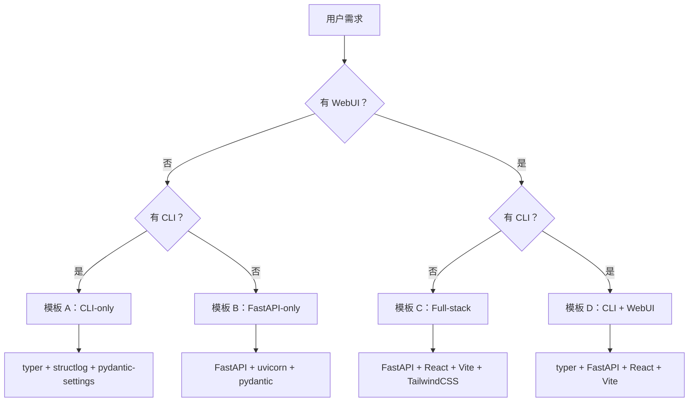
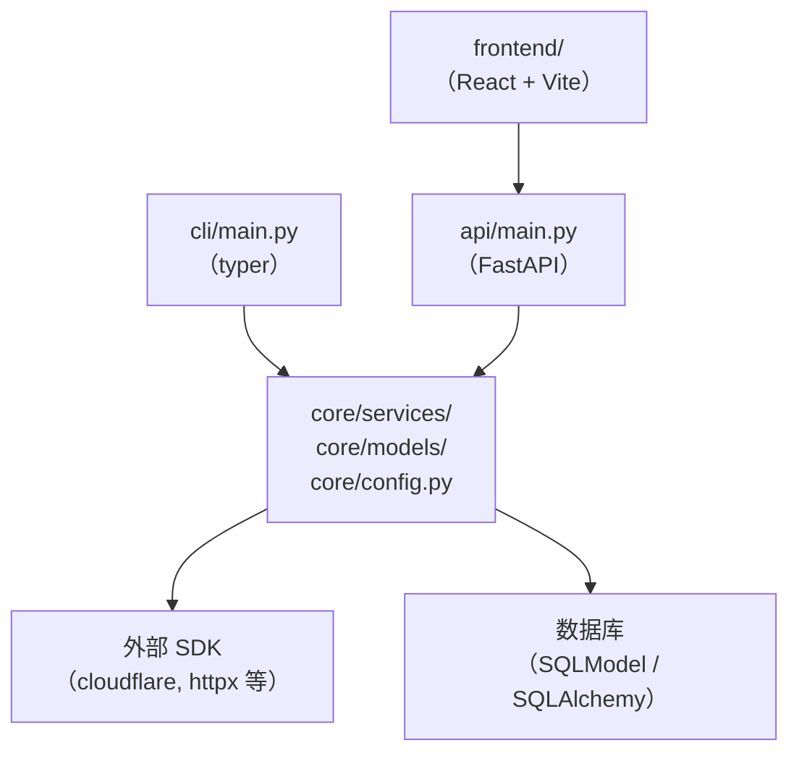

[toc]


---

## 目录结构总览

```
~/.claude/skills/modern-app-builder/
├── SKILL.md
├── references/
│   ├── tech-stack-guide.md
│   ├── project-templates.md
│   ├── code-conventions.md
│   ├── ui-design-guide.md
│   └── checklist.md
└── assets/
    ├── pyproject-template.toml
    ├── gitattributes-template
    └── agents-template.md
```

---

## `SKILL.md`

```markdown
---
name: modern-app-builder
description: >
  从零搭建现代化应用项目的脚手架技能。当用户说"创建新项目"、"搭建现代应用"、
  "初始化 CLI 工具"、"构建 Web 应用"、"新建 Python 项目"、"帮我建一个管理系统"、
  "scaffold a new app"、"create a CLI tool"、"start a new project"，
  或任何描述从零开始创建应用的意图时触发。
  适用范围：CLI 工具（typer/click）、独立脚本、FastAPI 后端服务、
  前后端全栈应用（FastAPI + React/Vue），或上述组合。
  产物：项目目录结构、pyproject.toml、AGENTS.md、.gitattributes、
  基础源文件、开发环境启动命令、任务清单。
---

# Modern App Builder — 现代应用脚手架技能

## 技能目标

引导用户完成现代跨平台应用的完整脚手架搭建，覆盖从需求澄清、技术选型、
目录结构生成、配置文件输出到开发环境启动的全流程。
每个阶段均要求人工确认后再推进，不得跳过。

---

## Phase 0 — 需求澄清（Clarify）

在生成任何文件之前，必须向用户提问以下问题。
若用户已在请求中明确回答某项，则跳过该项。
**所有问题一次性集中输出，不得逐条追问。**

```
我需要了解以下信息，以便为你生成最合适的项目结构：

1. **项目类型**：CLI 工具 / FastAPI 后端 / 前后端全栈 / CLI + WebUI 组合？
2. **主要语言**：Python / TypeScript / 其他？
3. **项目名称**：用于目录名、包名、CLI 命令名（建议 kebab-case，如 my-app）。
4. **Python 版本**：3.11 / 3.12 / 3.13？（默认 3.12）
5. **包管理器**：uv（推荐）/ pip / poetry？
6. **前端框架**（如有 WebUI）：React + Vite / Vue 3 + Vite / 其他？
7. **跨平台要求**：是否需要在 Windows 上运行？
8. **初始功能**：简述 2~5 个核心功能，帮助生成初始任务清单。

收到回答后，输出一份**确认摘要**（Confirmation Summary），格式如下，
请用户确认后再进入 Phase 1。

| 项目 | 确认值 |
|---|---|
| 项目名称 | `{name}` |
| 项目类型 | `{type}` |
| Python 版本 | `{python_version}` |
| 包管理器 | `{pkg_manager}` |
| 前端框架 | `{frontend}` 或 无 |
| 跨平台 | 是 / 否 |
| 核心功能 | {features_summary} |

---

## Phase 1 — 技术选型（Tech Stack Decision）

加载 `references/tech-stack-guide.md`，根据 Phase 0 的确认结果，
输出本项目的**最终技术选型表**。

说明每项选择的理由（1~2 句），并标注是否有国内镜像或替代方案。
若用户的选择与推荐方案存在冲突，列出利弊后询问用户最终决定。

---

## Phase 2 — 目录结构生成（Project Structure）

加载 `references/project-templates.md`，按项目类型选择对应模板：

- **模板 A**：仅 CLI（CLI-only）
- **模板 B**：仅 FastAPI 后端（Backend-only）
- **模板 C**：前后端全栈（Full-stack，FastAPI + React/Vue）
- **模板 D**：CLI + WebUI 组合（Combined）

以带注释的目录树形式输出完整结构，每个关键目录/文件附一行中文说明。
输出后请用户确认结构，可根据反馈调整。

---

## Phase 3 — 文件生成（Bootstrap Files）

按顺序生成以下文件，每个文件单独输出为完整代码块，
标注文件路径，不得省略内容：

1. `pyproject.toml` — 加载 `assets/pyproject-template.toml` 并填充
2. `.gitattributes` — 加载 `assets/gitattributes-template`
3. `.python-version` — 写入 Python 版本号
4. `src/{pkg_name}/__init__.py` — 包初始化，含 `__version__`
5. `src/{pkg_name}/cli/main.py` — CLI 入口（如有 CLI）
6. `src/{pkg_name}/api/main.py` — FastAPI 入口（如有 WebUI/API）
7. `src/{pkg_name}/core/config.py` — 配置模型（`pydantic-settings`）
8. `AGENTS.md` — 加载 `assets/agents-template.md` 并填充项目信息
9. `README.md` — 项目简介、安装步骤、快速开始

**架构硬约束（生成代码时强制遵守）：**
- `core/` 层只含纯业务逻辑，**禁止**导入 `typer`、`fastapi` 等框架模块。
- CLI 层和 API 层均只从 `core/` 导入，不得互相引用。
- 第三方 SDK 调用（如 Cloudflare SDK）必须封装在 `core/services/` 内的 Service 类中。
- 日志统一使用 `structlog`，**禁止**使用裸 `print()`。
- 路径操作统一使用 `pathlib.Path`，**禁止**硬编码路径分隔符。
- 跨平台用户配置目录使用 `platformdirs.user_config_dir()`。
- 凭据存储使用 `keyring`，**禁止**明文写入配置文件。

---

## Phase 4 — 开发环境启动（Dev Environment Bootstrap）

根据包管理器和跨平台要求，输出启动命令。
**同时提供 bash/zsh 版本和 PowerShell 版本**（如需跨平台）。

### 使用 uv（推荐）

**bash/zsh：**
```bash
# 创建项目并进入目录
uv init {name} && cd {name}

# 同步依赖（自动创建虚拟环境）
uv sync

# 安装开发依赖
uv add --dev ruff pyright pytest pytest-asyncio

# 运行 CLI（示例）
uv run {name} --help

# 运行 FastAPI 开发服务器（示例）
uv run uvicorn src.{pkg_name}.api.main:app --reload
```

**PowerShell：**
```powershell
uv init {name}; Set-Location {name}
uv sync
uv add --dev ruff pyright pytest pytest-asyncio
uv run {name} --help
uv run uvicorn src.{pkg_name}.api.main:app --reload
```

### 前端（如有，使用 Vite）

**bash/zsh：**
```bash
cd frontend
npm install   # 国内可用：npm install --registry https://registry.npmmirror.com
npm run dev
```

**PowerShell：**
```powershell
Set-Location frontend
npm install --registry https://registry.npmmirror.com
npm run dev
```

---

## Phase 5 — 验证清单（Validation Checklist）

加载 `references/checklist.md`，逐项输出检查结果。
对每项标注 ✅ 已完成 / ⚠️ 待处理 / ❌ 未满足，并给出说明。

---

## 禁止事项（Forbidden List）

以下行为在本 Skill 生成的任何内容中均**严格禁止**：

- 使用已归档的 `python-cloudflare` 包（应使用官方 `cloudflare` SDK）。
- 使用 Cloudflare Global API Key（必须使用 scoped API Token）。
- 在 `core/` 层导入任何 CLI 或 Web 框架模块。
- 使用裸 `print()` 作为日志输出。
- 生成文件中使用 CRLF 行尾（`.bat` 除外）。
- 在未获得用户明确同意的情况下添加生产依赖。
- 将 `.env` 文件或任何含密钥的文件提交到 Git 仓库。
- 使用硬编码路径分隔符（`\\` 或 `/`）替代 `pathlib.Path`。

---

## `references/tech-stack-guide.md`

# 技术选型参考指南（Tech Stack Reference Guide）

本文件由 Phase 1 按需加载，不在 SKILL.md 主流程中全量占用上下文。

---

## Python 后端核心栈

| 关注点 | 推荐选择 | 备注 |
|---|---|---|
| CLI 框架 | `typer` | 基于类型注解，自动生成帮助文档 |
| Web 框架 | `fastapi` + `uvicorn` | 异步原生，OpenAPI 自动生成 |
| 数据验证 | `pydantic` v2 | FastAPI 内置依赖 |
| 配置管理 | `pydantic-settings` | 支持 `.env`、环境变量、多层覆盖 |
| 凭据存储 | `keyring` | 跨平台系统密钥环；中国大陆可正常安装 |
| 日志 | `structlog` | 结构化 JSON 日志，替代 `logging` |
| HTTP 客户端 | `httpx` | 同步/异步均支持，替代 `requests` |
| 任务队列 | `arq`（轻量）/ `celery`（重量） | 按规模选择 |
| 数据库 ORM | `sqlmodel`（简单）/ `sqlalchemy` 2.x（复杂） | 视数据复杂度选择 |
| 测试 | `pytest` + `pytest-asyncio` | `anyio` 后端 |
| 类型检查 | `pyright`（strict 模式） | 优于 `mypy` 的性能 |
| Lint/格式化 | `ruff` | 替代 `flake8` + `black` + `isort` |
| 包管理 | `uv` | 速度快，支持 workspace；推荐首选 |
| 路径工具 | `pathlib.Path` + `platformdirs` | 跨平台必须 |

---

## Python 版本选择

| 版本 | 状态 | 推荐场景 |
|---|---|---|
| 3.13 | 最新稳定 | 新项目首选，JIT 性能提升 |
| 3.12 | 稳定，生态最成熟 | 保守选择，依赖兼容性最佳 |
| 3.11 | LTS，仍受支持 | 需兼容旧环境时使用 |
| ≤ 3.10 | 不推荐 | 缺少 `tomllib`、`match` 等现代特性 |

---

## 前端栈（Full-stack / WebUI 场景）

| 关注点 | 推荐选择 | 备注 |
|---|---|---|
| 构建工具 | `vite` 6.x | 极速 HMR，ES module 原生 |
| UI 框架 | React 18 + TypeScript | 生态最大；备选：Vue 3 + TypeScript |
| 样式 | TailwindCSS v4 | CSS-first 配置，无需 JS 配置文件 |
| 组件库 | `shadcn/ui` | 组件代码直接拷入项目，可完全自定义 |
| 状态管理 | `zustand`（轻量）/ `jotai`（原子化） | 避免 Redux 复杂度 |
| 路由 | `react-router` v7 | 支持 loader/action 模式 |
| 表格 | `@tanstack/react-table` | 排序、筛选、分页、虚拟化 |
| 图表 | `recharts` | 轻量，基于 SVG |
| 请求 | `@tanstack/react-query` v5 | 缓存、重试、乐观更新 |
| 表单 | `react-hook-form` + `zod` | 类型安全校验 |
| 图标 | `lucide-react` | Shadcn 生态默认图标集 |

---

## 国内镜像与替代方案

| 工具 | 镜像/加速地址 |
|---|---|
| PyPI | `https://pypi.tuna.tsinghua.edu.cn/simple`（清华） |
| npm | `https://registry.npmmirror.com` |
| GitHub 文件下载 | `https://gh-proxy.com/{原始 URL}` |
| Docker Hub | `docker.nju.edu.cn` / `docker.mirrors.sjtug.sjtu.edu.cn` |
| Cloudflare API | `api.cloudflare.com`，中国大陆直连无需代理 |

**uv 配置国内 PyPI 镜像：**
在项目 `pyproject.toml` 中添加：
```toml
[[tool.uv.index]]
url = "https://pypi.tuna.tsinghua.edu.cn/simple"
default = true
```

或通过环境变量：
```bash
export UV_INDEX_URL="https://pypi.tuna.tsinghua.edu.cn/simple"
```

---

## 技术选型决策树



---

## `references/project-templates.md`

# 项目目录结构模板（Project Structure Templates）

本文件由 Phase 2 按需加载。

---

## 模板 A — 仅 CLI（CLI-only）

{name}/
├── .gitattributes          # 行尾规范（LF）
├── .python-version         # Python 版本锁定
├── .env.example            # 环境变量示例（不提交真实值）
├── pyproject.toml          # 项目元数据、依赖、工具配置
├── AGENTS.md               # Agent 持久化指令（跨工具）
├── README.md
├── src/
│   └── {pkg_name}/
│       ├── __init__.py     # 包入口，定义 __version__
│       ├── cli/
│       │   ├── __init__.py
│       │   └── main.py     # typer App 定义，CLI 命令注册
│       └── core/
│           ├── __init__.py
│           ├── config.py   # pydantic-settings 配置模型
│           ├── models.py   # 业务数据模型（纯 Pydantic）
│           └── services/   # 业务逻辑、外部 SDK 封装
│               └── __init__.py
└── tests/
    ├── __init__.py
    ├── conftest.py
    └── test_core/
        └── __init__.py


---

## 模板 B — 仅 FastAPI 后端（Backend-only）

{name}/
├── .gitattributes
├── .python-version
├── .env.example
├── pyproject.toml
├── AGENTS.md
├── README.md
├── src/
│   └── {pkg_name}/
│       ├── __init__.py
│       ├── api/
│       │   ├── __init__.py
│       │   ├── main.py     # FastAPI app 实例，路由挂载
│       │   ├── deps.py     # 依赖注入（Depends）
│       │   └── routers/    # 按资源拆分路由
│       │       └── __init__.py
│       └── core/
│           ├── __init__.py
│           ├── config.py
│           ├── models.py
│           └── services/
│               └── __init__.py
└── tests/
    ├── __init__.py
    ├── conftest.py
    └── test_api/
        └── __init__.py


---

## 模板 C — 前后端全栈（Full-stack，FastAPI + React）

{name}/
├── .gitattributes
├── .python-version
├── .env.example
├── pyproject.toml          # 后端 Python 项目配置
├── AGENTS.md
├── README.md
├── backend/
│   └── src/
│       └── {pkg_name}/
│           ├── __init__.py
│           ├── api/
│           │   ├── main.py
│           │   ├── deps.py
│           │   └── routers/
│           └── core/
│               ├── config.py
│               ├── models.py
│               └── services/
├── frontend/
│   ├── package.json
│   ├── vite.config.ts
│   ├── tsconfig.json
│   ├── tailwind.config.ts  # v4 可选（CSS-first 时可省略）
│   ├── index.html
│   └── src/
│       ├── main.tsx
│       ├── App.tsx
│       ├── components/     # 通用 UI 组件
│       ├── pages/          # 页面级组件（路由对应）
│       ├── hooks/          # 自定义 hooks
│       ├── stores/         # Zustand / Jotai 状态
│       ├── lib/            # 工具函数、API 客户端
│       └── types/          # 全局 TypeScript 类型
└── tests/
    ├── backend/
    └── frontend/           # Playwright / Vitest

---

## 模板 D — CLI + WebUI 组合（Combined）

在模板 C 基础上，`backend/src/{pkg_name}/` 下增加：

│       ├── cli/
│       │   ├── __init__.py
│       │   └── main.py     # typer App，与 API 共享 core/ 逻辑

**关键约束**：`cli/` 和 `api/` 均只从 `core/` 导入，两者之间**不得**相互引用。

---

## 层级依赖关系（架构图）




---

## `references/code-conventions.md`

# 代码规范参考（Code Conventions Reference）

本文件由 Phase 3 按需加载，用于生成代码时强制遵守。

---

## Python 规范

### 通用

- 类型注解：所有公开函数必须有完整的参数和返回值类型注解。
- 字符串引号：统一使用双引号（`ruff` 默认）。
- 行长限制：120 字符（在 `pyproject.toml` 中设置 `line-length = 120`）。
- 导入排序：`ruff` 的 `isort` 规则，`known-first-party` 设为项目包名。
- f-string：优先使用 f-string，不使用 `%` 格式化或 `.format()`（简单场景除外）。

### 路径处理

```python
# ✅ 正确
from pathlib import Path
from platformdirs import user_config_dir

config_dir = Path(user_config_dir("my-app", "MyOrg"))
config_file = config_dir / "config.toml"

# ❌ 错误
config_file = "/home/user/.config/my-app/config.toml"
config_file = os.path.join(os.path.expanduser("~"), ".config", "my-app")
```

### 凭据管理

```python
# ✅ 正确：使用 keyring
import keyring
token = keyring.get_password("my-app", "api_token")
keyring.set_password("my-app", "api_token", token_value)

# ✅ 可接受：环境变量（CI/生产环境）
import os
token = os.environ.get("MY_APP_API_TOKEN")

# ❌ 错误：明文写入配置文件或代码
API_TOKEN = "abc123..."
```

### 日志

```python
# ✅ 正确
import structlog
logger = structlog.get_logger(__name__)
logger.info("操作完成", account_id=account_id, duration_ms=elapsed)

# ❌ 错误
print(f"操作完成: {account_id}")
```

### 异步

- FastAPI 路由函数优先使用 `async def`。
- 涉及 I/O 的 Service 方法使用 `async def`，CPU 密集型使用 `def`。
- 测试使用 `pytest-asyncio`，fixture 标注 `@pytest.fixture` + `anyio` 后端。

---

## TypeScript / React 规范

- 组件文件：`PascalCase.tsx`；工具函数：`camelCase.ts`；类型文件：`types.ts`。
- Props 类型：使用 `interface`，命名为 `{ComponentName}Props`。
- 状态管理：优先 `useState` + `useReducer`；跨组件共享用 Zustand store。
- API 请求：统一通过 `@tanstack/react-query` 的 `useQuery` / `useMutation`。
- 禁止 `any`：所有变量必须有明确类型，使用 `unknown` 替代 `any`。
- 错误边界：页面级组件必须包裹 `<ErrorBoundary>`。

---

## Git 规范

- 提交信息格式：`<type>(<scope>): <subject>`（Conventional Commits）。
  - type：`feat` / `fix` / `refactor` / `docs` / `test` / `chore`。
- `.env`、`*.key`、`*.pem` 必须在 `.gitignore` 中，**不得**提交。
- 分支命名：`feat/xxx`、`fix/xxx`、`chore/xxx`。

---

## `references/ui-design-guide.md`

# WebUI 设计规范参考（UI Design Guide）

本文件由 Phase 3（生成前端文件时）按需加载。

---

## 设计基调

参考审美：Vercel Dashboard、Linear、Notion。
风格：简洁、信息密度适中、功能优先、避免过度装饰。

---

## 响应式断点（TailwindCSS）

| 断点前缀 | 最小宽度 | 典型设备 |
|---|---|---|
| `sm:` | 640px | 大屏手机横屏 |
| `md:` | 768px | 平板 |
| `lg:` | 1024px | 桌面（导航切换点） |
| `xl:` | 1280px | 宽屏桌面 |
| `2xl:` | 1536px | 超宽屏 |

**移动优先原则**：所有样式从无前缀（移动端）开始写，逐级用前缀覆盖。

---

## 导航结构

| 视口 | 导航形式 |
|---|---|
| `< lg`（移动/平板） | 顶部栏 + 汉堡菜单（Hamburger），抽屉式展开 |
| `≥ lg`（桌面） | 左侧固定侧边栏（Sidebar），宽度 240px |

侧边栏收起时保留图标模式（64px），展开时显示文字标签。

---

## 深色/浅色模式

通过 CSS 变量 + `prefers-color-scheme` 实现，不依赖 JS 切换类名：

```css
:root {
  --bg-primary: #ffffff;
  --text-primary: #0a0a0a;
  --border: #e5e7eb;
}

@media (prefers-color-scheme: dark) {
  :root {
    --bg-primary: #0a0a0a;
    --text-primary: #fafafa;
    --border: #27272a;
  }
}
```

支持手动切换时，在 `<html>` 标签添加 `class="dark"`，
TailwindCSS 设置 `darkMode: 'class'`。

---

## 数据表格规范

使用 `@tanstack/react-table` v8，必须实现：

- **排序**（column sorting）：点击列标题切换升序/降序。
- **筛选**（column filtering）：文本输入或下拉选择。
- **分页**（pagination）：页码导航，可配置每页条数。
- **骨架屏**（skeleton loading）：加载中显示灰色占位行，不显示 spinner。
- **空状态**（empty state）：无数据时显示说明文字 + 引导操作按钮。
- **行操作**（row actions）：右侧 `...` 下拉菜单，使用 `shadcn/ui DropdownMenu`。

---

## 异步操作状态

任何触发 API 调用的操作，**必须**处理以下三种状态：

| 状态 | 处理方式 |
|---|---|
| Loading | 按钮禁用 + loading spinner；表格显示骨架屏 |
| Error | Toast 提示（`shadcn/ui Sonner`）+ 错误信息，不崩溃页面 |
| Empty | 空状态组件，含引导文字和操作按钮 |

---

## 表单规范

- 使用 `react-hook-form` + `zod` schema 校验。
- 校验时机：`onBlur`（离焦校验）+ 提交时全量校验。
- 错误信息显示在输入框正下方，红色小字，不使用弹窗。
- 提交按钮在表单 `isSubmitting` 期间自动禁用并显示 loading 状态。

---

## 颜色语义

| 用途 | TailwindCSS 类（浅色） | 含义 |
|---|---|---|
| 主操作 | `bg-blue-600` | 创建、保存、确认 |
| 危险操作 | `bg-red-600` | 删除、撤销 |
| 警告 | `bg-yellow-500` | 不可逆提醒 |
| 成功反馈 | `bg-green-600` | 操作完成 |
| 中性 | `bg-zinc-700` | 取消、次要操作 |

---

## `references/checklist.md`

# 项目验证清单（Project Validation Checklist）

Phase 5 加载本文件，逐项检查并标注状态。

---

## 结构完整性

- [ ] 项目根目录存在 `pyproject.toml`。
- [ ] 存在 `.gitattributes`，包含 `* text=auto eol=lf` 规则。
- [ ] 存在 `.python-version`，内容与 `pyproject.toml` 的 `requires-python` 一致。
- [ ] 存在 `AGENTS.md`，包含命令表、架构规则、禁止事项。
- [ ] 存在 `.env.example`，列出所有需要的环境变量（值留空或填示例）。
- [ ] `.gitignore` 包含 `.env`、`__pycache__/`、`.venv/`、`dist/`。

## 架构合规性

- [ ] `core/` 层无 `typer`、`fastapi`、`click` 导入。
- [ ] `cli/` 和 `api/` 之间无直接交叉导入。
- [ ] 所有外部 SDK 调用封装在 `core/services/` 内。
- [ ] 无裸 `print()` 用于日志（允许 CLI 用户输出使用 `typer.echo`）。

## 跨平台合规性

- [ ] 无硬编码路径分隔符 `\\` 或字符串拼接路径。
- [ ] 用户配置目录使用 `platformdirs.user_config_dir()`。
- [ ] 凭据存储使用 `keyring`，无明文凭据出现在代码中。
- [ ] Shebang 行为 `#!/usr/bin/env python3`（非绝对路径）。

## 代码质量

- [ ] `pyproject.toml` 中配置了 `ruff` lint 和 format 规则。
- [ ] `pyproject.toml` 中配置了 `pyright`（`strict` 模式）。
- [ ] `pyproject.toml` 中配置了 `pytest` 和 `pytest-asyncio`。
- [ ] 存在至少一个测试文件（哪怕只是 smoke test）。
- [ ] 所有公开函数有类型注解。

## 安全性

- [ ] `.env` 在 `.gitignore` 中。
- [ ] 无硬编码 API Token、密码、密钥。
- [ ] Cloudflare 集成使用 scoped API Token，非 Global API Key。

## 前端（如有）

- [ ] `frontend/package.json` 存在，包含正确的 `dev`、`build`、`preview` 脚本。
- [ ] `vite.config.ts` 配置了 API 代理（将 `/api` 转发到后端）。
- [ ] 所有异步操作处理 loading / error / empty 三种状态。
- [ ] 响应式布局：移动端可用，桌面端有侧边栏。

---

## `assets/pyproject-template.toml`

```toml
[project]
name = "PROJECT_NAME"
version = "0.1.0"
description = "PROJECT_DESCRIPTION"
readme = "README.md"
requires-python = ">=PYTHON_VERSION"
license = { text = "MIT" }
authors = [{ name = "AUTHOR_NAME", email = "AUTHOR_EMAIL" }]

dependencies = [
    # CLI 场景
    # "typer>=0.12",
    # "structlog>=24.0",
    # "pydantic-settings>=2.0",
    # "platformdirs>=4.0",
    # "keyring>=25.0",

    # FastAPI 场景
    # "fastapi>=0.115",
    # "uvicorn[standard]>=0.30",
    # "httpx>=0.27",
]

[project.scripts]
# CLI 入口点（CLI 场景）
# PROJECT_NAME = "PROJECT_PKG.cli.main:app"

[build-system]
requires = ["hatchling"]
build-backend = "hatchling.build"

[tool.hatch.build.targets.wheel]
packages = ["src/PROJECT_PKG"]

# ── uv 配置 ────────────────────────────────────────────────────────────────

[tool.uv]
dev-dependencies = [
    "ruff>=0.6",
    "pyright>=1.1",
    "pytest>=8.0",
    "pytest-asyncio>=0.24",
    "httpx>=0.27",   # FastAPI TestClient 依赖
]

# 国内 PyPI 镜像（中国大陆开发环境取消注释）
# [[tool.uv.index]]
# url = "https://pypi.tuna.tsinghua.edu.cn/simple"
# default = true

# ── Ruff ───────────────────────────────────────────────────────────────────

[tool.ruff]
line-length = 120
target-version = "pyPYTHON_VERSION_SHORT"   # 如 py312

[tool.ruff.lint]
select = ["E", "F", "I", "UP", "B", "SIM", "ANN"]
ignore = ["ANN101", "ANN102"]

[tool.ruff.lint.isort]
known-first-party = ["PROJECT_PKG"]

[tool.ruff.format]
quote-style = "double"
indent-style = "space"

# ── Pyright ────────────────────────────────────────────────────────────────

[tool.pyright]
include = ["src", "tests"]
pythonVersion = "PYTHON_VERSION"
typeCheckingMode = "strict"
venvPath = "."
venv = ".venv"

# ── Pytest ─────────────────────────────────────────────────────────────────

[tool.pytest.ini_options]
testpaths = ["tests"]
asyncio_mode = "auto"
asyncio_default_fixture_loop_scope = "function"
```

---

## `assets/gitattributes-template`

```gitattributes
# 强制所有文本文件使用 LF 行尾（跨平台一致性）
* text=auto eol=lf

# Windows 批处理文件保留 CRLF
*.bat text eol=crlf
*.cmd text eol=crlf

# 二进制文件，不做行尾处理
*.png binary
*.jpg binary
*.jpeg binary
*.gif binary
*.ico binary
*.svg binary
*.woff binary
*.woff2 binary
*.ttf binary
*.eot binary
*.pdf binary
*.zip binary
*.tar.gz binary
*.db binary
*.sqlite binary

# Python
*.py text eol=lf
*.pyi text eol=lf

# Web
*.ts text eol=lf
*.tsx text eol=lf
*.js text eol=lf
*.jsx text eol=lf
*.css text eol=lf
*.html text eol=lf
*.json text eol=lf
*.yaml text eol=lf
*.yml text eol=lf
*.toml text eol=lf
*.md text eol=lf
```

---

## `assets/agents-template.md`

# AGENTS.md — PROJECT_NAME

> 本文件为 Agent 持久化指令，遵循 AGENTS.md 开放规范。
> 适用于所有 AI 编码工具（Claude Code、Cursor、Copilot 等）。
> 更具体的子目录 AGENTS.md 优先级高于本文件。

---

## 常用命令（Commands）

| 操作 | 命令 |
|---|---|
| 安装依赖 | `uv sync` |
| 运行测试 | `uv run pytest` |
| Lint 检查 | `uv run ruff check src tests` |
| 格式化代码 | `uv run ruff format src tests` |
| 类型检查 | `uv run pyright` |
| 启动 CLI | `uv run PROJECT_NAME --help` |
| 启动 API | `uv run uvicorn src.PROJECT_PKG.api.main:app --reload` |
| 启动前端 | `cd frontend && npm run dev` |

**提交代码前必须全部通过：**`ruff check` → `pyright` → `pytest`。

---

## 项目架构规则（Architecture Rules）

- **`core/` 层**：只含纯业务逻辑。禁止导入 `typer`、`fastapi`、`click` 或任何 Web/CLI 框架模块。
- **`cli/` 层**：只从 `core/` 导入。禁止直接调用外部 SDK。
- **`api/` 层**：只从 `core/` 导入。禁止直接调用外部 SDK。
- **外部 SDK**：所有调用必须封装在 `core/services/` 内的 Service 类中。
- **`cli/` 与 `api/`**：不得互相导入。

---

## 代码规范（Code Conventions）

- **路径**：统一使用 `pathlib.Path`；用户配置目录使用 `platformdirs.user_config_dir()`。
- **凭据**：使用 `keyring` 存取；CI 环境使用环境变量。禁止明文写入任何文件。
- **日志**：使用 `structlog`。禁止裸 `print()`（CLI 用户输出可用 `typer.echo`）。
- **类型**：所有公开函数必须有完整类型注解；`pyright strict` 模式必须通过。
- **异步**：涉及 I/O 的函数使用 `async def`。

---

## 测试规范（Testing Rules）

- 新功能必须附带测试，与功能代码同 PR 提交。
- 测试文件命名：`test_{module_name}.py`，放在 `tests/` 对应子目录。
- 异步测试使用 `pytest-asyncio`，`asyncio_mode = "auto"`。
- FastAPI 接口测试使用 `httpx.AsyncClient` + `ASGITransport`。
- 禁止在测试中写死外部 API 调用，必须使用 mock 或 fixture。

---

## 跨平台规范（Cross-Platform Rules）

- 路径分隔符：禁止硬编码 `\\` 或 `/`，使用 `Path` 对象的 `/` 运算符。
- 行尾：所有源文件使用 LF（`.gitattributes` 已配置），`.bat` 文件使用 CRLF。
- Shebang：`#!/usr/bin/env python3`（禁止绝对路径）。
- 环境变量读取：使用 `pydantic-settings` 统一处理，支持 `.env` 文件和系统环境变量。

---

## 安全规范（Security Rules）

- `.env` 文件禁止提交到 Git 仓库（`.gitignore` 已配置）。
- 禁止在代码、日志、错误信息中输出任何凭据或 Token。
- Cloudflare 集成必须使用 scoped API Token，禁止使用 Global API Key。
- 新增生产依赖前必须获得用户明确确认。

---

## 禁止事项（Forbidden List）

- 使用已废弃的 `python-cloudflare` 包（应使用官方 `cloudflare` SDK）。
- 在 `core/` 层导入任何框架模块。
- 使用裸 `print()` 作为日志。
- 生成或提交含 CRLF 行尾的源文件（`.bat` 除外）。
- 提交 `.env` 或任何含密钥的文件。
- 在未获用户确认的情况下添加生产依赖。

---

## 常见错误与修正记录（Lessons Learned）

> 当 Agent 重复犯同一错误时，在此追加记录，格式如下：
>
> - **[日期] 错误描述**：根因说明。修正规则：具体规则。

---

## 安装方式

```bash
# 创建 Skill 目录
mkdir -p ~/.claude/skills/modern-app-builder/references
mkdir -p ~/.claude/skills/modern-app-builder/assets

# 将上述各文件按路径保存后，重启 Claude Code
# 验证安装
/skills
```

安装后触发示例：

```
> 帮我创建一个新的 Python CLI 工具，用来管理多个 Cloudflare 账号
> /modern-app-builder 帮我搭建一个 FastAPI + React 的全栈管理系统
> scaffold a new CLI + WebUI project for Cloudflare multi-account management
```