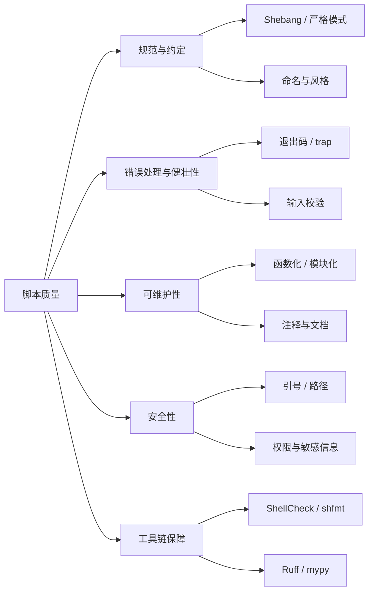
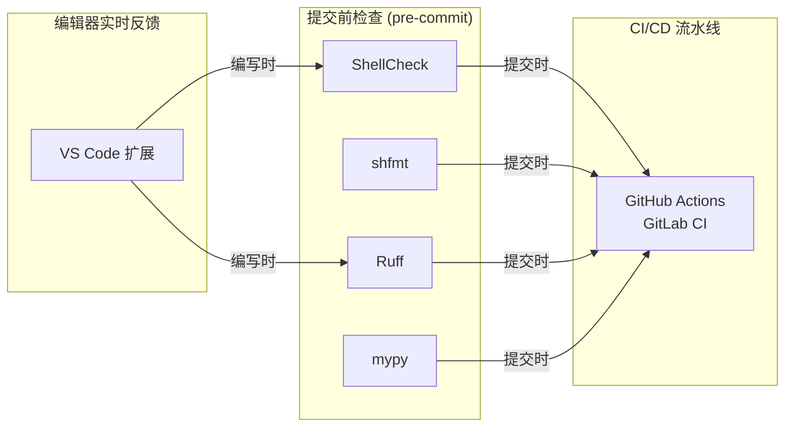

[toc]


---

## 编写高质量脚本的最佳实践与常见反模式

> **内容依据**：Google Shell Style Guide、ShellCheck Wiki、PEP 8、Real Python、Microsoft Engineering Playbook 等权威来源，以及 2025–2026 年社区最新实践文章。知识截止日期：2026 年 9 月。

---

### 全文结构概览



---

## Shell（Bash）脚本篇

### 脚本头部：Shebang 与严格模式

这是一份合格脚本与随意脚本之间**最显著的分水岭**。

#### Shebang

使用 Shebang（`#!/bin/bash` 或 `#!/bin/sh`）指定解释器，可确保在不同环境下行为一致，避免跨系统运行时的意外。

推荐写法是 `#!/usr/bin/env bash` 而非硬编码路径。这种写法让脚本通过 `PATH` 查找 Bash，在 Bash 安装位置不在 `/bin` 的系统上（如 macOS 通过 Homebrew 安装）能正确工作。

**关键辨析**：`bash` vs `sh`

| Shebang               | 含义             | 适用场景                                    |
| --------------------- | ---------------- | ------------------------------------------- |
| `#!/usr/bin/env bash` | 使用 Bash 解释器 | 需要 Bash 特性（数组、`[[ ]]`、`local` 等） |
| `#!/bin/sh`           | 使用 POSIX sh    | 追求最大可移植性，不使用 Bash 专有语法      |

如果脚本依赖仅存在于 Bash 的特性，**不要**使用 `#!/bin/sh`。在很多发行版上 `/bin/sh` 指向 `dash` 或其他精简 Shell，数组、`[[ ]]` 和 `local` 的行为会不同。

#### 严格模式（Strict Mode）

默认情况下，Bash 会忽略很多错误——命令失败、变量未设置，脚本照样继续执行。在脚本顶部启用严格模式可以改变这种行为。

```bash
#!/usr/bin/env bash
set -euo pipefail
```

各选项含义：

| 选项              | 作用                                     | 说明                               |
| ----------------- | ---------------------------------------- | ---------------------------------- |
| `set -e`          | 命令返回非零退出码时**立即终止**脚本     | 避免错误被静默忽略，逐级传播       |
| `set -u`          | 引用**未定义变量**时报错并终止           | 杜绝拼写错误的变量名带来的隐蔽 bug |
| `set -o pipefail` | 管道中**任一命令**失败则整条管道返回失败 | 默认行为仅看最后一条命令的退出码   |

严格模式不是万能的：它不会捕获逻辑错误，而且在某些脚本中，对于允许失败的命令需要局部使用 `|| true` 来放行。

**示例**——严格模式如何拯救你：

```bash
#!/usr/bin/env bash
set -euo pipefail

backup_dir="/data/backup"
# 如果 cd 失败（目录不存在），脚本立即退出
# 不会继续在错误的目录下执行 rm 操作
cd "$backup_dir"
rm -f *.log.old
```

如果没有 `set -e`，当 `cd` 失败时脚本会**在当前目录**继续执行 `rm`，后果可能是灾难性的。

---

### 变量引用：最高频的致命错误

未加引号的变量是 Bash bug **最常见的单一来源**。当变量未加引号时，Bash 会对其执行**词分割**（Word Splitting）和**通配符展开**（Glob Expansion），导致令人意外的行为。

**反面教材 vs 正确写法**：

```bash
# ❌ 错误：文件名含空格时 rm 会删除两个不存在的文件
filename="my file.txt"
rm $filename        # 实际执行: rm my file.txt

# ✅ 正确：始终用双引号包裹变量
rm "$filename"      # 实际执行: rm "my file.txt"
```

没有引号的变量可能产生完全不同的行为。例如 `headline="* Headline *"` 如果 `echo $headline` 不加引号，`*` 会被展开为当前目录下的文件名列表。

**规则很简单：除非你明确需要词分割或通配符展开，否则永远给变量加双引号。**

---

### 错误处理与资源清理

#### 检查命令的返回值

Bash 脚本中每条命令都会返回一个退出状态。忽略退出状态会导致隐蔽的错误。

```bash
# ❌ 错误：不检查 mkdir 是否成功就继续操作
mkdir /path/to/dir
cd /path/to/dir

# ✅ 正确：显式检查并处理失败
if ! mkdir -p /path/to/dir; then
    echo "ERROR: 无法创建目录" >&2
    exit 1
fi
cd /path/to/dir || exit 1
```

#### 使用 `trap` 做资源清理

使用 `trap` 在脚本退出时（无论正常还是异常）执行清理代码。这种模式可以创建临时目录，并保证它被清理，同时以有用的输出处理错误。

```bash
#!/usr/bin/env bash
set -euo pipefail

TMPDIR=""

cleanup() {
    local exit_code=$?
    if [[ -n "$TMPDIR" && -d "$TMPDIR" ]]; then
        rm -rf "$TMPDIR"
    fi
    exit "$exit_code"
}
trap cleanup EXIT

TMPDIR=$(mktemp -d)
# ... 使用 $TMPDIR 做临时工作 ...
echo "处理完成"
```

**`trap` 语法说明**：`trap <命令或函数名> <信号列表>`

| 信号   | 含义                                        |
| ------ | ------------------------------------------- |
| `EXIT` | 脚本退出时触发（最常用）                    |
| `ERR`  | 命令返回非零退出码时触发（需配合 `set -e`） |
| `INT`  | 收到 `Ctrl+C`（`SIGINT`）时触发             |
| `TERM` | 收到 `SIGTERM` 时触发                       |

---

### 函数化与结构化

函数可以让脚本结构更清晰，避免重复代码。将相关任务分组到函数中，使脚本更易读和维护。

**推荐的脚本骨架模板**（综合了社区最佳实践）：

```bash
#!/usr/bin/env bash
set -euo pipefail

# =============================================================================
# 脚本名称: deploy_app.sh
# 功能描述: 将应用部署到目标服务器
# 用法:     ./deploy_app.sh <环境名> [版本号]
# 作者:     DevOps Team
# =============================================================================

readonly SCRIPT_DIR="$(cd "$(dirname "${BASH_SOURCE[0]}")" && pwd)"
readonly LOG_FILE="/var/log/deploy.log"

# --- 日志函数 ---
log()  { printf '[%s] INFO:  %s\n' "$(date '+%Y-%m-%d %H:%M:%S')" "$*"; }
warn() { printf '[%s] WARN:  %s\n' "$(date '+%Y-%m-%d %H:%M:%S')" "$*" >&2; }
die()  { printf '[%s] ERROR: %s\n' "$(date '+%Y-%m-%d %H:%M:%S')" "$*" >&2; exit 1; }

# --- 依赖检查 ---
check_dependencies() {
    local deps=("$@")
    for dep in "${deps[@]}"; do
        command -v "$dep" > /dev/null 2>&1 \
            || die "缺少依赖: $dep，请先安装"
    done
}

# --- 清理函数 ---
cleanup() {
    # 在此添加清理逻辑
    log "清理临时资源..."
}
trap cleanup EXIT

# --- 参数校验 ---
usage() {
    cat <<EOF
用法: $(basename "$0") <环境名> [版本号]

参数:
  环境名    部署目标环境（dev / staging / prod）
  版本号    可选，默认部署最新版本

示例:
  $(basename "$0") staging v2.1.0
EOF
    exit 1
}

# --- 主逻辑 ---
main() {
    [[ $# -lt 1 ]] && usage
    local env="$1"
    local version="${2:-latest}"

    check_dependencies git docker curl

    log "开始部署: 环境=$env, 版本=$version"
    # ... 实际部署逻辑 ...
    log "部署完成"
}

main "$@"
```

**几个关键设计要点**：

1. **`main "$@"` 模式**：将所有逻辑封装在 `main()` 函数中并在脚本末尾调用，这是一个经过验证的模板，可以避免从第一天起就掉入最常见的陷阱。

2. **`readonly`**：用 `readonly` 声明不应被修改的变量（如路径常量），防止意外覆写。

3. **`command -v` 代替 `which`**：检测命令是否存在时，`command -v` 是 POSIX 标准内建命令，比 `which` 更可靠、更可移植。

4. **日志输出到 `stderr`**：错误和警告使用 `>&2` 输出到标准错误流，这样脚本的正常输出（`stdout`）可以被管道或重定向正常处理。

---

### 命名与风格规范

使用清晰、描述性的变量名使脚本更易读、更好维护。避免使用单字母变量，除非是循环计数器或极短生命周期的变量。例如，用 `filename` 或 `user_count` 代替 `x`。

| 类别            | 推荐命名风格                  | 示例                     |
| --------------- | ----------------------------- | ------------------------ |
| 普通变量        | `snake_case`，小写            | `log_dir`, `retry_count` |
| 常量 / 环境变量 | `UPPER_SNAKE_CASE`            | `readonly MAX_RETRIES=3` |
| 函数名          | `snake_case`，小写            | `check_dependencies()`   |
| 脚本文件名      | `snake_case`，带 `.sh` 扩展名 | `deploy_app.sh`          |

使用 `.sh`（或 `.bash`）扩展名。不使用扩展名可能看起来"酷"，但除非你的场景明确要求如此，这只是在追求"聪明"——而聪明的东西往往难以理解。

Bash 有若干**保留的变量名**（如 `$PATH`、`$HOME`），不应将它们用作自定义变量名。

---

### 常见陷阱速查表

以下汇总了 Bash 脚本中**最高频的反模式**：

| 反模式                 | 问题                                 | 正确做法                                |
| ---------------------- | ------------------------------------ | --------------------------------------- |
| `for f in $(ls *.mp3)` | 文件名含空格或特殊字符时会断裂       | `for f in *.mp3; do`                    |
| 反引号 `` `cmd` ``     | 嵌套困难、可读性差                   | `$(cmd)`                                |
| `[ $var = "foo" ]`     | 变量为空或含空格时语法错误           | `[[ "$var" = "foo" ]]`                  |
| `cd dir; rm -rf *`     | `cd` 失败则在错误目录删除            | `cd dir \|\| exit 1`                    |
| `local var=$(cmd)`     | `local` 会**掩盖** `$(cmd)` 的退出码 | 分两行：`local var`  然后 `var=$(cmd)`  |
| `echo $var`            | 词分割 + 通配符展开                  | `echo "$var"` 或 `printf '%s\n' "$var"` |
| 硬编码绝对路径         | 换环境即失效                         | 使用变量或 `$HOME`、`$SCRIPT_DIR`       |
| `eval "$user_input"`   | **代码注入**风险，极度危险           | 几乎永远不需要 `eval`                   |

在可能的情况下，优先使用 `printf` 代替 `echo`，以获得更好的可移植性和在不同环境中更可预测的行为。

---

### 可移植性与跨平台注意事项

在同时面向 Linux 和 macOS 的脚本中，需注意以下差异：

| 差异点         | Linux (GNU)           | macOS (BSD)         | 兼容方案                               |
| -------------- | --------------------- | ------------------- | -------------------------------------- |
| `sed` 原地编辑 | `sed -i 's/...'`      | `sed -i '' 's/...'` | 统一使用 `sed -i.bak` 或安装 `gnu-sed` |
| `date` 格式    | `date -d '1 day ago'` | `date -v-1d`        | 使用 `gdate`（Homebrew `coreutils`）   |
| `readlink -f`  | 支持                  | 不支持              | `realpath` 或 `cd + pwd`               |
| 换行符         | `LF`                  | `LF`                | Windows 混用时注意 `CRLF` 问题         |

**换行符问题**：如果团队成员同时在 Windows 和 *nix 上编辑脚本，Windows 的 `CRLF` 换行会导致 Bash 脚本报 `\r: command not found` 错误。解决方案：

- 在 `.gitattributes` 中强制指定：`*.sh text eol=lf`
- 使用 `dos2unix` 工具转换

---

## Python 脚本篇

### 脚本结构与入口点

在脚本开头添加注释说明功能、作者、版本和变更历史。避免硬编码——硬编码值会使脚本缺乏灵活性。使用命名常量提高可读性。使用入口点（`if __name__ == "__main__":`）将可执行代码与可导入定义分离。

定义清晰的 `main()` 函数来封装由 CLI 触发的核心脚本逻辑。

**推荐的 Python 脚本骨架**：

```python
#!/usr/bin/env python3
"""
backup_db.py - 数据库自动备份脚本

用法:
    python backup_db.py --env staging --output /data/backup/

依赖:
    pip install click rich
"""

import logging
import sys
from pathlib import Path

import click

# --- 常量 ---
DEFAULT_BACKUP_DIR = Path("/data/backup")
MAX_RETRIES = 3

# --- 日志配置 ---
logging.basicConfig(
    level=logging.INFO,
    format="%(asctime)s [%(levelname)s] %(message)s",
    datefmt="%Y-%m-%d %H:%M:%S",
)
logger = logging.getLogger(__name__)


@click.command()
@click.option("--env", required=True, type=click.Choice(["dev", "staging", "prod"]))
@click.option("--output", default=str(DEFAULT_BACKUP_DIR), type=click.Path())
def main(env: str, output: str) -> None:
    """执行数据库备份。"""
    output_path = Path(output)
    output_path.mkdir(parents=True, exist_ok=True)

    logger.info("开始备份: 环境=%s, 输出=%s", env, output_path)

    try:
        # ... 实际备份逻辑 ...
        logger.info("备份完成")
    except Exception:
        logger.exception("备份失败")
        sys.exit(1)


if __name__ == "__main__":
    main()
```

**设计要点解读**：

| 要素                          | 为什么重要                                                   |
| ----------------------------- | ------------------------------------------------------------ |
| `if __name__ == "__main__":`  | 使脚本既能直接运行也能被其他模块 `import` 复用               |
| `click` 库做参数解析          | 比 `argparse` 更简洁直观，自动生成 `--help`，自带输入校验    |
| `logging` 代替 `print`        | 支持级别控制、格式化、输出到文件，生产环境必备               |
| `pathlib.Path` 代替字符串拼接 | 跨平台路径处理，API 更现代化，避免 `os.path.join` 的冗长     |
| **类型注解**（Type Hints）    | Python 虽是动态类型，但类型注解使生产代码更易维护——它们记录了意图，通过类型检查器（如 mypy 或 Pyright）尽早发现错误，使重构更安全。 |

---

### 风格与工具链

遵循 PEP 8——使用格式化器和 Linter（如 Black、Ruff）自动执行一致的风格。

一致性胜过聪明。自动格式化并 lint 所有代码，让风格永远不再成为争论——团队把精力花在逻辑上，而不是格式上。

**2025–2026 年推荐的 Python 脚本工具链**：

| 工具                   | 用途                         | 说明                                                         |
| ---------------------- | ---------------------------- | ------------------------------------------------------------ |
| **Ruff**               | Linter + Formatter（二合一） | 用 `ruff check` + `ruff format` 执行风格检查和格式化。速度极快，正在取代 flake8 + Black 的组合 |
| **mypy** / **Pyright** | 静态类型检查                 | 添加类型注解并运行 mypy、pyright 或 ty 做类型检查。          |
| **uv**                 | 包管理与虚拟环境             | 使用 `pyproject.toml` + `uv`（或 Poetry）进行打包管理。Rust 编写，速度远超 pip |
| **pre-commit**         | Git 钩子框架                 | 提交前自动运行 lint / format / type check                    |

---

### Python 脚本常见反模式

| 反模式                                       | 问题                                         | 正确做法                                      |
| -------------------------------------------- | -------------------------------------------- | --------------------------------------------- |
| `except Exception: pass`                     | **吞掉所有异常**，bug 永远无法被发现         | 至少 `logger.exception(...)` 或 `raise`       |
| `import *`                                   | 污染命名空间，难以追踪名称来源               | 显式 `from module import name`                |
| 全局可变状态                                 | 难以测试，行为不可预测                       | 通过函数参数传递，或使用配置对象              |
| 用 `os.system()` / `os.popen()` 执行外部命令 | 安全隐患（shell 注入），且难以获取输出和错误 | `subprocess.run(["cmd", "arg"], check=True)`  |
| 字符串拼接 SQL / 命令                        | 注入攻击                                     | 参数化查询 / 列表传参给 `subprocess`          |
| 不使用虚拟环境                               | 依赖冲突，污染系统 Python                    | 使用虚拟环境并锁定（pin）依赖以保证可复现性。 |
| 硬编码配置（密码、路径）                     | 不可移植、不安全                             | 环境变量 / 配置文件 / `.env`                  |

---

### Python 脚本中的依赖管理新方式：PEP 723

通过 PEP 723 标准，可以在脚本文件内部以内联方式声明和管理依赖，创建自包含、可分享的脚本，以保证可复现性。

```python
#!/usr/bin/env python3
# /// script
# requires-python = ">=3.12"
# dependencies = [
#     "requests>=2.31",
#     "rich>=13.0",
# ]
# ///
"""一个自包含的脚本，依赖声明在文件内。"""

import requests
from rich import print as rprint

def main() -> None:
    resp = requests.get("https://httpbin.org/get")
    rprint(resp.json())

if __name__ == "__main__":
    main()
```

然后通过 `uv run script.py` 或 `pipx run script.py` 即可自动安装依赖并运行，无需手动维护 `requirements.txt`。这对于**单文件工具脚本**非常实用。

---

## 通用最佳实践（Shell 与 Python 共通）

### 质量保障工具链全景图



#### Shell：ShellCheck + shfmt

ShellCheck 是有史以来最好的静态分析工具之一。它读取你的脚本并找出你知道存在但忘记检查的 bug：未引用的变量、单引号内不会展开的 `$(cmd)`、`for x in $(ls)` 的词分割灾难。它免费、开源、快速且广泛可用。

ShellCheck 不是格式化器；shfmt 不是 Linter。两者都不能替代 `bash -n` 语法检查或行为测试。它们是**互补**的：

| 工具           | 职责                                                         | 典型用法                      |
| -------------- | ------------------------------------------------------------ | ----------------------------- |
| **ShellCheck** | 静态分析（找 bug）                                           | `shellcheck script.sh`        |
| **shfmt**      | 自动格式化（统一缩进与风格）                                 | `shfmt -w -i 4 -ci script.sh` |
| **bashate**    | Python 风格的 Bash 风格检查器，与 ShellCheck 互补（它关注风格，ShellCheck 关注正确性）。 | `bashate script.sh`           |

`shfmt` 常用参数说明：

| 参数   | 含义                                       |
| ------ | ------------------------------------------ |
| `-w`   | 原地修改文件（Write）                      |
| `-d`   | 仅显示差异，不修改（Diff），适用于 CI 检查 |
| `-i N` | 缩进宽度，`N` 为空格数（如 `-i 4`）        |
| `-ci`  | Switch/Case 语句体额外缩进（Case Indent）  |
| `-s`   | 简化代码（Simplify）                       |

shfmt 可以按照 Google Shell Style Guide 的风格自动格式化脚本。推荐配置选项为 `-i 2 -ci -s`。

**编辑器集成**：在 VS Code 中安装 ShellCheck 扩展，可获得静态分析和自动修复能力。shell-format 扩展可自动格式化 Bash 脚本，它底层依赖 shfmt。

#### Python：Ruff + Type Checker

现代 Python 项目的标准组合：

```toml
# pyproject.toml 中的 Ruff 配置示例
[tool.ruff]
target-version = "py312"
line-length = 100

[tool.ruff.lint]
select = ["E", "F", "W", "I", "UP", "B", "SIM"]
# E/F/W: pycodestyle + pyflakes 基础检查
# I: import 排序
# UP: 自动升级旧语法
# B: bugbear（常见 bug 模式）
# SIM: 代码简化建议
```

---

### 注释与文档

经过多年 DevOps 实践后的最重要认知是：**为人类写代码，而不是为计算机**。清晰的变量名、一致的格式和良好的文档，在新成员上手或回顾旧代码时能带来天壤之别。

**注释的正确姿势**：

- 注释**为什么**（Why），而不是**是什么**（What）——代码本身应该说明"是什么"
- 脚本头部写明：**用途、用法、参数、前置依赖、作者**
- 复杂逻辑前一行加注释解释**意图**

脚本和 `README.md` 应纳入版本控制系统以追踪变更并作为备份。任何值得创建和使用的脚本都值得用版本控制管理。

---

### 安全性要点

| 领域                                                       | 要点                                                         |
| ---------------------------------------------------------- | ------------------------------------------------------------ |
| **敏感信息**                                               | 密码、Token 等**永远不要硬编码**在脚本中，使用环境变量或加密的密钥管理服务 |
| **输入校验**                                               | 对用户输入做合法性检查和转义，防止注入                       |
| **最小权限**                                               | 脚本文件权限 `755` 或 `700`，不要 `777`；不要以 root 运行不需要特权的脚本 |
| **`rm` 操作**                                              | 永远使用带引号的变量路径；危险操作前做 dry-run 或交互确认    |
| **临时文件**                                               | 使用 `mktemp`（Shell）或 `tempfile`（Python）创建，并在 `trap` / `finally` 中清理 |
| **路径安全**：避免使用相对路径，因为它们容易受到环境攻击。 | 如果必须用相对路径，确保 `PATH` 变量已正确设置               |

---

### 脚本可维护性检查清单

以下清单可作为编写或审查脚本时的自检参考：

- [ ] **Shebang** 正确且使用 `env` 方式
- [ ] 启用了**严格模式**（Bash: `set -euo pipefail` / Python: 合理的异常处理）
- [ ] 所有变量**加了双引号**（Bash）/ 使用了**类型注解**（Python）
- [ ] 有 `trap` / `try-finally` 做**资源清理**
- [ ] 提供了 `--help` 或 `usage()` 说明
- [ ] 有**日志输出**而非裸 `echo` / `print`
- [ ] 依赖检查：启动时验证所需外部命令/库是否存在
- [ ] 通过 **ShellCheck** / **Ruff** 零告警
- [ ] 敏感信息不在代码中硬编码
- [ ] 纳入**版本控制**，有 `.gitattributes` 处理换行符

---

### 补充：让 AI 生成更好脚本的提示技巧

在让 AI 编写脚本时，可以在提示词（Prompt）中明确要求以下规范，以获得更专业的输出：

- 要求使用 `set -euo pipefail` 和 `trap`
- 要求遵循 ShellCheck 规范（或要求零 ShellCheck 告警）
- 要求使用 `main "$@"` 模式
- 要求提供 `usage()` 函数和参数校验
- 要求使用 `logging` 而非 `print`（Python）
- 要求提供类型注解（Python）
- 明确目标运行环境（Linux / macOS / 跨平台），避免不兼容的系统调用

---

> **小结**：代码库大部分生命周期花在被阅读和修改上，而不是被编写上，所以应当为下一个开发者（通常是未来的你自己）做优化。好的脚本不只是"能跑"，而是**可靠、可读、可维护、可审计**的。工具链（ShellCheck + shfmt / Ruff + mypy）是保障底线的最低成本投入，应当从第一天起就集成到工作流中。