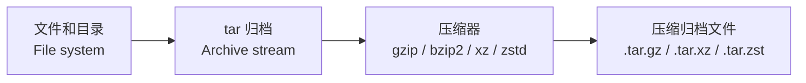

[toc]


## 学习大纲

本文以 **GNU tar** 为主，也会提醒 **BSD tar / bsdtar / libarchive** 的差异。Linux 上常见的是 GNU tar；macOS、FreeBSD 及部分 BSD 系统上常见的是 bsdtar/libarchive。GNU tar 官方手册说明：`tar` 是把多个文件保存到一个归档文件中的工具，名字来自 **tape archiver**；GNU 手册比简略 man page 更权威。([man7.org](https://man7.org/linux/man-pages/man1/tar.1.html)) bsdtar 则是基于 libarchive 的实现，可读写更多归档格式，例如 tar、pax、cpio、zip、7-zip、ISO 等。([Debian Manpages](https://manpages.debian.org/unstable/libarchive-tools/bsdtar.1.en.html))

建议按下面路径学习：

| 学习主题       | 重点                                       |
| -------------- | ------------------------------------------ |
| tar 的定位     | 打包、归档、压缩之间的区别                 |
| 基本语法       | 操作模式、选项、归档文件、文件路径         |
| 核心操作       | 创建、查看、解包、追加、更新、比较、删除   |
| 压缩与解压     | gzip、bzip2、xz、zstd、自动识别            |
| 路径与匹配     | `-C`、相对路径、绝对路径、通配符、排除规则 |
| 权限与元数据   | owner、group、mode、mtime、ACL、xattrs     |
| 管道与脚本     | 标准输入输出、远程传输、备份脚本           |
| 错误与状态码   | 常见报错、退出码、排查方法                 |
| 安全与最佳实践 | tarbomb、防覆盖、校验、可移植性            |

## tar 到底是什么

`tar` 的核心能力是 **归档**（archive），不是压缩。它会把多个文件、目录以及相关元数据合并成一个连续的归档流，常见后缀是 `.tar`。

压缩是另一层动作。比如：

| 文件名                         | 含义                      |
| ------------------------------ | ------------------------- |
| `backup.tar`                   | 只打包，不压缩            |
| `backup.tar.gz` / `backup.tgz` | tar 归档后再用 gzip 压缩  |
| `backup.tar.bz2`               | tar 归档后再用 bzip2 压缩 |
| `backup.tar.xz`                | tar 归档后再用 xz 压缩    |
| `backup.tar.zst`               | tar 归档后再用 zstd 压缩  |

可以把它理解成：



反向解压时，流程是：


tar 格式本身是流式的。libarchive 文档说明，tar 格式中的每个条目通常由一个或多个 **512 字节记录**（512-byte records）组成，第一个记录保存文件名、时间戳、权限等元数据，后续记录保存文件内容。([openSUSE 手册页服务器](https://manpages.opensuse.org/Leap-16.0/bsdtar/libarchive-formats.5.en.html))

## 基本语法

常见形式如下：

```bash
tar [操作模式] [选项] -f 归档文件 文件或目录
```

最经典的命令：

```bash
tar -cf archive.tar dir/
tar -xf archive.tar
tar -tf archive.tar
```

含义分别是：

| 命令                       | 含义         |
| -------------------------- | ------------ |
| `tar -cf archive.tar dir/` | 创建归档     |
| `tar -xf archive.tar`      | 解包归档     |
| `tar -tf archive.tar`      | 查看归档内容 |

其中：

| 部分             | 含义                   |
| ---------------- | ---------------------- |
| `-c`             | create，创建归档       |
| `-x`             | extract，解包          |
| `-t`             | list，列出内容         |
| `-f archive.tar` | file，指定归档文件     |
| `dir/`           | 要加入归档的文件或目录 |

GNU tar 每次调用通常需要指定一个操作模式，例如创建、列出、解包、比较、更新等，并且一次应选择一个主要操作模式。([GNU 官网](https://www.gnu.org/software/tar/manual/html_chapter/tar-invocation.html))

## 选项写法

tar 的选项写法有三种，初学者最容易在这里混淆。

| 写法       | 示例                                  | 说明                     |
| ---------- | ------------------------------------- | ------------------------ |
| 传统写法   | `tar cf archive.tar dir`              | 早期风格，选项前不加 `-` |
| 短选项写法 | `tar -cf archive.tar dir`             | 推荐日常使用             |
| 长选项写法 | `tar --create --file archive.tar dir` | 推荐脚本中使用，语义清晰 |

GNU tar 支持传统、短选项、长选项三种写法，并允许混用；不过脚本中更推荐长选项或清晰的短选项。([man7.org](https://man7.org/linux/man-pages/man1/tar.1.html))

特别注意 `-f`：

```bash
tar -cf archive.tar dir/
```

这里 `-f` 后面的 `archive.tar` 是归档文件名。不要写成：

```bash
tar -fc archive.tar dir/
```

在很多情况下，`-fc` 会被解释为 `-f c`，也就是把归档文件名当成 `c`，从而造成意外结果。为了清晰，推荐写成：

```bash
tar -c -f archive.tar dir/
```

或者：

```bash
tar --create --file=archive.tar dir/
```

## 核心操作模式

| 短选项   | 长选项                 | 英文术语       | 作用                      |
| -------- | ---------------------- | -------------- | ------------------------- |
| `-c`     | `--create`             | create         | 创建新的 tar 归档         |
| `-x`     | `--extract` / `--get`  | extract        | 从归档中解包文件          |
| `-t`     | `--list`               | list           | 查看归档内容              |
| `-r`     | `--append`             | append         | 向未压缩 tar 归档追加文件 |
| `-u`     | `--update`             | update         | 追加比归档中更新的文件    |
| `-d`     | `--compare` / `--diff` | compare / diff | 比较归档内容和文件系统    |
| `-A`     | `--concatenate`        | concatenate    | 合并 tar 归档             |
| 无短选项 | `--delete`             | delete         | 从归档中删除成员          |

GNU tar 官方选项列表中列出了这些操作：`--create` 创建归档，`--extract` 解包，`--list` 列出成员，`--update` 追加较新的文件，`--compare` 比较归档和文件系统，`--delete` 删除归档成员。([GNU 官网](https://www.gnu.org/software/tar/manual/html_section/All-Options.html))

### 创建归档

```bash
tar -cf project.tar project/
```

加上详细输出：

```bash
tar -cvf project.tar project/
```

其中 `-v` 是 **verbose**，表示显示处理过程。

更适合脚本的写法：

```bash
tar --create --file=project.tar project/
```

### 查看归档内容

```bash
tar -tf project.tar
```

查看详细信息：

```bash
tar -tvf project.tar
```

输出通常类似：

```text
drwxr-xr-x user/group        0 2026-07-06 10:00 project/
-rw-r--r-- user/group      123 2026-07-06 10:01 project/README.md
```

其中会显示文件类型、权限、所有者、大小、时间和归档内路径。

### 解包归档

```bash
tar -xf project.tar
```

解包到指定目录：

```bash
mkdir -p /tmp/project-out
tar -xf project.tar -C /tmp/project-out
```

`-C` 表示先切换目录再执行后续操作。GNU tar 文档特别说明，`-C` 是 **位置敏感选项**（position-sensitive option），会影响它后面出现的路径参数。([GNU 官网](https://www.gnu.org/software/tar/manual/html_chapter/tar-invocation.html))

例如：

```bash
tar -cf app.tar -C /opt app -C /var log
```

含义是：

| 片段          | 含义                                  |
| ------------- | ------------------------------------- |
| `-C /opt app` | 把 `/opt/app` 以 `app` 的名字加入归档 |
| `-C /var log` | 把 `/var/log` 以 `log` 的名字加入归档 |

### 只解包某个文件或目录

```bash
tar -xf project.tar project/README.md
```

只解包某个目录：

```bash
tar -xf project.tar project/src/
```

先查看归档里的真实路径非常重要：

```bash
tar -tf project.tar
```

很多“解不出来”的问题，本质是归档内路径和你指定的路径不一致。

### 追加文件

```bash
tar -rf archive.tar newfile.txt
```

注意：追加通常只适用于 **未压缩的 `.tar`**。压缩归档如 `.tar.gz`、`.tar.xz` 不能直接安全追加或更新。GNU tar 手册明确说明，压缩归档不能被修改，不能对其执行 update、delete、append、concatenate 等操作。([GNU 官网](https://www.gnu.org/software/tar/manual/html_node/gzip.html))

错误示例：

```bash
tar -rf archive.tar.gz newfile.txt
```

正确做法通常是重新创建归档：

```bash
tar -czf archive.tar.gz dir/
```

或者先解压为 `.tar`，修改后再压缩，但一般不如重新打包可靠。

### 更新文件

```bash
tar -uf archive.tar file.txt
```

`-u` 会把比归档内同名成员更新的文件追加到归档末尾。注意它不是“原地替换”，tar 是流式归档，更新通常表现为追加新的条目。解包时如果同名文件出现多次，后面的条目可能覆盖前面的条目。

### 比较归档和文件系统

```bash
tar -df archive.tar
```

也可以写成：

```bash
tar --compare --file=archive.tar
```

用于检查归档中的文件和当前文件系统中的对应文件是否一致。

### 删除归档成员

```bash
tar --delete -f archive.tar path/in/archive.txt
```

同样要注意：不要对压缩归档直接删除成员。应先处理未压缩 tar，或重新生成压缩归档。

## 压缩和解压缩应用

GNU tar 可以通过选项调用外部压缩程序。官方手册列出的压缩支持包括 gzip、bzip2、lzip、lzma、lzop、zstd、xz 和传统 compress；其中 `compress` 主要用于兼容，官方不推荐新场景使用。([GNU 官网](https://www.gnu.org/software/tar/manual/html_node/gzip.html))

| 格式     | 常见后缀           | tar 选项         | 特点                        | 典型场景             |
| -------- | ------------------ | ---------------- | --------------------------- | -------------------- |
| gzip     | `.tar.gz` / `.tgz` | `-z` / `--gzip`  | 速度快，兼容性极好          | 通用发布包、日志归档 |
| bzip2    | `.tar.bz2`         | `-j` / `--bzip2` | 压缩率通常优于 gzip，但较慢 | 老项目兼容           |
| xz       | `.tar.xz`          | `-J` / `--xz`    | 压缩率高，压缩较慢          | 源码发布、系统镜像   |
| zstd     | `.tar.zst`         | `--zstd`         | 速度和压缩率平衡好          | 现代备份、大文件归档 |
| compress | `.tar.Z`           | `-Z`             | 传统格式，不推荐新用        | 兼容旧系统           |

### 创建 gzip 压缩归档

```bash
tar -czf project.tar.gz project/
```

等价长选项：

```bash
tar --create --gzip --file=project.tar.gz project/
```

### 解压 gzip 压缩归档

```bash
tar -xzf project.tar.gz
```

不过现代 GNU tar 通常能自动识别压缩格式，读取压缩归档时经常可以直接：

```bash
tar -xf project.tar.gz
tar -tf project.tar.gz
```

GNU tar 手册说明，读取压缩归档时通常不必显式指定压缩选项，因为 GNU tar 会基于文件开头的格式签名自动识别；如果识别失败，则会回退到文件名后缀判断。([GNU 官网](https://www.gnu.org/software/tar/manual/html_node/gzip.html))

### 创建 xz 压缩归档

```bash
tar -cJf project.tar.xz project/
```

或者：

```bash
tar --create --xz --file=project.tar.xz project/
```

### 创建 zstd 压缩归档

```bash
tar --zstd -cf project.tar.zst project/
```

也可以写成：

```bash
tar -cf project.tar.zst --zstd project/
```

为了可读性，建议脚本中使用长选项：

```bash
tar --create --zstd --file=project.tar.zst project/
```

### 使用自动压缩选项

GNU tar 支持 `-a` / `--auto-compress`，根据归档文件后缀自动选择压缩程序。([GNU 官网](https://www.gnu.org/software/tar/manual/html_node/gzip.html))

```bash
tar -caf project.tar.gz project/
tar -caf project.tar.xz project/
tar -caf project.tar.zst project/
```

这里 `-a` 会根据 `.gz`、`.xz`、`.zst` 自动选择压缩器。

适合日常使用：

```bash
tar -caf backup.tar.zst data/
```

适合脚本使用：

```bash
tar --create --auto-compress --file=backup.tar.zst data/
```

### 调整压缩等级

tar 自身不是压缩算法，压缩等级通常要传给压缩程序。

常见方式是通过环境变量：

```bash
GZIP=-9 tar -czf backup.tar.gz data/
```

对 xz：

```bash
XZ_OPT=-9e tar -cJf backup.tar.xz data/
```

更通用的方式是使用 `-I` / `--use-compress-program`：

```bash
tar -cf backup.tar.zst -I 'zstd -19 -T0' data/
```

含义：

| 参数                | 含义                            |
| ------------------- | ------------------------------- |
| `-I 'zstd -19 -T0'` | 使用 zstd，自定义压缩等级和线程 |
| `-19`               | 高压缩等级                      |
| `-T0`               | 使用可用 CPU 线程               |

GNU tar 的选项表中列出 `-I` / `--use-compress-program=prog` 可指定压缩程序。([GNU 官网](https://www.gnu.org/software/tar/manual/html_section/All-Options.html))

## 常见命令速查

### 打包目录

```bash
tar -cf site.tar site/
```

### 打包并 gzip 压缩

```bash
tar -czf site.tar.gz site/
```

### 打包并 xz 压缩

```bash
tar -cJf site.tar.xz site/
```

### 打包并 zstd 压缩

```bash
tar --zstd -cf site.tar.zst site/
```

### 查看归档内容

```bash
tar -tf site.tar.gz
```

### 查看详细内容

```bash
tar -tvf site.tar.gz
```

### 解包到当前目录

```bash
tar -xf site.tar.gz
```

### 解包到指定目录

```bash
mkdir -p /opt/site
tar -xf site.tar.gz -C /opt/site
```

### 只解包一个文件

```bash
tar -xf site.tar.gz site/config.yml
```

### 排除文件

```bash
tar -czf project.tar.gz project/ \
  --exclude='project/node_modules' \
  --exclude='project/.git' \
  --exclude='*.log'
```

GNU tar 的 `--exclude=pattern` 用于跳过匹配模式的文件，`-X` / `--exclude-from=file` 可以从文件读取排除规则。([GNU 官网](https://www.gnu.org/software/tar/manual/html_section/All-Options.html))

### 从文件列表打包

```bash
tar -czf selected.tar.gz -T files.txt
```

`files.txt` 示例：

```text
README.md
src/
docs/
```

如果文件名可能包含换行符，使用 NUL 分隔更安全：

```bash
find . -type f -print0 | tar --null -T - -czf files.tar.gz
```

GNU tar 的 `--null` 会让 `--files-from` 读取 NUL 结尾的文件名，从而正确处理包含换行或以短横线开头的文件名。([GNU 官网](https://www.gnu.org/software/tar/manual/html_section/All-Options.html))

## 路径规则与易错点

### 归档内路径不是文件系统路径

创建归档时：

```bash
tar -czf backup.tar.gz /etc/nginx
```

GNU tar 默认会移除路径开头的 `/`，常见提示是：

```text
tar: Removing leading '/' from member names
```

这是安全设计，避免解包时强行写入绝对路径。更推荐这样写：

```bash
tar -czf nginx.tar.gz -C /etc nginx
```

归档内路径就是：

```text
nginx/
nginx/nginx.conf
```

而不是：

```text
/etc/nginx/
```

这样解包更可控：

```bash
tar -xf nginx.tar.gz -C /tmp/restore
```

### 不要随便使用 `-P`

`-P` / `--absolute-names` 会保留绝对路径，并关闭一些路径保护行为。GNU tar 文档说明，默认情况下 tar 会去掉成员名前面的 `/`，并对包含绝对路径或内部 `..` 的名字作特殊处理；`-P` 会禁用这种行为。([GNU 官网](https://www.gnu.org/software/tar/manual/html_section/All-Options.html))

危险示例：

```bash
tar -xPf backup.tar
```

如果归档里有 `/etc/passwd` 这样的路径，可能会直接覆盖系统文件。除非非常明确知道归档来源和目的，否则不建议使用。

### `-C` 的位置很重要

```bash
tar -cf backup.tar -C /var/www html -C /etc nginx
```

含义是：

| 片段               | 实际加入        |
| ------------------ | --------------- |
| `-C /var/www html` | `/var/www/html` |
| `-C /etc nginx`    | `/etc/nginx`    |

但归档内路径是：

```text
html/
nginx/
```

这常用于避免归档中出现冗长或绝对路径。

### shell 通配符和 tar 通配符不同

比如：

```bash
tar -xf archive.tar *.txt
```

这里 `*.txt` 可能先被 shell 展开成当前目录下已有的 `.txt` 文件，而不是传给 tar 去匹配归档成员。GNU tar 手册提醒：shell 只能对文件系统中已存在的文件做 glob 展开；如果要让 tar 对归档成员匹配，通配符要被正确引用。([GNU 官网](https://www.gnu.org/software/tar/manual/html_chapter/tar-invocation.html))

更安全：

```bash
tar -xf archive.tar '*.txt'
```

或者：

```bash
tar -tf archive.tar | grep '\.txt$'
```

## 归档格式选择

tar 不是单一格式，常见格式包括：

| 格式  | 英文术语                     | 特点                                 |
| ----- | ---------------------------- | ------------------------------------ |
| v7    | Unix V7 tar                  | 很老，限制多                         |
| ustar | POSIX.1-1988 ustar           | 兼容性好，但路径、大小、属性支持有限 |
| pax   | POSIX.1-2001 pax interchange | 更现代，支持扩展属性和更长路径       |
| gnu   | GNU tar format               | GNU 扩展，适合 GNU tar 环境          |

GNU tar 可通过 `--format` / `-H` 指定输出格式，如 `v7`、`ustar`、`posix`、`gnu` 等。([GNU 官网](https://www.gnu.org/software/tar/manual/html_section/All-Options.html)) libarchive 文档也说明，ustar 兼容性较好但有限制，例如路径长度、符号链接长度、扩展属性和大文件限制；pax 没有这些 ustar 限制，适合现代归档。([openSUSE 手册页服务器](https://manpages.opensuse.org/Leap-16.0/bsdtar/libarchive-formats.5.en.html))

推荐：

| 场景                 | 建议                         |
| -------------------- | ---------------------------- |
| 最大兼容性           | `--format=ustar`             |
| 现代 POSIX 可移植性  | `--format=posix`，也就是 pax |
| GNU/Linux 内部备份   | 默认 GNU tar 格式通常可接受  |
| 跨 macOS、Linux、BSD | 优先测试，必要时使用 pax     |

示例：

```bash
tar --format=posix -cf archive.tar dir/
```

## 权限、所有者和元数据

tar 可以保存很多文件元数据：

| 元数据   | 英文术语                     | 说明                     |
| -------- | ---------------------------- | ------------------------ |
| 权限     | mode / permissions           | 如 `0644`、`0755`        |
| 所有者   | owner / user                 | 文件所属用户             |
| 所属组   | group                        | 文件所属组               |
| 修改时间 | mtime                        | modification time        |
| 符号链接 | symbolic link / symlink      | 保存链接本身或跟随链接   |
| 硬链接   | hard link                    | 可保存硬链接关系         |
| 设备文件 | device node                  | 需要权限，常用于系统备份 |
| ACL      | Access Control List          | 扩展权限                 |
| 扩展属性 | extended attributes / xattrs | Linux/macOS 扩展元数据   |

### 是否恢复所有者

普通用户解包时通常不会恢复原 owner，只会恢复为当前用户。root 解包时可能恢复归档中的 owner/group。

如果只是解包别人给你的源码包，通常不需要保留 owner。

如果是系统备份，可能需要：

```bash
sudo tar --xattrs --acls -cpf system.tar /etc /home
```

恢复时：

```bash
sudo tar --xattrs --acls -xpf system.tar -C /
```

其中 `-p` / `--preserve-permissions` 表示尽量保留权限。

### 符号链接是否跟随

默认情况下，tar 会保存符号链接本身，而不是跟随链接指向的文件。

```bash
tar -cf links.tar symlink
```

如果使用 `-h` / `--dereference`，则会跟随符号链接，把目标文件内容加入归档：

```bash
tar -chf links.tar symlink
```

使用 `-h` 要谨慎，因为它可能把链接指向的大目录或敏感文件意外打包进去。

## 解包安全

### 先查看，再解包

对不可信归档，先执行：

```bash
tar -tf unknown.tar.gz
```

看是否有危险路径：

```text
/etc/passwd
../../.ssh/authorized_keys
home/user/.bashrc
```

### 解包到临时目录

```bash
mkdir -p /tmp/unpack-test
tar -xf unknown.tar.gz -C /tmp/unpack-test
```

确认安全后再移动。

### 防止 tarbomb

**tarbomb** 指的是归档解开后直接在当前目录散落大量文件，而不是包含在一个顶层目录中。

可以使用 GNU tar 的 `--one-top-level`：

```bash
tar -xf archive.tar.gz --one-top-level
```

GNU tar 文档说明，`--one-top-level` 会在解包目录下创建一个顶层目录，用于防护 tarbomb；如果归档成员不在该目录下，会被加上该目录前缀。([GNU 官网](https://www.gnu.org/software/tar/manual/html_section/All-Options.html))

也可以手动：

```bash
mkdir archive-out
tar -xf archive.tar.gz -C archive-out
```

### 不要直接在根目录测试归档

危险示例：

```bash
sudo tar -xf backup.tar -C /
```

更安全：

```bash
sudo mkdir -p /restore-test
sudo tar -xf backup.tar -C /restore-test
```

确认路径、权限、所有者都符合预期后，再做真正恢复。

## 备份应用

### 备份普通项目

```bash
tar -czf project-$(date +%F).tar.gz project/
```

示例输出：

```text
project-2026-07-06.tar.gz
```

### 备份并排除缓存

```bash
tar -czf app-backup.tar.gz app/ \
  --exclude='app/node_modules' \
  --exclude='app/.git' \
  --exclude='app/tmp' \
  --exclude='*.log'
```

### 备份 Linux 系统目录

谨慎示例：

```bash
sudo tar --xattrs --acls --one-file-system \
  -cpf rootfs.tar \
  --exclude=/proc \
  --exclude=/sys \
  --exclude=/dev \
  --exclude=/run \
  --exclude=/tmp \
  --exclude=/mnt \
  --exclude=/media \
  /
```

这里的重点：

| 选项                | 作用                                   |
| ------------------- | -------------------------------------- |
| `--one-file-system` | 不跨文件系统递归，避免把挂载盘也打进去 |
| `--exclude=/proc`   | 排除虚拟文件系统                       |
| `--exclude=/sys`    | 排除内核虚拟文件系统                   |
| `--exclude=/dev`    | 排除设备节点动态目录                   |
| `--exclude=/run`    | 排除运行时目录                         |
| `--xattrs --acls`   | 尽量保存扩展属性和 ACL                 |

GNU tar 的 `--one-file-system` 用于创建归档时避免递归进入不同文件系统。([GNU 官网](https://www.gnu.org/software/tar/manual/html_section/All-Options.html))

### 增量备份

GNU tar 支持 `--listed-incremental` / `-g` 做 GNU 格式增量备份，会使用快照文件记录状态。([GNU 官网](https://www.gnu.org/software/tar/manual/html_section/All-Options.html))

完整备份：

```bash
tar -czf full.tar.gz -g snapshot.snar data/
```

下一次增量备份：

```bash
tar -czf incr-1.tar.gz -g snapshot.snar data/
```

恢复时通常先恢复完整备份，再按顺序恢复增量备份：

```bash
tar -xzf full.tar.gz -C restore/
tar -xzf incr-1.tar.gz -C restore/
```

注意：tar 增量备份有学习成本，生产环境要先演练恢复流程。备份是否有效，最终看恢复是否成功，而不是看打包命令是否成功。

## 管道和远程传输

tar 是流式工具，很适合配合管道。

### 目录复制

```bash
tar -cf - -C src . | tar -xpf - -C dest
```

含义：

| 片段                 | 含义                        |
| -------------------- | --------------------------- |
| `tar -cf - -C src .` | 把 `src` 内容打包到标准输出 |
| `                    | `                           |
| `tar -xpf - -C dest` | 从标准输入解包到 `dest`     |

bsdtar man page 也给出了类似的用法，用 tar 管道移动文件层级。([Debian Manpages](https://manpages.debian.org/unstable/libarchive-tools/bsdtar.1.en.html))

### 通过 ssh 传输

```bash
tar -czf - project/ | ssh user@server 'tar -xzf - -C /srv/project'
```

### 远程备份到本地

```bash
ssh user@server 'tar -czf - /var/www' > www.tar.gz
```

更推荐避免绝对路径：

```bash
ssh user@server 'tar -czf - -C /var www' > var-www.tar.gz
```

## 常见错误和排查

### `tar: Removing leading '/' from member names`

原因：你打包了绝对路径，例如：

```bash
tar -czf etc.tar.gz /etc/nginx
```

tar 默认移除开头的 `/`，避免解包时写死到根目录。

解决：

```bash
tar -czf nginx.tar.gz -C /etc nginx
```

### `tar: Cowardly refusing to create an empty archive`

原因：创建归档时没有提供要打包的文件，或变量为空。

错误示例：

```bash
tar -czf backup.tar.gz
```

脚本中常见：

```bash
tar -czf backup.tar.gz $FILES
```

如果 `$FILES` 为空，就会失败。

解决：

```bash
tar -czf backup.tar.gz dir/
```

脚本中先检查变量：

```bash
if [ -n "$FILES" ]; then
  tar -czf backup.tar.gz $FILES
fi
```

### `tar: archive.tar: Cannot open: No such file or directory`

原因：归档文件不存在、路径写错，或目标目录不存在。

排查：

```bash
ls -l archive.tar
pwd
```

解包时确认文件存在：

```bash
tar -tf archive.tar
```

创建归档时确认目标目录存在：

```bash
mkdir -p backups
tar -czf backups/archive.tar.gz dir/
```

### `tar: Error is not recoverable: exiting now`

原因可能很多，例如归档损坏、压缩格式不匹配、权限不足、参数错误。

排查顺序：

```bash
file archive.tar.gz
tar -tf archive.tar.gz
gzip -t archive.tar.gz
```

如果是 xz：

```bash
xz -t archive.tar.xz
```

如果是 zstd：

```bash
zstd -t archive.tar.zst
```

### `gzip: stdin: not in gzip format`

原因：文件后缀是 `.gz`，但内容不是 gzip；或者你用了 `-z` 去解非 gzip 文件。

错误示例：

```bash
tar -xzf archive.tar.xz
```

解决：

```bash
tar -xf archive.tar.xz
```

或：

```bash
tar -xJf archive.tar.xz
```

先判断格式：

```bash
file archive.tar.xz
```

### `tar: Unexpected EOF in archive`

原因：归档文件不完整，常见于下载中断、传输截断、磁盘满、管道提前中断。

排查：

```bash
ls -lh archive.tar.gz
tar -tf archive.tar.gz
```

压缩包测试：

```bash
gzip -t archive.tar.gz
xz -t archive.tar.xz
zstd -t archive.tar.zst
```

解决通常是重新下载、重新传输或重新生成归档。

### `tar: file changed as we read it`

原因：tar 打包文件时，该文件正在被写入。

常见于打包日志、数据库文件、运行中的应用目录。

解决思路：

| 场景       | 建议                     |
| ---------- | ------------------------ |
| 日志文件   | 先轮转或暂停写入         |
| 数据库     | 使用数据库自己的备份工具 |
| 虚拟机镜像 | 先创建快照               |
| 普通目录   | 尽量在低写入时段打包     |

GNU tar 的退出码说明中提到，在创建、追加或更新时，如果文件在归档过程中发生变化，退出码可能为 `1`，表示归档结果不是文件集合的精确副本。([GNU 官网](https://www.gnu.org/software/tar/manual/html_chapter/tar-invocation.html))

### `tar: Exiting with failure status due to previous errors`

这通常不是根本原因，而是总结性提示。真正的错误在它之前的 stderr 输出中。

建议：

```bash
tar -czf backup.tar.gz dir/ 2>tar.err
cat tar.err
```

如果输出太多，不要先加 `-v`，避免错误被大量文件名淹没。

### `tar: Cannot stat: No such file or directory`

原因：要打包的文件不存在，或者路径拼错。

错误示例：

```bash
tar -czf backup.tar.gz ./dist
```

但 `./dist` 实际不存在。

排查：

```bash
ls -ld ./dist
```

### `tar: Permission denied`

原因：当前用户没有读取源文件、写入目标目录或恢复权限的权限。

解决：

| 场景                | 处理                      |
| ------------------- | ------------------------- |
| 打包系统目录        | 使用 `sudo tar ...`       |
| 写入目标目录失败    | 检查目录权限              |
| 解包恢复 owner 失败 | 需要 root                 |
| 普通源码包解包      | 不要用 sudo，解到用户目录 |

### `Cannot mkdir: No space left on device`

原因：磁盘满或 inode 用尽。

排查：

```bash
df -h
df -i
```

解决：清理空间、换目标目录、分卷或流式传输。

### `tar: This does not look like a tar archive`

原因：文件不是 tar，或者压缩层没有解开，或者文件损坏。

排查：

```bash
file archive
head -c 16 archive | xxd
```

常见情况：

| 实际文件    | 错误操作               | 正确操作                            |
| ----------- | ---------------------- | ----------------------------------- |
| zip         | `tar -xf file.zip`     | `unzip file.zip` 或 bsdtar 可尝试   |
| gzip 单文件 | `tar -xf file.gz`      | `gunzip file.gz`                    |
| xz 压缩 tar | `tar -xzf file.tar.xz` | `tar -xJf file.tar.xz` 或 `tar -xf` |

## GNU tar 状态码

GNU tar 的退出码比较特殊，不能简单理解为“非 0 都一样”。官方手册列出的主要退出码如下：([GNU 官网](https://www.gnu.org/software/tar/manual/html_chapter/tar-invocation.html))

| 状态码   | 含义             | 常见场景                                     | 处理建议                 |
| -------- | ---------------- | -------------------------------------------- | ------------------------ |
| `0`      | 成功             | 创建、查看、解包成功                         | 正常                     |
| `1`      | 有差异或文件变化 | `--compare` 发现不同；创建归档时文件发生变化 | 检查输出，判断是否可接受 |
| `2`      | 致命错误         | 参数错误、归档损坏、权限严重问题等           | 需要修复后重试           |
| 其他非 0 | 子进程错误码     | gzip、xz、zstd 等压缩器失败                  | 查看压缩器错误输出       |

GNU tar 文档还说明，如果 tar 调用了子进程，而子进程以非 0 退出，tar 也可能使用该退出码；例如使用压缩选项时，外部压缩程序失败就可能发生这种情况。([GNU 官网](https://www.gnu.org/software/tar/manual/html_chapter/tar-invocation.html))

bsdtar 的退出状态更概括：成功为 `0`，发生错误为 `>0`。([Debian Manpages](https://manpages.debian.org/unstable/libarchive-tools/bsdtar.1.en.html))

脚本中推荐这样写：

```bash
if tar -czf backup.tar.gz data/; then
  echo "backup ok"
else
  status=$?
  echo "backup failed, status=$status" >&2
  exit "$status"
fi
```

如果要区分 GNU tar 的 `1` 和 `2`：

```bash
tar -czf backup.tar.gz data/
status=$?

case "$status" in
  0)
    echo "success"
    ;;
  1)
    echo "warning: files changed or differ" >&2
    ;;
  2)
    echo "fatal error" >&2
    exit 2
    ;;
  *)
    echo "compressor or subprocess failed: $status" >&2
    exit "$status"
    ;;
esac
```

## GNU tar 和 bsdtar 差异

| 主题         | GNU tar          | bsdtar / libarchive            |
| ------------ | ---------------- | ------------------------------ |
| Linux 常见性 | 很常见           | 也可安装                       |
| macOS 默认   | 通常不是         | macOS 常见 tar 行为接近 bsdtar |
| 格式支持     | tar 相关能力强   | 多格式读写能力强               |
| 自动识别     | 支持多种压缩识别 | libarchive 强调自动格式检测    |
| GNU 专属选项 | 较多             | 不一定支持                     |
| 脚本可移植性 | Linux 内部较好   | 跨 BSD/macOS 要测试            |

libarchive 官方说明其支持多种归档和压缩格式，并具有自动格式检测能力，包括 `tar.gz` 这类归档和压缩组合。([Libarchive](https://www.libarchive.org/)) bsdtar 文档也显示它能读取 tar、pax、cpio、zip、jar、rpm、7-zip、ISO 等多种格式。([Debian Manpages](https://manpages.debian.org/unstable/libarchive-tools/bsdtar.1.en.html))

跨平台脚本建议：

```bash
tar --version
```

如果输出包含 GNU tar：

```text
tar (GNU tar) ...
```

如果是 bsdtar：

```text
bsdtar ...
```

写可移植脚本时，不要默认所有系统都支持 GNU tar 的高级选项，例如：

```bash
--xattrs
--acls
--selinux
--one-top-level
--warning
--checkpoint-action
```

这些选项在不同实现中可能行为不同或不存在。

## 最佳实践

### 优先使用相对路径

推荐：

```bash
tar -czf nginx.tar.gz -C /etc nginx
```

不推荐：

```bash
tar -czf nginx.tar.gz /etc/nginx
```

这样归档更容易迁移和恢复，也更安全。

### 解包前先查看

```bash
tar -tf archive.tar.gz | head
```

确认没有危险路径后再解包：

```bash
mkdir out
tar -xf archive.tar.gz -C out
```

### 脚本中使用清晰选项

日常命令可以写：

```bash
tar -czf backup.tar.gz data/
```

脚本中更推荐：

```bash
tar --create --gzip --file=backup.tar.gz data/
```

可读性更好，减少 `-f` 参数位置错误。

### 压缩格式选择要看场景

| 场景                       | 推荐                       |
| -------------------------- | -------------------------- |
| 最大兼容性                 | `.tar.gz`                  |
| 发布源码包                 | `.tar.gz` 或 `.tar.xz`     |
| 追求高压缩率               | `.tar.xz`                  |
| 现代备份，兼顾速度和压缩率 | `.tar.zst`                 |
| 需要追加或删除成员         | 先用未压缩 `.tar`          |
| 长期归档                   | 选择常见格式，并保存校验和 |

### 备份一定要验证

创建后查看：

```bash
tar -tf backup.tar.gz > /dev/null
```

测试压缩层：

```bash
gzip -t backup.tar.gz
```

或：

```bash
xz -t backup.tar.xz
zstd -t backup.tar.zst
```

生成校验和：

```bash
sha256sum backup.tar.gz > backup.tar.gz.sha256
```

验证：

```bash
sha256sum -c backup.tar.gz.sha256
```

### 对数据库不要直接 tar 数据目录

不推荐在数据库运行时直接：

```bash
tar -czf mysql-data.tar.gz /var/lib/mysql
```

原因是文件可能处于不一致状态。应使用数据库专用备份工具，例如逻辑导出、物理热备、快照等。tar 适合打包备份结果，而不是替代数据库一致性备份机制。

### 对不可信归档不要用 sudo 解包

危险：

```bash
sudo tar -xf unknown.tar.gz -C /
```

安全：

```bash
mkdir inspect
tar -tf unknown.tar.gz
tar -xf unknown.tar.gz -C inspect
```

确认内容后再决定是否提升权限。

### 处理文件名中的特殊字符

普通命令对大多数文件名有效，但如果有换行、前导 `-`、奇怪字符，建议使用 NUL 分隔：

```bash
find . -type f -print0 | tar --null -T - -cf files.tar
```

### 归档大目录时减少噪音

不要总是加 `-v`。大目录中 `-v` 会输出海量文件名，反而掩盖真正错误。

推荐：

```bash
tar -czf backup.tar.gz data/ 2>tar.err
```

需要进度时可考虑 GNU tar 的 checkpoint 机制，或配合 `pv`：

```bash
tar -cf - data/ | pv | gzip > data.tar.gz
```

## 经典场景模板

### 项目发布包

```bash
tar --create --gzip --file=myapp-1.0.0.tar.gz \
  --exclude='myapp/.git' \
  --exclude='myapp/node_modules' \
  myapp/
```

### 现代快速备份

```bash
tar --create --zstd --file=backup-$(date +%F).tar.zst data/
```

### 高压缩率归档

```bash
tar -cf archive.tar.xz -I 'xz -9e -T0' data/
```

### 安全解包未知文件

```bash
mkdir unpack
tar -tf unknown.tar.gz
tar -xf unknown.tar.gz -C unpack
```

### 迁移目录到另一台机器

```bash
tar -czf - -C /srv app | ssh user@host 'mkdir -p /srv/app && tar -xzf - -C /srv/app'
```

### 只备份最近修改的文件

```bash
find project -type f -mtime -7 -print0 |
  tar --null -T - -czf recent-files.tar.gz
```

### 用排除文件维护规则

`exclude.txt`：

```text
.git
node_modules
*.log
tmp
```

命令：

```bash
tar -czf project.tar.gz project/ -X exclude.txt
```

## 新手最需要记住的口诀

| 口诀                         | 解释                              |
| ---------------------------- | --------------------------------- |
| 先 `-t`，再 `-x`             | 不熟悉的归档先查看内容            |
| `tar` 是打包，压缩是另一层   | `.tar.gz` 是 tar 加 gzip          |
| `-f` 后面跟归档文件名        | `tar -cf archive.tar dir/`        |
| 尽量用相对路径               | 避免绝对路径恢复风险              |
| 压缩归档不要追加修改         | `.tar.gz`、`.tar.xz` 通常重新生成 |
| 备份后要验证                 | 能解包、能恢复才算备份成功        |
| 不可信归档不要 sudo 解到 `/` | 先解到临时目录检查                |
| 脚本要考虑退出码             | GNU tar 的 `1` 和 `2` 含义不同    |

## 最小必会命令

```bash
# 创建 tar
tar -cf archive.tar dir/

# 创建 gzip 压缩 tar
tar -czf archive.tar.gz dir/

# 创建 xz 压缩 tar
tar -cJf archive.tar.xz dir/

# 创建 zstd 压缩 tar
tar --zstd -cf archive.tar.zst dir/

# 自动按后缀压缩
tar -caf archive.tar.gz dir/
tar -caf archive.tar.xz dir/
tar -caf archive.tar.zst dir/

# 查看内容
tar -tf archive.tar.gz

# 详细查看
tar -tvf archive.tar.gz

# 解包到当前目录
tar -xf archive.tar.gz

# 解包到指定目录
tar -xf archive.tar.gz -C out/

# 排除目录
tar -czf archive.tar.gz dir/ --exclude='dir/cache' --exclude='*.log'

# 从文件列表打包
tar -czf selected.tar.gz -T files.txt

# 安全处理特殊文件名
find . -type f -print0 | tar --null -T - -czf files.tar.gz
```

掌握这些之后，tar 的大部分实际工作都可以完成；再深入学习路径控制、元数据、增量备份和跨平台差异，就能写出稳定可靠的归档与备份命令。

## tar命令对常见格式的支持

先澄清：tar 本身不是压缩器.

`tar` 的本职是 **归档打包**（archive）：把多个文件和目录合成一个 `.tar` 流。

> 所谓 `tar -czf`、`tar -xJf` 这类“压缩/解压”，本质上是 **tar 调用外部压缩程序作为过滤器**（filter），例如 `gzip`、`xz`、`zstd`。GNU tar 官方手册明确说明：使用这些压缩选项时，GNU tar 会在当前 `PATH` 中查找对应压缩器并调用它。([GNU 官网](https://www.gnu.org/software/tar/manual/html_node/gzip.html))

所以答案是：**tar 可以很方便地处理多种压缩格式，但通常依赖外部压缩工具。**

------

## GNU tar 可以直接配合的压缩格式

以 **GNU tar** 为准，它内置了调用这些压缩程序的选项支持：`gzip`、`bzip2`、`lzip`、`lzma`、`lzop`、`zstd`、`xz`、传统 `compress`。GNU tar 手册也特别说明，`compress` 主要是为了向后兼容，不推荐新场景使用。([GNU 官网](https://www.gnu.org/software/tar/manual/html_node/gzip.html))

| 格式     | 常见后缀                            | tar 选项            | 常用命令                  | 是否需要外部程序                      | 推荐程度                   |
| -------- | ----------------------------------- | ------------------- | ------------------------- | ------------------------------------- | -------------------------- |
| gzip     | `.tar.gz`、`.tgz`、`.taz`           | `-z` / `--gzip`     | `gzip` / `gunzip`         | 需要 `gzip`                           | 很常用，兼容性最好         |
| bzip2    | `.tar.bz2`、`.tbz2`、`.tbz`、`.tz2` | `-j` / `--bzip2`    | `bzip2` / `bunzip2`       | 需要 `bzip2`                          | 旧项目常见，现在用得少一些 |
| xz       | `.tar.xz`                           | `-J` / `--xz`       | `xz` / `unxz`             | 需要 `xz`                             | 压缩率高，源码包常见       |
| zstd     | `.tar.zst`、`.tzst`                 | `--zstd`            | `zstd` / `unzstd`         | 需要 `zstd`                           | 现代推荐，速度快           |
| lzip     | `.tar.lz`                           | `--lzip`            | `lzip` / `lunzip`         | 需要 `lzip`                           | 小众                       |
| lzma     | `.tar.lzma`、`.tlz`                 | `--lzma`            | `lzma` / `unlzma`         | 需要 `lzma`，有时可由 `xz` 替代       | 旧格式，通常不建议新用     |
| lzop     | `.tar.lzo`                          | `--lzop`            | `lzop`                    | 需要 `lzop`                           | 偏速度，较小众             |
| compress | `.tar.Z`、`.taZ`                    | `-Z` / `--compress` | `compress` / `uncompress` | 需要 `compress`，有时可由 `gzip` 替代 | 旧格式，不推荐新用         |

GNU tar 的 `--auto-compress` / `-a` 可以根据文件后缀自动选择压缩程序，例如 `.gz` 用 gzip、`.bz2` 用 bzip2、`.xz` 用 xz、`.zst` 用 zstd。

官方手册列出的自动识别后缀包括 `.gz`、`.tgz`、`.bz2`、`.tbz2`、`.xz`、`.zst`、`.tzst` 等。([GNU 官网](https://www.gnu.org/software/tar/manual/html_node/gzip.html))

------

## tar 解压时是否必须写压缩选项

多数现代 GNU tar 在读取普通文件时可以自动识别压缩格式：

```bash
tar -xf archive.tar.gz
tar -xf archive.tar.xz
tar -xf archive.tar.zst
```

GNU tar 的格式识别优先基于文件开头的签名，失败时再根据文件名后缀判断。([GNU 官网](https://www.gnu.org/software/tar/manual/html_node/gzip.html))

但是有一个重要例外：**从管道或某些不支持随机访问的设备读取时，可能需要显式写压缩选项**。例如：

```bash
cat archive.tar.gz | tar -tzf -
```

而不是：

```bash
cat archive.tar.gz | tar -tf -
```

------

## 常用创建和解压命令

| 任务              | 命令                                  |
| ----------------- | ------------------------------------- |
| 创建普通 tar      | `tar -cf archive.tar dir/`            |
| 创建 gzip 压缩包  | `tar -czf archive.tar.gz dir/`        |
| 创建 bzip2 压缩包 | `tar -cjf archive.tar.bz2 dir/`       |
| 创建 xz 压缩包    | `tar -cJf archive.tar.xz dir/`        |
| 创建 zstd 压缩包  | `tar --zstd -cf archive.tar.zst dir/` |
| 根据后缀自动压缩  | `tar -caf archive.tar.zst dir/`       |
| 查看内容          | `tar -tf archive.tar.gz`              |
| 解压到当前目录    | `tar -xf archive.tar.gz`              |
| 解压到指定目录    | `tar -xf archive.tar.gz -C out/`      |

个人建议：日常使用优先记住这几个：

```bash
tar -czf archive.tar.gz dir/     # 最通用
tar -cJf archive.tar.xz dir/     # 高压缩率
tar --zstd -cf archive.tar.zst dir/  # 现代快速压缩
tar -xf archive.tar.gz           # 解压，通常自动识别
```

------

## 外部依赖怎么看

GNU tar 本身通常不会把 gzip、xz、zstd 这些算法都实现进去，而是调用系统里的压缩器。官方手册写明，当给出压缩选项时，GNU tar 会搜索并调用对应的 compressor binary；也可以用 `-I` / `--use-compress-program` 指定任意外部压缩程序。([GNU 官网](https://www.gnu.org/software/tar/manual/html_node/gzip.html))

检查是否安装：

```bash
command -v gzip
command -v bzip2
command -v xz
command -v zstd
```

也可以直接看 tar 支持的实际压缩器名称：

```bash
tar --help | grep -E 'gzip|bzip2|xz|zstd|compress|lzip|lzop'
```

如果缺少工具，常见报错类似：

```text
tar: zstd: Cannot exec: No such file or directory
tar: Error is not recoverable: exiting now
```

或者：

```text
tar: Child returned status 2
```

------

## `-I`：使用自定义压缩工具

`-I` / `--use-compress-program` 很重要，它允许你把压缩参数传给外部工具。GNU tar 要求这个外部命令默认从标准输入读取、向标准输出写出；解压时 tar 会额外传 `-d` 参数给它。([GNU 官网](https://www.gnu.org/software/tar/manual/html_node/gzip.html))

例如，使用高等级 zstd 并开启多线程：

```bash
tar -cf backup.tar.zst -I 'zstd -19 -T0' data/
```

解压：

```bash
tar -xf backup.tar.zst -I zstd
```

高等级 xz：

```bash
tar -cf backup.tar.xz -I 'xz -9e -T0' data/
```

传统管道写法也可以：

```bash
tar -cf - data/ | zstd -19 -T0 > backup.tar.zst
zstd -dc backup.tar.zst | tar -xf -
```

------

## 常用压缩和解压工具

这里分两类：**单文件压缩工具** 和 **归档工具**。

### 单文件压缩工具

这些工具本身通常只压缩一个数据流或一个文件，不负责把多个文件打成一个包。多个文件通常要先用 tar 打包，再交给它们压缩。

| 工具     | 压缩            | 解压                                      | 常见后缀 | 特点                         |
| -------- | --------------- | ----------------------------------------- | -------- | ---------------------------- |
| gzip     | `gzip file`     | `gunzip file.gz` 或 `gzip -d file.gz`     | `.gz`    | 兼容性最好，速度快           |
| bzip2    | `bzip2 file`    | `bunzip2 file.bz2` 或 `bzip2 -d file.bz2` | `.bz2`   | 压缩率比 gzip 好，但慢       |
| xz       | `xz file`       | `unxz file.xz` 或 `xz -d file.xz`         | `.xz`    | 压缩率高，压缩较慢           |
| zstd     | `zstd file`     | `unzstd file.zst` 或 `zstd -d file.zst`   | `.zst`   | 现代常用，速度和压缩率平衡好 |
| lzip     | `lzip file`     | `lunzip file.lz`                          | `.lz`    | 小众，强调可靠性             |
| lzop     | `lzop file`     | `lzop -d file.lzo`                        | `.lzo`   | 速度快，压缩率一般           |
| compress | `compress file` | `uncompress file.Z`                       | `.Z`     | 传统 Unix 格式，不推荐新用   |

示例：

```bash
gzip log.txt        # 得到 log.txt.gz，原文件默认被替换
gunzip log.txt.gz   # 恢复 log.txt
```

如果想保留原文件：

```bash
gzip -k log.txt
zstd -k log.txt
xz -k log.txt
```

### 归档和多文件压缩工具

| 工具        | 常见格式                                 | 是否能打包多个文件 | 是否压缩     | 常见用途                         |
| ----------- | ---------------------------------------- | ------------------ | ------------ | -------------------------------- |
| tar         | `.tar`、`.tar.gz`、`.tar.xz`、`.tar.zst` | 是                 | 通过外部工具 | Linux/Unix 备份、源码包          |
| zip         | `.zip`                                   | 是                 | 是           | 跨平台共享，Windows 友好         |
| unzip       | `.zip`                                   | 解包               | 解压         | 解压 zip                         |
| 7z / 7-Zip  | `.7z`、`.zip` 等                         | 是                 | 是           | 高压缩率，多格式支持             |
| rar / unrar | `.rar`                                   | 是                 | 是           | Windows 场景较常见，RAR 解压常见 |
| bsdtar      | tar、pax、cpio、zip、7z 等               | 是                 | 视格式而定   | macOS/BSD/libarchive 生态        |

bsdtar/libarchive 和 GNU tar 不完全一样。bsdtar 文档说明它可以解包 tar、pax、cpio、zip、jar、ar、xar、rar、rpm、7-zip、ISO 等，也可以创建 tar、pax、cpio、ar、zip、7-zip、shar 等格式。([Debian Manpages](https://manpages.debian.org/unstable/libarchive-tools/bsdtar.1.en.html)) libarchive 官方也说明它能自动处理 gzip、bzip2、lzip、xz、lzma、compress 等压缩归档组合。([Libarchive](https://www.libarchive.org/))

------

## 压缩格式怎么选

| 需求                           | 推荐                    |
| ------------------------------ | ----------------------- |
| 最大兼容性                     | `.tar.gz` / `gzip`      |
| Linux 源码包发布               | `.tar.gz` 或 `.tar.xz`  |
| 追求更小体积                   | `.tar.xz`               |
| 追求速度和现代体验             | `.tar.zst`              |
| 和 Windows 用户交换            | `.zip`                  |
| 多格式、高压缩率、图形工具友好 | `.7z`                   |
| 老系统兼容                     | `.tar.gz`               |
| 不推荐新用                     | `.Z`、`.tar.Z`、`.lzma` |

实际建议：

```bash
# 通用
tar -czf project.tar.gz project/

# 高压缩率
tar -cJf project.tar.xz project/

# 现代快速备份
tar --zstd -cf project.tar.zst project/

# 自动按后缀选择
tar -caf project.tar.zst project/
```

------

## 重要限制：压缩后的 tar 不能直接追加、更新、删除成员

这一点很容易踩坑。GNU tar 官方手册说明，压缩归档不能被修改，不能对其执行 `--update`、`--delete`、`--append`、`--concatenate` 等操作。([GNU 官网](https://www.gnu.org/software/tar/manual/html_node/gzip.html))

可以追加的是未压缩 `.tar`：

```bash
tar -rf archive.tar newfile.txt
```

不建议也通常不能这样做：

```bash
tar -rf archive.tar.gz newfile.txt
```

正确做法通常是重新生成：

```bash
tar -czf archive.tar.gz dir/
```

------

## 常见工具安装包名称

不同系统略有差异，但常见包名如下：

| 工具      | Debian/Ubuntu 常见包   | RHEL/Fedora 常见包 | macOS Homebrew 常见包 |
| --------- | ---------------------- | ------------------ | --------------------- |
| gzip      | `gzip`                 | `gzip`             | 系统通常自带          |
| bzip2     | `bzip2`                | `bzip2`            | 系统通常自带          |
| xz        | `xz-utils`             | `xz`               | `xz`                  |
| zstd      | `zstd`                 | `zstd`             | `zstd`                |
| lzip      | `lzip`                 | `lzip`             | `lzip`                |
| lzop      | `lzop`                 | `lzop`             | `lzop`                |
| zip/unzip | `zip` / `unzip`        | `zip` / `unzip`    | `zip` / `unzip`       |
| 7z        | `p7zip-full` 或 `7zip` | `p7zip` 或 `7zip`  | `p7zip` 或 `sevenzip` |

------

## 记忆版总结

| 结论                                          | 说明                                      |
| --------------------------------------------- | ----------------------------------------- |
| tar 本身主要是打包工具                        | `.tar` 只是归档，不一定压缩               |
| `tar.gz`、`tar.xz`、`tar.zst` 是 tar 加压缩器 | gzip、xz、zstd 等负责压缩                 |
| GNU tar 支持 gzip、bzip2、xz、zstd 等         | 但通常需要外部程序存在                    |
| 解压时通常可以 `tar -xf` 自动识别             | 但管道场景常要写 `-z`、`-J` 等            |
| 新项目优先 `.tar.gz`、`.tar.xz`、`.tar.zst`   | `.Z`、`.lzma` 不推荐新用                  |
| 压缩 tar 不适合追加修改                       | 要追加请用未压缩 `.tar`，或重新生成压缩包 |