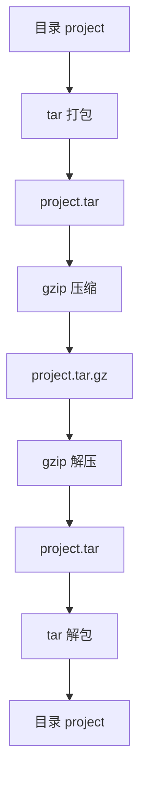
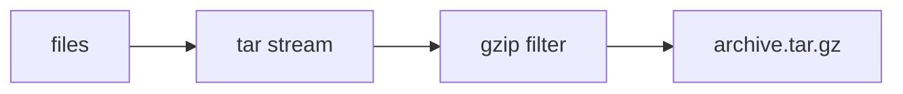

[toc]


## 学习大纲

围绕 `tar` 命令，建议按下面的路径学习：

| 模块     | 你需要掌握的内容                                             |
| -------- | ------------------------------------------------------------ |
| 基础定位 | `tar` 是归档工具，不是压缩工具；理解归档、压缩、解压、解包的区别 |
| 核心概念 | archive、member、record、metadata、tar format、filter、pipe  |
| 常用模式 | 创建、查看、解包、追加、更新、比较、删除                     |
| 常用选项 | `-c`、`-x`、`-t`、`-f`、`-v`、`-C`、`-z`、`-J`、`--zstd`、`--exclude` 等 |
| 压缩格式 | `.tar`、`.tar.gz`、`.tar.bz2`、`.tar.xz`、`.tar.zst` 的差异和选择 |
| 解压实践 | 安全解包、指定目录、只解包部分文件、去掉目录层级             |
| 备份应用 | 保留权限、所有者、软链接、硬链接、ACL、扩展属性、稀疏文件    |
| 排除规则 | 排除目录、排除缓存、排除版本控制文件、读取排除文件           |
| 安全问题 | 绝对路径、路径穿越、覆盖文件、软链接攻击、权限恢复风险       |
| 常见错误 | `Cannot stat`、`Unexpected EOF`、`Not found in archive`、`Permission denied` 等 |
| 状态码   | GNU tar 常见退出状态码 `0`、`1`、`2` 的含义                  |
| 最佳实践 | 可复现归档、脚本中安全使用、跨平台注意事项、性能优化         |

------

## tar 是什么

`tar` 是 Tape Archive 的缩写，最初用于把多个文件打包到磁带中。现在它主要用于把多个文件和目录合并成一个归档文件，也就是 archive file。

关键点是：

`tar` 本身主要负责“打包归档”，压缩通常由 `gzip`、`bzip2`、`xz`、`zstd` 等压缩程序完成。

常见文件名：

| 文件名           | 含义                    |
| ---------------- | ----------------------- |
| `backup.tar`     | 只归档，不压缩          |
| `backup.tar.gz`  | tar 归档后用 gzip 压缩  |
| `backup.tgz`     | `.tar.gz` 的短写        |
| `backup.tar.bz2` | tar 归档后用 bzip2 压缩 |
| `backup.tar.xz`  | tar 归档后用 xz 压缩    |
| `backup.tar.zst` | tar 归档后用 zstd 压缩  |

可以这样理解：


例如：

```bash
tar -cf project.tar project/
gzip project.tar
```

等价于更常见的写法：

```bash
tar -czf project.tar.gz project/
```

其中：

| 选项 | 英文术语 | 含义           |
| ---- | -------- | -------------- |
| `-c` | create   | 创建归档       |
| `-z` | gzip     | 使用 gzip 压缩 |
| `-f` | file     | 指定归档文件名 |

------

## 归档、压缩、解压、解包的区别

很多新手会把这些概念混在一起，但它们并不一样。

| 动作       | 英文术语               | 作用                   | 典型命令                 |
| ---------- | ---------------------- | ---------------------- | ------------------------ |
| 归档       | archive                | 把多个文件合成一个文件 | `tar -cf a.tar dir/`     |
| 解包       | extract / unpack       | 从 tar 包中恢复文件    | `tar -xf a.tar`          |
| 压缩       | compress               | 减小单个文件体积       | `gzip a.tar`             |
| 解压       | decompress             | 把压缩文件还原         | `gunzip a.tar.gz`        |
| 打包并压缩 | archive and compress   | 先归档，再压缩         | `tar -czf a.tar.gz dir/` |
| 解压并解包 | decompress and extract | 先解压，再解包         | `tar -xzf a.tar.gz`      |

一个 `.zip` 文件通常同时包含归档和压缩能力；而 `.tar.gz` 是两个步骤的组合：



------

## tar 命令的基本语法

常见语法：

```bash
tar [操作模式] [选项] -f 归档文件 要处理的文件或目录
```

例如：

```bash
tar -czf backup.tar.gz /etc
```

其中：

| 部分     | 示例               | 说明                   |
| -------- | ------------------ | ---------------------- |
| 操作模式 | `-c`               | 创建归档               |
| 普通选项 | `-z`、`-v`         | 是否压缩、是否显示过程 |
| 归档文件 | `-f backup.tar.gz` | 指定输出文件           |
| 输入路径 | `/etc`             | 要打包的目录           |

需要特别注意：`-f` 后面紧跟的是归档文件名。

正确：

```bash
tar -czf backup.tar.gz project/
```

错误或危险：

```bash
tar -czf project/ backup.tar.gz
```

这个命令的意思是把归档文件名设为 `project/`，通常会报错，因为 `project/` 是目录而不是归档文件。

------

## 操作模式

`tar` 的核心操作模式通常只能选择一个。

| 模式       | 长选项                 | 英文术语    | 含义                      |
| ---------- | ---------------------- | ----------- | ------------------------- |
| `-c`       | `--create`             | create      | 创建新归档                |
| `-x`       | `--extract`            | extract     | 解包归档                  |
| `-t`       | `--list`               | list        | 查看归档内容              |
| `-r`       | `--append`             | append      | 向未压缩 tar 包追加文件   |
| `-u`       | `--update`             | update      | 追加比归档中更新的文件    |
| `-A`       | `--concatenate`        | concatenate | 合并 tar 包               |
| `-d`       | `--diff` / `--compare` | compare     | 比较归档和文件系统        |
| `--delete` | `--delete`             | delete      | 从未压缩 tar 包中删除成员 |

最常用的是：

```bash
tar -cf archive.tar dir/
tar -xf archive.tar
tar -tf archive.tar
```

------

## 常用选项速查

| 选项                   | 长选项                   | 作用                             |
| ---------------------- | ------------------------ | -------------------------------- |
| `-f`                   | `--file`                 | 指定归档文件                     |
| `-v`                   | `--verbose`              | 显示处理过程                     |
| `-C`                   | `--directory`            | 切换到指定目录后执行             |
| `-z`                   | `--gzip`                 | 使用 gzip                        |
| `-j`                   | `--bzip2`                | 使用 bzip2                       |
| `-J`                   | `--xz`                   | 使用 xz                          |
| 无固定短选项           | `--zstd`                 | 使用 zstd，视 tar 版本而定       |
| `-a`                   | `--auto-compress`        | 根据文件后缀自动选择压缩器       |
| `-I`                   | `--use-compress-program` | 指定外部压缩程序                 |
| `-p`                   | `--preserve-permissions` | 尽量保留权限                     |
| `--same-owner`         |                          | 恢复原所有者                     |
| `--numeric-owner`      |                          | 使用数字 UID/GID，而不是用户名   |
| `--exclude`            |                          | 排除路径                         |
| `-X`                   | `--exclude-from`         | 从文件读取排除规则               |
| `--strip-components=N` |                          | 解包时去掉前 N 层目录            |
| `--one-top-level`      |                          | 解包到单独顶层目录，GNU tar 支持 |
| `--wildcards`          |                          | 使用通配符匹配归档成员           |
| `--checkpoint`         |                          | 显示进度检查点                   |
| `--totals`             |                          | 显示处理总量                     |
| `--acls`               |                          | 保存或恢复 ACL                   |
| `--xattrs`             |                          | 保存或恢复扩展属性               |
| `--selinux`            |                          | 保存或恢复 SELinux 上下文        |
| `--sparse`             |                          | 高效处理稀疏文件                 |

------

## 创建归档

只打包，不压缩：

```bash
tar -cf project.tar project/
```

显示详细过程：

```bash
tar -cvf project.tar project/
```

打包多个路径：

```bash
tar -cf backup.tar file1.txt file2.txt dir1/ dir2/
```

打包当前目录内容：

```bash
tar -cf current.tar .
```

更推荐在父目录执行：

```bash
tar -cf project.tar project/
```

这样解包后会得到一个清晰的顶层目录 `project/`，不容易污染当前目录。

------

## 查看归档内容

查看普通 tar 包：

```bash
tar -tf project.tar
```

查看 gzip 压缩 tar 包：

```bash
tar -tzf project.tar.gz
```

现代 `tar` 通常可以自动识别压缩格式，所以也可以写：

```bash
tar -tf project.tar.gz
```

查看详细信息：

```bash
tar -tvf project.tar.gz
```

输出类似：

```text
drwxr-xr-x user/group       0 2026-07-03 10:00 project/
-rw-r--r-- user/group     123 2026-07-03 10:01 project/README.md
```

含义：

| 字段         | 含义           |
| ------------ | -------------- |
| `drwxr-xr-x` | 文件类型和权限 |
| `user/group` | 所有者和所属组 |
| `0`、`123`   | 文件大小       |
| 日期时间     | 修改时间       |
| 路径         | 归档中的成员名 |

------

## 解包归档

解包到当前目录：

```bash
tar -xf project.tar
```

解包 gzip 压缩包：

```bash
tar -xzf project.tar.gz
```

解包 xz 压缩包：

```bash
tar -xJf project.tar.xz
```

解包 zstd 压缩包：

```bash
tar --zstd -xf project.tar.zst
```

现代 GNU tar 和 bsdtar 很多情况下可以直接：

```bash
tar -xf project.tar.gz
tar -xf project.tar.xz
tar -xf project.tar.zst
```

但是在脚本中，为了兼容旧环境，可以显式写出压缩选项。

------

## 解包到指定目录

使用 `-C`：

```bash
mkdir -p /tmp/project
tar -xf project.tar.gz -C /tmp/project
```

注意：`-C` 后面的目录必须已经存在，否则会报错。

错误示例：

```bash
tar -xf project.tar.gz -C /tmp/not-exist
```

常见报错：

```text
tar: /tmp/not-exist: Cannot open: No such file or directory
tar: Error is not recoverable: exiting now
```

正确做法：

```bash
mkdir -p /tmp/not-exist
tar -xf project.tar.gz -C /tmp/not-exist
```

------

## 只解包指定文件或目录

先查看归档内容：

```bash
tar -tf project.tar.gz
```

假设里面有：

```text
project/README.md
project/src/main.c
project/docs/manual.md
```

只解包 `README.md`：

```bash
tar -xf project.tar.gz project/README.md
```

只解包整个 `docs` 目录：

```bash
tar -xf project.tar.gz project/docs/
```

注意：归档成员路径必须和 `tar -tf` 显示的路径一致。

错误示例：

```bash
tar -xf project.tar.gz README.md
```

如果归档中实际路径是 `project/README.md`，会报：

```text
tar: README.md: Not found in archive
tar: Exiting with failure status due to previous errors
```

------

## 去掉顶层目录

有些归档内容是：

```text
project-1.0.0/README.md
project-1.0.0/src/main.c
```

如果你想把里面的内容直接解到当前目录，而不要 `project-1.0.0/` 这一层：

```bash
tar -xf project.tar.gz --strip-components=1
```

含义：

| 选项                   | 作用                          |
| ---------------------- | ----------------------------- |
| `--strip-components=1` | 解包时移除路径前面的 1 层目录 |
| `--strip-components=2` | 解包时移除路径前面的 2 层目录 |

示例：

| 原路径                     | `--strip-components=1` 后 |
| -------------------------- | ------------------------- |
| `project-1.0.0/README.md`  | `README.md`               |
| `project-1.0.0/src/main.c` | `src/main.c`              |

使用前最好先查看：

```bash
tar -tf project.tar.gz | head
```

------

## 防止解包污染当前目录

很多新手直接执行：

```bash
tar -xf unknown.tar.gz
```

如果归档里没有统一顶层目录，文件会散落到当前目录，很难清理。

更安全的方式：

```bash
mkdir -p extract-test
tar -xf unknown.tar.gz -C extract-test
```

GNU tar 支持：

```bash
tar --one-top-level -xf unknown.tar.gz
```

这会尝试创建一个顶层目录，然后把内容解进去。

对于不确定内容的归档，建议流程是：

```bash
tar -tf unknown.tar.gz | head -50
mkdir -p extract-test
tar -xf unknown.tar.gz -C extract-test
```

------

## 压缩格式选择

`tar` 常和压缩程序组合使用。不同压缩格式适合不同场景。

| 格式     | 选项                  | 扩展名              | 优点                   | 缺点                 | 适合场景                        |
| -------- | --------------------- | ------------------- | ---------------------- | -------------------- | ------------------------------- |
| gzip     | `-z`                  | `.tar.gz`、`.tgz`   | 兼容性最好，速度快     | 压缩率一般           | 通用发布包、Linux 软件源码包    |
| bzip2    | `-j`                  | `.tar.bz2`、`.tbz2` | 压缩率通常比 gzip 好   | 慢，现代场景减少使用 | 旧系统兼容                      |
| xz       | `-J`                  | `.tar.xz`、`.txz`   | 压缩率高               | 压缩慢，内存占用较高 | 发布体积敏感的软件包            |
| zstd     | `--zstd` 或 `-I zstd` | `.tar.zst`          | 速度快，压缩率好，现代 | 旧系统不一定内置支持 | 现代备份、CI 缓存、容器构建缓存 |
| lzip     | `--lzip` 或 `-I lzip` | `.tar.lz`           | 恢复能力较好           | 普及度较低           | 特定 GNU 生态                   |
| compress | `-Z`                  | `.tar.Z`            | 老系统兼容             | 过时                 | 历史兼容，不推荐新用            |

常用建议：

| 需求              | 推荐                   |
| ----------------- | ---------------------- |
| 最大兼容性        | `.tar.gz`              |
| 更小体积          | `.tar.xz`              |
| 速度和压缩率平衡  | `.tar.zst`             |
| 老系统            | `.tar.gz`              |
| CI 缓存、构建缓存 | `.tar.zst`             |
| 公开源码发布      | `.tar.gz` 或 `.tar.xz` |

------

## gzip 压缩和解压

创建：

```bash
tar -czf project.tar.gz project/
```

查看：

```bash
tar -tzf project.tar.gz
```

解包：

```bash
tar -xzf project.tar.gz
```

或者现代 tar：

```bash
tar -xf project.tar.gz
```

常见扩展名：

| 扩展名      | 含义     |
| ----------- | -------- |
| `.tar.gz`   | 标准写法 |
| `.tgz`      | 简写     |
| `.tar.gzip` | 少见     |

------

## bzip2 压缩和解压

创建：

```bash
tar -cjf project.tar.bz2 project/
```

查看：

```bash
tar -tjf project.tar.bz2
```

解包：

```bash
tar -xjf project.tar.bz2
```

bzip2 现在使用频率下降，主要见于旧项目或历史包。

------

## xz 压缩和解压

创建：

```bash
tar -cJf project.tar.xz project/
```

查看：

```bash
tar -tJf project.tar.xz
```

解包：

```bash
tar -xJf project.tar.xz
```

xz 的压缩率通常很好，但压缩耗时和内存占用可能较高。

适合发布包，不一定适合频繁增量备份。

------

## zstd 压缩和解压

GNU tar 新版本支持：

```bash
tar --zstd -cf project.tar.zst project/
```

解包：

```bash
tar --zstd -xf project.tar.zst
```

也可以使用 `-I` 指定外部程序：

```bash
tar -I zstd -cf project.tar.zst project/
tar -I zstd -xf project.tar.zst
```

设置压缩等级：

```bash
tar -I 'zstd -19' -cf project.tar.zst project/
```

使用多线程：

```bash
tar -I 'zstd -T0' -cf project.tar.zst project/
```

其中：

| 参数     | 含义                               |
| -------- | ---------------------------------- |
| `-T0`    | 使用所有可用 CPU 线程              |
| `-19`    | 较高压缩等级                       |
| `-1`     | 更快但压缩率较低                   |
| `--long` | 适合大文件的长距离匹配，视场景使用 |

zstd 很适合现代备份、缓存、日志归档和 CI/CD 场景。

------

## 自动根据后缀压缩

GNU tar 支持 `-a` 或 `--auto-compress`：

```bash
tar -caf project.tar.gz project/
tar -caf project.tar.xz project/
tar -caf project.tar.zst project/
```

tar 会根据扩展名选择压缩程序。

优点是简洁；缺点是脚本可读性稍弱，而且依赖 tar 版本和系统压缩工具是否存在。

在团队脚本中，建议明确写出压缩方式：

```bash
tar -czf project.tar.gz project/
tar -cJf project.tar.xz project/
tar -I 'zstd -T0' -cf project.tar.zst project/
```

------

## 使用管道

`tar` 非常适合和管道 pipe 配合。

创建归档并通过 gzip 压缩：

```bash
tar -cf - project/ | gzip > project.tar.gz
```

解压并解包：

```bash
gzip -dc project.tar.gz | tar -xf -
```

其中 `-` 表示标准输入或标准输出。

| 位置                 | 含义                    |
| -------------------- | ----------------------- |
| `tar -cf - project/` | 把 tar 数据写到标准输出 |
| `tar -xf -`          | 从标准输入读取 tar 数据 |

配合 ssh 远程复制：

```bash
tar -czf - project/ | ssh user@server 'mkdir -p /backup/project && tar -xzf - -C /backup/project'
```

这会把本地 `project/` 打包压缩后，通过 SSH 传到远端并解包。

------

## 常见经典用例

### 打包当前项目

```bash
tar -czf project.tar.gz project/
```

### 解包下载的源码包

```bash
tar -xf nginx-1.26.0.tar.gz
```

### 解包到指定目录

```bash
mkdir -p /opt/app
tar -xf app.tar.gz -C /opt/app
```

### 备份 home 目录

```bash
tar -czf home-backup.tar.gz /home/alice
```

通常会看到：

```text
tar: Removing leading `/' from member names
```

这是安全提示，不是错误。它表示 tar 默认去掉绝对路径开头的 `/`，避免解包时直接覆盖系统路径。

### 备份时排除缓存

```bash
tar -czf home-backup.tar.gz \
  --exclude='/home/alice/.cache' \
  --exclude='/home/alice/Downloads' \
  /home/alice
```

### 备份 `/etc`

```bash
sudo tar -czf etc-backup.tar.gz /etc
```

恢复到临时目录检查：

```bash
mkdir -p /tmp/etc-restore-test
sudo tar -xzf etc-backup.tar.gz -C /tmp/etc-restore-test
```

不要直接恢复到 `/`，除非你非常确定归档内容。

### 打包日志

```bash
tar -czf logs-$(date +%F).tar.gz /var/log/myapp
```

### 解包并去掉第一层目录

```bash
tar -xf package.tar.gz --strip-components=1
```

### 只查看前几个归档成员

```bash
tar -tf package.tar.gz | head
```

------

## 文件名、路径和 `-C` 的规则

`-C` 是 tar 中非常重要的选项。它表示切换目录 directory。

例如：

```bash
tar -czf backup.tar.gz -C /var/www html
```

含义是：

先进入 `/var/www`，然后把 `html` 目录放入归档。

归档里的路径会是：

```text
html/
html/index.html
html/assets/app.css
```

而不是：

```text
/var/www/html/
```

这对迁移和恢复非常有用。

另一个例子：

```bash
tar -czf etc-backup.tar.gz -C / etc
```

归档中的路径是：

```text
etc/passwd
etc/hosts
```

而不是：

```text
/etc/passwd
/etc/hosts
```

这是推荐写法。

------

## 绝对路径和相对路径

不推荐直接打包绝对路径：

```bash
tar -czf backup.tar.gz /etc /var/www
```

虽然可以用，但 tar 通常会提示：

```text
tar: Removing leading `/' from member names
```

这表示归档中的路径会从：

```text
/etc/passwd
```

变成：

```text
etc/passwd
```

这样做可以避免解包时无意覆盖系统路径。

更推荐：

```bash
tar -czf backup.tar.gz -C / etc var/www
```

优点：

| 做法                              | 归档路径                  | 推荐程度         |
| --------------------------------- | ------------------------- | ---------------- |
| `tar -czf backup.tar.gz /etc`     | `etc/...`，通常会去掉 `/` | 可以，但提示较多 |
| `tar -czf backup.tar.gz -C / etc` | `etc/...`                 | 更推荐           |
| `tar -czf backup.tar.gz -P /etc`  | `/etc/...`                | 谨慎使用         |

`-P` 或 `--absolute-names` 会保留绝对路径。新手不建议使用，尤其不要对不可信归档使用。

------

## 排除文件和目录

使用 `--exclude`：

```bash
tar -czf project.tar.gz \
  --exclude='project/node_modules' \
  --exclude='project/.git' \
  project/
```

常见排除项：

| 场景         | 排除项                    |
| ------------ | ------------------------- |
| Node.js 项目 | `node_modules`            |
| Python 项目  | `__pycache__`、`.venv`    |
| Git 项目     | `.git`                    |
| 构建产物     | `dist`、`build`、`target` |
| 缓存目录     | `.cache`                  |
| 日志文件     | `*.log`                   |

示例：

```bash
tar -czf app.tar.gz \
  --exclude='app/node_modules' \
  --exclude='app/.git' \
  --exclude='app/dist' \
  app/
```

需要注意：排除规则匹配的是传给 tar 的路径形式。

如果你这样写：

```bash
tar -czf app.tar.gz app/
```

那么排除应写：

```bash
--exclude='app/node_modules'
```

如果你这样写：

```bash
tar -czf app.tar.gz -C app .
```

那么归档里的路径是 `./node_modules` 或 `node_modules` 风格，排除规则也要相应调整：

```bash
tar -czf app.tar.gz -C app \
  --exclude='./node_modules' \
  --exclude='./.git' \
  .
```

------

## 使用排除文件

如果排除规则较多，可以写入文件。

例如 `.tarignore`：

```text
.git
node_modules
dist
build
*.log
.cache
```

然后：

```bash
tar -czf app.tar.gz -X .tarignore app/
```

不过要注意：`tar` 的排除规则和 `.gitignore` 不完全一样。复杂项目中，不要假设 `.gitignore` 可以无缝作为 tar 排除规则。

可以使用：

```bash
tar -czf app.tar.gz --exclude-vcs app/
```

`--exclude-vcs` 会排除常见版本控制目录，例如 `.git`、`.svn`、`CVS` 等。

------

## 权限、所有者和元数据

tar 不只是保存文件内容，还可以保存很多 metadata。

常见元数据包括：

| 元数据         | 英文术语                     | tar 是否可保存   |
| -------------- | ---------------------------- | ---------------- |
| 文件权限       | permissions / mode           | 可以             |
| 所有者         | owner                        | 可以             |
| 所属组         | group                        | 可以             |
| 修改时间       | modification time / mtime    | 可以             |
| 符号链接       | symbolic link / symlink      | 可以             |
| 硬链接         | hard link                    | 可以             |
| 设备文件       | device file                  | root 权限下可以  |
| ACL            | Access Control List          | 需要 `--acls`    |
| 扩展属性       | extended attributes / xattrs | 需要 `--xattrs`  |
| SELinux 上下文 | SELinux context              | 需要 `--selinux` |

备份系统目录时：

```bash
sudo tar --acls --xattrs --selinux -cpf system-backup.tar /etc
```

恢复时：

```bash
sudo tar --acls --xattrs --selinux -xpf system-backup.tar -C /
```

其中：

| 选项        | 作用                      |
| ----------- | ------------------------- |
| `-p`        | 尽量保留权限              |
| `--acls`    | 保存或恢复 ACL            |
| `--xattrs`  | 保存或恢复扩展属性        |
| `--selinux` | 保存或恢复 SELinux 上下文 |

普通用户解包时，通常不能恢复原始所有者。即使归档记录了 root 所有者，普通用户也无法把文件恢复成 root 拥有。

------

## 所有者恢复规则

tar 解包时的所有者行为和用户权限有关。

| 执行用户               | 默认行为                         |
| ---------------------- | -------------------------------- |
| 普通用户               | 解包出的文件通常归当前用户所有   |
| root 用户              | 可能尝试恢复归档中的原所有者     |
| 使用 `--same-owner`    | 明确要求恢复原所有者             |
| 使用 `--no-same-owner` | 不恢复原所有者，归当前用户       |
| 使用 `--numeric-owner` | 使用数字 UID/GID，不按用户名解析 |

迁移系统时推荐：

```bash
sudo tar --numeric-owner -xpf backup.tar -C /
```

普通应用发布包一般不应恢复所有者：

```bash
tar --no-same-owner -xf app.tar.gz
```

------

## 符号链接和硬链接

tar 默认会保存符号链接本身，而不是符号链接指向的文件。

例如：

```bash
ln -s real.txt link.txt
tar -cf links.tar link.txt
```

归档中保存的是 `link.txt` 这个 symlink。

如果希望跟随符号链接，把目标文件内容打进去，可以使用：

```bash
tar -chf archive.tar link.txt
```

其中 `-h` 是：

| 选项 | 长选项          | 含义                           |
| ---- | --------------- | ------------------------------ |
| `-h` | `--dereference` | 跟随符号链接，归档其指向的文件 |

使用 `-h` 要谨慎，因为它可能导致归档范围超出预期。例如某个链接指向很大的外部目录。

------

## 稀疏文件

稀疏文件 sparse file 是一种看起来很大，但实际占用磁盘空间较小的文件，常见于虚拟机镜像、数据库文件、磁盘镜像。

普通打包可能导致归档变大。

GNU tar 可以使用：

```bash
tar --sparse -cf vm-backup.tar vm.img
```

或：

```bash
tar -Scf vm-backup.tar vm.img
```

查看文件是否稀疏，可以比较：

```bash
ls -lh vm.img
du -h vm.img
```

如果 `ls` 显示 100G，但 `du` 显示 5G，就说明它可能是稀疏文件。

------

## 追加、更新和删除

这些操作主要适用于未压缩的 `.tar` 文件。

### 追加文件

```bash
tar -rf archive.tar newfile.txt
```

不能直接对 `.tar.gz` 使用追加：

```bash
tar -rf archive.tar.gz newfile.txt
```

通常会失败或产生不可用结果。压缩流不适合原地追加。

正确做法：

```bash
gunzip archive.tar.gz
tar -rf archive.tar newfile.txt
gzip archive.tar
```

或者重新创建归档。

### 更新文件

```bash
tar -uf archive.tar file.txt
```

`-u` 会把比归档中更新的文件追加进去。

注意：tar 归档中可以出现同名成员，后面的成员通常在解包时覆盖前面的成员。

### 删除成员

```bash
tar --delete -f archive.tar oldfile.txt
```

同样主要适用于未压缩 tar 包。

对压缩包，一般建议重新生成：

```bash
tar -czf new.tar.gz desired-files/
```

------

## 比较归档和文件系统

使用 `-d` 或 `--compare`：

```bash
tar -df archive.tar
```

对压缩包：

```bash
tar -dzf archive.tar.gz
```

它会比较归档中的文件和当前文件系统中的文件。

常见输出：

```text
file.txt: Mod time differs
file.txt: Size differs
```

这说明文件已经变化。

------

## 归档格式

tar 有不同的 archive format。常见包括：

| 格式    | 说明                                   |
| ------- | -------------------------------------- |
| old tar | 老格式，限制较多                       |
| ustar   | POSIX 标准格式，兼容性好               |
| pax     | POSIX 扩展格式，支持长路径、扩展属性等 |
| gnu     | GNU tar 扩展格式，支持一些 GNU 特性    |
| v7      | 非常老的 Unix tar 格式                 |

现代场景中，推荐：

```bash
tar --format=posix -cf archive.tar dir/
```

`--format=posix` 通常指 pax 格式，兼容性和现代特性更好。

如果你只是普通打包，默认格式通常够用。但如果你关心跨平台、长路径、元数据，应考虑显式格式。

------

## tar 的底层工作机制

tar 归档由一系列文件成员 member 组成。每个成员通常包含：

| 组成    | 说明                                     |
| ------- | ---------------------------------------- |
| header  | 文件名、权限、所有者、大小、时间等元数据 |
| data    | 文件内容                                 |
| padding | 对齐填充                                 |

tar 传统上以 512 字节为基本 block。每个文件的内容会被填充到 512 字节边界。

简化结构：


这也是为什么很小的文件打成 tar 后，体积可能比原始内容略大。

------

## tar 和压缩程序的协作方式

`tar -czf` 并不是 tar 自己实现了 gzip 压缩，而是把 tar 数据流交给 gzip 处理。

可以理解为：



解包时则反过来：


这也是为什么 `.tar.gz` 无法像普通 `.tar` 一样方便地原地追加。因为压缩后的数据是一个连续压缩流，修改中间内容代价很高。

------

## 常见命令组合速查

| 任务             | 命令                                                    |
| ---------------- | ------------------------------------------------------- |
| 创建 `.tar`      | `tar -cf archive.tar dir/`                              |
| 创建 `.tar.gz`   | `tar -czf archive.tar.gz dir/`                          |
| 创建 `.tar.bz2`  | `tar -cjf archive.tar.bz2 dir/`                         |
| 创建 `.tar.xz`   | `tar -cJf archive.tar.xz dir/`                          |
| 创建 `.tar.zst`  | `tar --zstd -cf archive.tar.zst dir/`                   |
| 查看内容         | `tar -tf archive.tar.gz`                                |
| 详细查看         | `tar -tvf archive.tar.gz`                               |
| 解包             | `tar -xf archive.tar.gz`                                |
| 解包到目录       | `tar -xf archive.tar.gz -C dest/`                       |
| 只解包某文件     | `tar -xf archive.tar.gz path/in/archive.txt`            |
| 去掉一层目录     | `tar -xf archive.tar.gz --strip-components=1`           |
| 排除目录         | `tar -czf app.tar.gz --exclude='app/node_modules' app/` |
| 从排除文件读取   | `tar -czf app.tar.gz -X .tarignore app/`                |
| 使用 zstd 多线程 | `tar -I 'zstd -T0' -cf app.tar.zst app/`                |
| 保留 ACL/xattrs  | `tar --acls --xattrs -cpf backup.tar dir/`              |
| 处理稀疏文件     | `tar --sparse -cf backup.tar disk.img`                  |

------

## 常见错误和原因

### Cannot stat

报错示例：

```text
tar: file.txt: Cannot stat: No such file or directory
tar: Exiting with failure status due to previous errors
```

含义：tar 找不到指定文件。

常见原因：

| 原因                   | 示例                          |
| ---------------------- | ----------------------------- |
| 路径写错               | `tar -cf a.tar not-exist.txt` |
| 当前目录不对           | 文件在别的目录                |
| shell 通配符没匹配     | `*.log` 没有任何匹配          |
| 文件在打包过程中被删除 | 临时文件或日志轮转            |

排查：

```bash
pwd
ls -l file.txt
```

如果路径中有空格，使用引号：

```bash
tar -czf backup.tar.gz "My Project/"
```

------

### Cannot open: Permission denied

报错示例：

```text
tar: /etc/shadow: Cannot open: Permission denied
```

含义：当前用户没有读取文件或进入目录的权限。

解决：

```bash
sudo tar -czf etc.tar.gz /etc
```

但不要随意用 `sudo` 解包不可信归档。

------

### Error is not recoverable: exiting now

报错示例：

```text
tar: Error is not recoverable: exiting now
```

含义：遇到致命错误，tar 不能继续。

通常前面会有真正原因，例如：

```text
tar: backup.tar.gz: Cannot open: Permission denied
tar: Error is not recoverable: exiting now
```

排查时不要只看最后一行，要看第一条错误。

------

### Unexpected EOF in archive

报错示例：

```text
tar: Unexpected EOF in archive
tar: Error is not recoverable: exiting now
```

含义：归档文件提前结束，通常是文件损坏或下载不完整。

常见原因：

| 原因           | 说明                   |
| -------------- | ---------------------- |
| 下载中断       | 文件没下完整           |
| 传输损坏       | scp、ftp、网盘同步异常 |
| 磁盘满         | 打包过程没写完         |
| 压缩文件被截断 | 只复制了部分文件       |

排查：

```bash
ls -lh archive.tar.gz
gzip -t archive.tar.gz
tar -tf archive.tar.gz
```

如果有校验和：

```bash
sha256sum archive.tar.gz
```

------

### gzip: stdin: not in gzip format

报错示例：

```text
gzip: stdin: not in gzip format
tar: Child returned status 1
tar: Error is not recoverable: exiting now
```

含义：你用了 gzip 解压选项，但文件不是 gzip 格式。

错误示例：

```bash
tar -xzf archive.tar.xz
```

正确：

```bash
tar -xJf archive.tar.xz
```

或者现代 tar：

```bash
tar -xf archive.tar.xz
```

检查文件类型：

```bash
file archive.tar.xz
```

------

### xz: File format not recognized

类似 gzip 错误，表示用了 xz 解压，但文件并不是 xz 格式。

错误示例：

```bash
tar -xJf archive.tar.gz
```

正确：

```bash
tar -xzf archive.tar.gz
```

------

### Not found in archive

报错示例：

```text
tar: README.md: Not found in archive
tar: Exiting with failure status due to previous errors
```

含义：你要解包的成员名在归档中不存在。

常见原因：

| 原因                   | 示例                       |
| ---------------------- | -------------------------- |
| 忘记顶层目录           | 实际是 `project/README.md` |
| 路径大小写不同         | `Readme.md` 和 `README.md` |
| 使用了错误通配符       | 没启用 `--wildcards`       |
| 归档本身不是你想的内容 | 下载或路径搞错             |

先查看：

```bash
tar -tf archive.tar.gz | grep README
```

然后按完整路径解包：

```bash
tar -xf archive.tar.gz project/README.md
```

------

### Cannot mkdir: Permission denied

报错示例：

```text
tar: project: Cannot mkdir: Permission denied
```

含义：tar 想创建目录，但当前用户没有权限。

例如你在 `/usr/local` 下普通用户解包：

```bash
tar -xf app.tar.gz -C /usr/local
```

解决：

```bash
sudo tar -xf app.tar.gz -C /usr/local
```

或解到自己有权限的目录：

```bash
mkdir -p ~/apps
tar -xf app.tar.gz -C ~/apps
```

------

### Cannot mkdir: No such file or directory

报错示例：

```text
tar: /tmp/app/project: Cannot mkdir: No such file or directory
```

可能原因：`-C` 指定的父目录不存在。

解决：

```bash
mkdir -p /tmp/app
tar -xf project.tar.gz -C /tmp/app
```

------

### File changed as we read it

报错示例：

```text
tar: app.log: file changed as we read it
```

含义：tar 正在读取文件时，该文件被其他进程修改了。

常见于日志、数据库文件、运行中的应用目录。

处理方法：

| 场景       | 建议                                          |
| ---------- | --------------------------------------------- |
| 日志文件   | 可以接受，或先停止服务                        |
| 数据库     | 不建议直接 tar 数据目录，应使用数据库备份工具 |
| 虚拟机镜像 | 先停机或创建快照                              |
| 业务目录   | 使用文件系统快照或维护窗口                    |

这类情况 GNU tar 可能返回状态码 `1`。

------

### Cowardly refusing to create an empty archive

报错示例：

```text
tar: Cowardly refusing to create an empty archive
```

含义：你要求创建归档，但没有指定要打包的文件。

错误示例：

```bash
tar -czf backup.tar.gz
```

正确：

```bash
tar -czf backup.tar.gz project/
```

脚本中尤其要注意变量为空：

```bash
tar -czf backup.tar.gz $FILES
```

如果 `$FILES` 为空，就可能触发这个错误。

更安全：

```bash
if [ -n "$FILES" ]; then
  tar -czf backup.tar.gz $FILES
fi
```

如果文件名可能有空格，应避免简单字符串变量，使用数组。

------

### Refusing to read archive contents from terminal

报错示例：

```text
tar: Refusing to read archive contents from terminal
tar: Error is not recoverable: exiting now
```

常见原因：忘了写 `-f` 后的文件名，tar 以为要从终端读取归档数据。

错误示例：

```bash
tar -xf
```

正确：

```bash
tar -xf archive.tar
```

------

### This does not look like a tar archive

报错示例：

```text
tar: This does not look like a tar archive
tar: Exiting with failure status due to previous errors
```

含义：文件不是 tar 归档，或者压缩格式没有正确处理。

排查：

```bash
file archive
```

可能结果：

| `file` 输出            | 应该怎么处理                            |
| ---------------------- | --------------------------------------- |
| `gzip compressed data` | `tar -xzf archive` 或 `tar -xf archive` |
| `XZ compressed data`   | `tar -xJf archive` 或 `tar -xf archive` |
| `Zip archive data`     | 用 `unzip`                              |
| `HTML document`        | 可能下载到了网页错误页                  |
| `data`                 | 可能损坏或未知格式                      |

------

### Child returned status 1

报错示例：

```text
tar: Child returned status 1
```

含义：tar 调用的子程序失败了，例如 gzip、xz、zstd。

常见组合：

```text
gzip: stdin: not in gzip format
tar: Child returned status 1
```

说明 gzip 失败，tar 只是转述子进程状态。

排查时重点看前面的 gzip、xz、zstd 报错。

------

### Exiting with failure status due to previous errors

报错示例：

```text
tar: Exiting with failure status due to previous errors
```

含义：tar 因前面的错误以失败状态退出。

它本身不是根因，根因在更早的报错行。

------

## tar 状态码

不同 tar 实现可能略有差异。GNU tar 常见退出状态码如下：

| 状态码 | 含义               | 典型场景                                         |
| ------ | ------------------ | ------------------------------------------------ |
| `0`    | 成功               | 归档、查看或解包完成，没有错误                   |
| `1`    | 有差异或非致命问题 | 文件在读取时变化、比较结果不同、部分文件无法处理 |
| `2`    | 致命错误           | 参数错误、归档损坏、无法打开文件、压缩程序失败等 |

示例：

```bash
tar -czf backup.tar.gz project/
echo $?
```

脚本中建议：

```bash
tar -czf backup.tar.gz project/
status=$?

if [ "$status" -eq 0 ]; then
  echo "backup ok"
elif [ "$status" -eq 1 ]; then
  echo "backup completed with warnings"
else
  echo "backup failed"
  exit "$status"
fi
```

需要注意：

| 情况               | 状态码可能                    |
| ------------------ | ----------------------------- |
| 完全成功           | `0`                           |
| 某些文件读取时变化 | `1`                           |
| 比较归档发现不同   | `1`                           |
| 缺少文件           | 通常 `2` 或失败状态           |
| 压缩器失败         | 通常 `2`，并伴随 child status |
| 参数用错           | `2`                           |

在自动化备份中，不建议简单认为“非 0 全部一样”。`1` 往往表示“有警告或差异”，需要结合日志判断是否可接受。

------

## 安全解包不可信归档

不要对未知来源的 tar 包直接执行：

```bash
sudo tar -xf unknown.tar.gz -C /
```

这是非常危险的。

归档中可能包含：

| 风险         | 说明                         |
| ------------ | ---------------------------- |
| 绝对路径     | `/etc/passwd`                |
| 路径穿越     | `../../.ssh/authorized_keys` |
| 覆盖文件     | 覆盖当前目录已有文件         |
| 恶意符号链接 | 通过 symlink 指向敏感位置    |
| 特殊文件     | 设备文件、FIFO 等            |
| 权限提升风险 | setuid 文件、危险权限        |

安全流程：

```bash
mkdir -p /tmp/tar-check
tar -tf unknown.tar.gz | less
tar -xf unknown.tar.gz -C /tmp/tar-check
```

然后检查内容：

```bash
find /tmp/tar-check -maxdepth 3 -ls
```

不要使用 root 解包不可信归档。

如果必须处理，应考虑容器、虚拟机或临时隔离目录。

------

## 防止覆盖已有文件

tar 解包时默认可能覆盖已有文件。

可以使用：

```bash
tar -xf archive.tar.gz --keep-old-files
```

含义：如果目标文件已存在，不覆盖。

也可以使用：

```bash
tar -xf archive.tar.gz --skip-old-files
```

差异大致是：

| 选项               | 行为                       |
| ------------------ | -------------------------- |
| `--keep-old-files` | 遇到已有文件时报错，不覆盖 |
| `--skip-old-files` | 跳过已有文件，不覆盖       |
| `--overwrite`      | 明确允许覆盖               |
| `--overwrite-dir`  | 允许覆盖目录属性           |

新手解包时建议先解到空目录，而不是依赖覆盖策略。

------

## 脚本中的最佳实践

### 使用 `set -euo pipefail`

备份脚本示例：

```bash
#!/usr/bin/env bash
set -euo pipefail

src="/var/www/app"
dest="/backup/app-$(date +%F).tar.zst"

tar -I 'zstd -T0' -cf "$dest" -C "$(dirname "$src")" "$(basename "$src")"

echo "Created: $dest"
```

### 始终给变量加引号

不推荐：

```bash
tar -czf $dest $src
```

推荐：

```bash
tar -czf "$dest" "$src"
```

这样可以处理包含空格的路径。

### 避免把归档文件打包进自己

错误示例：

```bash
tar -czf project/backup.tar.gz project/
```

这会把输出文件放进正在打包的目录中，可能导致警告或异常增长。

推荐：

```bash
tar -czf backup.tar.gz project/
```

或者把备份输出到外部目录：

```bash
tar -czf /tmp/project-backup.tar.gz project/
```

### 先检查再解包

```bash
tar -tf archive.tar.gz | head
mkdir -p extract
tar -xf archive.tar.gz -C extract
```

### 对关键备份生成校验和

```bash
sha256sum backup.tar.zst > backup.tar.zst.sha256
```

验证：

```bash
sha256sum -c backup.tar.zst.sha256
```

------

## 可复现归档

在软件发布、构建系统、供应链安全中，有时希望相同输入产生相同 tar 包。这叫 reproducible archive。

影响因素包括：

| 因素        | 说明                         |
| ----------- | ---------------------------- |
| 文件顺序    | 不同文件系统遍历顺序可能不同 |
| 修改时间    | mtime 不同会导致归档不同     |
| 所有者      | 用户名、UID、GID 可能不同    |
| 权限        | umask 或系统差异             |
| gzip 时间戳 | gzip 默认可能记录时间信息    |

一个较常见的可复现归档示例：

```bash
tar --sort=name \
  --mtime='UTC 1970-01-01' \
  --owner=0 --group=0 --numeric-owner \
  -cf project.tar project/
gzip -n project.tar
```

说明：

| 选项                  | 作用                   |
| --------------------- | ---------------------- |
| `--sort=name`         | 按名称排序             |
| `--mtime`             | 固定修改时间           |
| `--owner=0 --group=0` | 固定所有者             |
| `--numeric-owner`     | 使用数字 UID/GID       |
| `gzip -n`             | 不保存原文件名和时间戳 |

也可以：

```bash
GZIP=-n tar -czf project.tar.gz project/
```

但更现代、更清晰的方式是分步处理或显式使用支持可复现参数的压缩工具。

------

## 性能优化

### 使用更快的压缩器

gzip 兼容性好，但单线程 gzip 在大目录上可能较慢。

可以使用 pigz，也就是 parallel gzip：

```bash
tar -I 'pigz -9' -cf project.tar.gz project/
```

解包：

```bash
tar -I pigz -xf project.tar.gz
```

使用 zstd 多线程：

```bash
tar -I 'zstd -T0 -3' -cf project.tar.zst project/
```

### 避免压缩已经压缩过的文件

例如图片、视频、压缩包、数据库备份，通常已经高度压缩。

| 文件类型              | 再压缩收益 |
| --------------------- | ---------- |
| `.jpg`、`.png`        | 通常较低   |
| `.mp4`、`.mkv`        | 通常较低   |
| `.zip`、`.gz`、`.xz`  | 通常较低   |
| 文本、日志、CSV、JSON | 通常较高   |
| 源码                  | 通常较高   |

### 大量小文件

大量小文件时，tar 能显著减少传输开销。比如把很多源码文件先打成一个 tar，再复制，通常比逐个复制更快。

```bash
tar -cf - small-files/ | ssh server 'tar -xf - -C /dest'
```

------

## 跨平台注意事项

### GNU tar

Linux 上常见的是 GNU tar。很多教程默认 GNU tar。

查看版本：

```bash
tar --version
```

输出可能类似：

```text
tar (GNU tar) 1.35
```

GNU tar 常见特性：

| 特性              | 示例                        |
| ----------------- | --------------------------- |
| `--one-top-level` | 安全解包到顶层目录          |
| `--sort=name`     | 可复现归档                  |
| `--xattrs`        | 扩展属性                    |
| `--acls`          | ACL                         |
| `--warning`       | 控制警告                    |
| `--zstd`          | zstd 支持，视版本和构建而定 |

### bsdtar / libarchive

macOS、FreeBSD 上常见的是 bsdtar。

查看：

```bash
tar --version
```

可能看到 `bsdtar` 或 `libarchive`。

bsdtar 通常自动识别多种压缩格式，但某些 GNU tar 专有选项可能不可用。

### BusyBox tar

嵌入式系统、容器最小镜像中常见 BusyBox tar。

特点：

| 特点     | 影响                        |
| -------- | --------------------------- |
| 选项较少 | 复杂 GNU tar 选项可能不可用 |
| 体积小   | 适合 Alpine、initramfs 等   |
| 行为简化 | 脚本要避免依赖高级选项      |

如果要写跨平台脚本，尽量使用基础选项：

```bash
tar -czf archive.tar.gz dir/
tar -xzf archive.tar.gz
tar -tf archive.tar.gz
```

------

## tar 与 zip 的区别

| 对比项        | tar               | zip                |
| ------------- | ----------------- | ------------------ |
| 主要定位      | 归档工具          | 归档加压缩         |
| Unix 权限保存 | 较好              | 视工具而定         |
| 符号链接保存  | 较好              | 视工具而定         |
| 压缩方式      | 通常外部压缩器    | 每个文件可单独压缩 |
| 随机访问      | 较弱              | 较好               |
| Linux 生态    | 非常常见          | 也常见             |
| Windows 生态  | 相对少些          | 非常常见           |
| 追加更新      | 未压缩 tar 较方便 | zip 较方便         |

简单建议：

| 场景                     | 推荐             |
| ------------------------ | ---------------- |
| Linux 服务器备份         | tar              |
| 保留 Unix 权限和符号链接 | tar              |
| 发给 Windows 普通用户    | zip              |
| 软件源码发布             | tar.gz 或 tar.xz |
| 现代高速备份             | tar.zst          |

------

## 常见误区

### 误区：tar.gz 是一种单独格式

更准确地说，`.tar.gz` 是 tar 归档经过 gzip 压缩后的结果。

### 误区：`-v` 必须加

`-v` 只是显示详细过程。脚本中大量输出可能影响日志可读性。

交互操作可以用：

```bash
tar -czvf backup.tar.gz dir/
```

脚本中可以少用：

```bash
tar -czf backup.tar.gz dir/
```

### 误区：解包一定需要 `-z`、`-J`

现代 tar 通常可以自动识别：

```bash
tar -xf archive.tar.gz
tar -xf archive.tar.xz
```

但为了兼容旧系统，教程中仍常写：

```bash
tar -xzf archive.tar.gz
tar -xJf archive.tar.xz
```

### 误区：可以安全地解包任何 tar 包

不可信 tar 包可能覆盖文件、创建特殊路径或利用符号链接。应先查看，再解到空目录。

### 误区：tar 适合直接备份运行中的数据库

不推荐。数据库文件可能在备份过程中变化，导致备份不可用。

应使用数据库专用工具，例如：

| 数据库          | 推荐工具                     |
| --------------- | ---------------------------- |
| PostgreSQL      | `pg_dump`、`pg_basebackup`   |
| MySQL / MariaDB | `mysqldump`、`mariabackup`   |
| SQLite          | `.backup` 命令或在线备份 API |
| Redis           | RDB/AOF 机制                 |

tar 可以打包数据库导出的备份文件，但不一定适合直接打包正在运行的数据目录。

------

## 实用场景示例

### 发布一个应用目录

```bash
tar -czf myapp-1.0.0.tar.gz \
  --exclude='myapp/.git' \
  --exclude='myapp/node_modules' \
  --exclude='myapp/.env' \
  myapp/
```

注意 `.env` 可能包含密钥，发布包中通常不应包含。

### 备份网站目录

```bash
sudo tar -I 'zstd -T0' -cf /backup/www-$(date +%F).tar.zst -C /var www
```

恢复到测试目录：

```bash
mkdir -p /tmp/restore
sudo tar -I zstd -xf /backup/www-2026-07-03.tar.zst -C /tmp/restore
```

### 迁移目录到另一台服务器

```bash
tar -czf - -C /var/www app | ssh user@example.com 'mkdir -p /var/www && tar -xzf - -C /var/www'
```

如果权限需要保留，并且远端允许：

```bash
sudo tar -cpf - -C /var/www app | ssh user@example.com 'sudo tar -xpf - -C /var/www'
```

### 只备份最近修改的文件

可以先用 `find` 生成列表：

```bash
find project -type f -mtime -7 -print > files.txt
tar -czf recent-files.tar.gz -T files.txt
```

其中：

| 选项           | 含义                       |
| -------------- | -------------------------- |
| `-T files.txt` | 从文件读取要归档的路径列表 |

如果文件名可能包含换行符，使用空字符分隔更安全：

```bash
find project -type f -mtime -7 -print0 > files.txt
tar --null -T files.txt -czf recent-files.tar.gz
```

------

## 处理特殊文件名

文件名中可能包含空格、换行、特殊字符。

普通场景中，给路径加引号即可：

```bash
tar -czf backup.tar.gz "My Project/"
```

如果用 `find` 配合 tar，推荐使用 null 分隔：

```bash
find . -type f -print0 | tar --null -T - -czf files.tar.gz
```

含义：

| 选项           | 作用                   |
| -------------- | ---------------------- |
| `find -print0` | 用空字符分隔文件名     |
| `tar --null`   | 按空字符读取文件名     |
| `-T -`         | 从标准输入读取文件列表 |

这比用普通换行分隔更安全。

------

## 增量备份

GNU tar 支持 listed incremental backup。

完整备份：

```bash
tar --listed-incremental=snapshot.snar -czf full.tar.gz /home/alice
```

之后增量备份：

```bash
tar --listed-incremental=snapshot.snar -czf incr-1.tar.gz /home/alice
```

`snapshot.snar` 记录文件状态，用于判断哪些文件变化了。

恢复时通常要按顺序恢复：

```bash
tar --listed-incremental=/dev/null -xzf full.tar.gz -C /
tar --listed-incremental=/dev/null -xzf incr-1.tar.gz -C /
```

注意：

| 注意点           | 说明                         |
| ---------------- | ---------------------------- |
| 快照文件很重要   | 丢失后无法继续同一条增量链   |
| 恢复顺序重要     | 先完整备份，再按时间恢复增量 |
| 不适合所有场景   | 专业备份系统可能更可靠       |
| 删除文件处理复杂 | 需要理解增量恢复语义         |

新手做关键备份时，建议先使用完整备份，确认恢复流程后再学习增量备份。

------

## 常用排查命令

| 目的           | 命令                       |
| -------------- | -------------------------- |
| 查看文件类型   | `file archive.tar.gz`      |
| 查看归档内容   | `tar -tf archive.tar.gz`   |
| 测试 gzip 文件 | `gzip -t archive.tar.gz`   |
| 测试 xz 文件   | `xz -t archive.tar.xz`     |
| 测试 zstd 文件 | `zstd -t archive.tar.zst`  |
| 查看大小       | `ls -lh archive.tar.gz`    |
| 查看校验和     | `sha256sum archive.tar.gz` |
| 搜索归档成员   | `tar -tf archive.tar.gz    |
| 只看前几项     | `tar -tf archive.tar.gz    |
| 详细列出       | `tar -tvf archive.tar.gz`  |

------

## 新手推荐记忆的命令

最应该先记住这几个：

```bash
tar -czf archive.tar.gz dir/
```

创建 gzip 压缩 tar 包。

```bash
tar -xf archive.tar.gz
```

自动解包常见压缩格式。

```bash
tar -tf archive.tar.gz
```

查看归档内容。

```bash
tar -xf archive.tar.gz -C dest/
```

解包到指定目录。

```bash
tar -czf archive.tar.gz --exclude='dir/cache' dir/
```

打包时排除某些内容。

```bash
tar -I 'zstd -T0' -cf archive.tar.zst dir/
```

现代高速压缩。

------

## 推荐实践总结

| 场景             | 推荐做法                            |
| ---------------- | ----------------------------------- |
| 日常打包         | `tar -czf name.tar.gz dir/`         |
| 解包未知归档     | 先 `tar -tf`，再解到空目录          |
| 大文件现代备份   | 使用 zstd：`tar -I 'zstd -T0'`      |
| 最大兼容性       | 使用 gzip：`.tar.gz`                |
| 发布包体积敏感   | 使用 xz：`.tar.xz`                  |
| 保留系统元数据   | 使用 `--acls --xattrs --selinux -p` |
| 备份运行中数据库 | 不直接 tar，使用数据库备份工具      |
| 脚本中处理路径   | 给变量加引号                        |
| 不可信归档       | 不用 root，不直接解到 `/`           |
| 避免污染目录     | 使用 `-C` 或 `--one-top-level`      |
| 排除缓存         | 使用 `--exclude` 或 `-X`            |
| 校验备份         | 使用 `sha256sum`                    |

------

## 一套安全的 tar 使用流程

对于一个你不熟悉的压缩包，推荐这样处理：

```bash
file archive.tar.gz
tar -tf archive.tar.gz | head -50
mkdir -p extract-test
tar -xf archive.tar.gz -C extract-test
find extract-test -maxdepth 3 -ls
```

对于一个你要发布的项目，推荐这样处理：

```bash
tar -czf project.tar.gz \
  --exclude='project/.git' \
  --exclude='project/node_modules' \
  --exclude='project/.env' \
  --exclude='project/dist' \
  project/
```

对于一个现代服务器备份，推荐这样处理：

```bash
sudo tar --acls --xattrs --numeric-owner \
  -I 'zstd -T0' \
  -cf backup-$(date +%F).tar.zst \
  -C / etc var/www
```

恢复前先测试：

```bash
mkdir -p /tmp/restore-test
sudo tar --acls --xattrs --numeric-owner \
  -I zstd \
  -xf backup-2026-07-03.tar.zst \
  -C /tmp/restore-test
```

这样可以避免很多初学者最常见的问题：路径混乱、误覆盖、权限丢失、压缩格式用错、备份不可恢复。