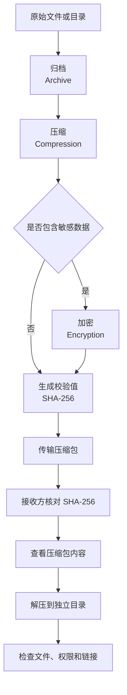
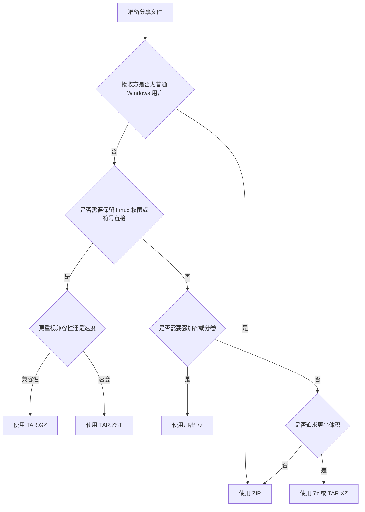

[toc]


## 跨 Windows 与 Linux 分享压缩文件完整指南

本文覆盖普通文件与目录的压缩、跨系统传输、校验、加密、解压、权限处理、文件名兼容性、安全防护和故障排查。

适用场景包括：

- Windows 与 Linux 用户之间发送文档、图片、源代码和项目目录
- 通过邮件、即时通信、网盘、共享目录、U 盘或移动硬盘传输文件
- 打包 Linux 应用、脚本、配置文件和部署产物
- 分享超大文件或海量小文件
- 保护敏感文件
- 保留 Linux 权限、符号链接、扩展属性或稀疏文件
- 编写可重复执行的压缩与解压脚本

------

## 详细大纲

### 基础概念

- 压缩、归档和加密的区别
- ZIP、TAR、GZIP、XZ、Zstandard、7z 的关系
- 为什么目录通常要先归档、再压缩
- 压缩率、速度、内存占用和兼容性之间的权衡

### 格式选择

- 日常分享优先使用 ZIP
- Linux 项目和服务器文件优先使用 TAR.GZ
- 大型数据和高性能场景使用 TAR.ZST
- 追求更小体积时使用 TAR.XZ 或 7z
- 敏感数据使用 AES-256 加密的 7z
- 完整保留 Linux 元数据时使用高级 TAR 方案

### 跨系统兼容性

- Windows 保留名称和非法字符
- 大小写冲突
- 路径长度限制
- 中文及 Unicode 文件名
- 隐藏文件与点文件
- Linux 执行权限、所有者和用户组
- 符号链接与硬链接
- NTFS ACL、备用数据流和 Linux 扩展属性
- 文本文件的 CRLF 与 LF 换行差异

### Windows 操作指南

- 文件资源管理器图形界面
- Windows 内置 `tar`
- PowerShell `Compress-Archive` 与 `Expand-Archive`
- 7-Zip 图形界面
- 7-Zip 命令行
- 加密、测试和分卷压缩

### Linux 操作指南

- `zip` 与 `unzip`
- `tar.gz`
- `tar.zst`
- `tar.xz`
- 7-Zip for Linux
- 单文件 GZIP、XZ 和 Zstandard
- 排除缓存、依赖目录和版本控制目录

### 解压与验证

- 解压前查看内容
- 解压到独立目录
- 避免覆盖已有文件
- 测试压缩包完整性
- SHA-256 校验
- 分卷压缩包的恢复
- 权限和符号链接的恢复

### 安全与最佳实践

- 防止目录穿越和符号链接攻击
- 防止压缩炸弹
- 不以管理员或 root 身份解压不可信压缩包
- 加密不等于真实性验证
- 安全传递密码
- 杀毒与隔离检查
- 版本化命名与清单文件

### 故障排查

- 文件名乱码
- Windows 无法创建某些文件
- 路径过长
- 文件缺失
- 权限丢失
- 文件损坏或 CRC 错误
- 压缩后几乎没有变小
- 解压需要巨大磁盘空间
- 分卷文件不完整
- 压缩包内部多出或缺少一层目录

------

## 先记住这些结论

| 使用场景                     | 首选格式                                  | 主要原因                                         |
| ---------------------------- | ----------------------------------------- | ------------------------------------------------ |
| 普通文档、图片或办公资料     | ZIP                                       | Windows 原生支持，Linux 工具成熟，接收方操作简单 |
| 面向非技术用户               | ZIP                                       | 双击或右键即可处理                               |
| Linux 源代码、脚本、配置目录 | TAR.GZ                                    | 兼容性成熟，通常能保留 Unix 权限和符号链接       |
| 大型项目、日志或数据集       | TAR.ZST                                   | 压缩和解压速度快，压缩率也较好                   |
| 长期存档且更重视体积         | TAR.XZ                                    | 通常体积较小，但压缩速度较慢                     |
| 双方均可使用 7-Zip           | 7z                                        | 压缩率高，支持分卷和 AES-256 加密                |
| 敏感文件                     | 加密 7z                                   | 支持 AES-256 和文件名加密                        |
| 完整 Linux 系统备份          | TAR 加 ACL、xattr、SELinux 和 sparse 选项 | 更适合保存 Linux 文件系统元数据                  |
| 只有一个日志或数据文件       | `.gz`、`.zst` 或 `.xz`                    | 单文件压缩，无需再建立目录归档                   |
| 不确定接收方环境             | ZIP                                       | 最稳妥的最低共同兼容格式                         |

最实用的默认规则是：

> 普通分享使用 ZIP；Linux 工程使用 TAR.GZ；大型数据使用 TAR.ZST；敏感数据使用加密 7z。

------

## 压缩、归档和加密不是一回事

### 归档

归档（Archive）是把多个文件和目录组织到一个文件中。

典型工具是：

- `tar`
- ZIP
- 7z

归档主要解决“很多文件如何变成一个文件”的问题，不一定减小数据体积。

### 压缩

压缩（Compression）通过算法减少数据占用空间。

典型算法或格式包括：

- DEFLATE
- GZIP
- XZ
- Zstandard
- LZMA2

GZIP、XZ 和 Zstandard 本质上是单数据流压缩格式，不能像 ZIP 那样原生保存一组独立目录项。因此，Linux 中常见的做法是：

1. 使用 TAR 把目录归档。
2. 使用 GZIP、XZ 或 Zstandard 压缩 TAR 数据流。

这就是 `.tar.gz`、`.tar.xz` 和 `.tar.zst` 名称的来源。

XZ 官方文档也明确说明，`.xz` 本身没有归档能力，只能容纳一个数据流；`.gz` 和 `.bz2` 也具有类似性质。([tukaani.org](https://tukaani.org/xz/format.html?utm_source=chatgpt.com))

### 加密

加密（Encryption）用于防止没有密码或密钥的人读取内容。

压缩本身不提供保密性。一个普通 ZIP、TAR.GZ 或 7z 压缩包，如果没有启用加密，任何得到文件的人都可以打开。

### 完整处理流程



------

## 常见格式对比

| 格式    | 本质             | Windows 兼容性                                  | Linux 兼容性          | Unix 权限与链接                     | 加密能力               | 推荐用途               |
| ------- | ---------------- | ----------------------------------------------- | --------------------- | ----------------------------------- | ---------------------- | ---------------------- |
| ZIP     | 归档加压缩       | 极佳                                            | 极佳                  | 工具支持不一致                      | 可选，但方案兼容性不同 | 日常跨平台分享         |
| TAR     | 归档，不压缩     | 当前 Windows 可处理                             | 原生常用              | 较好                                | 无                     | 中间归档、磁带或数据流 |
| TAR.GZ  | TAR 加 GZIP      | 较好                                            | 极佳                  | 较好                                | 无                     | Linux 软件包、源代码   |
| TAR.ZST | TAR 加 Zstandard | 新版工具较好                                    | 很好                  | 较好                                | 无                     | 大型数据、快速压缩解压 |
| TAR.XZ  | TAR 加 XZ        | 较好                                            | 很好                  | 较好                                | 无                     | 发布包、长期存档       |
| 7z      | 归档加压缩       | 需要现代 Windows 或 7-Zip                       | 需要 7-Zip 或兼容工具 | 部分支持，跨系统还原不如 TAR 可预测 | AES-256                | 高压缩率、加密、分卷   |
| RAR     | 归档加压缩       | 新版 Windows 可读取，专业功能通常依赖第三方工具 | 通常需额外工具        | 不适合作为开放的默认交换格式        | 支持                   | 接收已有 RAR           |
| GZ      | 单数据流压缩     | 可使用 `tar` 或 7-Zip                           | 原生常用              | 不负责保存目录结构                  | 无                     | 单个日志或 TAR 数据流  |
| ZST     | 单数据流压缩     | 需现代工具                                      | 很好                  | 不负责保存目录结构                  | 无                     | 大文件快速压缩         |
| XZ      | 单数据流压缩     | 需现代工具                                      | 很好                  | 不负责保存目录结构                  | 无                     | 单文件高压缩率         |

GNU tar 1.35 支持 GZIP、BZIP2、XZ、LZIP、LZMA、LZOP 和 Zstandard 等压缩程序，并且可根据文件扩展名自动选择压缩方式。([GNU官网](https://www.gnu.org/software/tar/manual/html_chapter/Formats.html))

Zstandard（Zstd）定位为快速无损压缩算法，在较高压缩率与快速解压之间提供较宽的调节范围，其格式已由 RFC 8878 稳定定义。([facebook.github.io](https://facebook.github.io/zstd/?utm_source=chatgpt.com))

7z 格式支持 LZMA/LZMA2、固实压缩（Solid Compression）、Unicode 文件名、AES-256 加密和压缩后的归档头。([7-zip.org](https://www.7-zip.org/7z.html))

------

## 如何选择格式



### 优先考虑接收方，而不是发送方

发送方可以安装很多工具，但接收方可能只会使用文件资源管理器。

因此，格式选择顺序应为：

1. 接收方能否解压。
2. 是否需要保存文件系统元数据。
3. 是否需要加密。
4. 文件有多大。
5. 是否值得为了更小的体积牺牲时间和兼容性。

### 不要只看压缩率

较高压缩等级通常意味着：

- 压缩时间更长
- 内存占用更高
- 对已经压缩过的文件收益很小
- 解压工具的最低版本要求可能提高

JPEG、PNG、MP4、MKV、MP3、PDF、DOCX、XLSX、APK、ISO、ZIP 和 7z 等文件通常已经包含压缩数据，再压缩一次往往只能得到很小的体积改进。微软也指出，多个 JPEG 文件打成 ZIP 后，总体积通常与原文件接近。([微软支持](https://support.microsoft.com/en-us/windows/experience/storage-filemanagement/zip-and-unzip-files))

------

## 跨 Windows 与 Linux 的核心兼容性问题

### 文件名非法字符

Linux 文件名除了 `/` 和 NUL 字符外限制较少，而 Windows 默认不允许下列字符出现在普通文件名中：

```text
< > : " / \ | ? *
```

Windows 还保留以下设备名称，即使添加扩展名也可能无效：

```text
CON PRN AUX NUL
COM1 至 COM9
LPT1 至 LPT9
```

例如，Linux 中的以下文件可能无法在 Windows 中正常创建：

```text
report?.txt
data:2026.csv
NUL.txt
config.
filename 
```

Windows 不允许文件名以空格或句点结尾，并且默认不应假设文件系统区分大小写。([Microsoft Learn](https://learn.microsoft.com/en-us/windows/win32/fileio/naming-a-file))

### 推荐的跨平台命名规则

对需要在 Windows 和 Linux 间交换的文件，建议只使用：

- 中文、英文字母和数字
- 连字符 `-`
- 下划线 `_`
- 句点 `.`
- 普通空格，但不要放在名称末尾

更严格的自动化项目可只使用：

```text
A-Z a-z 0-9 . _ -
```

建议避免：

- 设备保留名称
- 名称结尾的点或空格
- 同一目录中只有大小写不同的文件
- 很深的目录嵌套
- 文件名开头的 `-`
- 换行符、制表符和控制字符

GNU tar 的可移植性指南也建议使用简单名称，并提醒在不区分大小写的文件系统上不要依赖大小写差异。([GNU官网](https://www.gnu.org/software/tar/manual/html_chapter/Formats.html))

### 大小写冲突

Linux 通常认为以下名称是三个不同文件：

```text
README
Readme
readme
```

Windows 默认通常将它们视为同一个名称。

压缩包中如果同时存在这些文件，Windows 解压工具可能：

- 报错
- 覆盖其中一个文件
- 自动重命名
- 只保留最后处理的文件

在压缩前应主动检查大小写冲突。

Linux 可使用以下命令进行初步检查：

```bash
find project -printf '%P\n' |
    awk '{ key=tolower($0); if (seen[key]++) print "大小写冲突: " $0 }'
```

这是一条含管道的命令，因此不放入 Markdown 表格中。

### 路径长度

不少 Windows 应用仍会受到传统 `MAX_PATH` 约 260 字符限制影响。较新的 Windows API 可以支持更长路径，但应用程序必须主动声明长路径支持，系统配置也可能需要开启。不能假设所有解压程序都支持长路径。([Microsoft Learn](https://learn.microsoft.com/en-us/windows/win32/fileio/maximum-file-path-limitation))

最佳实践：

- 压缩前减少目录层级
- 避免非常长的文件名
- Windows 解压时选择较短目标路径，例如 `C:\x`
- 不要直接解压到很深的用户目录
- 对自动化流程使用支持长路径的现代工具

### 中文与 Unicode 文件名

现代 ZIP 工具通常使用 UTF-8 标志或 Unicode 扩展字段保存文件名。ZIP 规范规定可通过通用标志位 11 表示文件名和注释采用 UTF-8，也定义了 Unicode Path Extra Field。([PKWARE](https://pkware.cachefly.net/webdocs/casestudies/APPNOTE.TXT))

最佳实践：

- 两端均使用较新的解压工具
- Linux 环境使用 UTF-8 Locale
- 避免使用过旧的 ZIP 软件
- 乱码时不要反复解压覆盖，先换工具测试
- 优先尝试新版 7-Zip、Windows 内置 `tar`、GNU `unzip` 或 `bsdtar`

### 隐藏文件与点文件

Linux 中，以 `.` 开头的名称通常是隐藏文件，例如：

```text
.env
.gitignore
.config
.ssh
```

压缩目录本身时通常能够包括点文件：

```bash
tar -czf project.tar.gz project/
zip -r project.zip project/
```

但使用 shell 通配符 `*` 时，点文件通常不会被匹配：

```bash
tar -czf project.tar.gz *
```

上述命令可能遗漏当前目录下的 `.env`、`.gitignore` 等文件。

PowerShell 的 `Compress-Archive` 还有一个额外限制：它会忽略隐藏文件和隐藏目录；在非 Windows 系统上，通过 PowerShell 运行时，以句点开头的文件也属于受影响范围。([Microsoft Learn](https://learn.microsoft.com/en-us/powershell/module/microsoft.powershell.archive/compress-archive?view=powershell-7.6))

### Linux 权限和所有者

Linux 文件通常包含：

- 读、写、执行权限
- 用户所有者
- 用户组
- POSIX ACL
- 扩展属性
- SELinux 安全上下文

Windows 的权限模型与 Linux 不同。即使压缩格式记录了某些 Unix 元数据，Windows 文件系统和解压工具也未必能够完整还原。

实用原则：

- 普通资料分享不需要保存所有者和权限
- Linux 脚本和软件包优先使用 TAR
- 从 Linux 打包后，可以通过 Windows 存储或转发，但不要在 Windows 解压后重新压缩
- 回到 Linux 后检查脚本执行权限
- 完整系统备份不要依赖普通 ZIP

### 执行权限

假设 Linux 文件原本为：

```text
-rwxr-xr-x deploy.sh
```

在 Windows 解压、编辑并重新打包后，回到 Linux 可能变成：

```text
-rw-r--r-- deploy.sh
```

此时需要恢复权限：

```bash
chmod +x deploy.sh
```

对于正式软件项目，应把权限信息纳入版本控制或构建脚本。例如 Git 可记录普通文件与可执行文件之间的模式差异。

### 符号链接

符号链接（Symbolic Link）不是文件内容副本，而是指向其他路径的链接。

不同解压工具可能：

- 正确保留链接
- 将链接目标复制为普通文件
- 将链接保存成文本
- 因安全策略拒绝创建
- 在 Windows 中因权限或开发者模式设置而失败

GNU tar 默认保存符号链接本身；使用 `--dereference` 或 `-h` 时，则保存链接指向的实际文件。GNU 文档建议，为了向不支持符号链接的系统分发，可考虑解除引用，但同时提醒此选项在不可信目录中可能产生安全风险。([GNU官网](https://www.gnu.org/software/tar/manual/html_chapter/Formats.html))

选择原则：

| 目标                                | 处理方式                                 |
| ----------------------------------- | ---------------------------------------- |
| Linux 到 Linux 的备份               | 保留符号链接                             |
| 只在 Windows 上传输，最终回到 Linux | 保留符号链接，不在 Windows 重新打包      |
| 普通用户跨平台打开                  | 尽量避免符号链接，或在打包前复制实际文件 |
| 链接可能指向归档目录外              | 不要解除引用，先人工检查                 |
| 不可信压缩包                        | 在隔离目录中解压并检查链接目标           |

### 硬链接和特殊文件

TAR 可以表达硬链接、设备文件等 Unix 对象，但这些对象在 Windows 上没有完全等价的表现形式。

跨平台分享时应避免包含：

- 块设备
- 字符设备
- Unix Socket
- FIFO 命名管道
- 指向系统路径的危险链接
- 依赖 inode 关系的硬链接集合

GNU tar 的可移植性建议是尽量只包含普通文件和目录。([GNU官网](https://www.gnu.org/software/tar/manual/html_chapter/Formats.html))

### NTFS 特有数据

普通跨平台压缩包通常无法完整保留：

- NTFS 访问控制列表
- EFS 加密状态
- 备用数据流（Alternate Data Streams，ADS）
- 重解析点
- 某些 NTFS 稀疏属性

如果要求完整还原 Windows 系统状态，应使用系统映像、专业备份工具或文件系统级备份，而不是普通 ZIP。

### 换行符不会被自动转换

压缩和解压不会自动把：

- Windows 的 CRLF
- Linux 的 LF

互相转换。

如果脚本在 Linux 上出现：

```text
/bin/bash^M: bad interpreter
```

这通常是文本换行问题，不是压缩包损坏。

可使用：

```bash
dos2unix script.sh
```

或者配置 Git：

```bash
git config core.autocrlf input
```

是否使用该 Git 设置应由项目规范决定。

------

## 压缩前的准备工作

### 建立干净的暂存目录

不要直接从混乱的工作目录打包。推荐先建立一个暂存目录：

```text
release/
├── README.txt
├── docs/
├── src/
└── checksums/
```

然后只压缩 `release`。

这样可以避免无意加入：

- 临时文件
- 密钥
- `.env`
- 浏览器下载缓存
- 编辑器交换文件
- 构建缓存
- 日志
- 数据库临时文件
- Git 历史
- 依赖目录

### 明确是否保留顶层目录

包含顶层目录的压缩包：

```text
project.zip
└── project/
    ├── README.md
    └── src/
```

不包含顶层目录的压缩包：

```text
project-content.zip
├── README.md
└── src/
```

推荐默认包含一个顶层目录。这样接收方即使解压到桌面，也不会把大量文件散落到当前目录。

### 使用版本化名称

推荐：

```text
project-2.4.1-windows-linux.zip
project-2.4.1-source.tar.gz
dataset-2026-07-19.tar.zst
records-2026-Q2-encrypted.7z
```

不推荐：

```text
new.zip
final.zip
final-new.zip
final-final2.zip
data.7z
```

### 在压缩包内加入说明文件

建议包含：

```text
README.txt
MANIFEST.txt
SHA256SUMS
VERSION
```

`README.txt` 至少说明：

- 压缩包用途
- 创建日期
- 创建工具
- 推荐解压方式
- 是否包含符号链接
- 是否要求保留权限
- 主入口文件
- 联系人或来源

------

## Windows 图形界面方案

### 使用文件资源管理器创建 ZIP

适用于：

- 普通文件
- 普通目录
- 非敏感数据
- 接收方不熟悉命令行
- 不要求完整保存 Linux 权限

操作方法：

1. 选中文件或目录。
2. 单击右键。
3. 在 Windows 11 中选择“压缩为 ZIP 文件”，或者选择“显示更多选项”。
4. 在传统菜单中选择“发送到”。
5. 选择“压缩（zipped）文件夹”。
6. 修改生成的 ZIP 文件名称。

微软官方说明中，Windows 可通过右键菜单创建 ZIP，并可通过“全部提取”解压。([微软支持](https://support.microsoft.com/en-us/windows/experience/storage-filemanagement/zip-and-unzip-files))

### 使用文件资源管理器解压

1. 将压缩包保存到本地磁盘。
2. 右键压缩包。
3. 选择“全部提取”。
4. 指定一个新的空目录。
5. 解压完成后检查文件数量和目录结构。

不要养成直接在压缩包预览窗口中编辑文件的习惯。某些程序打开压缩包内文件时，会先写入临时目录，修改结果未必能可靠写回压缩包。

### 当前 Windows 11 的格式支持

Windows 11 24H2 支持 ZIP、RAR、7z 和 TAR 等归档格式，但 Windows 内置界面对加密压缩包的操作仍不受支持；加密文件应使用 7-Zip 等工具。([微软支持](https://support.microsoft.com/en-us/windows/experience/storage-filemanagement/zip-and-unzip-files))

为确保行为可预测：

- 创建普通共享包时，使用 ZIP
- 创建 TAR.GZ 时，使用内置 `tar`
- 创建加密 7z 时，使用 7-Zip
- 收到未知格式时，优先使用最新版 7-Zip 或 Windows `tar`

------

## Windows 内置 tar 方案

现代 Windows 自带 `tar` 命令。Windows 版本基于 libarchive 的 `bsdtar`，可创建、列出和提取 `.tar`、`.tar.gz`、`.zip` 和 `.7z` 等归档。([Microsoft Learn](https://learn.microsoft.com/en-us/windows/tar/))

可以在以下环境中使用：

- 命令提示符
- PowerShell
- Windows Terminal

### 查看帮助

```powershell
tar --help
```

### 将目录压缩为 TAR.GZ

```powershell
tar -czf project.tar.gz .\project
```

参数含义：

| 参数 | 含义               |
| ---- | ------------------ |
| `-c` | 创建归档           |
| `-z` | 使用 GZIP          |
| `-f` | 后面指定归档文件名 |

### 将目录压缩为 ZIP

```powershell
tar -caf project.zip .\project
```

`-a` 表示根据输出文件扩展名自动选择格式。

### 压缩目录内容但不保留外层目录

```powershell
tar -czf project-content.tar.gz -C .\project .
```

其中：

- `-C .\project` 表示先切换到该目录
- `.` 表示归档该目录的内容

### 查看压缩包内容

```powershell
tar -tf project.tar.gz
```

建议在解压前始终先查看列表。

### 解压到指定目录

```powershell
New-Item -ItemType Directory -Path .\extracted -Force
tar -xf project.tar.gz -C .\extracted
```

### 使用场景建议

Windows 内置 `tar` 适合：

- 创建 TAR.GZ
- 处理 Linux 发来的 TAR 包
- 编写与 Linux 相似的脚本
- 不希望安装额外软件的环境

对加密、复杂分卷和高级 7z 参数，仍建议使用 7-Zip。

------

## PowerShell ZIP 方案

### 创建 ZIP

压缩一个目录并保留顶层目录：

```powershell
Compress-Archive `
    -LiteralPath 'C:\Share\project' `
    -DestinationPath 'C:\Share\project.zip'
```

仅压缩目录内部内容：

```powershell
Compress-Archive `
    -Path 'C:\Share\project\*' `
    -DestinationPath 'C:\Share\project-content.zip'
```

处理名称中包含方括号等特殊字符时，优先使用 `-LiteralPath`。

### 解压 ZIP

```powershell
Expand-Archive `
    -LiteralPath 'C:\Share\project.zip' `
    -DestinationPath 'C:\Share\project-extracted'
```

需要覆盖已有文件时：

```powershell
Expand-Archive `
    -LiteralPath 'C:\Share\project.zip' `
    -DestinationPath 'C:\Share\project-extracted' `
    -Force
```

### 重要限制

`Compress-Archive` 和 `Expand-Archive` 只处理 ZIP。微软当前文档还说明，底层 `ZipArchive` API 对单个文件存在 2 GB 限制，并且 `Compress-Archive` 会忽略隐藏文件和目录。([Microsoft Learn](https://learn.microsoft.com/en-us/powershell/module/microsoft.powershell.archive/compress-archive?view=powershell-7.6))

因此，以下场景不要优先使用 `Compress-Archive`：

- 压缩包中存在大于 2 GB 的单个文件
- 必须包含隐藏文件
- 必须包含 Linux 点文件
- 需要保存符号链接
- 需要加密
- 需要分卷
- 需要高级排除规则

这些场景优先使用 Windows `tar` 或 7-Zip。

------

## Windows 7-Zip 方案

截至 2026 年 6 月，7-Zip 官方版本为 26.02。官方 Windows 版本支持创建和解压 7z、XZ、BZIP2、GZIP、TAR、ZIP 和 WIM，并支持解压 RAR 等多种格式。7-Zip 在 7z 和 ZIP 中支持 AES-256 加密。([7-zip.org](https://www.7-zip.org/?data1=hiip))

Linux 上不再建议继续依赖多年未更新的旧 p7zip 16.02；7-Zip 官方已经提供 Linux 版本。([7-zip.org](https://www.7-zip.org/links.html))

### 图形界面创建普通 7z

1. 安装官方 7-Zip。
2. 选中文件或目录。
3. 右键选择“7-Zip”。
4. 选择“添加到压缩包”。
5. 压缩格式选择 `7z`。
6. 普通使用保持 LZMA2 和默认压缩等级。
7. 单击“确定”。

### 图形界面创建兼容 ZIP

在“添加到压缩包”窗口中：

- 压缩格式选择 `zip`
- 压缩方法优先选择 Deflate
- 不需要极限压缩
- 不启用非必要的特殊算法

这样通常可获得更广泛兼容性。

### 7-Zip 命令行名称

Windows 安装版通常使用：

```powershell
7z
```

也可能需要完整路径：

```powershell
& 'C:\Program Files\7-Zip\7z.exe'
```

Linux 官方独立版本通常使用：

```bash
7zz
```

部分发行版或旧安装使用：

```bash
7z
```

本文命令中的 `7z` 可根据实际安装替换为 `7zz`。

### 创建 7z

```powershell
7z a project.7z .\project
```

### 创建 ZIP

```powershell
7z a -tzip project.zip .\project
```

### 查看内容

```powershell
7z l project.7z
```

### 测试完整性

```powershell
7z t project.7z
```

### 解压并保留目录结构

```powershell
7z x project.7z -o'.\project-extracted'
```

`x` 会按压缩包内路径还原目录结构。

### 只提取文件而忽略目录结构

```powershell
7z e project.7z -o'.\flat-output'
```

一般不建议使用 `e`，因为不同目录中的同名文件可能发生冲突。

------

## Linux ZIP 方案

### 创建包含顶层目录的 ZIP

```bash
zip -r project.zip project/
```

### 创建目录内容 ZIP

```bash
cd project
zip -r ../project-content.zip .
cd ..
```

使用 `.` 而不是 `*` 有助于包含点文件。

### 查看 ZIP 内容

```bash
unzip -l project.zip
```

### 测试 ZIP 完整性

```bash
unzip -t project.zip
```

### 解压到指定目录

```bash
mkdir -p project-extracted
unzip project.zip -d project-extracted
```

### 不覆盖已有文件

```bash
unzip -n project.zip -d project-extracted
```

### 自动覆盖已有文件

```bash
unzip -o project.zip -d project-extracted
```

对不可信压缩包不建议直接使用 `-o`。

### 排除常见目录

```bash
zip -r project.zip project/ \
    -x '*/.git/*' \
       '*/node_modules/*' \
       '*/__pycache__/*' \
       '*/.venv/*'
```

引号可以防止通配模式提前被当前 Shell 展开。

------

## Linux TAR.GZ 方案

### 创建包含顶层目录的 TAR.GZ

```bash
tar -czf project.tar.gz project/
```

### 创建目录内容 TAR.GZ

```bash
tar -czf project-content.tar.gz -C project .
```

### 查看内容

```bash
tar -tf project.tar.gz
```

详细查看：

```bash
tar -tvf project.tar.gz
```

### 解压到指定目录

```bash
mkdir -p project-extracted
tar -xf project.tar.gz -C project-extracted
```

现代 GNU tar 通常可以自动识别压缩格式，因此解压时一般不必显式写 `-z`。GNU tar 会先根据文件签名字节识别格式，必要时再参考扩展名。([GNU官网](https://www.gnu.org/software/tar/manual/html_chapter/Formats.html))

### 排除目录

```bash
tar -czf project.tar.gz \
    --exclude='.git' \
    --exclude='node_modules' \
    --exclude='__pycache__' \
    --exclude='.venv' \
    project/
```

### 不跨越其他挂载点

进行文件系统备份时：

```bash
tar -czf data.tar.gz --one-file-system /path/to/data
```

这可以避免递归进入挂载在目标目录下的其他文件系统。

------

## Linux TAR.ZST 方案

### 简单创建

```bash
tar --zstd -cf project.tar.zst project/
```

### 使用扩展名自动选择

```bash
tar -caf project.tar.zst project/
```

前提是系统安装了 Zstandard，且当前 tar 支持自动选择该压缩程序。

### 多线程压缩

```bash
tar -I 'zstd -T0 -6' -cf project.tar.zst project/
```

参数含义：

| 参数  | 含义                   |
| ----- | ---------------------- |
| `-T0` | 自动使用可用 CPU 线程  |
| `-6`  | 中等压缩等级           |
| `-I`  | 指定外部压缩程序及参数 |

日常共享通常没有必要直接使用 `-19`、`-20` 等极高等级。极高等级会显著增加时间和内存，而体积收益未必明显。

### 查看和解压

```bash
tar -tf project.tar.zst
mkdir -p project-extracted
tar -xf project.tar.zst -C project-extracted
```

如果 tar 未自动识别：

```bash
tar --zstd -xf project.tar.zst -C project-extracted
```

### 适用场景

- 大型源码树
- 大量日志
- 数据集
- 容器导出文件
- 高频备份
- 追求快速解压的分发包

------

## Linux TAR.XZ 方案

### 创建

```bash
tar -cJf project.tar.xz project/
```

或者：

```bash
tar -caf project.tar.xz project/
```

### 查看

```bash
tar -tf project.tar.xz
```

### 解压

```bash
mkdir -p project-extracted
tar -xf project.tar.xz -C project-extracted
```

### 适用场景

- 发布源码
- 长期存档
- 网络带宽比压缩时间更宝贵
- 内容以文本、源码或可压缩二进制为主

不适合：

- 高频打包
- 低内存设备
- 已经压缩过的媒体文件
- 希望快速生成压缩包的交互式工作

------

## 单个文件的压缩方案

### GZIP

保留原文件并生成 `.gz`：

```bash
gzip -k server.log
```

解压并保留 `.gz`：

```bash
gzip -dk server.log.gz
```

测试：

```bash
gzip -t server.log.gz
```

### Zstandard

保留原文件：

```bash
zstd -k server.log
```

解压：

```bash
zstd -d -k server.log.zst
```

测试：

```bash
zstd -t server.log.zst
```

### XZ

保留原文件：

```bash
xz -k server.log
```

解压：

```bash
xz -d -k server.log.xz
```

测试：

```bash
xz -t server.log.xz
```

### 何时不用单文件压缩格式

如果需要同时分享：

- 文件及说明
- 多个相关日志
- 目录结构
- 权限信息
- 多个数据分片

应先使用 TAR 或直接使用 ZIP、7z。

------

## Linux 7-Zip 方案

先确认命令：

```bash
command -v 7zz
command -v 7z
```

### 创建 7z

```bash
7zz a project.7z project/
```

### 创建 ZIP

```bash
7zz a -tzip project.zip project/
```

### 查看内容

```bash
7zz l project.7z
```

### 测试

```bash
7zz t project.7z
```

### 解压

```bash
mkdir -p project-extracted
7zz x project.7z -oproject-extracted
```

注意，`-o` 与目录名之间通常没有空格。

------

## 加密压缩包

### 推荐使用 7z 加密

7z 格式支持 AES-256，还可加密文件名和归档头。7-Zip 官方说明其 AES-256 密钥通过基于 SHA-256 的派生过程从密码生成，并使用大量迭代提高穷举成本。([7-zip.org](https://www.7-zip.org/7z.html?utm_source=chatgpt.com))

### 命令行安全创建方式

Windows：

```powershell
7z a -t7z -mhe=on -p secure-files.7z .\private-files
```

Linux：

```bash
7zz a -t7z -mhe=on -p secure-files.7z private-files/
```

参数含义：

| 参数      | 含义               |
| --------- | ------------------ |
| `-t7z`    | 指定 7z 格式       |
| `-mhe=on` | 加密文件名和归档头 |
| `-p`      | 交互式输入密码     |
| `a`       | 添加文件并创建归档 |

不要把密码直接写在命令中，例如：

```text
-pMySecretPassword
```

这样可能把密码暴露在：

- Shell 历史
- 进程列表
- 日志
- 自动化平台记录
- 屏幕录制
- 命令行审计系统

### 解压加密 7z

```powershell
7z x secure-files.7z -o'.\secure-output'
```

或者：

```bash
7zz x secure-files.7z -osecure-output
```

程序会提示输入密码。

### 不要依赖传统 ZIP 加密

传统 PKWARE ZIP 加密，也称 ZipCrypto，当前 ZIP 规范明确将其描述为按现代标准较弱，只建议用于低安全需求或兼容旧应用。([PKWARE](https://pkware.cachefly.net/webdocs/casestudies/APPNOTE.TXT?utm_source=chatgpt.com))

因此：

- 敏感数据不要使用传统 ZipCrypto
- 需要强加密时优先使用 7z AES-256
- AES 加密 ZIP 的工具兼容性不如普通 ZIP
- Windows 内置界面不能处理加密归档
- 双方应事先确认解压工具

### 密码传递原则

压缩包和密码不要通过同一条消息发送。

例如：

- 压缩包通过邮件发送，密码通过电话告知
- 压缩包通过网盘发送，密码通过企业即时通信发送
- 文件链接通过聊天发送，密码通过短信发送

密码应：

- 足够长
- 不复用账户密码
- 不包含明显姓名、生日或公司名称
- 优先采用多个随机词组成的长口令

### 加密不提供发送者真实性

攻击者仍可能替换整个加密压缩包。

因此，重要文件还应使用：

- SHA-256 校验值，通过可信渠道确认
- 数字签名
- OpenPGP 签名
- 代码签名
- 受控文件分享平台

------

## SHA-256 完整性校验

ZIP 内部通常使用 CRC32 检查文件错误。ZIP 规范要求每个文件提供 CRC32，但 CRC32 主要用于检测意外损坏，不是用于抵抗恶意修改的密码学验证。([PKWARE](https://pkware.cachefly.net/webdocs/casestudies/APPNOTE.TXT?utm_source=chatgpt.com))

跨系统传输时推荐额外生成 SHA-256。

### Windows 生成 SHA-256

```powershell
Get-FileHash `
    -Algorithm SHA256 `
    -LiteralPath '.\project.tar.zst'
```

只输出哈希：

```powershell
(Get-FileHash `
    -Algorithm SHA256 `
    -LiteralPath '.\project.tar.zst').Hash.ToLower()
```

生成可供 Linux 校验的文件：

```powershell
$file = 'project.tar.zst'
$hash = (Get-FileHash -Algorithm SHA256 -LiteralPath $file).Hash.ToLower()
"$hash *$file" | Set-Content -Encoding ascii "$file.sha256"
```

### Linux 生成 SHA-256

```bash
sha256sum project.tar.zst > project.tar.zst.sha256
```

### Linux 校验

```bash
sha256sum -c project.tar.zst.sha256
```

成功时会显示：

```text
project.tar.zst: OK
```

### Windows 手动核对 Linux 提供的哈希

```powershell
Get-Content '.\project.tar.zst.sha256'
Get-FileHash -Algorithm SHA256 '.\project.tar.zst'
```

确认两个哈希值完全相同，不区分字母大小写。

### 哈希值必须通过可信渠道获得

如果攻击者可以同时替换：

- 压缩包
- `.sha256` 文件

那么校验不会发现替换行为。

重要数据应通过另一个可信渠道确认哈希，或使用数字签名。

------

## 解压前必须做的检查

### 检查来源

确认：

- 谁发送了文件
- 是否预期收到该文件
- 文件名和大小是否合理
- 下载地址是否可信
- 是否有 SHA-256 或签名
- 是否包含可执行程序

### 先查看列表

ZIP：

```bash
unzip -l package.zip
```

TAR：

```bash
tar -tf package.tar.gz
```

7z：

```bash
7zz l package.7z
```

重点检查：

- 是否出现绝对路径
- 是否大量出现 `../`
- 是否包含异常长路径
- 是否包含系统目录名称
- 是否包含符号链接
- 是否包含可执行文件
- 文件数量是否异常
- 解压后大小是否异常巨大

### 解压到新建空目录

Linux：

```bash
mkdir -p inspect-package
tar -xf package.tar.gz -C inspect-package
```

Windows：

```powershell
New-Item -ItemType Directory -Path '.\inspect-package'
tar -xf '.\package.tar.gz' -C '.\inspect-package'
```

不要直接解压到：

- 用户主目录
- 桌面根目录
- 项目工作目录
- `/`
- `/usr`
- `C:\Windows`
- `C:\Program Files`
- Web 服务器目录

### 不要以高权限解压不可信文件

不可信压缩包不要使用：

```bash
sudo tar -xf unknown.tar
```

也不要使用管理员 PowerShell直接解压。

普通用户权限可以限制潜在破坏范围。

------

## 压缩包安全风险

### 目录穿越攻击

恶意压缩包可能包含类似路径：

```text
../../../../tmp/evil
..\..\..\Windows\Startup\evil.exe
```

不安全的解压程序可能把文件写出目标目录。这类问题通常称为：

- Archive Path Traversal
- Zip Slip
- Directory Traversal

OWASP 明确提醒，ZIP 等归档可能利用 `../` 路径写入预期目录之外的位置。([owasp.org](https://owasp.org/www-project-web-security-testing-guide/latest/4-Web_Application_Security_Testing/10-Business_Logic_Testing/09-Test_Upload_of_Malicious_Files?utm_source=chatgpt.com))

现代工具通常会阻止明显路径穿越，但不要假设所有库、脚本和旧工具都安全。

### 符号链接攻击

恶意归档可能先创建一个指向系统目录的符号链接，再通过该链接写入文件。

OWASP 也将归档中的符号链接攻击列为需要检查的问题。([owasp.org](https://owasp.org/www-project-web-security-testing-guide/latest/4-Web_Application_Security_Testing/10-Business_Logic_Testing/09-Test_Upload_of_Malicious_Files?utm_source=chatgpt.com))

防护方式：

- 使用最新解压软件
- 在空目录中解压
- 不以 root 或管理员运行
- 解压前查看链接
- 自动化服务禁止链接逃离目标目录
- 解压代码应使用规范化路径并验证目标路径前缀

### 压缩炸弹

压缩炸弹（Compression Bomb 或 Zip Bomb）可能具有：

- 很小的压缩文件
- 极大的解压后体积
- 巨量重复文件
- 多层嵌套压缩包
- 高压缩率零数据
- 极深目录结构

OWASP 建议同时限制上传文件大小和解压后的数据大小。([OWASP Cheat Sheet Series](https://cheatsheetseries.owasp.org/cheatsheets/File_Upload_Cheat_Sheet.html?utm_source=chatgpt.com))

解压前应确认：

- 可用磁盘空间
- 文件总数
- 预计解压体积
- 嵌套归档层数
- 单个文件最大尺寸

### 可执行文件风险

以下内容应特别谨慎：

```text
.exe
.msi
.bat
.cmd
.ps1
.scr
.js
.vbs
.lnk
.sh
.desktop
AppImage
ELF 可执行文件
Office 宏文件
```

压缩并不会使恶意程序变安全。

------

## 避免覆盖已有文件

### GNU tar

不覆盖已有文件并在冲突时报错：

```bash
tar --keep-old-files -xf package.tar.gz -C output
```

跳过已有文件但不把它视为错误：

```bash
tar --skip-old-files -xf package.tar.gz -C output
```

GNU tar 文档说明，`--keep-old-files` 会在目标文件已经存在时拒绝覆盖并返回错误；`--skip-old-files` 则跳过这些文件。([GNU官网](https://www.gnu.org/s/tar/manual/html_chapter/tar-invocation.html))

### unzip

不覆盖：

```bash
unzip -n package.zip -d output
```

### 最安全方式

最安全的方式不是依赖覆盖参数，而是每次解压到新的空目录：

```text
output-2026-07-19/
```

验证后再替换正式目录。

------

## 分卷压缩

### 什么时候需要分卷

- U 盘使用 FAT32
- 邮件有附件大小限制
- 网盘限制单文件大小
- 需要按固定介质容量拆分
- 网络不稳定，希望逐卷传输

FAT32 的单文件最大尺寸为 4 GiB，因此大于该尺寸的压缩包无法直接复制到 FAT32 介质。([Microsoft Learn](https://learn.microsoft.com/en-us/windows/win32/fileio/filesystem-functionality-comparison?utm_source=chatgpt.com))

对于现代移动存储，可在兼容条件允许时考虑使用 exFAT，以避免 FAT32 的 4 GiB 单文件限制。

### 使用 7-Zip 创建分卷

每卷 2 GiB：

```powershell
7z a -v2g archive.7z .\large-folder
```

Linux：

```bash
7zz a -v2g archive.7z large-folder/
```

可能生成：

```text
archive.7z.001
archive.7z.002
archive.7z.003
```

### 解压分卷

确保所有分卷：

- 位于同一目录
- 名称未改变
- 编号连续
- 每卷传输完整

然后对第一卷执行：

```powershell
7z x archive.7z.001
```

或者：

```bash
7zz x archive.7z.001
```

不要逐个解压 `.002`、`.003`。

### 分卷最佳实践

- 同时生成每一卷的 SHA-256
- 生成一个总清单
- 不要单独重命名某一卷
- 发送前测试第一卷能否读取完整归档
- 接收方确认卷数
- 能避免分卷时尽量避免，因为缺少任何一卷都可能导致归档无法完整恢复

------

## 完整保留 Linux 文件系统元数据

普通跨平台分享通常不需要以下高级方案。

需要保存 Linux 系统目录、服务配置或应用运行环境时，可考虑：

```bash
sudo tar \
    --format=posix \
    --acls \
    --xattrs \
    --selinux \
    --sparse \
    --numeric-owner \
    -I 'zstd -T0 -6' \
    -cpf backup.tar.zst \
    -C / \
    path/to/data
```

参数含义：

| 参数              | 作用                     |
| ----------------- | ------------------------ |
| `--format=posix`  | 使用 POSIX/PAX 扩展格式  |
| `--acls`          | 保存 POSIX ACL           |
| `--xattrs`        | 保存扩展属性             |
| `--selinux`       | 保存 SELinux 安全上下文  |
| `--sparse`        | 高效保存稀疏文件         |
| `--numeric-owner` | 使用数字 UID 和 GID      |
| `-p`              | 创建时保留权限信息       |
| `-C /`            | 将归档成员保存为相对路径 |
| `-I`              | 使用指定的压缩程序       |

GNU tar 明确提供 `--acls`、`--xattrs` 和 `--numeric-owner` 等选项。([GNU官网](https://www.gnu.org/s/tar/manual/html_chapter/tar-invocation.html))

对于虚拟磁盘、数据库文件或其他稀疏文件，`--sparse` 可识别文件空洞，只保存实际数据部分，避免压缩包因空洞展开而异常增大。([GNU官网](https://www.gnu.org/software/tar/manual/html_chapter/Formats.html))

### 高级恢复

只对可信归档操作：

```bash
sudo tar \
    --acls \
    --xattrs \
    --selinux \
    --same-owner \
    --same-permissions \
    -xpf backup.tar.zst \
    -C /restore-root
```

注意：

- 目标文件系统必须支持相关属性
- 用户和用户组 ID 可能与原系统不同
- SELinux 策略可能不同
- 不应在 Windows 解压后重新打包
- 某些系统的 tar 构建可能未启用 ACL、xattr 或 SELinux 支持
- 使用 root 恢复前必须验证来源、签名和内容列表

普通用户解压时，GNU tar 默认不会尝试恢复归档内所有者，并会结合当前 `umask` 调整权限。([GNU官网](https://www.gnu.org/s/tar/manual/html_chapter/tar-invocation.html))

------

## 可重复构建的压缩包

同一目录多次压缩，哈希值可能不同，原因包括：

- 文件修改时间不同
- 目录枚举顺序不同
- 用户和用户组不同
- 工具版本不同
- 压缩器版本不同
- ZIP 时间字段精度不同
- 文件权限不同

构建发布产物时，可考虑确定性归档：

```bash
export SOURCE_DATE_EPOCH=1767225600

tar \
    --sort=name \
    --mtime="@${SOURCE_DATE_EPOCH}" \
    --owner=0 \
    --group=0 \
    --numeric-owner \
    -czf project-reproducible.tar.gz \
    project/
```

这会规范：

- 文件顺序
- 时间戳
- 所有者
- 用户组

但它也会修改归档中记录的时间信息，因此不适合需要保留原始时间戳的备份。

GNU tar 的 `--sort=name` 可按名称排序目录项，以提高归档可重复性。([GNU官网](https://www.gnu.org/s/tar/manual/html_chapter/tar-invocation.html))

------

## 文件数量很多时为什么要先打包

传输十万个小文件通常比传输一个大压缩包慢，原因包括：

- 每个文件需要单独创建和关闭
- 需要反复更新目录元数据
- 网络协议存在逐文件往返
- 杀毒程序会逐个扫描
- 云盘客户端会逐项同步
- 文件系统随机 I/O 增加

把目录打成一个归档通常能显著改善：

- 上传速度
- 下载速度
- 复制稳定性
- 文件完整性
- 目录结构一致性

但压缩完成后，SMB 等网络层再进行压缩通常收益很小，因为 ZIP、7z 和 RAR 已属于难以再次压缩的数据。微软的 SMB 性能说明也将这些归档列为不可压缩数据。([Microsoft Learn](https://learn.microsoft.com/en-us/troubleshoot/windows-server/networking/slow-smb-file-transfer?utm_source=chatgpt.com))

------

## 常用命令速查

### Windows

创建 ZIP：

```powershell
tar -caf package.zip .\folder
```

创建 TAR.GZ：

```powershell
tar -czf package.tar.gz .\folder
```

查看：

```powershell
tar -tf package.tar.gz
```

解压：

```powershell
tar -xf package.tar.gz -C .\output
```

创建 7z：

```powershell
7z a package.7z .\folder
```

测试 7z：

```powershell
7z t package.7z
```

加密：

```powershell
7z a -t7z -mhe=on -p secure.7z .\folder
```

计算 SHA-256：

```powershell
Get-FileHash -Algorithm SHA256 .\package.7z
```

### Linux

创建 ZIP：

```bash
zip -r package.zip folder/
```

解压 ZIP：

```bash
unzip package.zip -d output
```

创建 TAR.GZ：

```bash
tar -czf package.tar.gz folder/
```

创建 TAR.ZST：

```bash
tar --zstd -cf package.tar.zst folder/
```

创建 TAR.XZ：

```bash
tar -cJf package.tar.xz folder/
```

查看 TAR：

```bash
tar -tf package.tar.zst
```

解压 TAR：

```bash
tar -xf package.tar.zst -C output
```

测试 ZIP：

```bash
unzip -t package.zip
```

测试 7z：

```bash
7zz t package.7z
```

计算 SHA-256：

```bash
sha256sum package.tar.zst
```

------

## 推荐工作流

### 普通资料从 Windows 发给 Linux

Windows：

```powershell
tar -caf documents-2026-07.zip .\documents
Get-FileHash -Algorithm SHA256 .\documents-2026-07.zip
```

Linux：

```bash
unzip -l documents-2026-07.zip
mkdir documents-output
unzip documents-2026-07.zip -d documents-output
```

### Linux 项目发给 Windows

Linux：

```bash
tar -czf myapp-1.3.0.tar.gz \
    --exclude='.git' \
    --exclude='node_modules' \
    --exclude='__pycache__' \
    myapp/

sha256sum myapp-1.3.0.tar.gz > myapp-1.3.0.tar.gz.sha256
```

Windows：

```powershell
tar -tf .\myapp-1.3.0.tar.gz
New-Item -ItemType Directory .\myapp-output
tar -xf .\myapp-1.3.0.tar.gz -C .\myapp-output
```

### 大型数据从 Linux 发给 Windows

Linux：

```bash
tar -I 'zstd -T0 -6' \
    -cf dataset-2026-07.tar.zst \
    dataset/

sha256sum dataset-2026-07.tar.zst \
    > dataset-2026-07.tar.zst.sha256
```

Windows 可使用较新的 `tar`：

```powershell
tar -tf .\dataset-2026-07.tar.zst
tar -xf .\dataset-2026-07.tar.zst -C .\dataset-output
```

如果 Windows 环境无法识别 TAR.ZST，接收方可使用新版 7-Zip。

### 敏感目录双向分享

发送方：

```powershell
7z a -t7z -mhe=on -p finance-2026-Q2.7z .\finance
7z t finance-2026-Q2.7z
Get-FileHash -Algorithm SHA256 .\finance-2026-Q2.7z
```

接收方：

```bash
7zz t finance-2026-Q2.7z
mkdir finance-output
7zz x finance-2026-Q2.7z -ofinance-output
```

密码通过独立渠道传递。

------

## 常见故障排查

| 问题                       | 常见原因                                      | 解决方案                                        |
| -------------------------- | --------------------------------------------- | ----------------------------------------------- |
| 中文文件名乱码             | 旧工具未正确处理 UTF-8                        | 换用新版 7-Zip、Windows `tar` 或现代 `unzip`    |
| Windows 报文件名无效       | Linux 文件包含 Windows 保留字符或名称         | 在 Linux 解压或重命名后重新打包                 |
| 解压时提示路径过长         | 目标路径过深或工具不支持长路径                | 解压到 `C:\x` 等短路径，并换用现代工具          |
| ZIP 中缺少 `.env`          | 使用了 `*` 通配符，或 PowerShell 忽略隐藏文件 | 压缩目录本身，或改用 `tar`、`zip -r directory/` |
| PowerShell 无法压缩大文件  | `Compress-Archive` 的单文件限制               | 改用 Windows `tar` 或 7-Zip                     |
| Linux 脚本无法执行         | 执行权限丢失                                  | 使用 TAR 打包，或执行 `chmod +x`                |
| 符号链接变成普通文件       | 工具解除引用或不支持链接                      | 使用 TAR 和兼容工具，避免在 Windows 重新打包    |
| CRC Error 或 Data Error    | 下载不完整、存储损坏、缺少分卷                | 核对 SHA-256、重新下载、检查所有分卷            |
| 压缩包打不开               | 扩展名错误、文件头损坏、实际并非该格式        | 使用 `file`、7-Zip 测试或重新传输               |
| 压缩后几乎没变小           | 原文件已经压缩                                | 使用低压缩等级或仅归档，不做极限压缩            |
| 解压磁盘空间不足           | 解压后体积远大于压缩包                        | 查看压缩包列表和解压后大小，准备足够空间        |
| 解压后多一层目录           | 打包时包含了顶层目录                          | 使用 `-C directory .` 创建内容归档              |
| 解压后文件散落             | 打包时没有顶层目录                            | 先创建独立输出目录再解压                        |
| 某些文件被覆盖             | 大小写冲突或目标目录已有文件                  | 解压到空目录，检查名称冲突                      |
| 分卷无法解压               | 缺少某一卷或卷名被修改                        | 补齐所有卷，并从 `.001` 开始解压                |
| 7z 解压一个文件很慢        | 使用了固实压缩                                | 完整解压，或创建非固实归档用于随机访问          |
| 文件时间变化               | 工具或文件系统时间精度不同                    | 不把时间戳作为唯一完整性依据，使用哈希          |
| `.tar.gz` 被误认为双重扩展 | 实际是 TAR 归档经过 GZIP 压缩                 | 使用 `tar -xf`，不要只用普通文件重命名          |
| `not in gzip format`       | 扩展名与真实格式不一致                        | 使用 `file archive` 或 `7z l archive` 检查      |
| 解压提示权限不足           | 目标目录不可写或归档包含特殊对象              | 换到用户可写目录，不要立即使用 root             |

------

## 收到损坏的 7z 时

先测试：

```bash
7zz t archive.7z
```

常见情况：

- 能列出文件，但部分文件出现 CRC 或 Data Error
- 无法读取归档头
- 文件尾部未下载完整
- 某个分卷缺失
- 传输过程中被截断

7-Zip 官方指出，固实压缩包一旦部分数据损坏，后续位于同一固实数据块中的多个文件都可能受到影响，恢复通常比较困难。([7-zip.org](https://www.7-zip.org/recover.html?utm_source=chatgpt.com))

因此，重要归档应：

- 创建后立即执行测试
- 生成 SHA-256
- 保留原始文件
- 重要长期档案使用多个副本
- 不把唯一备份放在一个固实 7z 中
- 对容错要求高的数据考虑分文件或分块保存

------

## 工具和版本最佳实践

- 使用仍在维护的工具
- 通过操作系统软件源或官方网站安装
- 避免从随机下载站获取压缩软件
- 定期更新解压工具，因为归档解析器属于常见安全攻击面
- Linux 上优先使用官方新 7-Zip，而不是多年未维护的旧 p7zip 16.02
- 自动化脚本中记录工具版本
- 发送给外部人员时使用基础格式和普通压缩参数
- 不使用不必要的实验性压缩算法

7-Zip 26.02 和近期 LZMA SDK 更新中包含漏洞与安全问题修复，因此保持工具更新很重要。([7-zip.org](https://7-zip.org/sdk.html?utm_source=chatgpt.com))

------

## 团队级最佳实践模板

### 普通文件交换规范

- 默认格式：ZIP
- 文件名：ASCII、数字、中文、连字符、下划线
- 顶层目录：必须包含
- 压缩包名称：项目、版本、日期
- 校验：大于 100 MB 时提供 SHA-256
- 禁止：密码、密钥和临时文件
- 解压：必须解压到新目录

### Linux 工程包规范

- 默认格式：TAR.GZ
- 大于数 GB：TAR.ZST
- 保留执行权限
- 排除 `.git`、缓存和本地依赖
- 包含 README、VERSION 和校验文件
- Windows 只负责存储和传输，不重新打包

### 敏感数据规范

- 格式：7z
- 加密：AES-256
- 文件名加密：开启
- 密码：交互式输入
- 密码通道：与文件传输通道分离
- 完整性：SHA-256 或数字签名
- 生命周期：接收确认后按制度清理临时明文副本

### 长期归档规范

- 不只保存压缩包
- 至少两个独立存储位置
- 定期执行完整性校验
- 保存工具和格式说明
- 避免使用罕见专有格式
- 对 Linux 系统备份保存 ACL、xattr 和所有者信息
- 对关键数据考虑非固实、分块或带纠错的存储方案

------

## 最终检查清单

### 发送方

-  格式是否适合接收方
-  是否包含一个明确的顶层目录
-  是否排除了密钥、密码和临时文件
-  是否包含隐藏文件和点文件
-  文件名是否符合 Windows 规则
-  是否存在大小写冲突
-  是否存在过长路径
-  是否需要保存执行权限或符号链接
-  是否需要加密
-  是否测试了压缩包
-  是否生成 SHA-256
-  是否记录文件数量和预计解压体积
-  是否使用版本化名称

### 接收方

-  文件来源是否可信
-  SHA-256 是否匹配
-  是否先查看了压缩包列表
-  是否检查了异常路径和符号链接
-  是否准备了足够磁盘空间
-  是否解压到新的空目录
-  是否避免使用管理员或 root
-  是否检查可执行文件
-  是否核对文件数量
-  是否检查脚本执行权限
-  是否确认所有分卷齐全
-  是否在使用前进行安全扫描

------

## 术语表

| 中文术语     | 英文术语或缩写                      | 含义                              |
| ------------ | ----------------------------------- | --------------------------------- |
| 归档         | Archive                             | 将多个文件和目录组织成一个文件    |
| 压缩         | Compression                         | 减少数据占用空间                  |
| 解压         | Decompression / Extraction          | 恢复压缩或归档内容                |
| 压缩率       | Compression Ratio                   | 原始大小与压缩后大小的比例        |
| 无损压缩     | Lossless Compression                | 解压后数据与原始数据完全一致      |
| 固实压缩     | Solid Compression                   | 多个文件连续压缩以提高压缩率      |
| 校验和       | Checksum                            | 用于检测数据错误的值              |
| 循环冗余校验 | Cyclic Redundancy Check，CRC        | 常用于检测意外损坏                |
| 安全哈希     | Cryptographic Hash                  | 用于可靠识别文件内容，如 SHA-256  |
| 高级加密标准 | Advanced Encryption Standard，AES   | 现代对称加密算法                  |
| 扩展属性     | Extended Attributes，xattr          | 文件系统附加元数据                |
| 访问控制列表 | Access Control List，ACL            | 更细粒度的权限规则                |
| 符号链接     | Symbolic Link，Symlink              | 指向另一个路径的链接              |
| 硬链接       | Hard Link                           | 多个目录项指向同一文件数据        |
| 稀疏文件     | Sparse File                         | 包含未实际分配磁盘空间区域的文件  |
| 路径穿越     | Path Traversal                      | 利用路径跳出预期目录              |
| 压缩炸弹     | Compression Bomb                    | 解压后数据量异常巨大的恶意归档    |
| Unicode      | Unicode                             | 跨语言字符编码标准                |
| UTF-8        | Unicode Transformation Format 8-bit | 常用 Unicode 编码方式             |
| ZIP64        | ZIP64                               | 支持超大文件和大量条目的 ZIP 扩展 |
| POSIX        | Portable Operating System Interface | Unix 类系统接口和行为规范         |
| PAX          | POSIX Archive Exchange              | 扩展 TAR 格式能力的规范           |
| Zstandard    | Zstd                                | 快速无损压缩算法                  |
| LZMA2        | Lempel–Ziv–Markov chain Algorithm 2 | 7z 与 XZ 常用压缩算法             |
| 文件清单     | Manifest                            | 记录归档内容和版本信息的文件      |

------

## 最终推荐

对大多数用户，采用以下四条规则就足够可靠：

- 普通跨平台文件和目录使用 ZIP。
- Linux 项目和脚本使用 TAR.GZ。
- 数 GB 以上且追求速度时使用 TAR.ZST。
- 敏感内容使用 AES-256 加密并开启文件名加密的 7z。

无论使用哪种格式，都应做到：

> 压缩前清理内容，创建后测试归档，传输时提供 SHA-256，解压前查看列表，并始终解压到新的空目录。

这份内容也适合进一步整理为“新手简版、命令速查版或企业文件交换规范版”。

## 基于zip的包交流方案命令速查

## ZIP 通用参考命令🎈

### Windows 或 Linux 使用 7-Zip

Windows 通常使用 `7z`，Linux 官方版本通常使用 `7zz`。

```bash
# 创建 ZIP
7z a -tzip archive.zip source/

# 查看内容
7z l archive.zip

# 测试完整性
7z t archive.zip

# 解压并保留目录结构
7z x archive.zip -ooutput
```

Linux 中可将命令名替换为：

```bash
7zz a -tzip archive.zip source/
7zz l archive.zip
7zz t archive.zip
7zz x archive.zip -ooutput
```


### Windows 

#### PowerShell

| 操作               | 命令                                                         |
| ------------------ | ------------------------------------------------------------ |
| 压缩单个文件或目录 | `Compress-Archive -LiteralPath '.\source' -DestinationPath '.\archive.zip'` |
| 压缩目录中的内容   | `Compress-Archive -Path '.\source\*' -DestinationPath '.\archive.zip'` |
| 解压到指定目录     | `Expand-Archive -LiteralPath '.\archive.zip' -DestinationPath '.\output'` |
| 解压并覆盖已有文件 | `Expand-Archive -LiteralPath '.\archive.zip' -DestinationPath '.\output' -Force` |
| 计算 SHA-256       | `Get-FileHash -Algorithm SHA256 '.\archive.zip'`             |

注意：`Compress-Archive` 可能忽略隐藏文件，也不适合包含超大单文件的压缩任务。

#### Windows 内置 tar

[tar on Windows | Microsoft Learn](https://learn.microsoft.com/en-us/windows/tar/)

```powershell
# 创建 ZIP，保留 source 顶层目录
tar -caf archive.zip source

# 仅压缩 source 目录中的内容
tar -caf archive.zip -C source .

# 查看压缩包内容
tar -tf archive.zip

# 解压到指定目录
New-Item -ItemType Directory -Path '.\output' -Force
tar -xf archive.zip -C output
```


### Linux zip 与 unzip

```bash
# 压缩目录，保留顶层目录
zip -r archive.zip source/

# 仅压缩目录内容，包括点文件
cd source
zip -r ../archive.zip .
cd ..

# 排除常见无用目录
zip -r archive.zip source/ \
  -x '*/.git/*' \
     '*/node_modules/*' \
     '*/__pycache__/*'

# 查看内容
unzip -l archive.zip

# 测试完整性
unzip -t archive.zip

# 解压到指定目录
unzip archive.zip -d output/

# 解压但不覆盖已有文件
unzip -n archive.zip -d output/

# 解压并自动覆盖
unzip -o archive.zip -d output/
```

### SHA-256 校验

Linux 生成校验文件：

```bash
sha256sum archive.zip > archive.zip.sha256
```

Linux 校验：

```bash
sha256sum -c archive.zip.sha256
```

Windows 查看哈希：

```powershell
Get-FileHash -Algorithm SHA256 '.\archive.zip'
```

### 最推荐的通用组合

```bash
# Linux 创建
zip -r archive.zip source/
unzip -t archive.zip
sha256sum archive.zip > archive.zip.sha256
# Windows 创建
tar -caf archive.zip .\source
tar -tf archive.zip
Get-FileHash -Algorithm SHA256 '.\archive.zip'
# 通用解压原则
mkdir output
unzip archive.zip -d output/
```

最佳实践：保留一个顶层目录、创建后测试完整性、提供 SHA-256，并始终解压到新的空目录。