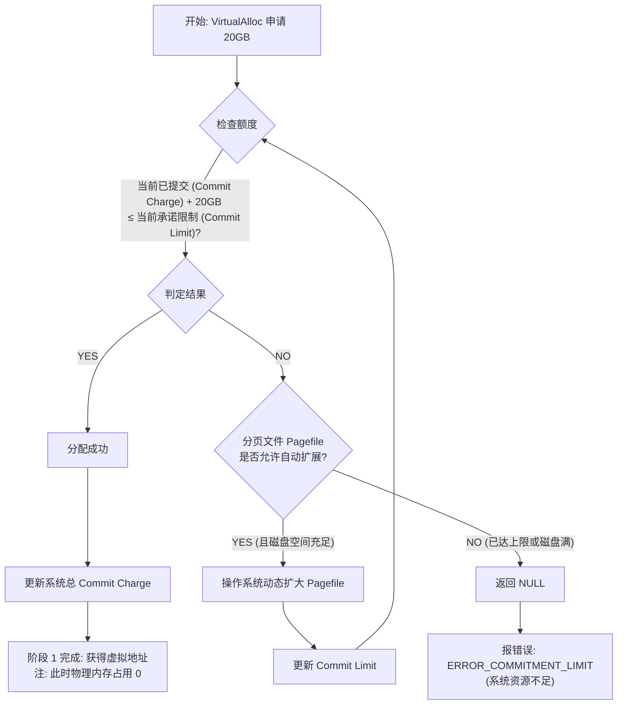

[toc]

## 基本概念

分析 Windows 进程的内存占用，最让人头疼的就是：**任务管理器里的那个数字，往往不是进程真正占用的物理内存。**

我们可以把 Windows 的内存管理想象成一个**“大型共享图书馆”**。

- Windows程序（进程）**先申请内存再使用**,申请内存要大于需要使用的内存,内存申请成功(提交)不表示内存立即被使用.
- 任务管理器里看到的进程所占用内存是实际使用，不是已申请的内存所以会比实际占用偏小

### 两阶段详解

| **维度**          | **阶段 1：VirtualAlloc(MEM_COMMIT)**                         | **阶段 2：首次读写该内存地址**                    |
| ----------------- | ------------------------------------------------------------ | ------------------------------------------------- |
| **操作性质**      | **预订与承诺** (Reservation & Commitment)                    | **实际激活** (Actual Population)                  |
| **系统动作**      | 在进程虚拟地址空间中标记页面为“已提交”。                     | CPU 触发 **Page Fault**（缺页异常）。             |
| **资源变动**      | 从系统的 **Commit Charge**（承诺额度）中扣减。               | 操作系统此时才分配一个 **4KB 物理内存页**。       |
| **地址映射**      | 仅记录逻辑上的提交，未建立物理映射。                         | 建立 **虚拟地址 → 物理地址** 的映射（修改页表）。 |
| **物理内存消耗**  | ❌ **不分配** 物理内存页。                                    | ✅ **真正消耗** 物理资源。                         |
| **Pagefile 影响** | ❌ **不写入** Pagefile。                                      | 可能会导致不常用的页被置换到 Pagefile。           |
| **核心本质**      | 操作系统给出的**“信用担保”**：保证将来你用的时候能拿得出来。 | 履行担保：将物理硬件资源正式交付给进程使用。      |

------

| **判定维度** | **逻辑详情**                    | **关键影响因素**                                             |
| ------------ | ------------------------------- | ------------------------------------------------------------ |
| **准入标准** | **Commit Limit** (系统承诺上限) | 物理内存总量 + 当前分页文件(Pagefile)设定大小。              |
| **申请动作** | `VirtualAlloc(MEM_COMMIT)`      | 进程向操作系统请求“行政审批”一段内存额度。                   |
| **成功条件** | **申请量 $\le$ 当前可用额度**   | **✅ 申请成功**：系统扣减对应额度，返回有效内存地址。         |
| **失败条件** | **申请量 $>$ 当前可用额度**     | **❌ 申请失败**：系统拒绝请求，返回 `NULL`（导致 OOM 错误）。 |
| **结果影响** | **行政性质的“配额”扣减**        | 此时**并不**代表物理内存被占满，仅代表“信用额度”被占满。     |

#### pagefile.sys文件和普通文件的对比

| **特性**       | **普通文件 **                            | **分页文件 (pagefile.sys)**                                  |
| -------------- | ---------------------------------------- | ------------------------------------------------------------ |
| **锁定状态**   | 可以被移动、重命名或删除。               | **绝对锁定**。Windows 运行时任何工具都无法移动或删除它。     |
| **磁盘分布**   | 允许高度碎片化。                         | **追求连续性**。内核会尽力在磁盘上寻找连续扇区，以减少磁头寻道时间。 |
| **读写优先级** | 受文件系统缓存（FileSystem Cache）影响。 | **绕过缓存**。直接由内存管理器（Memory Manager）与硬件交互，优先级极高。 |
| **删除机制**   | 关闭程序后文件依然存在。                 | **动态收缩**。Windows 重启后通常会重置回初始大小；即便运行中增加，后续空闲时也可能收缩。 |

### 1. 虚拟内存 (Virtual Memory) 

每个进程都以为自己拥有巨大的、连续的内存空间，但其实这只是系统给它画的一个“大饼”。

- **通俗理解：** 就像图书馆给你办了一张 100GB 的借书卡。你可以申请借很多书，但并不代表你手里现在就拿着 100GB 的实体书。
- **分析意义：** 看到某个进程的虚拟内存很大（比如几十 GB）不用慌，那只是它“预定”的额度。

**虚拟内存（Virtual Memory）** 是计算机操作系统的一种内存管理技术。它让应用程序认为它拥有一个连续且巨大的内存空间，而实际上，这个空间通常被分散在物理内存（RAM）和硬盘（磁盘驱动器）之间。

它的核心逻辑是：**即便你的物理内存只有 16GB，你也可以运行需要 32GB 内存的游戏或程序，因为系统把硬盘当成了“备用内存”。**

#### 虚拟内存的构成

大致可以理解为:

> 虚拟内存(总的内存空间)=物理内存+磁盘上的专用文件或分区

在windows上,可以理解为

> 可提交内存量(Commit Limit)=物理内存+分页文件(pagesfile.sys)

在linux上,理解为

> 物理内存+交换分区(文件)swap

#### 虚拟内存的核心作用

- **空间扩展：** 当物理内存（RAM）用尽时，系统会将暂时不用的数据搬到硬盘上(并且记录着地址映射可以找回数据块)，释放 RAM 给当前急需运行的任务。
- **内存隔离：** 每个进程都有独立的虚拟地址空间，一个程序崩溃不会直接导致另一个程序甚至整个系统崩溃，提高了稳定性。
- **优化利用：** 物理内存不需要连续，虚拟内存可以将零散的物理内存碎片整合起来，给程序提供一个完整的逻辑空间。

#### 内存管理的工作流程

1.  地址映射与分页
    内存管理的核心工作是将应用程序使用的虚拟地址转换为实际的物理地址。这个过程由硬件中的内存管理单元 (MMU) 和操作系统协同完成。
    *   分页 (Paging): 虚拟内存和物理内存都被划分为固定大小的单元，通常为 4KB，称为“页”。
    *   页表 (Page Table): 系统为每个进程维护一张页表，记录了虚拟页和物理页帧之间的映射关系。

2.  缺页异常 (Page Fault)
    当一个进程访问一个虚拟地址时，CPU 会通过页表查找对应的物理页。
    *   如果物理内存中存在对应的页，则直接访问，这是最理想的情况。
    *   如果物理内存中没有找到（即该页被换出到了硬盘），就会触发一个“缺页异常”。此时，操作系统会暂停该进程，从硬盘的页面文件中将所需的数据读取回物理内存，更新页表后，再继续执行进程的访问请求。这个过程对应用程序是透明的。

3.  页面置换
    当物理内存紧张，且需要从硬盘加载新页面时，系统必须腾出空间。这时会根据特定的算法，将物理内存中暂时不用的“牺牲页”写入硬盘的页面文件，从而释放出物理页供新页面使用。

#### 在操作系统中的具体表现

##### linux系统中的表现

而在 Linux 中，这被称为 **Swap**

**Swap 分区 vs Swap 文件：**

- **Swap 分区：** 在安装系统时专门划分的一个硬盘区域，没有文件系统，读写效率略高于文件。
- **Swap 文件：** 类似于 Windows 的 `pagefile.sys`，可以在系统运行时随时增加或删除。

**控制权：** Linux 允许你通过 `swappiness` 参数（取值 0-100）来控制系统使用虚拟内存的“积极程度”。数值越高，系统越倾向于把不常用的数据换出到硬盘

Linux 特有的内存策略

Linux 处理虚拟内存时有两个非常出色的机制：

- **写时复制 (Copy-on-Write, COW)：** 当一个进程“克隆”（fork）自己时，Linux 并不立刻复制内存，而是让父子进程共享同一块虚拟内存空间。只有当其中一个进程尝试修改数据时，系统才会真正复制内存。这极大地节省了物理内存。
- **OOM Killer (内存溢出杀手)：** 如果物理内存和 Swap 全部耗尽，Linux 不会像 Windows 那样容易蓝屏或卡死。它会启动一个“杀手”进程，根据算法选出一个占用内存最高且“罪大恶极”的进程（通常是浏览器或数据库）强行关掉，以保全系统核心功能的运行。

#####  Windows 系统中的具体体现

在 Windows 中，虚拟内存主要通过一个名为 **“页面文件” (Page File)** 的隐藏文件来实现。

- **文件名：** `pagefile.sys`（通常存放在 C 盘根目录）。
- **工作机制：** 当你打开了太多浏览器标签页或运行大型视频剪辑软件时，Windows 察觉 RAM 告急，就会把那些“后台挂着但没在用”的数据写入 `pagefile.sys`。当你切换回那个标签页时，它再从硬盘读回到 RAM 中。

##### Linux 与 Windows 的虚拟内存区别

| **特性**     | **Windows**                          | **Linux**                              |
| ------------ | ------------------------------------ | -------------------------------------- |
| **主要载体** | 硬盘根目录下的隐藏文件               | 独立的磁盘分区或 Swap 文件             |
| **管理策略** | 相对自动化，用户干预较少             | 极其灵活，可精细调整 `swappiness`      |
| **极端情况** | 容易导致图形界面假死或弹出“内存不足” | 启动 OOM Killer 杀掉进程以维持核心运转 |

#### 分析示例

##### 示例

假设某个时刻查询到的分页文件大小:

```powershell
#⚡️[cxxu@CXXUFIREBAT][C:\][19:53:36] PS >
 ls -Force .\pagefile.sys

    Directory: C:\

Mode                 LastWriteTime         Length Name
----                 -------------         ------ ----
-a-hs           2026/2/15    17:10    13458751488 pagefile.sys
#⚡️[cxxu@CXXUFIREBAT][C:\][19:56:49] PS >
 ls -Force .\pagefile.sys |select FullName, @{name="size(GB)";expression={$_.Length/1GB}}

FullName        size(GB)
--------        --------
C:\pagefile.sys    12.53

```

计算计算机识别到的可用总内存

```powershell
 (Get-CimInstance Win32_ComputerSystem).TotalPhysicalMemory / 1GB
15.1922492980957
```

并且将任务管理器中"性能"部分关于"内存"的总结转换为表格:

| **项目 (名称)**     | **当前数值**         | **含义解析**                                                 | **状态评估**                                       |
| ------------------- | -------------------- | ------------------------------------------------------------ | -------------------------------------------------- |
| **使用中 (已压缩)** | **11.5 GB (1.7 GB)** | 物理内存中正在被程序使用的部分，其中 1.7 GB 经过压缩以节省空间。 | **偏高**：占用超过物理总容量的 70%。               |
| **可用**            | **3.6 GB**           | 尚未被分配，随时可以给新程序使用的物理内存。                 | **偏紧**：剩余空间不多。                           |
| **已提交**          | **24.8 / 28.7 GB**   | 虚拟内存（物理内存 + 硬盘分页文件）的总承诺量。              | **警告**：远超物理内存，说明正在大量读写硬盘缓存。 |
| **已缓存**          | **3.6 GB**           | 系统预先读取的常用数据，可随时释放。                         | **正常**：系统性能优化的表现。                     |
| **分页缓冲池**      | **936 MB**           | 内核驱动程序使用的可移动到硬盘的内存。                       | **正常**。                                         |
| **非分页缓冲池**    | **947 MB**           | 必须常驻在物理内存中、不可移动的内核数据。                   | **中等**：若持续上涨至 2GB 以上需警惕驱动泄漏。    |

> 当虚拟内存设置为系统默认时，可用上限可以动态增加（磁盘空间足够），反之占满已提交时系统会报内存不足;
>
> 如果你禁用了系统的虚拟内存(分页大小设置为0),那么总的可提交空间和物理内存空间几乎一致;
>
> 此时,如果程序申请(提交)总量达到上限,即便还没有真正被使用,也会被预留(类似于图书馆所有位置或者火车作为都被预定了,即便人还没来,也不能再被其他人申请和使用)
>
> 换句话说,windows系统上内存占用百分比(默认显示的是**工作集**内存占用量(物理内存占用量)而不是**提交量**(近似虚拟内存占用量),且百分比是相对于物理内存总量而言的);如此一来,即便看到的内存占用还算充足(比如占用70%),但是如果已提交内存占据受限大小的分页文件的几乎百分百,那么新进程的启动就会因为申请不到内存而无法成功创建(系统会提示内存不足),只不过,通常系统默认的设置是自动管理分页文件,分页文件可以动态增加,上限较大,一般不会遇到因为提交量达到上限而报错,从而将默认的内存占用指标设置为相对物理内存占用的指标--工作集,而不是用的提交量

以下是针对各项参数的具体分析：

1. 核心状态：内存已满

- **使用中 (In use): 11.5 GB**
  - 这是当前物理内存中正在被程序和系统占用的部分。
  - **1.7 GB (已压缩)**：这是 Windows 的一个优化功能，它将内存中不常用的数据压缩，以腾出更多空间，避免频繁读写硬盘。
- **可用 (Available): 3.6 GB**
  - 这是你目前还能分配给新程序使用的剩余物理内存。

------

2. 潜在瓶颈：已提交 (Committed)

这是最关键的一个指标：**24.8 / 28.7 GB**。

- **含义**：它代表“虚拟内存”的总量（物理内存 + 虚拟内存分页文件）。
- **分析**：你的物理内存大概是 **16 GB**（11.5 使用 + 3.6 可用 + 少量损耗）。
- **危险信号**：数值 **24.8 GB** 远超你的物理内存，说明系统正在大量使用硬盘上的“分页文件”来充当内存。因为硬盘（即便是 SSD）的速度远慢于内存，这会导致系统出现明显的**卡顿、掉帧或程序无响应**。

------

3. 缓存与池 (Cache & Pools)

- **已缓存 (Cached): 3.6 GB**
  - 这是系统预加载的文件数据，通常会在程序需要时立即释放，属于正常现象。
- **分页/非分页缓冲池 (Paged/Non-paged pool): 约 1.8 GB 合计**
  - 这些是内核驱动程序使用的内存。目前的数值属于中等偏高。如果“非分页缓冲池”持续异常升高（例如超过 2GB），通常意味着某个驱动程序存在**内存泄漏**。

##### 示例

假设我的物理内存是 16GB，有个程序申请了 20G 内存，那么 Windows 如何处理?

pagefile.sys 和物理内存总量一定大于 20G 吗？pagefile.sys 文件的增大会很耗时吗？




| **节点**          | **深入解析**                                                 |
| ----------------- | ------------------------------------------------------------ |
| **Commit Limit**  | 这是系统的“总信用额度”，由 **物理内存 + 当前 Pagefile 大小** 决定。 |
| **Pagefile 扩展** | 如果你在系统设置中勾选了“让 Windows 管理所有驱动器的分页文件大小”，当内存申请告急时，系统会尝试临时增大磁盘上的 `pagefile.sys` 文件来提高 **Commit Limit**。 |
| **磁盘空间陷阱**  | 即使设置了“自动扩展”，如果 **C 盘空间不足**，扩展会失败，直接导致 `VirtualAlloc` 返回 `NULL`，造成程序闪退或报错。 |
| **逻辑胜于物理**  | 请注意，在这个流程走完时，即便申请成功，**物理内存（RAM）的占用率数字是不会跳动的**。只有当你真正往这块地址写数据时，才会进入你之前提到的“阶段 2”。 |

Windows 并不需要让 pagefile.sys 和物理内存的总和时刻满足 20GB 的需求。关键在于“提交限制 (Commit Limit)”。

*   提交限制 (Commit Limit)： 这是 Windows 系统允许所有进程的虚拟内存总和能达到的最大值。它由物理内存大小和所有页面文件的总大小共同决定。
*   按需分配： 当程序申请 20GB 虚拟内存时，系统只会检查“提交限制”是否足够。如果足够，申请就会成功。但是，pagefile.sys 文件并不会立即占用 20GB 的硬盘空间。
*   实际占用： pagefile.sys 的实际大小是动态增长的。只有当物理内存（16GB）被填满，并且系统需要将数据写入硬盘来腾出空间时，pagefile.sys 才会开始占用硬盘空间。它占用的空间大小，取决于超出物理内存负荷的数据量。

场景模拟：
假设你的物理内存是 16GB，pagefile.sys 初始设置为 4GB。

1.  程序申请 20GB： 系统检查提交限制（16GB RAM + 4GB Pagefile = 20GB），足够，申请成功。
2.  程序刚开始运行： 只有 10GB 数据在活跃使用，全部驻留在 16GB 物理内存中。此时 pagefile.sys 可能只有几百 MB 甚至更小。
3.  程序全力运行： 当程序活跃数据达到 18GB 时，16GB 物理内存被占满，多出的 2GB 数据就会被写入 pagefile.sys。此时 pagefile.sys 大小约为 2GB。

所以，pagefile.sys 的大小取决于有多少数据需要被“换出”到硬盘，而不是程序申请的总量。

**pagefile.sys 文件的增大会很耗时吗?**

通常不会，但在特定情况下会有感知。

1.  预分配与自动增长：
    *   初始分配： 如果你在系统设置中指定了页面文件的“初始大小”（例如 4GB），**Windows 会在系统空闲时或启动时尝试预先创建这个文件，避免在急需时临时分配**。
    *   动态扩展： **如果初始大小不够用，Windows 允许页面文件自动增长。**这个“增长”操作本身较快，并不一定立即写入数据。

2.  真正的“耗时”环节：
    页面文件变大本身不耗时，耗时的是将数据写入这个文件的过程。
    *   写入操作： 当物理内存不足，系统需要把 RAM 中的数据搬到硬盘的 pagefile.sys 里时，会发生大量的磁盘 I/O（读写）操作。
    *   性能瓶颈： 如果你的硬盘是机械硬盘 (HDD)，这个搬运过程会非常慢，你会感觉到电脑卡顿、硬盘灯狂闪。如果是固态硬盘 (SSD)，速度会快很多，但频繁的读写依然会增加硬盘负担。

3.  碎片问题：
    如果 pagefile.sys 需要频繁增长，且硬盘空间比较零碎，文件可能会被分散存储（碎片化）。这会导致读取时需要在硬盘不同位置寻找数据，进一步降低速度。

总结：
pagefile.sys 的扩容动作很快，但伴随扩容而来的数据交换（内存换硬盘）过程会消耗时间，且速度取决于硬盘性能。这也是为什么当内存吃紧时，电脑会变慢的原因。

### 2. 工作集 (Working Set) —— “你桌上的书”

这是分析时**最重要**的指标之一，它代表了进程当前实际占用的**物理内存 (RAM)**。

- **通俗理解：** 虽然你借了很多书，但你桌子上摆着、正翻开看的只有那 5 本。这 5 本书占用的桌面空间就是“工作集”。
- **分类：**
  - **私有工作集 (Private Working Set)：** 只有你能看，别人不能碰的部分（比如你的私人笔记）。
  - **共享工作集 (Shareable Working Set)：** 别人也能看的公共资料（比如系统 DLL 库）。

### 3. 提交 (Commit Size) —— “已经出库的书”

这是最容易和工作集搞混的概念。它指的是系统已经为该进程在**物理内存或分页文件（虚拟内存文件）**中预留的总量。

- **通俗理解：** 你从书库里领出来的书。有的在桌上（物理内存），有的因为桌子放不下了，暂时堆在了走廊的推车里（硬盘上的分页文件）。
- **分析意义：** 如果一个进程的 **Commit Size** 持续上涨，而 **Working Set** 保持不变，那说明发生了**内存泄漏**，系统正不断把不用的数据踢到硬盘里。

------

### 4. 关键指标对比表

在分析资源监视器（Resource Monitor）或 Process Explorer 时，请参考下表：

| **术语**                     | **对应现实**   | **分析重点**                                             |
| ---------------------------- | -------------- | -------------------------------------------------------- |
| **Commit (提交)**            | 已经领走的总量 | 衡量程序到底**吃掉了多少总资源**（内存+硬盘空间）。      |
| **Working Set (工作集)**     | 摆在桌上的总量 | 衡量程序对**物理内存**的真实占用。                       |
| **Private Bytes (私有字节)** | 你的独家资料   | **内存泄漏**的最直接指标，如果它一直涨，程序肯定有问题。 |

------

### 5. 页面错误 (Page Faults) —— “跑回书库换书”

当程序想读的数据不在物理内存里，而在硬盘（分页文件）里时，就会发生页面错误。

- **通俗理解：** 你发现桌上的书不够用了，得跑回书库（硬盘）去取。
- **分析意义：** 如果一个进程的“硬页面错误（Hard Faults）”非常高，说明物理内存严重不足，电脑会因为频繁读写硬盘而变得非常卡顿。

------

### 小结

通常: 虚拟大小 >> 提交大小 ,工作集 ≥ 专用工作集

工作集（Working Set）与提交量（Commit Size）之间没有绝对的“谁大谁小”关系

核心公式与重叠关系

逻辑上，它们的关系如下：

- **提交量 (Commit)** = 进程私有的、受系统担保的内存（RAM 或 Pagefile）。
- **工作集 (Working Set)** = 进程当前驻留在物理内存（RAM）中的全部数据。

它们之间存在一个**交集**，但各自都有对方不包含的部分：

1. **重叠部分**(交集)：进程正在使用的私有内存，且当前正物理存放在 RAM 中。
2. **提交量特有**：进程申请了内存，但因为不常用，被系统置换（Page Out）到了硬盘的**分页文件**中。
3. **工作集特有**：进程调用的**共享库（Shared DLLs）**。例如，10 个程序都调用了 `kernel32.dll`，这个 DLL 物理上只占一份 RAM，但会同时计入这 10 个程序各自的工作集里。

### 进阶工具

如果你厌倦了简单的任务管理器，推荐使用以下“神器”：

1. **Resource Monitor (资源监视器)：** Windows 自带（Win+R 输入 `resmon`），看内存条分配最直观。
2. **Process Explorer：** 微软官方加强版任务管理器，能看清每个 DLL 的占用。
3. **VMMap：** 专门分析进程虚拟内存布局的专业工具。

## 是否需要手动清理内存

| **观察指标**                | **状态/现象** | **严重程度** | **分析与决策建议**                                           |
| --------------------------- | ------------- | ------------ | ------------------------------------------------------------ |
| **内存占用 <80%**           | 正常          | 🟢 正常       | 无需处理                                                     |
| **内存占用 90%+**           | 偏高          | 🟡 留意       | 物理内存接近饱和，建议停止开启大型新程序。                   |
| **系统变卡 / 响应迟钝**     | 异常          | 🟠 需处理     | 发生频繁换页，应查看 **Working Set (工作集)** 最大的进程。   |
| **硬盘灯狂闪 (频繁换页)**   | 异常          | 🟠 需处理     | 正在进行大量磁盘交换，应清理后台不用的程序。                 |
| **程序打不开 / 报内存不足** | 严重          | 🔴 必须处理   | **Commit Limit (提交限制)** 已达上限，必须关掉 Commit 最大的进程。 |
| **可用内存 < 500MB**        | 紧张          | 🟠 需处理     | 剩余空间极低，系统随时可能开始剧烈抖动（Thashing）。         |
| **关闭程序后内存不释放**    | 异常          | 🟡 潜在风险   | 可能是 **Memory Leak (内存泄漏)**，需观察 Private Bytes 指标。 |

**变卡：** 是因为物理内存（RAM）不够，系统在拼命读写硬盘。

**报内存不足：** 是因为总额度（RAM + 分页文件）都不够了，系统已经无法给任何程序分配“借书额度”了。

### 现象分析

假设一个进程已经占用了大量内存(比如10GB),现在你通过内存管理工具(比如rammap.exe)将该进程的**工作集**内存清理,那windows会将此大量内存(正在使用)标记为**已修改**(而不是直接清理,否则容易造成卡顿),然后逐步从**已修改**更改为**备用**(状态),部分内容可能写入到磁盘中.

> windows可以自动管理物理内存和虚拟内存的交换
>
> 物理内存不够时,会把不活跃的内容写入磁盘,但是这不意味着彻底不需要手动管理内存.
>
> 例如,某个程序需要占用大量内存才能启动,而当前已经有不少活跃进程占用了总内存中的大部分,这样就需要你判断关闭掉一些活跃进程,以提高大型应用的加载速度减少卡顿.
>
> 这也意味着取舍,随意更理想的方案就是增加物理内存.

### 资源监视器中的内存数据

#### 进程部分

在进程的内存分析列表中有相关字段:

- 提交:操作系统为进程保留的虚拟内存量(KB)
- 工作集:进程当前正在使用的**物理内存**量
- 可共享:进程所使用的可与其他进程共享的物理内存量
- 专用:该进程所使用而其他进程无法使用的物理内存量

#### 总结部分

资源监视器中的内存分析中可以看到如下概念:

> 通常分为2个大的方面:空闲和非空闲

- 非空闲

  - 为硬件保留:已保留供BIOS和其他外设的某些驱动程序使用的内存
  - 使用中:有进程,驱动程序或操作系统使用的内存

  - 已修改:内容必须写入磁盘才能用于其他用途的内存(一种过渡状态,不属于空闲内存)

- 空闲
  - 备用:包含未活跃使用的缓存数据和代码内容(可以被快速重新分配为"可用"状态的内存部分)
  - 可用:不包含任何有价值的数据,以及当前进程,驱动程序或操作系统需要更多内存时将首先使用的内存.

一般空闲占比少一些往往意味着内存使用充分(利用率高),不能直接认为内存不足

而非空闲中的"使用中"占比如果很高,则表示当前内存不充足.


## 清理内存

如果你发现内存占用过高（比如任务管理器显示已用 90% 以上），打算通过关闭程序来“回血”

### 提交大小 (Commit Size)

这是最能反映一个程序**到底吃掉了系统多少总资源**的指标。

- **为什么要看它：** 有些程序可能看起来物理内存（工作集）占用不高，那是由于 Windows 把它的数据挤到了硬盘的分页文件里。但它依然占据着“提交额度”。关闭提交大小高的程序，能最有效地释放系统压力，防止系统因内存耗尽而崩溃。
- **在哪里看：** 任务管理器 -> **详细信息** 选项卡 -> 右键标题列 -> **选择列** -> 勾选 **“提交大小”**。(或者使用**资源监视器**(resmon.exe)分析内存在不同指标上的占用)

------

### 工作集 (Working Set)

如果你想立刻腾出物理内存（RAM）给另一个急需运行的大型程序（比如开个游戏或跑个渲染），请看这个指标。

- **为什么要看它：** 它代表该程序当前实打实霸占着的内存条空间。关闭工作集大的程序，你的“已用物理内存”百分比会立刻下降。
- **注意点：** 浏览器（Chrome/Edge）通常会分成几十个进程。你需要看它们的**总和**，或者在任务管理器的“进程”选项卡里看折叠后的总数。

------

### 特殊指标：**句柄 (Handles)** —— “潜在的系统阻塞者”

如果某个程序的内存占用不算最高，但其**句柄数**达到几万甚至十几万，它就是个危险分子。

- **分析意义：** 句柄过多会消耗非分页池（Non-paged pool），这部分内存是无法被置换到硬盘的。关闭这种程序不仅能省内存，还能让系统响应变快，减少“假死”现象。

------

### 实战操作：该关哪一个？

请对比下表来做决定：

| **场景**                       | **观察指标**                         | **决策建议**                                       |
| ------------------------------ | ------------------------------------ | -------------------------------------------------- |
| **系统提示“内存不足”或闪退**   | **提交大小 (Commit Size)**           | 关掉那个 Commit 最大的，它是导致“爆内存”的元凶。   |
| **电脑操作卡顿，响应慢**       | **工作集 (Working Set)**             | 关掉占用物理内存最高的，把空间还给当前活动的窗口。 |
| **想清理后台，不影响当前工作** | **私有工作集 (Private Working Set)** | 关掉那些私有内存高、但你现在并不使用的后台程序。   |

------

不要只看“内存 (活动工作集)”

任务管理器默认显示的“内存”列往往是**活动工作集**。有些程序在后台挂起时，Windows 会主动压缩它的内存占用，显示数字变小了。但如果你看 **“提交大小”**，你会发现它依然占据着大量资源。**关闭那些“提交大小”远高于“工作集”的程序，往往能获得意想不到的清理效果。**

### 资源监视器(resmon)

在资源监视器的表格里，请盯着这四个列（建议按“提交”倒序排列）：

1. **提交 (Commit):** * **含义：** 程序申请的总额度（包含物理内存和硬盘分页）。
   - **必杀技：** 只要这个数值异常大，**关掉它准没错**，能立刻缓解系统“内存不足”的压力。
2. **工作集 (Working Set):** * **含义：** 当前霸占物理内存（RAM）的量。
   - **必杀技：** 想让电脑变快、变流畅？找这个数值大的下手。
3. **共享 (Shareable):** * **含义：** 可以和其他程序共用的部分（如系统组件）。
   - **冷知识：** 如果这个值很大，说明这个程序很“合群”，它其实没你想象中那么浪费资源。
4. **私有 (Private):**  如果你想抓出谁在“内存泄漏”，就盯着它的“私有”列。如果这个数字在你不操作程序时还一直往上涨，它就是那个罪魁祸首。

## 内存泄露

分析**内存泄漏 (Memory Leak)**，本质上是在寻找那些“只借不还”的程序流氓。

在 Windows 环境下，内存泄漏并不是指内存条坏了，而是程序在申请了内存空间后，因为逻辑错误**失去了对这块内存的控制**，导致系统无法将其回收，最终耗尽所有可用资源。

------

### 1. 内存泄漏的三个阶段

你可以通过以下三个阶段来识别和定位泄漏：

#### 第一阶段：潜伏期（看 Private Bytes）

程序刚启动时表现正常，但随着你不断操作（或者仅仅是挂机），其 **Private Bytes (私有字节)** 持续稳定增长，且从不回落。

- **特征：** 任务管理器中的“提交大小”一列匀速上升。

#### 第二阶段：爆发期（看 Page Faults）

当物理内存（RAM）被占满，Windows 开始疯狂将数据往硬盘（分页文件）里挪。

- **特征：** 电脑开始变得卡顿，硬盘灯狂闪，**Hard Faults (硬错误/页错误)** 数值激增。
- **感受：** 切换窗口时有明显的几秒钟延迟。

#### 第三阶段：崩溃期（Out of Memory）

当“提交大小”达到了系统的**提交限制 (Commit Limit)**，即“物理内存 + 分页文件”的总和。

- **结果：** 程序直接闪退（Crash），或者系统弹出“计算机内存不足”的警告。

------

### 2. 核心排查指标：Handle (句柄) 泄漏

很多时候，内存泄漏不只是因为数据没删，还因为**句柄 (Handles)** 没关。

- **什么是句柄：** 句柄是 Windows 用来标识资源（文件、窗口、注册表键）的“门票”。
- **泄漏表现：** 如果一个进程的句柄数从几百慢慢涨到几万，这通常意味着程序打开了文件或创建了对象却忘记关闭。这最终也会导致内存被吃光。

------

### 3. 如何实战排查？

如果你怀疑某个进程（例如 `example.exe`）有泄露，请按以下步骤操作：

#### 第一步：准备工具

打开 **任务管理器** -> 切换到 **详细信息** 选项卡。右键点击列标题，选择“选择列”，勾选以下三项：

1. **提交大小 (Commit Size)**：最真实的内存消耗。
2. **句柄 (Handles)**：排查资源泄露。
3. **用户对象 (User Objects)**：排查界面元素泄露。

#### 第二步：压力测试

记录下当前的数值，然后对程序进行操作（比如反复打开关闭某个窗口，或者连续点击某个功能）。

- **正常情况：** 操作时数值上升，停止操作后数值应回落（或趋于平稳）。
- **泄露情况：** 数值像爬楼梯一样，只升不降。

#### 第三步：使用 VMMap 定位（高级）

如果你是开发者或专业分析师，使用微软的 **VMMap** 工具。它可以把内存细分为：

- **Image:** 程序本身占用的空间。
- **Heap (堆):** 最常发生泄露的地方，通常是程序员忘记调用 `free()` 或 `delete`。
- **Stack (栈):** 线程占用的空间。

------

### 总结

判断内存泄漏最简单的方法：**看“提交大小”是否与操作成正比增长，且在闲置时拒绝回落。**

## windows 内存占用分析工具👺

在Windows系统中，如果需要对内存占用情况进行更为专业和深入的分析，可以采用以下微软自家以及第三方的专业内存分析工具：

1. **微软官方工具**:
   - **RAMMap**：由Sysinternals提供的工具，它可以详细展示系统是如何分配和使用物理内存的，包括不同类型的内存使用情况（例如文件缓存、进程工作集等）。
     - [RAMMap - Sysinternals | Microsoft Learn](https://learn.microsoft.com/zh-cn/sysinternals/downloads/rammap)
     - [Defrag Tools：6 - RAMMap | Microsoft Learn](https://learn.microsoft.com/zh-cn/shows/defrag-tools/6-rammap?source=recommendations)
   - **Process Explorer**：也是Sysinternals工具包的一部分，除了常规的进程管理功能外，还可以深入了解每个进程的虚拟内存使用细节。
   - **Performance Monitor (PerfMon)**：系统内置的性能监视工具，可以创建数据收集器集来持续监控内存性能计数器，从而帮助分析内存瓶颈和趋势。
2. **第三方工具**:
   - **VMMap**：同样是Sysinternals工具之一，专门用于分析进程的虚拟内存使用情况。
   - **PoolMon**：用于检测和调试Windows内核池使用情况的工具，特别适用于排查由于内存池耗尽导致的系统问题。
   - **Memory Profiler** 类工具，比如 ANTS Memory Profiler 或 dotMemory 等针对 .NET 应用程序的内存分析工具，它们可以帮助开发者查找.NET程序中的内存泄漏等问题。

对于具体应用场景，例如排查内存泄露、优化程序性能或是系统级内存管理问题，建议使用更为专业的分析工具进行深度排查。而对于一般性的内存使用监控，Windows自带的任务管理器已经足够满足大部分需求。

### RamMap命令行用法

找到可执行文件`rammap.exe`执行`rammap -h`得到帮助文档

```cmd
Usage: Rammap [[outputfile] | [[-run32] -o <inputfile.rmp>]]
outputfile Has RAMMap dump scan output to a file and exit
inputfile Has RAMMap open the specified log file
Launch the 32-bit RAMMap on 64-bit Windows

Command line mode: Rammap -E[wsmto
-Ew Empty Working Sets
-ES Empty System Working Sets
-Em Empty Modified Page List
-Et Empty Standby List
-EO Empty Priority O standby List
```

Rammap 是一个高级内存分析工具，由Windows Sysinternals提供，它能帮助用户详细了解系统内存的使用情况，包括各种内存列表和占用情况。您给出的命令行用法说明涉及到了如何使用Rammap的不同参数来执行特定的内存管理操作，特别是在命令行模式下。下面是对每个部分的详细解释：

#### 基础用法
1. **Rammap [[outputfile] | [[-run32] -o <inputfile.rmp>]]**

   - **[outputfile]**: 如果指定此参数，Rammap会执行内存扫描并将结果输出到指定的文件后退出。这对于日志记录和后续分析非常有用。
   
   - **[-run32]**: 在64位Windows系统上强制运行32位版本的Rammap。这对于需要在特定体系结构下分析应用程序或系统行为时很有用。
   
   - **-o <inputfile.rmp>**: 让Rammap打开(open)之前保存的扫描结果文件（.rmp格式）。这对于查看历史扫描数据或者分析不同时间点的内存状态变化非常有帮助。

#### 特定操作模式 (-E 开头的参数):
这些参数允许用户通过命令行直接执行对系统内存的各种清理或管理操作。请注意，这些操作可能对系统性能和运行中的应用程序产生重大影响，因此应谨慎使用。

1. **-Ew**: 空置工作集（Empty Working Sets）。这会将所有进程的工作集（即它们当前在物理内存中的页面）标记为非resident，当进程再次访问它们时迫使操作系统重新从磁盘加载这些页面。这有助于回收内存，但可能导致短时间内性能下降。

2. **-ES**: 空置系统工作集（Empty System Working Sets）。类似于-Ew，但仅针对系统进程的工作集。这可以释放更多内存给**用户进程**，但也可能暂时降低系统响应速度。

3. **-Em**: 空置修改页列表（Empty Modified Page List）。这会促使系统立即写回所有已修改的页面到磁盘，清空修改页列表。这通常在准备进行系统维护或想要减少未来写入操作时使用。

4. **-Et**: 空置备用列表（Empty Standby List）。备用列表包含了可被快速重新分配给其他进程的未使用页面。清空它会减少系统可用的快速分配内存，但可能有助于某些调试场景。

5. **-EO**: 空置优先级0备用列表（Empty Priority 0 Standby List）。这是备用列表的一个子集，包含最高优先级的页面。清空这部分列表会更直接影响系统迅速恢复页面的能力，但同样可用于特定的诊断或测试目的。

使用上述命令时，请确保理解其后果，并在必要时先做好系统备份。由于这些操作直接影响系统内存管理，不正确的使用可能会导致应用程序崩溃或系统不稳定。


### 内存整理和占用优化工具😊

- RamMap 微软官方出品[RAMMap - Sysinternals | Microsoft Learn](https://learn.microsoft.com/zh-cn/sysinternals/downloads/rammap)
- MemReduct[henrypp/memreduct: Lightweight real-time memory management application to monitor and clean system memory on your computer. (github.com)](https://github.com/henrypp/memreduct)
- Memorymaster 软媒魔方工具箱:[软媒魔方 (ruanmei.com)](https://mofang.ruanmei.com/)
  - 之前有免安装版(便携版),现在只提供标准版(安装完毕后会解压出一堆工具,可以单独将需要的工具提出来)
    - 我把便携版提取出来,只有300多kb:https://www.123pan.com/s/l7DKVv-FmcsH.html
  - 新的版本有些组件引入广告,比如云日历,所以我还是用的免安装版
- 上述软件都可以释放内存,并且RamMap支持命令行方式调用,通常执行`Rammap -ew`进行内存释放(建议把Rammap.exe所在路径配置到Path环境变量中方便随任意路径下调用
- 而后两者可以设置开机自启，以及自动清理和定时清理(比如内存占用超过80%时执行内存清理)
- 尽管上述工具可以大幅释放内存,但是这些被释放的内存存放的数据优先级虽然不是很高,但是对于加速应用有帮助,而且随着后续的操作,这些占用可能会比较快的回升回来;如果内存充足,是不建议执行内存释放的操作
- 另一方面，如果内存容量不充裕,那么更有效的办法仍然是加大物理内存容量,而不是反复清理;然而有些机器想要更换或增加内存条是受限的(比如板载内存),则推荐使用上一代的系统降低资源占用,并考虑使用上述软件进行自动清理,当过高的内存占用出现时,缓存内存的数据不但加速效果有限,还会导致重要数据加载受限或变慢,那么这时候执行内存清理是合适的

## windows 预读取技术👺

- **Windows SysMain（原名Superfetch）**是微软Windows操作系统中内置的一项服务，旨在优化系统性能并提升应用程序启动速度。
- 该服务最初在Windows Vista中以“Superfetch”形式引入，并从Windows 10开始更名为“SysMain”，是对Windows XP等早期版本中引入的预取技术的进一步发展。

### 目的与功能：

1. **应用程序预加载：** SysMain监控系统上应用程序和文件的使用模式。根据这些数据，它预测您可能使用的应用程序，并在您实际启动它们之前将相关数据预加载到内存中。这样可以减少这些应用程序启动所需的时间，使用户体验更加流畅、高效。

2. **启动与登录优化：** 除了应用程序预加载外，SysMain还专注于优化启动过程和登录体验。它分析系统启动序列，识别常用的服务和驱动程序，确保它们在后续启动时被高效加载。这可以带来更快的系统启动时间和更快速的用户登录。

3. **智能内存管理：** SysMain采用智能算法来管理系统资源，特别是RAM。它根据当前和预期的使用模式动态调整内存中存储的内容。当系统内存未充分利用时，SysMain可能会将数据预加载到内存中以利用可用空间；相反，如果运行中的应用程序对内存的需求增加，它可能会释放预加载的数据以确保为运行进程提供足够的资源。

4. **自适应行为：** SysMain持续学习您的使用习惯，相应地调整其预加载策略。它考虑了如时间、最近的应用程序使用情况以及系统资源可用性等因素，以便就应预加载哪些数据及何时预加载做出明智决策。

### 好处

- **提高应用程序启动速度：** 通过将应用程序数据预加载到内存中，SysMain显著减少了点击应用程序图标与应用程序完全功能化之间的延迟。
- **增强系统响应能力：** 一个管理良好的预加载数据缓存使得多任务处理更加顺畅，且在打开应用程序之间切换速度更快。
- **优化启动与登录体验：** 用户可以享受到启动计算机或登录用户账户时等待时间缩短的便利，这得益于SysMain的启动与登录优化。
- **高效使用系统资源：** SysMain的自适应性质确保了内存被有效分配，在预加载的好处与当前运行应用程序及整体系统性能需求之间取得平衡。

### 争议

虽然SysMain旨在提升大多数用户的系统性能，但在某些场景下，禁用或定制其行为可能是有必要的：

- **低内存系统：** 在内存有限（如4GB或更少）的计算机上，一些用户认为SysMain的预加载可能会与正在运行的应用程序争夺宝贵的RAM资源，导致性能下降。在这种情况下，考虑禁用SysMain以优先满足应用程序的即时需求而非主动预加载。
- **固态硬盘（SSD）：** 随着SSD（相较于传统硬盘驱动器，读取速度显著加快）的广泛使用，对激进预加载的需求可能降低。一些用户认为在配备SSD的系统上，SysMain带来的性能提升微乎其微，选择禁用该服务以最小化后台活动和潜在的驱动磨损。
- **定制工作负载：** 具有特定或高度可预测工作负载的用户可能希望精细调整SysMain设置或在认为其不符合自身使用模式或引入不必要的开销时完全禁用它。

## 配置预读取服务启动行为

要在Windows 10或更高版本上禁用或定制SysMain（Superfetch）可以用GUI操作,也可以用命令行操作

### 禁用

- 通常预读取服务是默认启用的,以下是配置禁用方法

- **使用服务管理器：** 打开“服务”应用（通常通过在开始菜单或控制面板中搜索“services.msc”），找到“SysMain”服务，双击它，然后将其“启动类型”更改为“禁用”。您也可以使用此界面停止当前正在运行的服务。
- **使用PowerShell或命令提示符：** 

  - 运行命令`Stop-Service SysMain`（在PowerShell中）或`sc stop SysMain`（在命令提示符中）立即停止服务

  - 接着运行`Set-Service SysMain -StartupType Disabled`（在PowerShell中）或`sc config SysMain start= disabled`（在命令提示符中）防止其在未来自动启动。

  - 整理成脚本:

    - 利用powershell执行

      ```powershell
      Stop-Service SysMain
      Set-Service SysMain -StartupType Disabled
      
      ```

    - 利用cmd执行,更加通用的(兼容老版本windows,可能要把SysMain修改为SuperFetch)

      ```cmd
      sc stop SysMain
      sc config SysMain start= disabled
      ```


### 启用

- 如果您发现关闭预读取后计算机的相应速度变慢,尽管计算机工作负载很低,但是相应速度不如以往,则考虑启用预读取服务

- 方法就是将上一节禁用修改为自动

  - 如果幸运的话,可以启动成功

    ```bash
    PS C:\Users\cxxu\Desktop> sc start Sysmain
    
    SERVICE_NAME: Sysmain
            TYPE               : 30  WIN32
            STATE              : 2  START_PENDING
                                    (NOT_STOPPABLE, NOT_PAUSABLE, IGNORES_SHUTDOWN)
            WIN32_EXIT_CODE    : 0  (0x0)
            SERVICE_EXIT_CODE  : 0  (0x0)
            CHECKPOINT         : 0x0
            WAIT_HINT          : 0x7d0
            PID                : 3328
            FLAGS              :
    PS C:\Users\cxxu\Desktop> sc query sysmain
    
    SERVICE_NAME: sysmain
            TYPE               : 30  WIN32
            STATE              : 4  RUNNING
                                    (STOPPABLE, NOT_PAUSABLE, ACCEPTS_SHUTDOWN)
            WIN32_EXIT_CODE    : 0  (0x0)
            SERVICE_EXIT_CODE  : 0  (0x0)
            CHECKPOINT         : 0x0
            WAIT_HINT          : 0x0
    ```

    

- 然而启动这个服务用命令行可能会出错

  - ```bash
    
    PS C:\Users\cxxu\Desktop> sasv SysMain
    Start-Service: Service 'SysMain (SysMain)' cannot be started due to the following error: Cannot start service 'SysMain' on computer '.'.
    
    PS C:\Users\cxxu\Desktop> sc start Sysmain
    [SC] StartService FAILED 1058:
    
    The service cannot be started, either because it is disabled or because it has no enabled devices associated with it.
    
    ```

- 可以考虑直接配置启动类型为自动,然后重启计算机

  - ```bash
    #配置开机自动运行预读取服务
    sc config sysmain start=auto
    
    #演示
    PS C:\Users\cxxu\Desktop> sc config sysmain start=auto
    [SC] ChangeServiceConfig SUCCESS
    ```

    

- 如果不想重启,这里推荐用`services.msc`GUI找到服务并启用

## windows系统技术专业书籍

- 微软提供了关于windows技术问题的介绍书籍
  - [Windows Internals Book - Sysinternals | Microsoft Learn](https://learn.microsoft.com/en-us/sysinternals/resources/windows-internals)
- 这个书网络上有资源,版权问题,这里不明说,执行搜索
  - 感兴趣的话可以支持正版,购买(只有英文的)
  - 全书800页左右

### Free内存和Zero内存

- 在《Windows Internals》一书中，"free" 和 "zero" 内存指的是操作系统中两种不同的物理内存页面状态：

  1. **Free内存**：
     - 这种状态下的内存页面表示当前是空闲的，可供操作系统分配给需要内存资源的进程或系统组件使用。
     - 具体来说，free内存页面含有不确定的脏数据，出于安全性原因，在分配给用户进程之前不能直接作为用户页面使用，除非先将其初始化为零。这意味着操作系统在将free页面分配给新的使用者之前，可能需要擦除原有的数据，确保敏感信息不会泄露。

  2. **Zero内存**：
     - Zero内存页面同样是空闲状态，但它已经被初始化为全零，因此可以直接分配给用户进程而无需额外的初始化步骤。
     - 操作系统中有一个名为“zero page thread”（MiZeroPageThread）的内核线程，其作用就是将free列表上的某些页面置零，这样就形成了一种预置零值的页面缓存，可以在未来出现零页故障（demand-zero page faults）时迅速满足需求。

- 简而言之，在Windows内存管理中，free内存是指尚未初始化或清除数据的空闲物理页面，而zero内存则是已经清零待用的空闲物理页面，两者都是操作系统内存资源池的一部分，随时准备服务于进程的内存分配请求。

